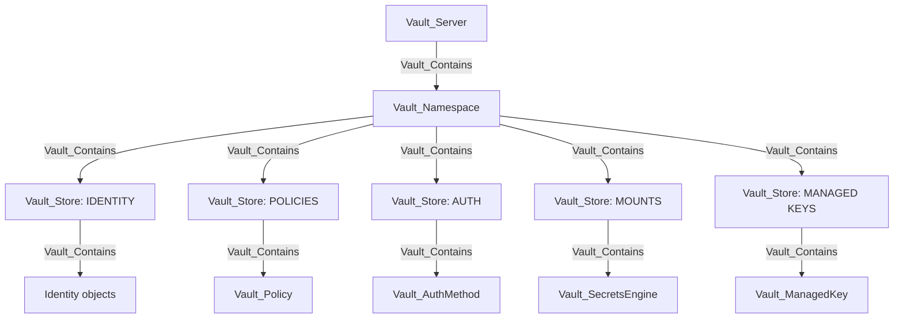

# VaultHound Graph Model

VaultHound models HashiCorp Vault as a hierarchy of administrative boundaries, durable configuration objects, policy authority, and concrete security outcomes. It is designed for BloodHound analysis rather than as a lossless copy of the Vault API.

The model has three goals:

1. Preserve policy documents as the auditable source of declared authority.
2. Route access to the most specific observed target so attack paths do not rely on broad mount-level assumptions.
3. Distinguish ordinary visibility and administration from operations that yield credentials, plaintext, signatures, policy authority, or identity control.

## Conceptual Layout



Containment is immediate-parent containment. A role belongs beneath its auth method or secrets engine, an issuer belongs beneath its PKI mount, and a KV pair belongs beneath its KV file. Namespace-to-grandchild shortcuts are not emitted.

## The Five Stores

Each namespace receives five `Vault_Store` anchors. Stores are organizational and policy-targeting boundaries, not Vault mounts themselves.

| Store | Vault surface | Contains | Why it exists |
| --- | --- | --- | --- |
| Identity | `identity/` | Entities, aliases, groups, OIDC, MFA, and SCIM objects | Keeps identity-wide rights away from the namespace and groups related identity services. |
| Policies | `sys/policy`, `sys/policies/acl`, `sys/policies/rgp`, `sys/policies/egp` | Policy documents | Anchors collection-wide list/create rights and exact policy administration. |
| Auth | `sys/auth` | Authentication method mounts | Represents the auth registry without making every auth method a direct namespace child. |
| Mounts | `sys/mounts` | Secrets-engine mounts | Represents the secrets-engine registry and separates mount administration from engine resources. |
| Managed Keys | `sys/managed-keys` | Enterprise managed keys | Anchors the namespace-local external KMS/HSM key registry. |

Store names use the namespace as their prefix, for example `ROOT / IDENTITY` and `TEAM-A / MOUNTS`. Policies in one namespace do not automatically authorize objects in a sibling namespace.

The subsystem guides describe each store in detail:

- [Identity Store](stores/IDENTITY.md)
- [Policy Store](stores/POLICIES.md)
- [Auth Store](stores/AUTH.md)
- [Mount Store](stores/MOUNTS.md)
- [Managed Keys Store](stores/MANAGED_KEYS.md)

## Node Type Separation

VaultHound separates objects when their Vault semantics or attack-path meaning differ. It does not create a unique node kind for every API response.

A node may carry a specific display kind followed by a generic query kind:

```text
Vault_SecretsEngineTransit -> Vault_SecretsEngine
Vault_AuthApproleRole      -> Vault_AuthRole
Vault_AuthLdapUser         -> Vault_AuthUser
Vault_AwsRole              -> Vault_SecretsRole
```

The specific kind is emitted first so BloodHound uses the specific icon. The base kind allows queries across related backends. BloodHound adds its own `Base` kind, so custom inheritance is deliberately shallow.

Objects remain distinct when combining them would blur permissions. `Vault_KvDirectory` and `Vault_KvFile`, for example, do not share a KV object base type: listing a path prefix and reading secret data are different outcomes.

## Base Nodes

The following nodes define the shared vocabulary used by the store-specific model.

| Node | Meaning |
| --- | --- |
| `Vault_Server` | The collected Vault server or cluster endpoint. |
| `Vault_Namespace` | A Vault Enterprise tenancy and policy-evaluation boundary; OSS Vault uses `root`. |
| `Vault_Store` | One of the five namespace-local subsystem anchors. |
| `Vault_Policy` | A collected path-based policy document and the source of declared ACL authority. |
| `Vault_Entity` | A canonical Vault identity that accumulates direct and inherited policies. |
| `Vault_EntityAlias` | An auth-mount-specific external identity that resolves to an entity. |
| `Vault_Group` | An internal or external Vault group that aggregates membership and policies. |
| `Vault_GroupAlias` | An auth-mount-specific external group mapping that resolves to a Vault group. |
| `Vault_AuthMethod` | Base kind for an authentication method mount. |
| `Vault_AuthRole` | Base kind for role-like auth configuration objects. |
| `Vault_AuthUser` | Base kind for user-like auth configuration objects. |
| `Vault_AuthGroup` | Base kind for group-like auth configuration objects. |
| `Vault_SecretsEngine` | Base kind for a mounted secrets backend. Unsupported backends stop at this node. |
| `Vault_SecretsRole` | Base kind for role-like secrets-engine resources. |
| `Vault_ManagedKey` | An Enterprise external KMS or HSM key registration. |

### Base Node Properties

| Applies to | Non-common properties | Meaning |
| --- | --- | --- |
| `Vault_Server` | `API Address`, `Instance Hash`, `Version`, `Cluster Name`, `Cluster ID`, `Seal Type`, `HA Enabled` | Identifies the collected Vault endpoint and the cluster and availability metadata returned by health and leader APIs. |
| `Vault_Namespace` | `Namespace ID`, `Parent Namespace ID`, `Path` | Defines the namespace's stable identity, hierarchy, and request prefix. |
| `Vault_Store` | `Store Type`, `Path` or `Paths`, `Built In`, `Enterprise` | Identifies which namespace-local registry the anchor represents and whether it is built in or Enterprise-only. Store-specific guides document the concrete paths. |

The collector-generated node ID is graph identity rather than a displayed business property. Backend IDs are retained separately where they are useful for correlation, such as `Entity ID`, `Group ID`, or `Managed Key ID`.

## Base Structural Edges

| Edge | Source | Destination | Traversable | Meaning |
| --- | --- | --- | :---: | --- |
| `Vault_Contains` | Administrative parent | Immediate observed child | :white_check_mark: | Hierarchy and implied control over immediate children. |
| `Vault_ParentOf` | Parent namespace | Child namespace | :white_check_mark: | Enterprise namespace administration. |
| `Vault_References` | Configured object | Referenced object | :x: | Non-owning dependency, such as a PKI issuer referencing a key. |
| `Vault_MemberOf` | Entity or group | Group | :white_check_mark: | Permission-bearing membership. |
| `Vault_MapsTo` | External/auth representation | Alias or canonical identity | :white_check_mark: | Identity correlation and canonical resolution. |
| `Vault_LinksPolicy` | Identity, auth object, or backend default | Policy | :white_check_mark: | Direct assignment or configured policy grant. |
| `Vault_OnAuthMethod` | Alias | Auth method | :x: | Mount placement for an alias. |
| `Vault_ManagedBy` | Cryptographic object | Managed key | :x: | The object delegates cryptographic operations to an external managed key. |

`Vault_References` is used where containment would imply ownership. A PKI issuer references its key, and a database role references a connection; neither object contains the other.

## Base Access Edges

Generic edge families reduce visual clutter while preserving subsystem context in properties.

| Edge | Typical target | Traversable | Meaning |
| --- | --- | :---: | --- |
| `Vault_ListObjects` | Store, mount, or collection anchor | :x: | Enumerate child objects. |
| `Vault_CreateObject` | Collection anchor or exact synthetic target | :x: | Create an object without proving control of a concrete observed object. |
| `Vault_ReadObject` | Concrete object | :x: | Read durable object configuration. |
| `Vault_ManageObject` | Concrete object | :x: | Update, patch, delete, rotate, or otherwise administer an object. |
| `Vault_ControlObject` | Concrete identity/auth object | :white_check_mark: | Perform a proven takeover-capable mutation. |
| `Vault_ReadConfig` | Store, auth method, or secrets-engine mount | :x: | Read registry, mount, tuning, or backend configuration. |
| `Vault_ManageConfig` | Store, auth method, or secrets-engine mount | :x: | Change configuration, tuning, root credentials, or maintenance state. |
| `Vault_GenerateCredentials` | Concrete secrets-engine role | :white_check_mark: | Invoke a viable endpoint that returns usable external credentials. |
| `Vault_ReadStaticCredentials` | Concrete static role/account | :white_check_mark: | Read a managed static credential. |
| `Vault_ReadCredential` | Secret-bearing identity object | :white_check_mark: | Read returned credential material, such as an OIDC client secret. |
| `Vault_DenyAccess` | Concrete or anchored target | :x: | Record an overriding Vault `deny` capability. |
| `Vault_PotentialAccess` | Unobserved or unresolved target | :x: | Record a possible outcome whose prerequisites cannot be proven. |

Properties such as `Object Types`, `Auth Method Types`, `Engine Types`, `Role Types`, `Operations`, `Read Targets`, and `Config Targets` retain the meaning removed from generic edge names.

## Declared And Derived Authority

Policy nodes remain the source of truth. A policy-to-object edge represents declared ACL authority after endpoint-aware path matching. VaultHound does not generally duplicate ordinary policy rights as entity-to-object edges.

Derived relationships are emitted only where composition adds a materially useful security fact, such as:

- A templated policy resolves for a specific entity, alias, or group reference.
- A password reset enables control of a concrete UserPass user.
- Controlling an object and its policy-assignment parameters allows acquisition of a policy.
- An OIDC assignment and provider configuration prove application authentication.

`Declared`, `Derived`, and `Effective` identify these cases. `Via Policies` and `Policy Origins` retain provenance without changing the logical source of an edge.

## Policy Path Resolution

The collector parses HCL path blocks, normalizes capabilities, and compares paths with known Vault API surfaces.

| Path form | Resolution behavior |
| --- | --- |
| Exact path | Targets the concrete observed object; an exact missing object may become synthetic. |
| `+` wildcard | Matches exactly one path segment against compatible concrete paths. |
| Trailing `*` | Performs Vault prefix matching and expands to compatible observed descendants. |
| Identity template | Renders against the referenced entity, alias, or group context and emits effective edges from that representation. |

A broad path may retain a non-traversable anchor edge when it can create or affect unobserved future objects. Traversable security-outcome edges are expanded to concrete compatible targets rather than relying on mount containment.

`deny` overrides matching grants. Capabilities on an exported edge are operation-specific rather than a copy of the complete policy block. `sudo` is retained only where the Vault endpoint requires it.

## Observed, Synthetic, And Potential

An observed node was returned by Vault. A synthetic node was inferred from an exact ACL path and carries `Synthetic: true`. Synthetic nodes are not attached through ordinary containment because their existence is not proven.

A credential or control outcome aimed at an unobserved object is normally downgraded to `Vault_PotentialAccess`. Potential edges include properties such as `Potential Outcomes`, `Requirements`, `Resolution Status`, and `Target Observed`.

## Traversability

`is_traversable: true` means control or use of the source can defensibly yield the target's authority or the represented security outcome. It does not merely mean Vault permits an API request.

Traversable families include hierarchy and identity resolution, concrete credential acquisition, secret reads, compatible signing/decryption, proven object takeover, and policy acquisition. Listing, ordinary reads, configuration changes, destructive maintenance, metadata access, and uncertain outcomes remain non-traversable.

`Vault_Contains` is intentionally traversable: controlling a parent administrative structure implies control of its immediate children. Because this is powerful, narrow policy operations must not terminate at a mount when that would incorrectly fan out to every child.

When adding an edge, ask:

1. Does the operation return plaintext, credentials, a signature, a token, or an authenticated session?
2. Does the destination identify the exact affected object?
3. Would traversable containment exaggerate the result?
4. Are role mode, key type, exportability, compatibility, and endpoint prerequisites known?
5. What happens for globs, exact missing targets, templates, deny, and parameter constraints?

The generated [Schema Reference](SCHEMA.md) contains the authoritative traversability value for every relationship.

## Reading Attack Paths

Store guides document attack paths beside the subsystem that owns the security outcome. A complete path commonly composes identity, policy, and resource relationships:

```text
Auth principal
  -> Vault_MapsTo -> Canonical identity
  -> Vault_MemberOf -> Group
  -> Vault_LinksPolicy -> Policy
  -> Traversable subsystem edge -> Concrete target
```

Enterprise namespace authority composes with immediate-parent containment into the child namespace's stores and objects:

```text
Parent Vault_Namespace
  -> Vault_ParentOf -> Child Vault_Namespace
  -> Vault_Contains -> Child Namespace Store
  -> Vault_Contains -> Subsystem Object
```

`Vault_ParentOf` and `Vault_Contains` are traversable because the model treats control of an administrative parent as control of its immediate children. This path is one-way: it does not imply child-to-parent authority or access between sibling namespaces.

Non-traversable edges can still be security-relevant evidence, but they do not extend BloodHound's automatic attack path. For example, deleting a PKI issuer is destructive without granting its signing authority, and Transit encryption does not reveal plaintext.

An exact policy path to an unobserved target can create a synthetic node, but a credential, plaintext, or control outcome is converted to `Vault_PotentialAccess`. Synthetic targets are not attached through ordinary containment, preventing an inferred object from becoming an asserted attack path.

Attack-path examples are therefore located in:

- [Identity Store](stores/IDENTITY.md) for identity takeover, OIDC, identity tokens, MFA, and SCIM.
- [Policy Store](stores/POLICIES.md) for policy assignment and acquisition.
- [Auth Store](stores/AUTH.md) for authentication method and credential-issuance paths.
- [Mount Store](stores/MOUNTS.md) for secrets, dynamic credentials, PKI, SSH, and cryptographic outcomes.
- [Managed Keys Store](stores/MANAGED_KEYS.md) for external-key dependency semantics.

## Property Contract

Properties are strings, numbers, booleans, or scalar arrays accepted by BloodHound OpenGraph. Nested Vault objects are serialized as deterministic JSON strings. Null values and null array members are removed; a missing property means unknown, unavailable, or inapplicable rather than false.

Collector keys are normalized for human-readable BloodHound display. Acronyms are preserved deliberately, for example `Entity ID`, `Direct Group IDs`, `Use CSR Subject Alternative Names`, and `Allow IP Subject Alternative Names`. Properties that accumulate evidence from multiple policy paths are arrays. Singular and plural aliases are normalized before output so merged edges do not show duplicate labels.

Subsystem guides list every stable non-common property beside the node or edge that emits it. Some Vault APIs are extensible and return plugin- or version-specific fields; those additional fields are exported with humanized labels and are identified as pass-through fields in the relevant subsystem table.

### Common Node Properties

| Property | Type | Meaning |
| --- | --- | --- |
| `name` | string | BloodHound primary display and lookup name. |
| `Path` | string | Vault API or logical resource path. |
| `Namespace ID` | string | Namespace in which the object was collected. |
| `Accessor` | string | Stable mount accessor where Vault returns one. |
| `Auth Accessor` | string | Parent authentication-method accessor for an auth child. |
| `Engine Accessor` | string | Parent secrets-engine accessor for a mount child. |
| `Type` | string | Backend or resource type when a more specific label is not available. |
| `Description` | string | Vault-provided description. |
| `Synthetic` | boolean | The object was inferred from an exact policy path rather than observed through collection. |
| `Local` | boolean | The mount or object is local to the current cluster. |
| `Seal Wrap` | boolean | Seal wrapping is enabled for the mount. |
| `Default Lease TTL` | integer or string | Default lease TTL returned by Vault. |
| `Max Lease TTL` | integer or string | Maximum lease TTL returned by Vault. |
| `Creation Time` | string | Creation timestamp where returned. |
| `Last Update Time` | string | Last-modification timestamp where returned. |

### ACL Evidence

| Property | Type | Meaning |
| --- | --- | --- |
| `Capabilities` | string[] | Only capabilities relevant to the exported edge operation. |
| `Matched Paths` | string[] | Concrete or template-rendered request paths matched by the rule. |
| `Matched Policy Paths` | string[] | Original HCL paths before template rendering. |
| `Scopes` | string[] | Exact, collection, pattern, subtree, mount, or similar target scope. |
| `Surfaces` | string[] | Backend API surfaces represented by the edge. |
| `Operations` | string[] | Human-readable actions represented by the edge. |
| `Requirements` | string[] | Preconditions required for the operation to succeed. |

Capabilities are endpoint-specific. A policy block containing `create`, `read`, `update`, `delete`, `list`, and `sudo` does not cause every emitted edge to carry all six values.

### Generic Object Context

| Property | Type | Meaning |
| --- | --- | --- |
| `Object Types` | string[] | Canonical target families such as Role, Key, Connection, or KV Secret. |
| `Auth Method Types` | string[] | Authentication backend families represented by a generic edge. |
| `Engine Types` | string[] | Secrets-engine families represented by a generic edge. |
| `Role Types` | string[] | Dynamic, static, OTP, CA, token, or other role distinctions. |
| `Read Targets` | string[] | Information returned by a read operation. |
| `Config Targets` | string[] | Configuration surfaces affected by a read or manage edge. |
| `Policy Link Types` | string[] | Direct, inherited, role, user, group, or backend-default policy assignment semantics. |

### Derivation And Uncertainty

| Property | Type | Meaning |
| --- | --- | --- |
| `Potential Only` | boolean | The outcome remains intentionally non-traversable because a prerequisite or target is unresolved. |
| `Target Observed` | boolean | The destination was returned by Vault rather than inferred. |
| `Potential Outcomes` | string[] | Security outcomes that could become available after uncertainty is resolved. |
| `Resolution Status` | string[] | Reasons the collector cannot assert the full outcome. |
| `Viable Operations` | string[] | Operations proven compatible with the observed target. |
| `Operation Requirements` | string[] | Operation-qualified requirements such as CAS or target-state conditions. |

### Identity Templates And Provenance

| Property | Type | Meaning |
| --- | --- | --- |
| `Templated` | boolean | The policy path contains a Vault identity template. |
| `Template Entity Fields` | string[] | Entity attributes referenced by the template. |
| `Template Alias Fields` | string[] | Alias attributes referenced by the template. |
| `Template Group IDs` | string[] | Identity groups referenced by ID. |
| `Resolved Source Types` | string[] | Identity representations used to render the path. |
| `Resolved For Entity IDs` | string[] | Canonical entities for which the policy was resolved. |
| `Via Policies` | string[] | Policies contributing to the effective relationship. |
| `Policy Origins` | string[] | Direct, group-inherited, auth-role, or other policy provenance. |
| `Policy Bases` | string[] | Vault policy families participating in resolution. |
| `Inherited From Group IDs` | string[] | Groups through which policy authority was inherited. |
| `Inherited From Group Names` | string[] | Human-readable names for the inherited group IDs. |

Template-effective edges originate from the identity representation referenced by the template. Group inheritance remains provenance and does not automatically make the group the relationship source.

### Control Context

| Property | Type | Meaning |
| --- | --- | --- |
| `Control Methods` | string[] | Proven takeover mechanism, such as password reset or trust replacement. |
| `Control Parameters` | string[] | Request parameters whose control makes takeover possible. |
| `Impacts` | string[] | Resulting offensive capability. |
| `Assignable Policies` | string[] | Concrete policies assignable through the operation. |
| `Policy Assignment Parameters` | string[] | Request parameters that carry policy names. |
| `Via Object IDs` | string[] | Intermediate controlled objects providing indirect-control evidence. |
| `Via Object Names` | string[] | Human-readable names for intermediate controlled objects. |

Policy-assignment properties remain evidence on management, control, and potential-access edges; they do not create a direct policy-to-policy relationship.

## Sensitive Data Boundary

VaultHound graphs authority; it is not a secret-dumping tool.

- KV plaintext values are never exported.
- KV pair names may be exported for visibility.
- Public certificates and keys may be summarized.
- Credential-generation endpoints are modeled but not invoked.
- Secret-bearing configuration returned by ordinary reads can produce `Vault_ReadCredential` without exposing generated runtime credentials.

Collector output remains security-sensitive and should be protected accordingly.
