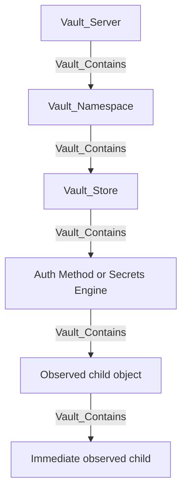

# Graph Model

## Conceptual Hierarchy

VaultHound models Vault as a hierarchy of administrative boundaries and concrete resources.



Stores are namespace-scoped anchor points for identity, policies, auth mounts, secrets-engine mounts, and managed keys. They keep global subsystem permissions away from namespace nodes and make broad ACL surfaces readable without flattening every object directly beneath a namespace.

Containment is immediate-parent containment. A secrets-engine child belongs beneath its mount, a role belongs beneath its auth method or engine, and a KV pair belongs beneath its KV file. Namespace-to-grandchild shortcuts are pruned.

## Multiple Node Kinds

A graph node may carry a specific kind and one or more base kinds. The specific kind is emitted first so BloodHound can render its specific icon while generic queries remain possible.

Examples:

```text
Vault_SecretsEngineTransit -> Vault_SecretsEngine
Vault_AuthApproleRole      -> Vault_AuthRole
Vault_AuthLdapUser         -> Vault_AuthUser
Vault_KvFile               -> Vault_KvObject
Vault_AwsRole              -> Vault_SecretsRole
```

BloodHound adds its own `Base` kind. VaultHound therefore limits custom inheritance depth to avoid exceeding BloodHound's practical node-kind limit.

## Model Layers

### Infrastructure

- `Vault_Server` identifies the collected Vault cluster or endpoint.
- `Vault_Namespace` represents an Enterprise tenancy boundary.
- `Vault_Store` anchors a namespace-scoped subsystem.
- `Vault_AuthMethod` and `Vault_SecretsEngine` represent mounted backends.

### Identity

- `Vault_Entity` is the canonical Vault identity.
- `Vault_EntityAlias` maps an external login identity on an auth mount to an entity.
- `Vault_Group` aggregates entities or child groups and links inherited policies.
- `Vault_GroupAlias` maps an external group representation to a Vault group.
- Auth-specific users and groups represent configuration records within auth methods. `Vault_MapsTo` resolves them through aliases into canonical identity objects when correlation is available.

### Policy

`Vault_Policy` is the source of declared ACL authority. `Vault_LinksPolicy` normalizes direct identity assignments and policy grants from auth roles, auth users, auth groups, and backend defaults. The `Policy Link Types` property preserves how the policy is obtained.

Policy nodes remain visible even when the collector derives a more specific relationship to a resource. This keeps the policy document as the auditable source of truth.

### Authentication

An auth-method mount may contain roles, users, groups, CRLs, or other method-specific configuration objects. Auth roles link to the policies granted by a successful login. Alias and group-alias mappings connect external authentication representations to Vault identity.

### Secrets Engines

Supported secrets engines have specific mount kinds and concrete children such as roles, keys, issuers, database connections, static accounts, or KV paths. Unsupported mounts retain only generic existence and type data.

### Identity Services

OIDC applications, providers, scopes, assignments, token roles, MFA methods, login enforcements, SCIM clients, and managed keys are modeled as namespace-scoped identity or platform objects rather than ordinary mounted secrets engines.

## Structural Relationships

| Relationship | Meaning |
| --- | --- |
| `Vault_Contains` | Immediate observed hierarchy and implied parent control. |
| `Vault_ParentOf` | Parent namespace authority over a child namespace. |
| `Vault_References` | Non-hierarchical configuration reference. |
| `Vault_MemberOf` | Permission-bearing entity or group membership. |
| `Vault_MapsTo` | Identity correlation or canonical resolution. |
| `Vault_LinksPolicy` | Direct assignment or configured policy grant. |
| `Vault_OnAuthMethod` | Alias placement on an auth mount. |

`Vault_References` is used when the source does not contain the target. For example, a PKI issuer references a key, and a database role references a connection.

## Access Relationships

Access relationships fall into four broad classes:

1. Visibility: list, read, inspect, and configuration discovery.
2. Administration: create, update, delete, rotate, import, or tune.
3. Security outcomes: read a credential, generate credentials, decrypt data, sign material, obtain a policy, or control an identity object.
4. Uncertainty: potential access where the target or a required condition cannot be proven.

Generic edge families such as `Vault_ListObjects`, `Vault_ReadObject`, `Vault_ManageObject`, `Vault_ReadConfig`, and `Vault_ManageConfig` reduce graph clutter. Their `Object Types`, `Operations`, `Read Targets`, `Config Targets`, and subsystem properties retain the specialized meaning.

## Policy Path Resolution

The collector parses HCL path blocks, normalizes capability lists, and compares each path against known resource surfaces.

### Exact Paths

An exact path targets the concrete observed object. If the path names an object that does not exist in collected data, the collector may create a synthetic target for policy visibility.

### `+` Wildcards

`+` matches exactly one path segment. Matching is performed against concrete resource paths, not treated as an unrestricted subtree.

### `*` Globs

Vault's trailing `*` glob is a prefix match. For supported backends, the collector expands it to all observed compatible children while preserving an anchor or potential edge where the policy can affect unobserved future objects.

### Templates

Identity policy templates are rendered against the relevant entity, alias, or group context. A rendered effective edge originates from the identity object actually referenced by the template expression. Policy inheritance remains edge provenance rather than changing the source identity.

### Deny and Capability Filtering

`deny` overrides otherwise matching grants. Each exported edge contains only capabilities relevant to that operation, not the complete capability set from the policy block. Sudo appears only on endpoints that Vault actually gates with sudo.

## Observed, Synthetic, and Potential Targets

An observed object was returned by Vault. A synthetic object was inferred from an exact policy path because the target was not observed. Synthetic nodes carry `Synthetic: true` and are not attached through ordinary containment.

Operations that would normally create attack paths are downgraded to `Vault_PotentialAccess` when their target is synthetic, runtime-selected, or compatibility-dependent. Potential edges record the expected outcome, unresolved requirement, and target-observation state.

## Canonicalization

The collector uses specialized internal names while routing endpoint-specific behavior, then canonicalizes them into the exported schema. Examples include method-specific role CRUD becoming `Vault_ListObjects`, `Vault_ReadObject`, or `Vault_ManageObject`, and engine-specific configuration access becoming `Vault_ReadConfig` or `Vault_ManageConfig`.

Properties preserve the original family through values such as `Auth Method Types`, `Engine Types`, `Object Types`, `Role Types`, `Config Targets`, and `Operations`.

Only names registered in `schema.json` should be used in BloodHound queries. The generated [SCHEMA.md](SCHEMA.md) is the exported-kind reference.

## Namespace Semantics

Identity, policies, auth mounts, secrets engines, managed keys, and stores are namespace-scoped. Policies are evaluated in their namespace context, and paths in one namespace do not automatically authorize objects in a sibling namespace. `Vault_ParentOf` represents parent administrative authority, not ordinary policy inheritance between siblings.

## Sensitive Data Boundary

VaultHound is graphing security relationships, not building a secret dump:

- KV values are not exported.
- KV pair names are exported for visibility.
- Public certificates and public keys may be summarized.
- Secret-bearing configuration returned by Vault may be represented as a sensitive-read condition and should be protected as collection output.
- Tokens, generated dynamic credentials, and one-time response values are not collected by invoking generation endpoints; the graph models permission to invoke them.
