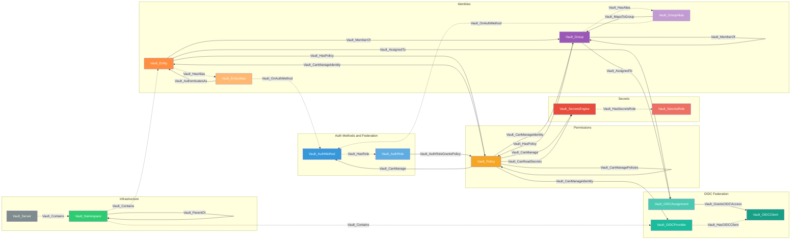
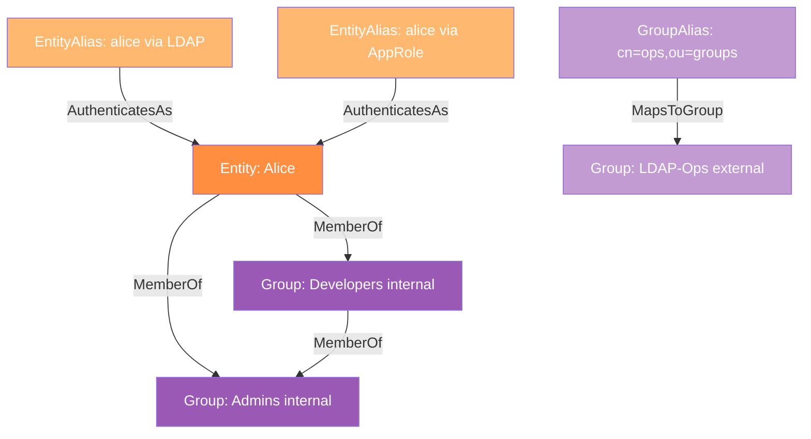
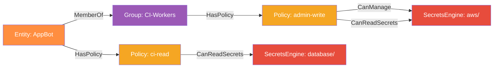
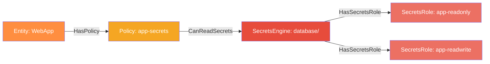
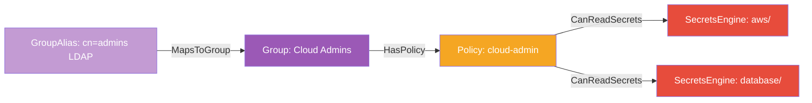
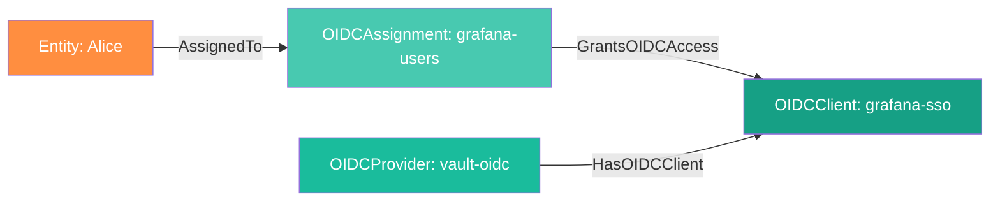

# HashiCorp Vault OpenGraph Schema Documentation

> This document provides human-readable documentation of the HashiCorp Vault OpenGraph schema for BloodHound.
> Generated from the analysis and schema files in this project.

**Schema Version**: 1.0
**Last Updated**: 2026-02-10
**Platform Prefix**: `Vault_`

---

## Table of Contents

1. [Schema Overview](#schema-overview)
2. [Design Rationale](#design-rationale)
3. [Visual Schema Diagrams](#visual-schema-diagrams)
4. [Node Types](#node-types)
5. [Edge Types](#edge-types)
6. [Attack Path Diagrams](#attack-path-diagrams)
7. [Cypher Query Examples](#cypher-query-examples)

---

## Schema Overview

### Purpose

This schema models the identity, authentication, authorization, and resource access relationships within HashiCorp Vault as an attack graph for BloodHound. It enables security teams to answer questions like:

- "Who can access production database credentials?"
- "If this LDAP group is compromised, what Vault secrets are exposed?"
- "Which entities can escalate to administrative access via policy manipulation?"
- "What is the blast radius of a compromised CI/CD orchestrator with Vault AppRole permissions?"

Vault is a Tier 0 asset: compromise cascades to all systems whose credentials it manages (AWS, Azure, GCP, databases, PKI, SSH). This schema models the authorization decisions within Vault itself -- the minimum data needed to predict allow/deny decisions on any Vault API path.

### Scope

**Included**:
- Entity-Alias identity model (all auth methods resolve to entities)
- Internal and external group membership with policy inheritance
- ACL policy path-based capabilities
- Auth method mounts, roles, and policy bindings (all federation types)
- Secrets engine mounts, roles, and access patterns
- Namespace hierarchy (Enterprise)
- Privilege escalation via policy write, identity manipulation, and group modification
- Federation attack paths (LDAP, OIDC, K8s, AWS, Azure, GCP)
- OIDC Provider federation (Vault as IdP to downstream systems)

**Not Included** (documented in known-limitations.md):
- Token objects (transient runtime artifacts)
- Plugin catalog and code execution paths
- Physical/infrastructure attacks (unseal key aggregation, memory extraction, storage backend)
- Cross-cluster replication trust
- External system nodes (AWS accounts, databases, K8s clusters)

### Statistics

| Metric | Count |
|--------|-------|
| Node Types | 14 |
| Edge Types | 18 |
| Traversable Edges | 13 |
| Non-Traversable Edges | 5 |

---

## Design Rationale

### Key Modeling Decisions

1. **Policy as Central Authorization Node**
   - What: Policies are modeled as first-class nodes with edges to both identities and resources
   - Why: ALL Vault authorization flows through policies. Modeling the policy layer enables querying "who can do what" through the same mechanism Vault uses
   - Trade-off: Adds a hop to every access path (entity -> policy -> resource) but faithfully represents the authorization model

2. **Entity-Alias Split into Two Node Types**
   - What: Entities and aliases are separate nodes connected by edges, rather than merged
   - Why: Aliases represent distinct authentication pathways. An entity with 3 aliases has 3 different credential theft scenarios. Separating them enables per-alias attack path queries and visualizes the multi-alias accumulation problem
   - Trade-off: More nodes and edges, but accurately represents the "compromise any one alias, gain all policies" pattern

3. **Policy-to-Resource Edges (Not Entity-to-Resource)**
   - What: Access to secrets engines flows through policy nodes, not directly from entities
   - Why: Vault evaluates policies at request time. An entity's effective access is the union of all policies from entity + groups + token. Modeling policy-to-resource edges enables accurate "who can access what" queries through policy union
   - Trade-off: Longer paths, but prevents false positives from direct entity-to-resource edges that would ignore the policy evaluation step

4. **Tokens Excluded as Nodes**
   - What: Vault tokens are not modeled as graph nodes
   - Why: Tokens are transient, runtime artifacts. A service token's policies are determined by the combination of token-attached policies + entity policies + group policies at request time. Including tokens would create massive graph noise (potentially millions of nodes) without adding queryable attack paths that cannot be derived from entity/group/policy relationships
   - Trade-off: Cannot query specific token properties (orphan, periodic). These are instead captured as entity/policy properties

5. **Group Alias as Separate Node**
   - What: External group aliases are separate from the groups they map to
   - Why: Group aliases represent the external federation bridge (e.g., LDAP group -> Vault group). Separating them makes the LDAP group poisoning attack path explicit and queryable
   - Trade-off: Additional node type, but critical for federation attack modeling

### Identifier Strategy

All node IDs use Vault-provided UUIDs where available, ensuring stability and global uniqueness. Every node ID is prefixed with an instance hash (`{hash}`) derived from the first 8 characters of `SHA256(VAULT_ADDR)`. This ensures that nodes from different Vault instances are globally unique when ingested into the same BloodHound database.

| Node Type | ID Format | Source | Quality |
|-----------|-----------|--------|---------|
| Vault_Server | `vault_{hash}_server` | SHA256(VAULT_ADDR)[:8] | Excellent -- deterministic |
| Vault_Entity | `vault_{hash}_entity_{uuid}` | Instance hash + Vault-assigned UUID | Excellent -- immutable |
| Vault_EntityAlias | `vault_{hash}_entity_alias_{uuid}` | Instance hash + Vault-assigned UUID | Excellent |
| Vault_Group | `vault_{hash}_group_{uuid}` | Instance hash + Vault-assigned UUID | Excellent |
| Vault_GroupAlias | `vault_{hash}_group_alias_{uuid}` | Instance hash + Vault-assigned UUID | Excellent |
| Vault_Policy | `vault_{hash}_policy_{ns_id}_{name}` | Instance hash + namespace ID + name | Good -- deterministic |
| Vault_AuthMethod | `vault_{hash}_auth_method_{accessor}` | Instance hash + mount accessor UUID | Excellent |
| Vault_AuthRole | `vault_{hash}_auth_role_{accessor}_{name}` | Instance hash + accessor + name | Good -- composite |
| Vault_SecretsEngine | `vault_{hash}_secrets_engine_{accessor}` | Instance hash + mount accessor UUID | Excellent |
| Vault_SecretsRole | `vault_{hash}_secrets_role_{accessor}_{name}` | Instance hash + accessor + name | Good -- composite |
| Vault_Namespace | `vault_{hash}_namespace_{ns_id}` | Instance hash + namespace ID | Good |
| Vault_OIDCProvider | `vault_{hash}_oidc_provider_{ns_id}_{name}` | Instance hash + namespace ID + name | Good -- deterministic |
| Vault_OIDCClient | `vault_{hash}_oidc_client_{client_id}` | Instance hash + Vault-assigned client ID | Excellent |
| Vault_OIDCAssignment | `vault_{hash}_oidc_assignment_{ns_id}_{name}` | Instance hash + namespace ID + name | Good -- deterministic |

> **Note**: `{hash}` = `SHA256(VAULT_ADDR)[:8]` -- the first 8 hexadecimal characters of the SHA-256 hash of the `VAULT_ADDR` environment variable (e.g., `https://vault.example.com:8200` hashes to `a1b2c3d4...`, so `{hash}` = `a1b2c3d4`). This prefix is computed once at collection time and applied consistently to all node IDs from that Vault instance.

> **Reserved property `objectid`**: BloodHound auto-derives `objectid` from the top-level `id` value at ingest time. The collector emits the node identifier ONLY as the top-level `id` field — never inside `properties`. After ingest, queries against `n.objectid` continue to work because BHCE creates the property automatically. Source: [`/opengraph/developer/nodes`](https://bloodhound.specterops.io/opengraph/developer/nodes).

---

## Visual Schema Diagrams

### Full Schema Overview

This diagram shows all node types and their primary relationships.



**Legend**:
- **Orange**: Identity nodes (who can act)
- **Purple**: Group nodes (membership containers)
- **Yellow**: Permission nodes (what defines access)
- **Blue**: Auth method nodes (trust boundaries)
- **Red**: Secrets nodes (what can be accessed)
- **Gray**: Server node (Vault instance)
- **Green**: Infrastructure nodes (organizational boundaries)
- **Teal**: OIDC federation nodes (outbound identity provider)

---

### Identity and Membership Relationships

This diagram focuses on how identities authenticate and form groups.



**Key Insight**: Alice has two authentication pathways (LDAP and AppRole). Compromising either one grants the full union of all policies from entity direct attachment, Group Admins, and Group Developers. The external group LDAP-Ops is populated by LDAP group membership -- an LDAP admin can add users to this Vault group by modifying the LDAP directory.

---

### Policy and Permission Flow

This diagram shows how policies mediate access between identities and resources.



**Key Insight**: AppBot has direct read access to the database engine via ci-read policy, and inherits admin-write policy from the CI-Workers group which grants both management AND read access to the AWS engine. The CanManage edge on the AWS engine means this identity can also read root credentials from the engine configuration.

---

### Secrets Access and Dynamic Credential Generation

This diagram shows the full path from identity to external system credentials.



**Key Insight**: The WebApp entity can generate dynamic database credentials through two roles: app-readonly (limited SELECT access) and app-readwrite (full CRUD). The secrets roles define the SQL creation statements that determine what the generated credentials can do in the database.

---

### Privilege Escalation Attack Path

This diagram shows the critical policy write self-escalation pattern.


**Key Insight**: An entity with a policy granting write on `sys/policy/*` can create a new root-equivalent policy granting unrestricted access, then attach it to their own entity. This is the most critical misconfiguration-based escalation pattern in Vault, confirmed by 3 independent research sources.

---

### Federation Attack Path (LDAP Group Poisoning)

This diagram shows the LDAP-to-Vault-to-secrets attack chain.

```mermaid
flowchart LR
    GAlias[GroupAlias: cn=vault-admins LDAP]
    Group[Group: Vault Admins]
    Policy[Policy: admin-policy]
    PolicyWrite[Policy: can write sys/policy]
    SE[SecretsEngine: aws/ azure/ database/]

    GAlias -->|MapsToGroup| Group
    Group -->|HasPolicy| Policy
    Policy -->|CanManagePolicies| PolicyWrite
    PolicyWrite -->|CanReadSecrets| SE

    style GAlias fill:#C39BD3,color:#fff
    style Group fill:#9B59B6,color:#fff
    style Policy fill:#F5A623,color:#fff
    style PolicyWrite fill:#E74C3C,color:#fff
    style SE fill:#E74C3C,color:#fff
```



**Key Insight**: Compromising the LDAP directory and adding a user to the cn=vault-admins group immediately grants Vault admin policies through external group sync. No Vault-side credential is needed. This chain enables multi-cloud administrative access through Vault.

---

## Node Types

### Vault_Server

**Description**: Represents a HashiCorp Vault server instance identified by its API address. This is the top-level node in the containment hierarchy. All namespaces, and transitively all other nodes, belong to a specific Vault server. The server node is populated from unauthenticated and leader endpoints, making it available even with minimal permissions.

**Icon**: `server` | **Color**: `#7F8C8D`

**Kinds**: `["Vault_Server", "VaultBase"]`

**ID Format**: `vault_{hash}_server` where `{hash}` is the first 8 characters of `SHA256(VAULT_ADDR)`.

**Properties**:

| Property | Type | Required | Description |
|----------|------|----------|-------------|
| `name` | string | :white_check_mark: | Display name (cluster_name if available, otherwise API address) |
| `api_address` | string | :white_check_mark: | Vault API address (e.g., `https://vault.example.com:8200`) |
| `cluster_name` | string | :x: | Vault cluster name from health endpoint |
| `cluster_id` | string | :x: | Vault cluster UUID |
| `version` | string | :x: | Vault server version |
| `seal_type` | string | :x: | Seal type (e.g., `shamir`, `awskms`, `transit`) |
| `ha_enabled` | boolean | :x: | Whether HA mode is enabled |
| `instance_hash` | string | :x: | The `{hash}` value (first 8 chars of SHA256 of VAULT_ADDR) |

**API Endpoints**:
- `GET /v1/sys/health` (unauthenticated) -- provides version, cluster_name, cluster_id, seal status
- `GET /v1/sys/leader` -- provides HA status and leader address

**Relationships**:
- Outgoing: `Vault_Contains` to `Vault_Namespace`
- Incoming: None (top-level node)

**Example**:
```json
{
  "id": "vault_a1b2c3d4_server",
  "kinds": ["Vault_Server", "VaultBase"],
  "properties": {
    "name": "vault-prod",
    "api_address": "https://vault.example.com:8200",
    "cluster_name": "vault-prod",
    "cluster_id": "e4f5a6b7-c8d9-0e1f-2a3b-4c5d6e7f8a9b",
    "version": "1.15.4",
    "seal_type": "awskms",
    "ha_enabled": true,
    "instance_hash": "a1b2c3d4"
  }
}
```

---

### Vault_Entity

**Description**: The core identity primitive in HashiCorp Vault. Every principal (human or machine) that authenticates through a non-token auth method is represented as an entity. Entities accumulate policies from direct assignment, group membership, and all associated aliases.

**Icon**: `user` | **Color**: `#FF8E40`

**Properties**:

| Property | Type | Required | Description |
|----------|------|----------|-------------|
| `name` | string | :white_check_mark: | Display name (updatable) |
| `disabled` | boolean | :x: | Whether entity is disabled (tokens blocked but not revoked) |
| `namespace_id` | string | :x: | Owning namespace ID |
| `policies` | array[string] | :x: | Directly assigned policy names |
| `merged_entity_ids` | array[string] | :x: | IDs of entities merged into this one |

**Relationships**:
- Outgoing: `Vault_MemberOf` to `Vault_Group`, `Vault_HasPolicy` to `Vault_Policy`, `Vault_HasAlias` to `Vault_EntityAlias`
- Incoming: `Vault_AuthenticatesAs` from `Vault_EntityAlias`, `Vault_CanManageIdentity` from `Vault_Policy`, `Vault_Contains` from `Vault_Namespace`

**Example**:
```json
{
  "id": "vault_entity_b3e2d4f6-8a1c-4e7b-9f3a-2c5d8e1f4a6b",
  "kinds": ["Vault_Entity", "VaultBase"],
  "properties": {
    "name": "alice@example.com",
    "disabled": false,
    "namespace_id": "root",
    "policies": ["default", "app-secrets"]
  }
}
```

---

### Vault_EntityAlias

**Description**: Binds an entity to a specific authentication method mount. Each alias represents one authentication pathway (e.g., LDAP username, K8s service account, AppRole RoleID). An entity can have at most one alias per auth mount.

**Icon**: `id-badge` | **Color**: `#FFB870`

**Properties**:

| Property | Type | Required | Description |
|----------|------|----------|-------------|
| `name` | string | :white_check_mark: | Identity within the auth method (e.g., username, SA email) |
| `mount_accessor` | string | :x: | Auth method mount accessor UUID |
| `mount_type` | string | :x: | Auth method type (ldap, kubernetes, approle, etc.) |
| `canonical_id` | string | :x: | Parent entity UUID |

**Relationships**:
- Outgoing: `Vault_AuthenticatesAs` to `Vault_Entity`, `Vault_OnAuthMethod` to `Vault_AuthMethod`
- Incoming: `Vault_HasAlias` from `Vault_Entity`, `Vault_Contains` from `Vault_Namespace`

---

### Vault_Group

**Description**: Aggregates entities and other groups for policy inheritance. Internal groups have explicitly managed membership. External groups have membership driven by auth backend at login time (e.g., LDAP group membership).

**Icon**: `users` | **Color**: `#9B59B6`

**Properties**:

| Property | Type | Required | Description |
|----------|------|----------|-------------|
| `name` | string | :white_check_mark: | Group display name |
| `type` | string | :x: | "internal" or "external" |
| `namespace_id` | string | :x: | Owning namespace ID |
| `policies` | array[string] | :x: | Policies granted to all members |

**Relationships**:
- Outgoing: `Vault_HasPolicy` to `Vault_Policy`, `Vault_MemberOf` to `Vault_Group` (parent), `Vault_HasAlias` to `Vault_GroupAlias`
- Incoming: `Vault_MemberOf` from `Vault_Entity`, `Vault_MemberOf` from `Vault_Group` (child), `Vault_MapsToGroup` from `Vault_GroupAlias`, `Vault_CanManageIdentity` from `Vault_Policy`

---

### Vault_GroupAlias

**Description**: Maps an external Vault group to an authentication method mount. When entities authenticate via the mapped mount, if the auth response includes matching group information (e.g., LDAP groups, OIDC groups_claim), the entity is added to the group.

**Icon**: `people-arrows` | **Color**: `#C39BD3`

**Properties**:

| Property | Type | Required | Description |
|----------|------|----------|-------------|
| `name` | string | :white_check_mark: | External group name (e.g., LDAP group CN) |
| `mount_accessor` | string | :x: | Auth method mount accessor UUID |
| `mount_type` | string | :x: | Auth method type |
| `canonical_id` | string | :x: | Parent group UUID |

**Relationships**:
- Outgoing: `Vault_MapsToGroup` to `Vault_Group`, `Vault_OnAuthMethod` to `Vault_AuthMethod`
- Incoming: `Vault_HasAlias` from `Vault_Group`, `Vault_Contains` from `Vault_Namespace`

---

### Vault_Policy

**Description**: An ACL policy document defining path-based capabilities. Policies are the core authorization primitive in Vault. ALL access flows through policies. Changes to policy content take immediate effect on all tokens referencing that policy.

**Icon**: `shield-alt` | **Color**: `#F5A623`

**Properties**:

| Property | Type | Required | Description |
|----------|------|----------|-------------|
| `name` | string | :white_check_mark: | Policy name |
| `type` | string | :x: | "acl", "rgp", or "egp" |
| `namespace_id` | string | :x: | Owning namespace ID |
| `is_wildcard` | boolean | :x: | True if policy contains path "*" rule |
| `uses_templates` | boolean | :x: | True if policy uses identity template syntax |
| `can_manage_audit` | boolean | :x: | True if policy grants delete on sys/audit/* |
| `paths_summary` | string | :x: | Serialized summary of path rules |

**Relationships**:
- Outgoing: `Vault_CanManage` to `Vault_AuthMethod`/`Vault_SecretsEngine`, `Vault_CanReadSecrets` to `Vault_SecretsEngine`, `Vault_CanManagePolicies` to `Vault_Policy`, `Vault_CanManageIdentity` to `Vault_Entity`/`Vault_Group`
- Incoming: `Vault_HasPolicy` from `Vault_Entity`/`Vault_Group`, `Vault_AuthRoleGrantsPolicy` from `Vault_AuthRole`, `Vault_CanManagePolicies` from `Vault_Policy`

---

### Vault_AuthMethod

**Description**: A mounted authentication method. Each mount is a trust boundary defining how external identities are verified and mapped into Vault entities. Auth methods include LDAP, OIDC/JWT, Kubernetes, AWS, Azure, GCP, AppRole, Userpass, TLS Certificate, and others.

**Icon**: `lock` | **Color**: `#3498DB`

**Properties**:

| Property | Type | Required | Description |
|----------|------|----------|-------------|
| `name` | string | :white_check_mark: | Auth method mount path |
| `accessor` | string | :x: | Mount accessor UUID |
| `path` | string | :x: | Full mount path (e.g., "auth/ldap/") |
| `type` | string | :x: | Auth method type |
| `description` | string | :x: | Mount description |
| `namespace_id` | string | :x: | Owning namespace ID |
| `ldap_url` | string | :x: | LDAP server URL(s) — identifies AD domain controller(s) (only when type=ldap) |
| `ldap_binddn` | string | :x: | Service account DN for LDAP queries (only when type=ldap) |
| `ldap_userdn` | string | :x: | User search base DN — maps to AD OU (only when type=ldap) |
| `ldap_groupdn` | string | :x: | Group search base DN — maps to AD OU (only when type=ldap) |
| `ldap_userattr` | string | :x: | User matching attribute, e.g., sAMAccountName, cn, uid (only when type=ldap) |
| `ldap_groupattr` | string | :x: | Group name attribute, e.g., cn, memberOf (only when type=ldap) |
| `ldap_upndomain` | string | :x: | UPN domain — AD domain identifier (only when type=ldap) |

**Cross-Environment Correlation (LDAP)**:

When both AD and Vault data are ingested into BloodHound, the LDAP properties on `Vault_AuthMethod` enable programmatic correlation:
- `ldap_userattr` determines how `Vault_EntityAlias` names map to AD user objects. If `ldap_userattr` is `sAMAccountName`, the alias `name` matches the AD user's `sAMAccountName`. If `cn`, it matches the AD user's `cn` attribute.
- `ldap_groupattr` determines how `Vault_GroupAlias` names map to AD group objects. If `ldap_groupattr` is `cn`, the group alias `name` matches the AD group's `cn` attribute.
- `ldap_url` identifies which AD domain controller(s) Vault connects to, confirming the AD domain relationship.
- `ldap_userdn` and `ldap_groupdn` identify the OUs within AD where Vault searches for users and groups.
- `ldap_upndomain` provides the AD domain name when UPN-based authentication is configured.

**Relationships**:
- Outgoing: `Vault_HasRole` to `Vault_AuthRole`
- Incoming: `Vault_OnAuthMethod` from `Vault_EntityAlias`/`Vault_GroupAlias`, `Vault_CanManage` from `Vault_Policy`, `Vault_Contains` from `Vault_Namespace`

---

### Vault_AuthRole

**Description**: A named role within an auth method that binds external identity attributes to Vault policies. Auth roles define what policies federated identities receive and what binding constraints are enforced.

**Icon**: `user-shield` | **Color**: `#5DADE2`

**Properties**:

| Property | Type | Required | Description |
|----------|------|----------|-------------|
| `name` | string | :white_check_mark: | Role name |
| `auth_accessor` | string | :x: | Parent auth method accessor |
| `auth_type` | string | :x: | Auth method type |
| `token_policies` | array[string] | :x: | Policies attached to tokens |

**Relationships**:
- Outgoing: `Vault_AuthRoleGrantsPolicy` to `Vault_Policy`
- Incoming: `Vault_HasRole` from `Vault_AuthMethod`, `Vault_Contains` from `Vault_Namespace`

---

### Vault_SecretsEngine

**Description**: A mounted secrets engine that stores or generates secrets. Each mount represents a distinct secret management domain. Types include KV, database, AWS, Azure, GCP, PKI, SSH, Transit, and many others.

**Icon**: `key` | **Color**: `#E74C3C`

**Properties**:

| Property | Type | Required | Description |
|----------|------|----------|-------------|
| `name` | string | :white_check_mark: | Secrets engine mount path |
| `accessor` | string | :x: | Mount accessor UUID |
| `path` | string | :x: | Full mount path |
| `type` | string | :x: | Secrets engine type |
| `description` | string | :x: | Mount description |
| `namespace_id` | string | :x: | Owning namespace ID |

**Relationships**:
- Outgoing: `Vault_HasSecretsRole` to `Vault_SecretsRole`
- Incoming: `Vault_CanManage` from `Vault_Policy`, `Vault_CanReadSecrets` from `Vault_Policy`, `Vault_Contains` from `Vault_Namespace`

---

### Vault_SecretsRole

**Description**: A named role within a secrets engine that defines the template for dynamic credential generation. Each role specifies what credentials are created (e.g., SQL creation statements, IAM policies, certificate parameters).

**Icon**: `cog` | **Color**: `#EC7063`

**Properties**:

| Property | Type | Required | Description |
|----------|------|----------|-------------|
| `name` | string | :white_check_mark: | Role name |
| `engine_accessor` | string | :x: | Parent engine accessor |
| `engine_type` | string | :x: | Secrets engine type |
| `credential_type` | string | :x: | Type of credential generated |

**Relationships**:
- Incoming: `Vault_HasSecretsRole` from `Vault_SecretsEngine`, `Vault_Contains` from `Vault_Namespace`

---

### Vault_Namespace

**Description**: A hierarchical isolation boundary (Enterprise only). Each namespace contains its own auth methods, secrets engines, policies, entities, and groups. Parent namespaces can assert policies on children.

**Icon**: `folder` | **Color**: `#2ECC71`

**Properties**:

| Property | Type | Required | Description |
|----------|------|----------|-------------|
| `name` | string | :white_check_mark: | Namespace path |
| `namespace_id` | string | :x: | Namespace ID |
| `path` | string | :x: | Full namespace path |
| `parent_namespace_id` | string | :x: | Parent namespace ID |

**Relationships**:
- Outgoing: `Vault_ParentOf` to `Vault_Namespace`, `Vault_Contains` to all non-Server/Namespace node types (Entity, Group, EntityAlias, GroupAlias, AuthMethod, AuthRole, SecretsEngine, SecretsRole, Policy, OIDCProvider, OIDCClient, OIDCAssignment)
- Incoming: `Vault_ParentOf` from `Vault_Namespace`, `Vault_Contains` from `Vault_Server`

---

### Vault_OIDCProvider

**Description**: Vault can act as an OIDC Identity Provider (IdP), issuing OIDC tokens that downstream systems (Grafana, CI dashboards, etc.) consume for SSO. Each provider defines an issuer URL and a set of allowed clients.

**Icon**: `globe` | **Color**: `#1ABC9C`

**Properties**:

| Property | Type | Required | Description |
|----------|------|----------|-------------|
| `name` | string | :white_check_mark: | Provider name |
| `issuer` | string | :x: | OIDC issuer URL |
| `allowed_client_ids` | array[string] | :x: | Client IDs permitted to use this provider |
| `scopes_supported` | array[string] | :x: | Supported OIDC scopes |
| `namespace_id` | string | :x: | Owning namespace ID |

**Relationships**:
- Outgoing: `Vault_HasOIDCClient` to `Vault_OIDCClient`
- Incoming: `Vault_Contains` from `Vault_Namespace`, `Vault_CanManageIdentity` from `Vault_Policy`

**Example**:
```json
{
  "id": "vault_oidc_provider_root_vault-oidc",
  "kinds": ["Vault_OIDCProvider", "VaultBase"],
  "properties": {
    "name": "vault-oidc",
    "issuer": "http://opengraph-vault:8200/v1/identity/oidc/provider/vault-oidc",
    "allowed_client_ids": ["*"],
    "scopes_supported": [],
    "namespace_id": "root"
  }
}
```

---

### Vault_OIDCClient

**Description**: A registered OIDC relying party (client application) that can request OIDC tokens from a Vault provider. Each client has a unique client ID, redirect URIs, and is bound to specific OIDC assignments that control which entities/groups can obtain tokens.

**Icon**: `window-maximize` | **Color**: `#16A085`

**Properties**:

| Property | Type | Required | Description |
|----------|------|----------|-------------|
| `name` | string | :white_check_mark: | Client name |
| `client_id` | string | :x: | OIDC client ID (UUID) |
| `redirect_uris` | array[string] | :x: | Allowed callback URLs |
| `assignments` | array[string] | :x: | Assignment names controlling token issuance |
| `key` | string | :x: | Named key used for signing |
| `client_type` | string | :x: | "confidential" or "public" |
| `namespace_id` | string | :x: | Owning namespace ID |

**Relationships**:
- Incoming: `Vault_HasOIDCClient` from `Vault_OIDCProvider`, `Vault_GrantsOIDCAccess` from `Vault_OIDCAssignment`, `Vault_Contains` from `Vault_Namespace`, `Vault_CanManageIdentity` from `Vault_Policy`

**Example**:
```json
{
  "id": "vault_oidc_client_abc123",
  "kinds": ["Vault_OIDCClient", "VaultBase"],
  "properties": {
    "name": "grafana-sso",
    "client_id": "abc123",
    "redirect_uris": ["https://grafana.opengraph.local/login/generic_oauth"],
    "assignments": ["grafana-users"],
    "key": "default-key",
    "client_type": "confidential",
    "namespace_id": "root"
  }
}
```

---

### Vault_OIDCAssignment

**Description**: Defines which entities and groups are authorized to obtain OIDC tokens for clients that reference this assignment. Assignments are the authorization control for Vault's outbound OIDC federation.

**Icon**: `user-check` | **Color**: `#48C9B0`

**Properties**:

| Property | Type | Required | Description |
|----------|------|----------|-------------|
| `name` | string | :white_check_mark: | Assignment name |
| `entity_ids` | array[string] | :x: | Entity UUIDs authorized for token issuance |
| `group_ids` | array[string] | :x: | Group UUIDs authorized for token issuance |
| `namespace_id` | string | :x: | Owning namespace ID |

**Relationships**:
- Outgoing: `Vault_GrantsOIDCAccess` to `Vault_OIDCClient`
- Incoming: `Vault_AssignedTo` from `Vault_Entity` / `Vault_Group`, `Vault_Contains` from `Vault_Namespace`, `Vault_CanManageIdentity` from `Vault_Policy`

**Example**:
```json
{
  "id": "vault_oidc_assignment_root_grafana-users",
  "kinds": ["Vault_OIDCAssignment", "VaultBase"],
  "properties": {
    "name": "grafana-users",
    "entity_ids": ["alice-uuid", "bob-uuid"],
    "group_ids": ["all-staff-uuid"],
    "namespace_id": "root"
  }
}
```

---

## Edge Types

### Vault_MemberOf

**Relationship**: `Vault_Entity` -> `Vault_Group` OR `Vault_Group` (child) -> `Vault_Group` (parent)

**Traversable**: Yes

**Description**: Entity is a member of a group, or a child group is nested within a parent group. Members inherit all group policies, and policies accumulate upward through nested group hierarchies.

**Direction Justification**:
> If I compromise an entity, I gain all policies inherited from every group the entity belongs to. For nested groups, members of the child group gain the parent group's permissions through nesting. Policies accumulate upward through the hierarchy.

---

### Vault_AuthenticatesAs

**Relationship**: `Vault_EntityAlias` -> `Vault_Entity`

**Traversable**: Yes

**Description**: Authenticating via credentials represented by this alias resolves to the target entity, granting all entity and group policies.

**Direction Justification**:
> If I compromise credentials represented by an entity alias, I can authenticate and receive a token inheriting ALL of the entity's policies. The alias is the attack starting point; the entity is what I gain control of.

---

### Vault_MapsToGroup

**Relationship**: `Vault_GroupAlias` -> `Vault_Group`

**Traversable**: Yes

**Description**: External group alias maps external identity provider group membership to this Vault group.

**Direction Justification**:
> If I control the external identity source mapped by this group alias (e.g., LDAP admin), I can add entities to this Vault group by modifying the external group. Controlling the group alias grants control over group membership.

---

### Vault_HasPolicy

**Relationship**: `Vault_Entity` -> `Vault_Policy` OR `Vault_Group` -> `Vault_Policy`

**Traversable**: Yes

**Description**: Entity or group has a directly assigned policy. For entities, changes take immediate effect on all existing tokens. For groups, all member entities inherit this policy.

**Direction Justification**:
> Compromising an entity grants all directly assigned policies. Members of a group gain its policies through membership.

---

### Vault_AuthRoleGrantsPolicy

**Relationship**: `Vault_AuthRole` -> `Vault_Policy`

**Traversable**: Yes

**Description**: Authenticating through this auth role grants the specified policy.

**Direction Justification**:
> Successfully authenticating via the role's auth method with matching identity attributes grants this policy on the resulting token.

---

### Vault_CanManage

**Relationship**: `Vault_Policy` -> `Vault_AuthMethod` or `Vault_SecretsEngine`

**Traversable**: Yes

**Description**: Policy grants write/management capabilities on the target resource's paths.

**Direction Justification**:
> A principal with this policy can modify the target resource's configuration, create/modify roles, and establish persistence or extract root credentials.

**Properties**: `capabilities` (array of granted capabilities)

---

### Vault_CanReadSecrets

**Relationship**: `Vault_Policy` -> `Vault_SecretsEngine`

**Traversable**: Yes

**Description**: Policy grants read/list capabilities on the secrets engine's credential or data paths.

**Direction Justification**:
> A principal with this policy can retrieve secrets or generate dynamic credentials from the target engine.

**Properties**: `capabilities` (array, typically read/list)

---

### Vault_CanManagePolicies

**Relationship**: `Vault_Policy` -> `Vault_Policy`

**Traversable**: Yes

**Description**: Policy grants write on sys/policy/* or sys/policies/acl/*, enabling creation or modification of any policy.

**Direction Justification**:
> Write access to sys/policy enables creating a root-equivalent policy and attaching it to one's own entity. This is the most critical privilege escalation vector in Vault.

---

### Vault_CanManageIdentity

**Relationship**: `Vault_Policy` -> `Vault_Entity` or `Vault_Group`

**Traversable**: Yes

**Description**: Policy grants write on identity endpoints, enabling entity alias manipulation, group membership changes, and metadata forgery.

**Direction Justification**:
> Write access to identity endpoints enables re-binding aliases to privileged entities, adding entities to groups, and modifying metadata for templated policy exploitation.

**Properties**: `identity_scope` (entity, group, or alias)

---

### Vault_ParentOf

**Relationship**: `Vault_Namespace` (parent) -> `Vault_Namespace` (child)

**Traversable**: Yes

**Description**: Parent namespace has authority over child namespace.

**Direction Justification**:
> Parent namespace administrators can assert policies on child namespaces and their identities. Root namespace compromise cascades to all children.

---

### Vault_AssignedTo

**Relationship**: `Vault_Entity` or `Vault_Group` -> `Vault_OIDCAssignment`

**Traversable**: Yes

**Description**: Entity or group is listed in an OIDC assignment, authorizing them to obtain OIDC tokens for any client that references this assignment.

**Direction Justification**:
> If I compromise an entity or group that is assigned to an OIDC assignment, I can obtain OIDC tokens for downstream systems. The entity/group is the attack source; the assignment gates token issuance.

---

### Vault_GrantsOIDCAccess

**Relationship**: `Vault_OIDCAssignment` -> `Vault_OIDCClient`

**Traversable**: Yes

**Description**: Assignment authorizes token issuance for this OIDC client. Entities/groups in the assignment can obtain tokens that the client application will accept.

**Direction Justification**:
> If I am listed in this assignment, I can obtain OIDC tokens for the target client, gaining access to the downstream application that trusts these tokens.

---

### Vault_HasOIDCClient

**Relationship**: `Vault_OIDCProvider` -> `Vault_OIDCClient`

**Traversable**: No (structural)

**Description**: Provider registers this client. The client's tokens are issued through this provider's endpoint.

**Direction Justification**:
> Structural containment: the provider contains the client registration. Not traversable because provider compromise does not independently grant client-level access (that requires assignment membership).

---

### Non-Traversable Edges

| Edge Kind | Source | Target | Description |
|-----------|--------|--------|-------------|
| `Vault_HasAlias` | Entity/Group | EntityAlias/GroupAlias | Structural: identity owns the alias (entity->entity alias or group->group alias) |
| `Vault_OnAuthMethod` | EntityAlias/GroupAlias | AuthMethod | Structural: alias is bound to auth mount (entity alias or group alias) |
| `Vault_HasRole` | AuthMethod | AuthRole | Containment: auth method contains role |
| `Vault_HasSecretsRole` | SecretsEngine | SecretsRole | Containment: engine contains role |
| `Vault_Contains` | Server/Namespace | Namespace/Entity/Group/EntityAlias/GroupAlias/AuthMethod/AuthRole/SecretsEngine/SecretsRole/Policy/OIDCProvider/OIDCClient/OIDCAssignment | Containment: server-to-namespace and namespace-to-all-child-types |
| `Vault_HasOIDCClient` | OIDCProvider | OIDCClient | Structural: provider registers client |

---

## Edge Type Summary Table

| Edge Kind | Source | Target | Traversable | Description |
|-----------|--------|--------|-------------|-------------|
| `Vault_MemberOf` | Entity/Group | Group | :white_check_mark: | Direct or nested group membership |
| `Vault_HasAlias` | Entity/Group | EntityAlias/GroupAlias | :x: | Identity owns alias |
| `Vault_AuthenticatesAs` | EntityAlias | Entity | :white_check_mark: | Alias resolves to entity |
| `Vault_OnAuthMethod` | EntityAlias/GroupAlias | AuthMethod | :x: | Alias bound to mount |
| `Vault_MapsToGroup` | GroupAlias | Group | :white_check_mark: | External sync to group |
| `Vault_HasPolicy` | Entity/Group | Policy | :white_check_mark: | Direct policy assignment |
| `Vault_AuthRoleGrantsPolicy` | AuthRole | Policy | :white_check_mark: | Auth role grants policy |
| `Vault_HasRole` | AuthMethod | AuthRole | :x: | Mount contains role |
| `Vault_HasSecretsRole` | SecretsEngine | SecretsRole | :x: | Engine contains role |
| `Vault_ParentOf` | Namespace | Namespace | :white_check_mark: | Parent namespace authority |
| `Vault_Contains` | Server/Namespace | Namespace/Entity/Group/EntityAlias/GroupAlias/AuthMethod/AuthRole/SecretsEngine/SecretsRole/Policy/OIDCProvider/OIDCClient/OIDCAssignment | :x: | Server-to-namespace and namespace containment |
| `Vault_CanManage` | Policy | AuthMethod/SE | :white_check_mark: | Management access |
| `Vault_CanReadSecrets` | Policy | SecretsEngine | :white_check_mark: | Secret read access |
| `Vault_CanManagePolicies` | Policy | Policy | :white_check_mark: | Policy write escalation |
| `Vault_CanManageIdentity` | Policy | Entity/Group/OIDC | :white_check_mark: | Identity manipulation |
| `Vault_AssignedTo` | Entity/Group | OIDCAssignment | :white_check_mark: | OIDC assignment membership |
| `Vault_GrantsOIDCAccess` | OIDCAssignment | OIDCClient | :white_check_mark: | OIDC token issuance authorization |
| `Vault_HasOIDCClient` | OIDCProvider | OIDCClient | :x: | Provider-client registration |

---

## Attack Path Diagrams

### Attack Path 1: Policy Write Self-Escalation

**Scenario**: An entity with a misconfigured policy granting write on sys/policy/* creates a root-equivalent policy and attaches it to their own entity.

**Start**: `Vault_Entity` (low-privilege application identity)
**Target**: `Vault_SecretsEngine` (all secrets engines)


**Cypher Query**:
```cypher
MATCH p=(e:Vault_Entity)-[:Vault_HasPolicy|Vault_MemberOf*1..4]->(pol:Vault_Policy)-[:Vault_CanManagePolicies]->(any:Vault_Policy)
RETURN DISTINCT e.name, pol.name
```

---

### Attack Path 2: LDAP Group Poisoning to Multi-Cloud

**Scenario**: LDAP directory compromise enables adding users to Vault-mapped LDAP groups, cascading through Vault to AWS/Azure/GCP/database credential access.

**Start**: `Vault_GroupAlias` (LDAP group mapping)
**Target**: `Vault_SecretsEngine` (cloud and database engines)



---

### Attack Path 3: CI/CD Orchestrator to All Application Secrets

**Scenario**: Compromised CI/CD orchestrator with AppRole wrapping permissions generates secrets for all downstream application roles.

```mermaid
flowchart LR
    Orch[Entity: Jenkins Orchestrator]
    Policy[Policy: ci-approle-manage]
    AM[AuthMethod: approle/]
    AR1[AuthRole: app-1]
    AR2[AuthRole: app-2]
    P1[Policy: app-1-secrets]
    P2[Policy: app-2-secrets]
    SE[SecretsEngine: database/]

    Orch -->|HasPolicy| Policy
    Policy -->|CanManage| AM
    AM -->|HasRole| AR1
    AM -->|HasRole| AR2
    AR1 -->|AuthRoleGrantsPolicy| P1
    AR2 -->|AuthRoleGrantsPolicy| P2
    P1 -->|CanReadSecrets| SE
    P2 -->|CanReadSecrets| SE

    style Orch fill:#FF8E40,color:#fff
    style Policy fill:#F5A623,color:#fff
    style AM fill:#3498DB,color:#fff
    style AR1 fill:#5DADE2,color:#fff
    style AR2 fill:#5DADE2,color:#fff
    style P1 fill:#F5A623,color:#fff
    style P2 fill:#F5A623,color:#fff
    style SE fill:#E74C3C,color:#fff
```



---

### Attack Path 4: OIDC Provider Token Issuance to Downstream Systems

**Scenario**: An entity assigned to an OIDC assignment obtains OIDC tokens that a downstream application (Grafana, CI dashboard) trusts for SSO.

**Start**: `Vault_Entity` (any entity in an OIDC assignment)
**Target**: `Vault_OIDCClient` (downstream application)



**Key Insight**: Alice is listed in the grafana-users OIDC assignment, which grants her OIDC tokens for the grafana-sso client. Anyone who compromises Alice's credentials can obtain a valid OIDC token to access Grafana. This is the key cross-platform link: Vault as IdP to downstream systems.

**Cypher Query**:
```cypher
MATCH p=(e:Vault_Entity)-[:Vault_AssignedTo]->(a:Vault_OIDCAssignment)-[:Vault_GrantsOIDCAccess]->(c:Vault_OIDCClient)
RETURN e.name, a.name, c.name
```

---

## Cypher Query Examples

### Basic Queries

**List all Vault nodes**:
```cypher
MATCH (n:VaultBase)
RETURN n.name, labels(n)
ORDER BY n.name
```

**Find all entities and their direct policies**:
```cypher
MATCH (e:Vault_Entity)-[:Vault_HasPolicy]->(p:Vault_Policy)
RETURN e.name, collect(p.name) as policies
```

**Find all groups and their policies**:
```cypher
MATCH (g:Vault_Group)-[:Vault_HasPolicy]->(p:Vault_Policy)
RETURN g.name, g.type, collect(p.name) as policies
```

### Server-Scoped Queries

**Find all entities on a specific Vault server**:
```cypher
MATCH (s:Vault_Server {name: 'vault-prod'})-[:Vault_Contains]->(ns:Vault_Namespace)-[:Vault_Contains]->(e:Vault_Entity)
RETURN e.name
```

**Find all secrets engines accessible from a specific Vault server**:
```cypher
MATCH (s:Vault_Server {name: 'vault-prod'})-[:Vault_Contains]->(ns:Vault_Namespace)-[:Vault_Contains]->(se:Vault_SecretsEngine)
RETURN ns.name AS namespace, se.name AS secrets_engine, se.type AS engine_type
```

**Compare entity counts across Vault servers**:
```cypher
MATCH (s:Vault_Server)-[:Vault_Contains]->(ns:Vault_Namespace)-[:Vault_Contains]->(e:Vault_Entity)
RETURN s.name AS server, s.api_address, count(DISTINCT e) AS entity_count
ORDER BY entity_count DESC
```

**Find all auth methods on a specific Vault server**:
```cypher
MATCH (s:Vault_Server)-[:Vault_Contains]->(ns:Vault_Namespace)-[:Vault_Contains]->(am:Vault_AuthMethod)
WHERE s.api_address = 'https://vault.example.com:8200'
RETURN ns.name AS namespace, am.name AS auth_method, am.type AS auth_type
```

### Attack Path Queries

**Find all paths from any entity to a specific secrets engine**:
```cypher
MATCH p=(e:Vault_Entity)-[:Vault_HasPolicy|Vault_MemberOf|Vault_CanReadSecrets*1..6]->(se:Vault_SecretsEngine)
WHERE se.path = 'database/'
RETURN p
```

**Find entities that can escalate via policy write**:
```cypher
MATCH (e:Vault_Entity)-[:Vault_HasPolicy|Vault_MemberOf*1..4]->(pol:Vault_Policy)-[:Vault_CanManagePolicies]->(any:Vault_Policy)
RETURN DISTINCT e.name, pol.name
```

**Find entities that can manipulate identities**:
```cypher
MATCH (e:Vault_Entity)-[:Vault_HasPolicy|Vault_MemberOf*1..4]->(pol:Vault_Policy)-[:Vault_CanManageIdentity]->(target)
RETURN e.name, pol.name, labels(target), target.name
```

**Find all external group aliases and the secrets they grant access to**:
```cypher
MATCH (ga:Vault_GroupAlias)-[:Vault_MapsToGroup]->(g:Vault_Group)-[:Vault_HasPolicy]->(pol:Vault_Policy)-[:Vault_CanReadSecrets]->(se:Vault_SecretsEngine)
RETURN ga.name, g.name, pol.name, se.path
```

**Find auth roles with broad access (potential misconfiguration)**:
```cypher
MATCH (ar:Vault_AuthRole)-[:Vault_AuthRoleGrantsPolicy]->(pol:Vault_Policy)-[:Vault_CanReadSecrets]->(se:Vault_SecretsEngine)
RETURN ar.name, collect(DISTINCT se.path) as accessible_engines
ORDER BY size(collect(DISTINCT se.path)) DESC
```

### Compliance/Audit Queries

**Find entities with wildcard policies**:
```cypher
MATCH (e:Vault_Entity)-[:Vault_HasPolicy|Vault_MemberOf*1..4]->(pol:Vault_Policy)
WHERE pol.is_wildcard = true
RETURN e.name, pol.name
```

**Find disabled entities still having policy assignments**:
```cypher
MATCH (e:Vault_Entity)-[:Vault_HasPolicy]->(p:Vault_Policy)
WHERE e.disabled = true
RETURN e.name, collect(p.name) as policies
```

**Find external groups and their auth method bindings**:
```cypher
MATCH (g:Vault_Group)-[:Vault_HasAlias]->(ga:Vault_GroupAlias)-[:Vault_OnAuthMethod]->(am:Vault_AuthMethod)
WHERE g.type = 'external'
RETURN g.name, ga.name, am.type, am.path
```

**Find all entities that can manage audit devices (defense evasion capability)**:
```cypher
MATCH (e:Vault_Entity)-[:Vault_HasPolicy|Vault_MemberOf*1..4]->(pol:Vault_Policy)
WHERE pol.can_manage_audit = true
RETURN e.name, pol.name
```

### OIDC Federation Queries

**Find all entities that can obtain OIDC tokens for downstream systems**:
```cypher
MATCH (e:Vault_Entity)-[:Vault_AssignedTo]->(a:Vault_OIDCAssignment)-[:Vault_GrantsOIDCAccess]->(c:Vault_OIDCClient)
RETURN e.name, a.name, c.name
```

**Find all groups whose members can obtain OIDC tokens**:
```cypher
MATCH (g:Vault_Group)-[:Vault_AssignedTo]->(a:Vault_OIDCAssignment)-[:Vault_GrantsOIDCAccess]->(c:Vault_OIDCClient)
RETURN g.name, a.name, c.name
```

**Find the full OIDC token issuance chain from entity to provider**:
```cypher
MATCH (e:Vault_Entity)-[:Vault_AssignedTo]->(a:Vault_OIDCAssignment)-[:Vault_GrantsOIDCAccess]->(c:Vault_OIDCClient)<-[:Vault_HasOIDCClient]-(p:Vault_OIDCProvider)
RETURN e.name, a.name, c.name, p.name
```

**Find entities that can manipulate OIDC assignments (escalation to downstream systems)**:
```cypher
MATCH (e:Vault_Entity)-[:Vault_HasPolicy|Vault_MemberOf*1..4]->(pol:Vault_Policy)-[:Vault_CanManageIdentity]->(target:Vault_OIDCAssignment)
RETURN e.name, pol.name, target.name
```

---

## References

- Analysis Documents: `/workspace/projects/vault/analysis/` folder
- Schema JSON: `/workspace/projects/vault/schema/schema.json`
- Model JSON: `/workspace/projects/vault/schema/model.json`
- Known Limitations: `/workspace/projects/vault/analysis/99-known-limitations.md`
- System Understanding: `/workspace/projects/vault/analysis/01-system-understanding.md`
- Attack Patterns: `/workspace/projects/vault/acquired_data/08-attack-patterns.md`
