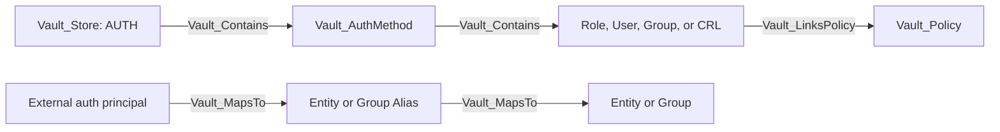

# Authentication Method Model

VaultHound models authentication methods as namespace-scoped mounts with durable child configuration objects. It does not invoke login endpoints or attempt to authenticate as collected users.

## Common Hierarchy

Every specific auth mount also has the `Vault_AuthMethod` base kind. Method-specific roles, users, and groups use `Vault_AuthRole`, `Vault_AuthUser`, or `Vault_AuthGroup` as applicable.

## Common Access Edges

Auth-specific internal CRUD relationships are exported through generic families:

| Exported edge | Typical target | Meaning |
| --- | --- | --- |
| `Vault_ListObjects` | Auth method | Enumerate roles, users, groups, or related child objects. |
| `Vault_CreateObject` | Auth method or synthetic exact target | Create a new child object. |
| `Vault_ReadObject` | Concrete role, user, group, or CRL | Read durable child configuration. |
| `Vault_ManageObject` | Concrete role, user, group, or CRL | Update or delete durable child configuration. |
| `Vault_ReadConfig` | Auth method | Read mount, tuning, or backend configuration. |
| `Vault_ManageConfig` | Auth method | Change backend configuration, tuning, root credentials, or maintenance state. |

`Object Types`, `Auth Method Types`, `Operations`, `Config Targets`, and `Role Types` retain method-specific context.

## Identity and Policy Semantics

Login endpoints are usually unauthenticated protocol surfaces, so VaultHound does not create policy-to-login edges. Instead:

1. Auth configuration objects describe who can match a role.
2. Auth-specific principals map to aliases when the collected name and mount accessor agree.
3. Aliases map to canonical entities or groups.
4. Roles, users, and groups link the policies granted by successful authentication.

`Vault_LinksPolicy` uses `Policy Link Types` to distinguish authentication grants from direct identity assignments and backend defaults.

## Method Coverage

### AppRole

Nodes: `Vault_AuthMethodApprole`, `Vault_AuthApproleRole`.

| Surface | Exported relationship | Notes |
| --- | --- | --- |
| `role` collection and role records | Generic object edges | Includes bind SecretID, CIDRs, periods, token policies, and RoleID state. |
| `role-id` | `Vault_ReadObject` | RoleID visibility is modeled separately from SecretID generation. |
| `secret-id` and custom SecretID | `Vault_AuthApproleGenerateSecretId` | Traversable only when a usable RoleID is known or independently readable. |
| SecretID accessor lookup | `Vault_AuthApproleReadSecretId` | Metadata visibility only. |
| SecretID/accessor destruction | `Vault_AuthApproleManageSecretId` | Non-traversable maintenance. |

A generated SecretID without RoleID cannot authenticate. That case becomes `Vault_PotentialAccess` rather than an attack path.

### Token

Nodes: `Vault_AuthMethodToken`, `Vault_AuthTokenRole`.

| Surface | Exported relationship | Notes |
| --- | --- | --- |
| Token roles | Generic object edges | Includes allowed/disallowed policies, orphan, renewable, path suffix, CIDRs, TTLs, and token type. |
| Lookup and accessor lookup | `Vault_AuthTokenReadToken` | Visibility into token state. |
| `create` and `create-orphan` | `Vault_AuthTokenCreateRestrictedToken` | Non-traversable when policies remain a caller subset. |
| Role-backed or sudo issuance | `Vault_AuthTokenCreatePrivilegedToken` | Traversable only for proven policy expansion or privileged alias outcome. |
| Renew and revoke | `Vault_AuthTokenManageToken` | Destructive or maintenance access, not token acquisition. |
| List accessors | `Vault_AuthTokenListAccessors` | Requires the endpoint's sudo capability. |

### UserPass

Nodes: `Vault_AuthMethodUserpass`, `Vault_AuthUserpassUser`.

User records include token policies and token settings. Password, policy, and user updates are normalized into generic object management. A password reset can derive traversable `Vault_ControlObject` because the caller can authenticate as the concrete user. User-to-alias correlation reuses `Vault_MapsTo`.

### LDAP

Nodes: `Vault_AuthMethodLdap`, `Vault_AuthLdapUser`, `Vault_AuthLdapGroup`.

VaultHound collects LDAP configuration, user mappings, group mappings, nested group settings, case-sensitivity behavior, and root credential rotation. LDAP users and groups represent Vault mappings, not a complete external directory inventory. Policy links describe the policies Vault adds when those names authenticate.

### GitHub

Nodes: `Vault_AuthMethodGithub`, `Vault_AuthGithubUser`, `Vault_AuthGithubTeam`.

The mount configuration includes organization and token settings. User and team mappings become auth principals and policy links. Teams use the generic auth-group model. External GitHub membership is not independently verified by this collector.

### Okta

Nodes: `Vault_AuthMethodOkta`, `Vault_AuthOktaUser`, `Vault_AuthOktaGroup`.

The model includes Okta organization/API configuration, local user/group policy mappings, group membership data returned by Vault, token settings, and sensitive API-token reads where Vault returns the credential.

### RADIUS

Nodes: `Vault_AuthMethodRadius`, `Vault_AuthRadiusUser`.

The mount stores server, port, shared-secret-related configuration, NAS settings, token settings, and optional user-to-policy mappings. Login ability is not represented as a policy edge because login is the unauthenticated authentication operation itself.

### Kerberos

Nodes: `Vault_AuthMethodKerberos`, `Vault_AuthKerberosGroup`.

The collector models Kerberos and LDAP configuration, SPN/keytab-related settings exposed by Vault, group policy mappings, case behavior, and group aliases generated at login. It does not ingest the Kerberos directory independently.

### TLS Certificate

Nodes: `Vault_AuthMethodTlsCert`, `Vault_AuthTlsCertRole`, `Vault_AuthTlsCertCrl`.

Certificate roles include trusted certificate material, names, DNS/email/URI constraints, organizational units, extensions, token settings, and OCSP behavior. CRL configuration is represented as a child object. Unrestricted replacement of trusted certificate material can derive `Vault_ControlObject`; constrained replacement remains potential or ordinary management.

### JWT/OIDC

Nodes: `Vault_AuthMethodJwtOidc`, `Vault_AuthJwtOidcRole`.

The mount captures JWT/OIDC discovery and verification trust, bound issuer, supported algorithms, default role, provider configuration, and claim mappings. Roles include role type, bound audiences, subjects, claims, redirect URIs, scopes, user/group claims, and token settings. Trust replacement can derive control only when attacker-controlled trust parameters are not constrained by policy.

This auth method is distinct from Vault's outbound OIDC provider model under the identity subsystem.

### Kubernetes

Nodes: `Vault_AuthMethodKubernetes`, `Vault_AuthKubernetesRole`.

The model includes Kubernetes host, CA, token-review configuration, issuer validation, service-account and namespace constraints, audiences, alias metadata, and token settings. Unrestricted replacement of token-review or Kubernetes trust can derive role control; ordinary role management remains non-traversable.

### AWS

Nodes: `Vault_AuthMethodAws`, `Vault_AuthAwsRole`.

The model covers IAM and EC2 auth modes, identity and STS endpoints, inferred account/region constraints, role bindings, principal ARNs, AMI/VPC/subnet/instance constraints, role tags, inferred entity aliases, and token settings. Role-tag creation is represented separately because the tag is a login prerequisite rather than a complete login credential.

### Azure

Nodes: `Vault_AuthMethodAzure`, `Vault_AuthAzureRole`.

Configuration includes tenant/resource/environment and identity credentials exposed by Vault. Roles capture bound subscriptions, resource groups, locations, VM/scale-set/service-principal identities, audiences, and token settings.

### GCP

Nodes: `Vault_AuthMethodGcp`, `Vault_AuthGcpRole`.

Roles distinguish IAM and GCE login modes and capture bound projects, service accounts, zones, regions, instance groups, labels, token settings, and alias metadata.

### AliCloud

Nodes: `Vault_AuthMethodAliCloud`, `Vault_AuthAliCloudRole`.

Roles capture bound RAM role and principal constraints plus token behavior. The auth method remains supported even though the AliCloud secrets engine is not a first-class collected secrets engine.

### Cloud Foundry

Nodes: `Vault_AuthMethodCf`, `Vault_AuthCfRole`.

The model captures CF API and certificate trust configuration, login signature validity, role organization/space/application constraints, certificate requirements, and token settings.

### OCI

Nodes: `Vault_AuthMethodOci`, `Vault_AuthOciRole`.

Roles capture OCI group and dynamic-group OCIDs, tenancy-related constraints, request-header validation surfaces, alias metadata, and token policies.

### SAML

Nodes: `Vault_AuthMethodSaml`, `Vault_AuthSamlRole`.

Configuration includes IdP metadata or certificate trust, entity IDs, SSO URLs, default role, assertion behavior, and token settings. Roles capture bound subjects, attributes, group attribute behavior, and policies. Default-role selection is represented by `Vault_AuthSamlDefaultRole`. Unrestricted trust replacement can derive control of observed roles.

### SCEP

Nodes: `Vault_AuthMethodScep`, `Vault_AuthScepRole`.

The model captures static-challenge or Intune authentication type, challenge and validation configuration returned by Vault, role authentication compatibility, and token policies. PKI protocol configuration references use generic `Vault_References` with reference evidence rather than a family of nearly identical PKI-to-auth edges.

### SPIFFE

Nodes: `Vault_AuthMethodSpiffe`, `Vault_AuthSpiffeRole`.

The model captures trust domain, bundle format, JWT and X.509 validation profiles, workload ID patterns, subject templates, audiences, token settings, and observed alias-to-role compatibility through `Vault_AuthSpiffeMayMatchRole`.

## Glob and Synthetic Behavior

- Exact role/user/group paths target the concrete object.
- An exact missing object can create a synthetic node for policy visibility.
- Collection globs expand read/manage rights to compatible observed children.
- Creation rights that may affect unknown future children remain anchored to the method as non-traversable or potential access.
- SecretID, privileged token, and control edges require their additional prerequisites even under broad globs.

## Limitations

- VaultHound does not validate credentials against external identity providers.
- External group membership is only as complete as Vault's returned mappings and aliases.
- Login MFA, control groups, quotas, Sentinel policies, and token wrapping can impose runtime conditions beyond static ACLs.
- A role's configuration describes who may authenticate; it does not prove that an attacker possesses the required external credential.
