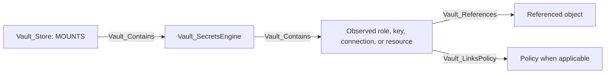

# Secrets Engine Model

VaultHound gives first-class treatment to secrets engines whose durable objects and ACL endpoint semantics are understood. Other mounts are retained as generic `Vault_SecretsEngine` nodes only.

## Common Hierarchy



Supported mount nodes carry a specific kind first and `Vault_SecretsEngine` as a base kind.

## Common Access Edges

| Exported edge | Meaning |
| --- | --- |
| `Vault_ListObjects` | Enumerate roles, keys, accounts, connections, or KV children. |
| `Vault_CreateObject` | Create an exact synthetic object or potentially create beneath a collection. |
| `Vault_ReadObject` | Read concrete durable resource configuration. |
| `Vault_ManageObject` | Update, delete, rotate, import, or otherwise administer a concrete object. |
| `Vault_ReadConfig` | Read mount or backend configuration. |
| `Vault_ManageConfig` | Change mount or backend configuration and maintenance state. |
| `Vault_GenerateCredentials` | Generate usable dynamic external credentials from an observed viable role. |
| `Vault_ReadStaticCredentials` | Read a concrete static account credential managed by Vault. |

Generic edges preserve `Engine Types`, `Object Types`, `Role Types`, `Operations`, request surfaces, credential types, and prerequisites.

## KV

Nodes: `Vault_SecretsEngineKv`, `Vault_KvDirectory`, `Vault_KvFile`, `Vault_KvPair` with the `Vault_KvObject` base kind for directories and files.

### Hierarchy

```text
KV mount -> directory -> directory/file -> pair
```

Directories are logical path prefixes rather than mutable Vault objects. Files represent secret paths. Pairs represent top-level key names only; plaintext values are never exported.

### Version Behavior

KV v1 paths are modeled directly beneath the mount. KV v2 separates API surfaces:

| Surface | Purpose | Principal edges |
| --- | --- | --- |
| `data/:path` | Secret data and versions | Read/manage secret |
| `metadata/:path` | Version/custom metadata and listing | List objects, read/manage metadata |
| `delete/:path` | Soft-delete versions | Manage secret |
| `undelete/:path` | Recover versions | Manage secret |
| `destroy/:path` | Permanently destroy versions | Manage secret |
| `subkeys/:path` | Key structure and selected-version metadata | Metadata/object read context |
| `config` | Engine CAS/version retention configuration | Read/manage config |

KV v2 mount config and key metadata contribute effective CAS requirements, max versions, and delete-after behavior. A write edge records whether CAS is required, but VaultHound does not predict the runtime version value supplied by a caller.

Exact paths target files or directories according to endpoint semantics. Globs expand to observed matching objects. Template-effective edges can originate from the referenced entity, alias, or group representation.

## PKI

Nodes: `Vault_SecretsEnginePki`, `Vault_PkiRole`, `Vault_PkiIssuer`, `Vault_PkiKey`.

The mount contains roles, issuers, and keys. An issuer references its key through `Vault_References`; it does not contain the key.

### Major Access Families

| Family | Target | Offensive interpretation |
| --- | --- | --- |
| Issue certificate | Concrete PKI role | Obtain a certificate constrained by the role. |
| Sign certificate | Concrete PKI role | Submit a CSR for signing. |
| Sign verbatim | Role or issuer | Sign with fewer role-derived constraints, according to endpoint. |
| Sign intermediate/self-issued | Concrete issuer | Exercise CA-signing authority. |
| Revoke | Mount or issuer | Destructive PKI operation, non-traversable. |
| Provision issuer/key | Mount | CA lifecycle administration, non-traversable. |
| Root/intermediate lifecycle | Mount | Administrative CA lifecycle, non-traversable. |

Globs over role or issuer selectors expand to observed objects. Traversable issuance edges are not allowed to terminate at the mount, because traversable containment would imply authority over every role, issuer, and key. Runtime-dependent mount-native outcomes become potential access.

### Issuance Protocols

Authenticated ACME, CMP, EST, and SCEP policy surfaces are folded into existing issue/sign/config families with `Issuance Protocols`, `Protocol Paths`, directory scope, role, and issuer properties. Public authority-information endpoints are not treated as policy rights.

ACME EAB creation is currently non-traversable: it returns a directory-specific registration credential, but challenge completion and protocol registration remain separate prerequisites.

## Transit

Nodes: `Vault_SecretsEngineTransit`, `Vault_TransitKey`.

Key nodes include type, version bounds, derivation, convergent encryption, exportability, plaintext backup, rotation, operation support, and managed-key references.

| Operation | Edge | Traversable |
| --- | --- | --- |
| Encrypt | `Vault_TransitEncrypt` | No |
| Decrypt | `Vault_TransitDecrypt` | Yes |
| Generate data key | `Vault_TransitGenerateDataKey` | No |
| Rewrap | `Vault_TransitRewrap` | No |
| Sign | `Vault_TransitSign` | Yes |
| Generate CMAC/HMAC | Dedicated MAC edges | Yes |
| Verify | `Vault_TransitVerify` | No |
| Export secret key | `Vault_TransitExportKey` | Yes, when compatible and exportable |
| Read public material | `Vault_ReadObject` | No |
| BYOK-wrapped export | `Vault_TransitExportByokKey` | No |

Key-type compatibility is enforced before operation edges are emitted. Context requirements for derived keys are recorded as prerequisites.

## GCP KMS

Nodes: `Vault_SecretsEngineGcpKms`, `Vault_GcpKmsKey`.

VaultHound models Vault registrations of external Google Cloud KMS keys, including resource ID, key ring, purpose, protection level, and Vault-side configuration. Encrypt/decrypt/re-encrypt/sign/verify relationships target concrete keys. Decrypt and sign become traversable only when the observed key purpose is compatible; unknown purpose produces potential access.

The collector does not independently ingest Google Cloud IAM policy.

## SSH

Nodes: `Vault_SecretsEngineSsh`, `Vault_SshRole`.

One role kind covers OTP and CA role modes; role properties identify the mode and valid operations.

| Surface | Edge | Target |
| --- | --- | --- |
| `creds/:role` | `Vault_SshGenerateOtp` | OTP role |
| `sign/:role` | `Vault_SshSignKey` | CA role |
| `issue/:role` | `Vault_SshIssueKeyPair` | CA role |
| `lookup` | `Vault_SshLookupRoles` | Mount |
| `config/ca` | Generic config edges | Mount |
| `config/zeroaddress` | Generic config edges | Mount |

The CA public key is a mount property. Public unauthenticated key retrieval is not represented as policy authority. Role globs expand security outcomes to compatible observed roles rather than terminating at the mount.

## AWS

Nodes: `Vault_SecretsEngineAws`, `Vault_AwsRole`, `Vault_AwsStaticRole`.

Dynamic roles describe IAM-user, assumed-role, federation-token, or session-token modes, policy documents/ARNs, role ARNs, groups, tags, boundaries, and MFA configuration. Static roles map managed IAM users and rotation state.

Credential generation is traversable only for a proven viable mode. A session-token-only role requiring an MFA code produces potential access unless another non-MFA credential mode is available. Static credential reads target concrete static roles.

Root and lease configuration plus root credential rotation are generic config management, not control of every role.

## Azure

Nodes: `Vault_SecretsEngineAzure`, `Vault_AzureRole`, `Vault_AzureStaticRole`.

Dynamic roles capture Azure role assignments, groups, application settings, TTL behavior, and service-principal generation. Static roles map existing applications/service principals and rotation configuration. Credential generation and static credential reads target concrete roles. Static-role import is retained as a specialized non-traversable administrative edge.

## Database

Nodes: `Vault_SecretsEngineDatabase`, `Vault_DatabaseConnection`, `Vault_DatabaseRole`, `Vault_DatabaseStaticRole`.

Connections capture plugin, URL, allowed roles, root rotation, password policy, TLS, and plugin-specific configuration. Dynamic and static roles reference connections through `Vault_DatabaseUsesConnection`.

Dynamic credential generation requires an observed compatible connection and an `allowed_roles` match. If connection collection is incomplete, the result becomes potential rather than traversable. Static credential reads do not require current dynamic connection viability in the same way.

Connection reset and plugin reload are non-traversable maintenance operations.

## GCP

Nodes: `Vault_SecretsEngineGcp`, `Vault_GcpRoleset`, `Vault_GcpStaticAccount`, `Vault_GcpImpersonatedAccount`.

Rolesets model secret type, project, bindings, token scopes, rotation, and generated credential effects. Static and impersonated accounts model OAuth token or service-account-key surfaces where supported. Generation and static reads target concrete accounts or rolesets.

## Kubernetes

Nodes: `Vault_SecretsEngineKubernetes`, `Vault_KubernetesRole`.

The mount stores Kubernetes connection and service-account configuration. Roles capture service account name, allowed namespaces, namespace selectors, token TTL, generated role/cluster-role bindings, and request parameters.

Credential generation records whether the role can affect namespaced or cluster-scoped resources. It does not independently verify live Kubernetes RBAC objects.

## LDAP

Nodes: `Vault_SecretsEngineLdap`, `Vault_LdapDynamicRole`, `Vault_LdapStaticRole`, `Vault_LdapLibrarySet`, `Vault_LdapServiceAccount`.

Dynamic roles generate ephemeral directory credentials from creation/deletion templates. Static roles expose managed account credentials and rotation. Library sets contain observed service accounts and support status, checkout, checkin, and force-checkin operations.

Traversable checkout edges target only observed available accounts. Unknown availability remains potential; checking out a library set does not imply simultaneous access to every member.

## Terraform Cloud

Nodes: `Vault_SecretsEngineTerraform`, `Vault_TerraformRole`.

The mount models Terraform Cloud address/token configuration and roles for organization, team, or user token generation. `Vault_GenerateCredentials` targets concrete roles and describes the generated Terraform API token mode.

## TOTP

Nodes: `Vault_SecretsEngineTotp`, `Vault_TotpKey`.

Key nodes include issuer, account name, period, algorithm, digits, skew, key size, and export state where returned. Code generation is traversable because it returns an immediately usable OTP; validation is not.

## Unsupported Mounts

Unsupported mounts remain generic `Vault_SecretsEngine` nodes with Vault-reported type and mount properties. VaultHound does not extrapolate child resources or generic secret-read edges for them.

## External-System Boundary

Cloud, database, LDAP, Kubernetes, and Terraform role properties describe what Vault is configured to request or return. They do not replace ingestion of those external systems. Hybrid graph edges should be added only when an external collector resolves the referenced principal or resource unambiguously.
