# Auth Store

The Auth Store represents the namespace-local authentication-method registry at `sys/auth`. It contains auth method mounts; each supported method contains its observed role, user, group, CRL, or other durable configuration objects.

VaultHound does not invoke login endpoints or assert that a collected external principal possesses valid credentials. It models the configuration that controls matching, the policies granted after authentication, and policy authority over durable auth objects.

The following matrix summarizes implemented auth methods and their current test status:

| Technology | Supported | Tested | Mount Node |
| --- | :---: | :---: | --- |
| AliCloud | :white_check_mark: | :x: | `Vault_AuthMethodAliCloud` |
| AppRole | :white_check_mark: | :white_check_mark: | `Vault_AuthMethodApprole` |
| AWS | :white_check_mark: | :x: | `Vault_AuthMethodAws` |
| Azure | :white_check_mark: | :x: | `Vault_AuthMethodAzure` |
| Cloud Foundry | :white_check_mark: | :x: | `Vault_AuthMethodCf` |
| GCP | :white_check_mark: | :x: | `Vault_AuthMethodGcp` |
| GitHub | :white_check_mark: | :x: | `Vault_AuthMethodGithub` |
| JWT/OIDC | :white_check_mark: | :x: | `Vault_AuthMethodJwtOidc` |
| Kerberos | :white_check_mark: | :x: | `Vault_AuthMethodKerberos` |
| Kubernetes | :white_check_mark: | :x: | `Vault_AuthMethodKubernetes` |
| LDAP | :white_check_mark: | :white_check_mark: | `Vault_AuthMethodLdap` |
| OCI | :white_check_mark: | :x: | `Vault_AuthMethodOci` |
| Okta | :white_check_mark: | :x: | `Vault_AuthMethodOkta` |
| RADIUS | :white_check_mark: | :x: | `Vault_AuthMethodRadius` |
| SAML | :white_check_mark: | :x: | `Vault_AuthMethodSaml` |
| SCEP | :white_check_mark: | :x: | `Vault_AuthMethodScep` |
| SPIFFE | :white_check_mark: | :x: | `Vault_AuthMethodSpiffe` |
| TLS Certificate | :white_check_mark: | :x: | `Vault_AuthMethodTlsCert` |
| Token | :white_check_mark: | :white_check_mark: | `Vault_AuthMethodToken` |
| UserPass | :white_check_mark: | :white_check_mark: | `Vault_AuthMethodUserpass` |

## Glob, Synthetic, And Control Behavior

- `auth/<mount>/role/*`-style paths expand read/manage rights to compatible observed roles.
- Exact missing role, user, or group names can create detached synthetic targets.
- Collection creation is anchored to the method with `can_create_unobserved_objects` evidence.
- SecretID, privileged token, and takeover edges require their method-specific prerequisites even under a broad glob.
- Broad `auth/*` and method-specific globs use the same endpoint-routing logic, so equivalent rights normalize to equivalent edges.

## Limitations

- VaultHound does not attempt logins or validate external credentials.
- External user/group membership is limited to Vault mappings and aliases returned by the API.
- MFA, control groups, quotas, token wrapping, and runtime token state can impose additional conditions.
- A role describes who may authenticate and which policies would be granted; it does not prove credential possession.

## Common Topology

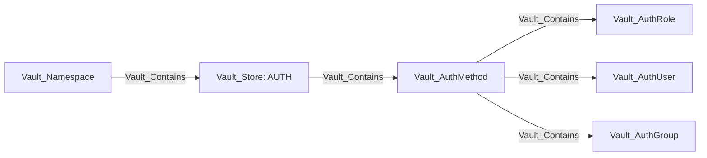

Specific mounts carry their specific kind first and `Vault_AuthMethod` second. Child records use `Vault_AuthRole`, `Vault_AuthUser`, or `Vault_AuthGroup` as a base kind where applicable. Per-method layout diagrams are structural: policy grants, identity correlation, administrative access, and security outcomes appear in the relevant tables, prose, and attack-path sections instead. Only concrete auth users and groups supported by the collector's alias-correlation logic use `Vault_MapsTo`; auth roles are login selectors rather than identity representations.

### Common Nodes

| Type | Meaning |
| --- | --- |
| `Vault_AuthMethod` | Base node for an auth method mount. |
| `Vault_AuthRole` | Base node for role-like login configuration. |
| `Vault_AuthUser` | Base node for user-like login configuration. |
| `Vault_AuthGroup` | Base node for group-like policy mapping. |

### Common Edges

| Edge | Source | Destination | Traversable | Meaning |
| --- | --- | --- | :---: | --- |
| `Vault_ReadConfig` | Policy | Auth method | :x: | Reads mount, tuning, or backend-wide authentication configuration. |
| `Vault_ManageConfig` | Policy | Auth method | :x: | Changes mount tuning, backend configuration, root credentials, or maintenance state. |
| `Vault_ListObjects` | Policy | Auth method | :x: | Lists roles, users, groups, CRLs, or another method-specific child collection. |
| `Vault_CreateObject` | Policy | Auth method or exact synthetic child | :x: | Creates a child object or records authority to create an unobserved exact target. |
| `Vault_ReadObject` | Policy | Concrete auth child | :x: | Reads durable role, user, group, CRL, or other child configuration. |
| `Vault_ManageObject` | Policy | Concrete auth child | :x: | Updates, patches, deletes, or otherwise administers a child without proving takeover. |
| `Vault_ControlObject` | Policy | Concrete auth child or trust target | :white_check_mark: | Performs a parameter-aware mutation that proves takeover of the target authentication outcome. |
| `Vault_PotentialAccess` | Policy | Unobserved or unresolved auth target | :x: | Preserves a possible authentication or takeover outcome whose prerequisites are not proven. |

### Common Properties

The tables in each method section list only stable properties beyond the common contract in [the graph model](../MODEL.md#property-contract). Vault-version-specific `alias_metadata_<key>` values are exported dynamically with humanized labels.

| Applies to | Non-common properties | Meaning |
| --- | --- | --- |
| Auth method | `Auth Method Types`, backend-specific configuration fields | Identifies the method family and the durable login/trust configuration returned by its API. |
| Auth role, user, or group | `Policies`, `Token Policies`, `Token Bound CIDRs`, `Token TTL`, `Token Max TTL`, `Token Explicit Max TTL`, `Token No Default Policy`, `Token Num Uses`, `Token Period`, `Token Type`, `Alias Metadata Keys` | Common policy, token, network, and alias behavior shared by auth children. |
| `Vault_LinksPolicy` | `Policy Link Types` | Distinguishes direct assignments, authentication grants, auth-method defaults, and unregistered-user defaults. |

Collection globs expand read and manage rights to compatible observed children. Collection-wide creation remains anchored to the auth method and is non-traversable. Exact missing children may be emitted as detached synthetic nodes.

### Common Attack Paths

Method-wide defaults are represented directly on the auth method:

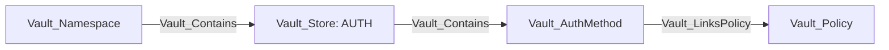

| Auth Methods | Policy Link Type | Meaning |
| --- | --- | --- |
| GitHub, LDAP, Okta, RADIUS, and Kerberos | `Auth Method Default` | Policy configured as a method-wide login default. For Kerberos, this comes from the LDAP authorization configuration. |
| RADIUS | `Unregistered User Default` | Policy granted after successful RADIUS authentication when no configured user record matches. |

These links describe the policy outcome after successful external authentication. They do not prove possession of GitHub, LDAP, Okta, RADIUS, or Kerberos credentials.

Auth configuration participates in attack paths in three ways:

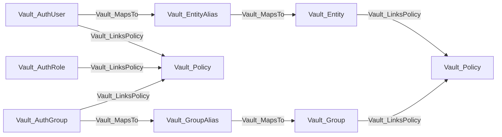

The direct branch records policies configured on the auth principal. The identity-resolution branch records additional policies reached through canonical Vault Identity. Both describe policy outcomes if the represented external authentication succeeds; the collector does not assert possession of the external credential.

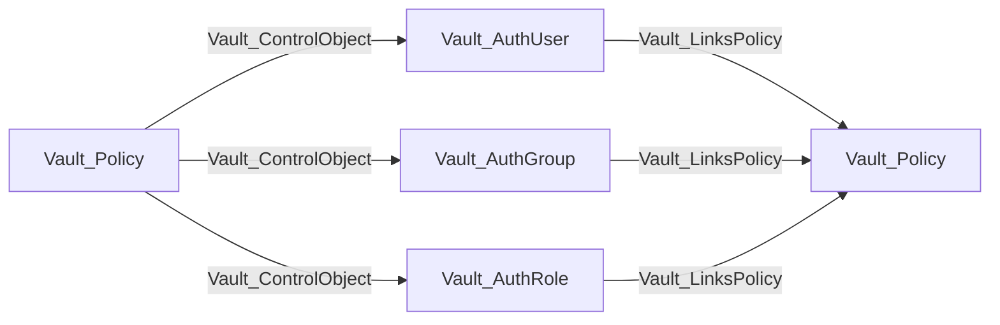

This chain is emitted only when parameter-aware mutation proves takeover of the concrete object and that object has an observed policy link. Ordinary `Vault_ManageObject` and `Vault_ManageConfig` remain non-traversable. Policy-assignment parameters remain evidence on the relevant management or control edge but do not synthesize a direct policy-to-policy relationship.

AppRole SecretID generation and privileged token issuance have their own traversable edge families because those endpoints can produce authentication material directly.

## AliCloud

AliCloud roles capture RAM role and principal constraints, token policy behavior, TTLs, CIDRs, and alias metadata. The auth method is supported even though the AliCloud secrets engine is not collected as a first-class backend.

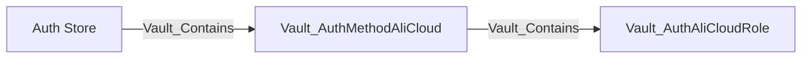

Configuration uses `Vault_ReadConfig` and `Vault_ManageConfig`; role CRUD uses generic object edges. No login edge is emitted because the login endpoint is the unauthenticated authentication surface.

### Nodes

| Node | Description |
| --- | --- |
| `Vault_AuthMethodAliCloud` | AliCloud authentication mount and backend configuration. |
| `Vault_AuthAliCloudRole` | RAM role and principal constraints used to authorize AliCloud login. |

### Edges

This authentication method does not define any specialized edges.

### Properties

| Applies to | Non-common properties | Meaning |
| --- | --- | --- |
| `Vault_AuthAliCloudRole` | `Role Name`, `ARN`, `Alias Metadata Keys` | RAM role selector and alias behavior; common token and policy fields are defined above. |

### Attack Paths

AliCloud roles link the policies granted after a successful external login, but VaultHound emits no policy-to-login attack edge. Role management and mount configuration are non-traversable unless a separate parameter-aware control derivation proves takeover.

## AppRole

AppRole roles include RoleID state, SecretID binding, CIDR restrictions, SecretID limits, token policies, TTLs, periods, and token type.

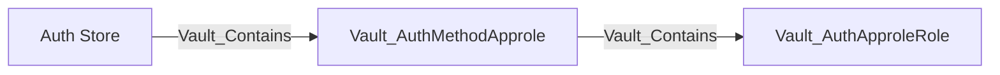

### Nodes

| Node | Description |
| --- | --- |
| `Vault_AuthMethodApprole` | AppRole authentication mount and backend configuration. |
| `Vault_AuthApproleRole` | AppRole login configuration, RoleID behavior, SecretID constraints, and granted policies. |

### Edges

| Edge | Source | Destination | Traversable | Meaning |
| --- | --- | --- | :---: | --- |
| `Vault_AuthApproleReadSecretId` | Policy | AppRole role | :x: | Reads SecretID accessor metadata. |
| `Vault_AuthApproleGenerateSecretId` | Policy | AppRole role | :white_check_mark: | Generates a SecretID when a usable RoleID is known or independently readable. |
| `Vault_AuthApproleManageSecretId` | Policy | AppRole role | :x: | Destroys SecretIDs or SecretID accessors. |

### Properties

| Applies to | Non-common properties | Meaning |
| --- | --- | --- |
| `Vault_AuthApproleRole` | `Role Name`, `Role ID`, `Bind Secret ID`, `Local Secret IDs`, `Secret ID Bound CIDRs`, `Secret ID Num Uses`, `Secret ID TTL`, `Alias Metadata Keys` | RoleID and SecretID requirements that govern whether generated material can authenticate. |
| AppRole SecretID edges | `Authorization Modes`, `Role ID Required`, `Role ID Observed`, `Role ID Obtainable`, `Role ID Access Capabilities`, `Role ID Sources`, `Secret ID Required`, `Local Secret IDs`, `Secret ID Bound CIDRs`, `Secret ID Num Uses`, `Secret ID TTL` | Records the complete login-material prerequisite state used to choose traversable generation versus potential access. |

RoleID is always required for login. SecretID generation alone is not treated as a complete credential path when RoleID is unavailable.

### Attack Paths

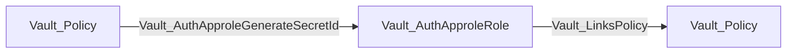

The chain is traversable only when RoleID is known or independently readable. Without RoleID, SecretID generation becomes `Vault_PotentialAccess`. SecretID accessor reads and SecretID destruction remain non-traversable.

## AWS

AWS roles cover IAM and EC2 authentication modes, principal ARNs, account/region restrictions, AMIs, VPCs, subnets, instances, role tags, inferred aliases, and token behavior.

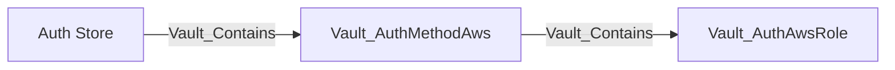

`Vault_AuthAwsCreateRoleTag` represents creation of a role tag that can satisfy a login prerequisite; it is not itself a complete AWS login credential. Method configuration records STS and IAM endpoints, client credentials where exposed, and root rotation behavior through generic config edges.

### Nodes

| Node | Description |
| --- | --- |
| `Vault_AuthMethodAws` | AWS authentication mount and IAM/STS verification configuration. |
| `Vault_AuthAwsRole` | IAM or EC2 login selector, constraints, and token-policy outcome. |

### Edges

| Edge | Source | Destination | Traversable | Meaning |
| --- | --- | --- | :---: | --- |
| `Vault_AuthAwsCreateRoleTag` | Policy | AWS role | :x: | Creates a role tag that may satisfy one AWS login prerequisite. |

### Properties

| Applies to | Non-common properties | Meaning |
| --- | --- | --- |
| `Vault_AuthMethodAws` | `Endpoint`, `EC2 Endpoint`, `IAM Endpoint`, `STS Endpoint`, `STS Region`, `Use STS Region From Client`, `IAM Server ID Header Value`, `Max Retries`, `IAM Alias`, `IAM Metadata`, `EC2 Alias`, `EC2 Metadata`, `Certificate Configured` | AWS validation endpoints, alias construction, metadata projection, and certificate state. |
| `Vault_AuthAwsRole` | `Role Name`, `Role ID`, `Auth Type`, `Inferred AWS Region`, `Inferred Entity Type`, `IAM Alias`, `EC2 Alias`, `Bound Account IDs`, `Bound AMI IDs`, `Bound EC2 Instance IDs`, `Bound IAM Principal ARNs`, `Bound IAM Role ARNs`, `Bound IAM Instance Profile ARNs`, `Bound Regions`, `Bound Subnet IDs`, `Bound VPC IDs`, `Bound Role Tag`, `Disallow Reauthentication`, `Allow Instance Migration`, `Resolve AWS Unique IDs`, `Alias Metadata Keys` | IAM/EC2 login mode, principal and infrastructure constraints, and alias behavior. |
| `Vault_AuthAwsCreateRoleTag` and AWS maintenance/config edges | `Config Surfaces`, `Surface Entry Type`, `Tidy Scope`, `Tidy Surfaces` | Identifies the AWS configuration collection, access-list/deny-list entry family, and tidy surface represented by a merged generic edge. |

### Attack Paths

AWS auth roles link policies that would be granted after successful IAM or EC2 authentication. `Vault_AuthAwsCreateRoleTag` is non-traversable because the tag is only one login prerequisite. No direct attack path is asserted without a valid AWS identity document or independently resolved identity correlation.

## Azure

Azure roles capture tenant and resource context, subscriptions, resource groups, locations, VM and scale-set identities, service principals, audiences, token settings, and alias metadata.

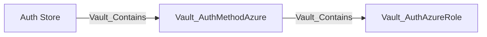

Mount-wide tenant, environment, resource, and identity credential settings use generic config edges. VaultHound does not validate Azure workload identity or live tenant state.

### Nodes

| Node | Description |
| --- | --- |
| `Vault_AuthMethodAzure` | Azure authentication mount and tenant/resource verification configuration. |
| `Vault_AuthAzureRole` | Azure identity, group, subscription, resource, and service-principal login constraints. |

### Edges

This authentication method does not define any specialized edges.

### Properties

| Applies to | Non-common properties | Meaning |
| --- | --- | --- |
| `Vault_AuthMethodAzure` | `Tenant ID`, `Resource`, `Client ID`, `Environment`, `Identity Token Audience`, `Identity Token TTL`, `Max Retries`, `Retry Delay`, `Max Retry Delay`, `Rotation Period`, `Rotation Schedule`, `Rotation Window`, `Disable Automated Rotation`, `Authentication Type`, `Login Required Fields`, `Login Optional Fields` | Azure trust context, client credential mode, retry/rotation behavior, and login request contract. |
| `Vault_AuthAzureRole` | `Role Name`, `Bound Service Principal IDs`, `Bound Group IDs`, `Bound Locations`, `Bound Subscription IDs`, `Bound Resource Groups`, `Bound Scale Sets`, `Bound Resource IDs`, `Max TTL`, `Max JWT Exp`, `Primary Binding Type`, `Binding Configuration Valid`, `Login Validation Surface`, `Login Required Fields`, `Login Required Instance Fields`, `Alias Metadata Keys` | Azure workload selectors and validation status. |

### Attack Paths

Azure roles describe login constraints and the policies granted after successful Azure authentication. They are not identity principals and do not map to entity aliases. Reading or managing the role does not prove possession of an Azure workload credential, so no policy-to-login edge is emitted.

## Cloud Foundry

Cloud Foundry roles capture API and certificate trust configuration, signature validity, organization, space, application constraints, certificate requirements, and token settings.

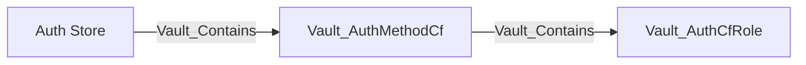

Unrestricted replacement of `identity_ca_certificates` derives `Vault_ControlObject` to each observed CF role. Value-constrained replacement emits `Vault_PotentialAccess`, while writes limited to routing, timeout, or CF API client settings remain ordinary non-traversable configuration management.

### Nodes

| Node | Description |
| --- | --- |
| `Vault_AuthMethodCf` | Cloud Foundry authentication mount and trusted platform configuration. |
| `Vault_AuthCfRole` | Organization, space, application, and certificate constraints for Cloud Foundry login. |

### Edges

This authentication method does not define any specialized edges.

### Properties

| Applies to | Non-common properties | Meaning |
| --- | --- | --- |
| `Vault_AuthMethodCf` | `CF API Address`, `CF Username`, `Identity CA Certificates Set`, `Identity CA Certificate Count`, `CF API Trusted Certificates Set`, `CF API Trusted Certificate Count`, `Login Max Seconds Not Before`, `Login Max Seconds Not After`, `CF Timeout`, `Force New Client`, `CF API Mutual TLS Certificate Configured`, `CF API Mutual TLS Key Configured` | Cloud Foundry API and instance-identity trust configuration without exporting private credential material. |
| `Vault_AuthCfRole` | `Role Name`, `Bound Application IDs`, `Bound Space IDs`, `Bound Organization IDs`, `Bound Instance IDs`, `Bound CIDRs`, `Disable IP Matching`, `Alias Metadata Keys` | Application, organization, space, instance, and network selectors. |

### Attack Paths

Cloud Foundry uses the common object-takeover-to-policy path only when configuration and parameter constraints prove that the caller can replace the instance-identity CA trust with attacker-controlled values. Role CIDRs, instance-IP matching, and token-bound CIDRs are retained as requirements on the edge. Ordinary CF configuration access remains non-traversable.

## GCP

GCP roles distinguish IAM and GCE login modes and include projects, service accounts, zones, regions, instance groups, labels, token settings, and alias metadata.

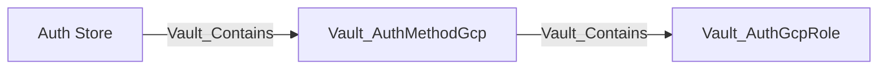

The collector models Vault's binding configuration but does not independently prove Google Cloud IAM membership or possession of a valid signed identity document.

### Nodes

| Node | Description |
| --- | --- |
| `Vault_AuthMethodGcp` | GCP authentication mount and identity-verification configuration. |
| `Vault_AuthGcpRole` | IAM or GCE login role with service-account, project, zone, and instance constraints. |

### Edges

This authentication method does not define any specialized edges.

### Properties

| Applies to | Non-common properties | Meaning |
| --- | --- | --- |
| `Vault_AuthMethodGcp` | `Client Email`, `Client ID`, `Private Key ID`, `Project ID`, `IAM Alias`, `IAM Metadata`, `GCE Alias`, `GCE Metadata`, `Service Account Email`, `Identity Token Audience`, `Identity Token TTL`, `Rotation Period`, `Rotation Schedule`, `Rotation Window`, `Disable Automated Rotation`, `Custom API Endpoint`, `Custom IAM Endpoint`, `Custom CRM Endpoint`, `Custom Compute Endpoint` | GCP credential identity, alias behavior, rotation, and custom service endpoints. |
| `Vault_AuthGcpRole` | `Role Name`, `Role Type`, `Role ID`, `Project ID`, `GCE Alias`, `IAM Alias`, `Bound Projects`, `Bound Service Accounts`, `Bound Zones`, `Bound Regions`, `Bound Instance Groups`, `Bound Labels`, `Max JWT Exp`, `Allow GCE Inference`, `Add Group Aliases`, `Login Validation Surface`, `Login Required Fields`, `Alias Metadata Keys` | IAM/GCE selectors, inference behavior, and login validation contract. |

### Attack Paths

GCP roles describe IAM or GCE login constraints and link policies available after successful authentication. They are not identity principals and do not map to entity aliases. Role management alone is not an authentication path.

## GitHub

GitHub auth stores organization configuration plus Vault-local user and team mappings. Teams use the generic auth-group base type.


User and team CRUD uses generic object edges. External organization membership is not independently queried, so mappings describe what Vault grants if GitHub authentication succeeds.

### Nodes

| Node | Description |
| --- | --- |
| `Vault_AuthMethodGithub` | GitHub authentication mount and organization configuration. |
| `Vault_AuthGithubUser` | GitHub user-to-policy mapping known to Vault. |
| `Vault_AuthGithubTeam` | GitHub team-to-policy mapping known to Vault. |

### Edges

This authentication method does not define any specialized edges.

### Properties

| Applies to | Non-common properties | Meaning |
| --- | --- | --- |
| `Vault_AuthMethodGithub` | `Organization`, `Organization ID`, `Base URL`, `Authentication Type`, `Login Requires Scope`, `Login Metadata Fields`, `TTL`, `Max TTL`, `Alias Metadata Keys` | GitHub organization boundary, API location, login requirements, and method-default token behavior. |
| `Vault_AuthGithubUser` | `Username`, `Policies` | Vault-local user-to-policy mapping. |
| `Vault_AuthGithubTeam` | `Team Name`, `Policies` | Vault-local team-to-policy mapping. |

### Attack Paths

GitHub users and teams follow the common auth-user and auth-group policy-link and identity-correlation paths. These paths expose both policies configured on the GitHub mapping and policies accumulated through canonical Vault Identity. They do not prove control of the GitHub account or membership in the external organization.

## JWT/OIDC

The JWT/OIDC auth method validates inbound JWTs or performs inbound OIDC login. It is separate from the Identity Store's outbound OIDC provider model.

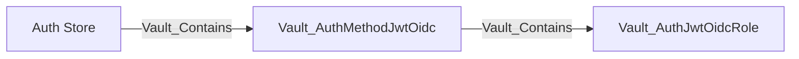

Mount properties include discovery, verification keys, bound issuer, algorithms, default role, and provider configuration. Roles include role type, audiences, subjects, bound claims, redirect URIs, scopes, claim mappings, groups, and token settings. Unrestricted trust replacement can derive `Vault_ControlObject`; parameter-constrained replacement remains ordinary or potential management.

### Nodes

| Node | Description |
| --- | --- |
| `Vault_AuthMethodJwtOidc` | JWT/OIDC authentication mount and token-verification trust configuration. |
| `Vault_AuthJwtOidcRole` | JWT or OIDC login role with claim, audience, redirect, and policy mappings. |

### Edges

This authentication method does not define any specialized edges.

### Properties

| Applies to | Non-common properties | Meaning |
| --- | --- | --- |
| `Vault_AuthMethodJwtOidc` | `OIDC Discovery URL`, `OIDC Client ID`, `OIDC Response Mode`, `OIDC Response Types`, `Namespace In State`, `JWKS URL`, `JWKS Pair Count`, `JWKS Pair URLs`, `JWT Validation Pubkeys`, `JWT Supported Algs`, `Bound Issuer`, `Default Role`, `Provider Config Keys`, `Fetch Groups`, `OIDC Client Secret Set`, `JWKS CA PEM Set`, `OIDC Discovery CA PEM Set`, `Validation Method`, `Supports Browser Flow`, `Supports Direct JWT Login` | Inbound JWT/OIDC trust roots, browser-flow configuration, and validation mode. |
| `Vault_AuthJwtOidcRole` | `Role Name`, `Role Type`, `User Claim`, `Groups Claim`, `Bound Subject`, `Bound Audiences`, `Bound Claims`, `Bound Claims Type`, `Claim Mappings`, `Allowed Redirect URIs`, `OIDC Scopes`, `User Claim JSON Pointer`, `Clock Skew Leeway`, `Expiration Leeway`, `Not Before Leeway`, `Verbose OIDC Logging`, `Max Age`, `Validation Method`, `Binding Configuration Valid`, `Login Required Fields`, `Login Optional Fields`, `Supports Browser Flow`, `Supports Direct JWT Login`, `Alias Metadata Keys` | Claim, audience, redirect, timing, and flow constraints used to decide whether a token can satisfy the role. |

### Attack Paths

JWT/OIDC uses the common object-takeover-to-policy path only when attacker-controlled issuer, discovery, verification-key, or claim values can satisfy the concrete role. Constrained trust changes produce `Vault_PotentialAccess` or ordinary management instead.

## Kerberos

Kerberos models mount-wide Kerberos/LDAP configuration and Vault group policy mappings. It does not ingest a complete Kerberos directory.

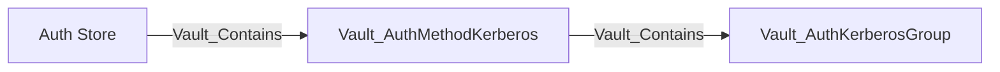

SPN, keytab, LDAP, case behavior, and token configuration use method properties and generic config edges. Group aliases model canonical Vault group resolution after authentication.

### Nodes

| Node | Description |
| --- | --- |
| `Vault_AuthMethodKerberos` | Kerberos authentication mount and SPN, keytab, and LDAP configuration. |
| `Vault_AuthKerberosGroup` | Kerberos or LDAP group-to-policy mapping known to Vault. |

### Edges

This authentication method does not define any specialized edges.

### Properties

| Applies to | Non-common properties | Meaning |
| --- | --- | --- |
| `Vault_AuthMethodKerberos` | `Kerberos Configured`, `LDAP Configured`, `Service Account`, `Add Group Aliases`, `Remove Instance Name`, `LDAP URL`, `LDAP Bind DN`, `Bind Password Set`, `LDAP User DN`, `LDAP Group DN`, `LDAP User Attribute`, `LDAP Group Attribute`, `LDAP UPN Domain`, `Case Sensitive Names`, `Discover DN`, `Anonymous Group Search`, `Deny Null Bind`, `User Filter`, `Group Filter`, `Start TLS`, `TLS Min Version`, `TLS Max Version`, `Insecure TLS`, `Certificate Set`, `Alias Metadata Keys` | Kerberos service behavior and LDAP group-resolution configuration. |
| `Vault_AuthKerberosGroup` | `Group Name`, `Policies` | Vault-local Kerberos group policy mapping. |

### Attack Paths

Kerberos groups follow the common auth-group policy-link and identity-correlation paths. Group-alias correlation is emitted only when the method is configured to add group aliases. These paths expose direct group policies and canonical Vault group policies, but do not prove Kerberos credential possession or external directory membership.

## Kubernetes

Kubernetes roles bind service accounts, namespaces, namespace selectors, audiences, alias metadata, and token settings to Vault policies.

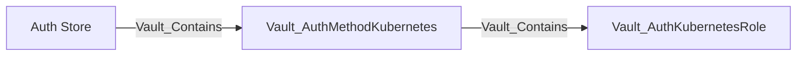

The mount records Kubernetes host, CA, token reviewer, issuer validation, and service-account behavior. Replacing unrestricted reviewer or cluster trust can derive control of compatible roles; ordinary role management remains non-traversable.

### Nodes

| Node | Description |
| --- | --- |
| `Vault_AuthMethodKubernetes` | Kubernetes authentication mount and token-review trust configuration. |
| `Vault_AuthKubernetesRole` | Service-account, namespace, audience, and token-policy login constraints. |

### Edges

This authentication method does not define any specialized edges.

### Properties

| Applies to | Non-common properties | Meaning |
| --- | --- | --- |
| `Vault_AuthMethodKubernetes` | `Kubernetes Host`, `Kubernetes CA Cert Set`, `PEM Keys Set`, `Token Reviewer JWT Set`, `Disable Local CA JWT`, `Disable ISS Validation`, `Use Annotations As Alias Metadata`, `Issuer`, `Kubernetes CA Source`, `Token Reviewer Source` | Cluster trust, issuer validation, reviewer credentials, and fallback sources. |
| `Vault_AuthKubernetesRole` | `Role Name`, `Bound Service Account Names`, `Bound Service Account Namespaces`, `Bound Service Account Namespace Selector`, `Audience`, `Alias Name Source`, `Namespace Binding Mode`, `TTL`, `Max TTL`, `Period`, `Binding Configuration Valid`, `Login Required Fields`, `Kubernetes Identity Surface`, `Alias Metadata Keys` | Service-account, namespace, audience, alias, and token constraints. |

### Attack Paths

Kubernetes uses the common object-takeover-to-policy path only when unrestricted trust or reviewer replacement makes an attacker-controlled Kubernetes token satisfy the observed role. Merely editing the role or reading cluster configuration does not create that path.

## LDAP

LDAP auth models Vault-local LDAP user and group mappings plus mount connection and bind configuration.

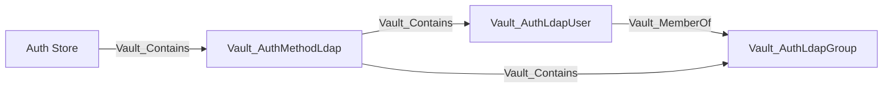

Configuration includes URLs, bind DN behavior, user/group search, nested groups, case sensitivity, certificates, token settings, and root credential rotation. The user/group nodes are mappings known to Vault, not a complete LDAP inventory.

### Nodes

| Node | Description |
| --- | --- |
| `Vault_AuthMethodLdap` | LDAP authentication mount and directory search/bind configuration. |
| `Vault_AuthLdapUser` | LDAP user-to-policy mapping known to Vault. |
| `Vault_AuthLdapGroup` | LDAP group-to-policy mapping known to Vault. |

### Edges

This authentication method does not define any specialized edges.

### Properties

| Applies to | Non-common properties | Meaning |
| --- | --- | --- |
| `Vault_AuthMethodLdap` | `LDAP URL`, `LDAP Bind DN`, `Bind Password Set`, `LDAP User DN`, `LDAP Group DN`, `LDAP User Attribute`, `LDAP Group Attribute`, `LDAP UPN Domain`, `Case Sensitive Names`, `Connection Timeout`, `Request Timeout`, `Discover DN`, `Deny Null Bind`, `Anonymous Group Search`, `User Filter`, `Group Filter`, `Username As Alias`, `Dereference Aliases`, `Max Page Size`, `Use Token Groups`, `Enable SAM Account Name Login`, `Start TLS`, `TLS Min Version`, `TLS Max Version`, `Insecure TLS`, `Certificate Set`, `Client TLS Certificate Set`, `Client TLS Key Set`, `Schema`, `Rotation URL`, `Rotation Period`, `Rotation Schedule`, `Rotation Window`, `Disable Automated Rotation`, `Alias Metadata Keys` | LDAP connection, search, TLS, alias, schema, and bind-credential rotation configuration. |
| `Vault_AuthLdapUser` | `Username`, `Policies`, `Groups` | Vault-local LDAP user policy and collected group mapping. |
| `Vault_AuthLdapGroup` | `Group Name`, `Policies` | Vault-local LDAP group policy mapping. |

### Attack Paths

LDAP users and groups follow the common auth-user and auth-group policy-link and identity-correlation paths. `Vault_MemberOf` additionally exposes policies inherited from collected LDAP group mappings. LDAP auth-group records are not correlated to Vault Group Aliases by the collector, and these paths do not assert live LDAP credentials or complete directory membership.

## OCI

OCI roles capture group and dynamic-group OCIDs, tenancy constraints, request-header validation, alias metadata, and token policies.

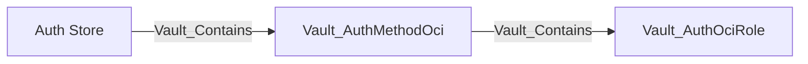

VaultHound preserves the configured OCI selectors but does not independently resolve dynamic-group membership or verify signed request credentials.

### Nodes

| Node | Description |
| --- | --- |
| `Vault_AuthMethodOci` | OCI authentication mount and signed-request verification configuration. |
| `Vault_AuthOciRole` | OCI group, dynamic-group, tenancy, and compartment login constraints. |

### Edges

This authentication method does not define any specialized edges.

### Properties

| Applies to | Non-common properties | Meaning |
| --- | --- | --- |
| `Vault_AuthMethodOci` | `Home Tenancy ID`, `Supported Login Types`, `Login Request Fields` | Tenancy context and signed-request login contract. |
| `Vault_AuthOciRole` | `Role Name`, `OCID List`, `OCI Group OCIDs`, `OCI Dynamic Group OCIDs`, `Login Validation Surface`, `Login Request Fields`, `Alias Metadata Keys` | OCI identity, group, and dynamic-group selectors. |

### Attack Paths

OCI roles participate in policy-grant and alias-resolution chains after external OCI authentication. No direct login edge is emitted because the collector cannot prove possession of a signed OCI request or group membership.

## Okta

Okta auth contains Vault-local user and group policy mappings and method-wide Okta organization/API configuration.

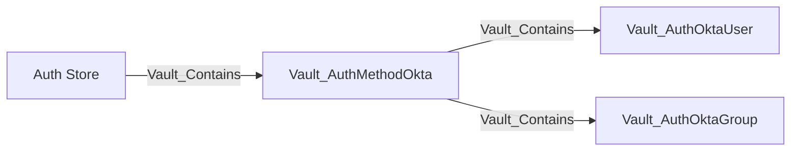

Okta's API token is a write-only configuration input and is not returned by the configuration read endpoint. Configuration and mapping reads therefore remain non-traversable and do not produce `Vault_ReadCredential`.

### Nodes

| Node | Description |
| --- | --- |
| `Vault_AuthMethodOkta` | Okta authentication mount and organization/API configuration. |
| `Vault_AuthOktaUser` | Okta user-to-policy mapping known to Vault. |
| `Vault_AuthOktaGroup` | Okta group-to-policy mapping known to Vault. |

### Edges

This authentication method does not define any specialized edges.

### Properties

| Applies to | Non-common properties | Meaning |
| --- | --- | --- |
| `Vault_AuthMethodOkta` | `Org Name`, `Base URL`, `API Token Status`, `Group Membership Source`, `Bypass Okta MFA`, `Authentication Type`, `Login Metadata Fields`, `Alias Metadata Keys` | Okta organization, API-token presence state, group source, MFA behavior, and login contract. |
| `Vault_AuthOktaUser` | `Username`, `Policies`, `Groups`, `Membership Evaluation Time` | Vault-local user grant and token-time group evaluation. |
| `Vault_AuthOktaGroup` | `Group Name`, `Policies` | Vault-local Okta group policy mapping. |

### Attack Paths

Okta users and groups follow the common auth-user and auth-group policy-link and identity-correlation paths. These paths expose policies configured on the Okta mapping and policies accumulated through canonical Vault Identity. External Okta authentication and live group membership are not independently proven. Alias correlation records matching Vault Identity aliases without claiming that Vault returned the configured Okta API token.

## RADIUS

RADIUS stores mount-wide server/NAS configuration and optional Vault-local user-to-policy mappings.

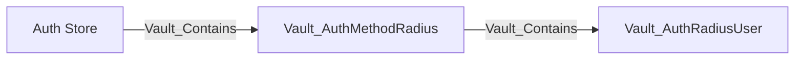

Server, port, shared-secret-related configuration, NAS settings, and token behavior use generic config edges. Login ability is not represented as an ACL edge.

### Nodes

| Node | Description |
| --- | --- |
| `Vault_AuthMethodRadius` | RADIUS authentication mount and server/NAS configuration. |
| `Vault_AuthRadiusUser` | RADIUS username-to-policy mapping known to Vault. |

### Edges

This authentication method does not define any specialized edges.

### Properties

| Applies to | Non-common properties | Meaning |
| --- | --- | --- |
| `Vault_AuthMethodRadius` | `Host`, `Port`, `Secret Set`, `NAS Port`, `NAS Identifier`, `Dictionary Path`, `Dial Timeout`, `Read Timeout`, `Retries`, `Username Template`, `Alias Metadata Keys`, `Unregistered User Policies` | RADIUS server, shared-secret presence, NAS, retry, user-template, and fallback-policy configuration. |
| `Vault_AuthRadiusUser` | `Username`, `Policies` | Vault-local RADIUS user policy mapping. |

### Attack Paths

RADIUS users follow the common auth-user policy-link and identity-correlation paths. These paths expose policies configured on the RADIUS user and policies accumulated through canonical Vault Identity. No policy-to-login path is emitted because the RADIUS password exchange is external and unauthenticated from Vault's ACL perspective.

## SAML

SAML models IdP trust at the method and attribute/subject matching at roles.

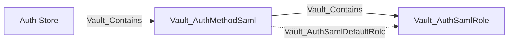

Configuration includes IdP metadata or certificate trust, entity IDs, SSO URLs, default role, and assertion behavior. Roles capture bound subjects, attributes, group attributes, and policies. Unrestricted trust replacement may derive control of observed roles.

### Nodes

| Node | Description |
| --- | --- |
| `Vault_AuthMethodSaml` | SAML authentication mount and identity-provider trust configuration. |
| `Vault_AuthSamlRole` | SAML subject, attribute, group, and policy constraints. |

### Edges

| Edge | Source | Destination | Traversable | Meaning |
| --- | --- | --- | :---: | --- |
| `Vault_AuthSamlDefaultRole` | SAML method | SAML role | :x: | Identifies the role selected when login omits an explicit role. |

### Properties

| Applies to | Non-common properties | Meaning |
| --- | --- | --- |
| `Vault_AuthMethodSaml` | `IDP Metadata URL`, `IDP SSO URL`, `IDP Entity ID`, `IDP Certificate Set`, `IDP Configuration Mode`, `Entity ID`, `ACS URLs`, `Default Role Name`, `Role Parameter Required`, `Verbose Logging`, `Validate Response Signature`, `Validate Assertion Signature`, `Signature Validation Mode`, `Supported Login Types`, `Login Flow Request Fields` | SAML IdP trust, service-provider identity, callback, default-role, and signature-validation behavior. |
| `Vault_AuthSamlRole` | `Role Name`, `Bound Subjects`, `Bound Subjects Type`, `Bound Attributes`, `Bound Attributes Type`, `Groups Attribute`, `Creates Group Aliases`, `Is Default Role`, `Alias Metadata Keys` | Subject, attribute, and group constraints used for role selection. |

### Attack Paths

SAML uses the common object-takeover-to-policy path only when unrestricted attacker-controlled IdP metadata, certificate, or assertion-routing values are compatible with the role. Routing-only writes or constrained trust replacement remain non-traversable or potential.

## SCEP

SCEP auth supports static-challenge and Intune-style authentication used by compatible PKI issuance protocol configuration.

```mermaid
flowchart LR
    store[Auth Store] -->|Vault_Contains| method[Vault_AuthMethodScep]
    method -->|Vault_Contains| role[Vault_AuthScepRole]
    pki[Vault_SecretsEnginePki] -.->|Vault_References| method
    pki -.->|Vault_References| role
```

Challenge, validation, authentication type, role compatibility, and token policy properties are collected where Vault returns them. PKI-to-auth dependencies use `Vault_References` with evidence properties instead of separate near-duplicate edge kinds.

### Nodes

| Node | Description |
| --- | --- |
| `Vault_AuthMethodScep` | SCEP authentication mount and enrollment-challenge configuration. |
| `Vault_AuthScepRole` | SCEP enrollment authentication and token-policy constraints. |

### Edges

This authentication method does not define any specialized edges.

### Properties

| Applies to | Non-common properties | Meaning |
| --- | --- | --- |
| `Vault_AuthMethodScep` | `Delegated Authentication Only`, `Supported Authentication Types`, `Login Invocation`, `Role Selection Behavior` | SCEP challenge mode and delegated-authentication behavior. |
| `Vault_AuthScepRole` | `Role Name`, `Display Name`, `Authentication Type`, `Challenge Authentication Required`, `Delegated Authentication Only`, `Alias Metadata Keys` | Static-challenge or delegated authentication requirements. |
| `Vault_References` | `Reference Types`, `Reference Evidence`, `Authenticator Type`, `Delegated Auth Accessor`, `Delegation Allowed`, `SCEP Enabled`, `Expected Authentication Type`, `Role Selections` | Identifies the PKI protocol configuration that selects this method or role and whether the selection is compatible. |

### Attack Paths

SCEP configuration and PKI references are non-traversable evidence. VaultHound does not infer enrollment or Vault policy acquisition from the reference alone; a concrete PKI issuance edge must establish the certificate outcome.

## SPIFFE

SPIFFE roles match workload identities validated by trust-domain, JWT, or X.509 profiles.

```mermaid
flowchart LR
    store[Auth Store] -->|Vault_Contains| method[Vault_AuthMethodSpiffe]
    method -->|Vault_Contains| role[Vault_AuthSpiffeRole]
    alias[Vault_EntityAlias] -.->|Vault_AuthSpiffeMayMatchRole| role
```

`Vault_AuthSpiffeMayMatchRole` records observed alias compatibility; it is non-traversable because possession of a currently valid SPIFFE credential is not proven. Trust domain, bundle, workload ID templates, audiences, and token settings are retained.

### Nodes

| Node | Description |
| --- | --- |
| `Vault_AuthMethodSpiffe` | SPIFFE authentication mount and bundle/trust-domain configuration. |
| `Vault_AuthSpiffeRole` | JWT or X.509 SVID workload selectors and token-policy constraints. |

### Edges

| Edge | Source | Destination | Traversable | Meaning |
| --- | --- | --- | :---: | --- |
| `Vault_AuthSpiffeMayMatchRole` | Entity Alias | SPIFFE role | :x: | Records selector compatibility without proving possession of a valid SPIFFE credential. |

### Properties

| Applies to | Non-common properties | Meaning |
| --- | --- | --- |
| `Vault_AuthMethodSpiffe` | `Trust Domain`, `Trust Domain Configured`, `Profile`, `Audience`, `Trust Bundle Configuration Present`, `Cached Trust Bundle Available`, `Trust Bundle Format`, `Bundle Fetch Deferred`, `Endpoint URL`, `Endpoint SPIFFE ID`, `Endpoint Root CA Truststore Configured`, `Cached Bundle Config Version`, `Cached Bundle Fetched At`, `Cached Bundle Refresh Hint`, `Cached Bundle Sequence Number`, `Configuration Version`, `Passthrough Request Headers`, `Authorization Passthrough Header Configured`, `Listener Client Certificate Support`, `JWT SVID Authentication Prerequisites Present`, `X.509 SVID Authentication Prerequisites Present`, `JWT SVID Readiness`, `X.509 SVID Readiness`, `Supported SVID Types`, `Potential SVID Types`, `Login Role Selection` | Trust-domain, bundle, endpoint, listener, profile, and SVID readiness state. |
| `Vault_AuthSpiffeRole` | `Role Name`, `Display Name`, `Workload ID Patterns`, `Has Wildcard Workload ID Patterns`, `Alias Metadata Keys`; dynamic template fields include `Template`, `Canonical Template`, `Template Format`, `Template Claims`, `Subject Template`, `Resolved Subject Template`, `Subject Scope`, `Subject Is Templated`, `Identity Template References` | Workload selectors and parsed role-template evidence. |
| `Vault_AuthSpiffeMayMatchRole` | `Workload ID`, `Matched Patterns`, `Match Types` | Explains why an observed entity alias is compatible with the role without asserting credential possession. |

### Attack Paths

SPIFFE aliases can resolve into canonical identity through `Vault_MapsTo`, but `Vault_AuthSpiffeMayMatchRole` is not an attack-path hop. It records compatibility only; a valid workload credential is an unresolved external prerequisite.

## TLS Certificate

TLS Certificate auth contains trusted certificate roles and CRL records.

```mermaid
flowchart LR
    store[Auth Store] -->|Vault_Contains| method[Vault_AuthMethodTlsCert]
    method -->|Vault_Contains| role[Vault_AuthTlsCertRole]
    method -->|Vault_Contains| crl[Vault_AuthTlsCertCrl]
```

Roles include trusted certificate material, names, DNS/email/URI constraints, organizational units, extensions, token settings, and OCSP behavior. Unrestricted replacement of trusted material can derive `Vault_ControlObject`; constrained replacement remains management or potential access.

### Nodes

| Node | Description |
| --- | --- |
| `Vault_AuthMethodTlsCert` | TLS certificate authentication mount and certificate-validation configuration. |
| `Vault_AuthTlsCertRole` | Trusted certificate role and subject, SAN, extension, or OCSP constraints. |
| `Vault_AuthTlsCertCrl` | Certificate revocation list configured for TLS certificate authentication. |

### Edges

This authentication method does not define any specialized edges.

### Properties

| Applies to | Non-common properties | Meaning |
| --- | --- | --- |
| `Vault_AuthMethodTlsCert` | `Disable Binding`, `Enable Identity Alias Metadata`, `Enable Metadata On Failures`, `OCSP Cache Size`, `Role Cache Size` | Certificate-binding, metadata, OCSP cache, and role-cache behavior. |
| `Vault_AuthTlsCertRole` | `Role Name`, `Display Name`, `Certificate Set`, `OCSP Enabled`, `OCSP CA Certificates Set`, `OCSP Servers Override`, `OCSP Fail Open`, `OCSP Query All Servers`, `OCSP This Update Max Age`, `OCSP Max Retries`, `Allowed Names`, `Required Extensions`, `Allowed Common Names`, `Allowed DNS SANs`, `Allowed Email SANs`, `Allowed URI SANs`, `Allowed Organizational Units`, `Allowed Organizations`, `Allowed Metadata Extensions`, `TTL`, `Max TTL`, `Period`, `Alias Metadata Keys` | Trusted material, certificate-name/extension matching, OCSP, and token lifetime constraints. |
| `Vault_AuthTlsCertCrl` | `CRL Name`, `Configured`, `Source Type`, `Revoked Serial Count`, `Revoked Serials`, `CRL Distribution Point URL`, `CRL Valid Until` | Collected revocation-list source and status. |

### Attack Paths

TLS Certificate auth uses the common object-takeover-to-policy path only when the caller can replace trusted certificate material or matching constraints with attacker-controlled values. CRL maintenance and constrained role changes do not automatically confer login ability.

## Token

Token auth contains token roles but does not enumerate ordinary live tokens. A root token can authenticate without any token role because the built-in token auth method validates issued tokens directly; roles are optional issuance templates.

```mermaid
flowchart LR
    store[Auth Store] -->|Vault_Contains| method[Vault_AuthMethodToken]
    method -->|Vault_Contains| role[Vault_AuthTokenRole]
```

### Nodes

| Node | Description |
| --- | --- |
| `Vault_AuthMethodToken` | Built-in token authentication and token-management endpoint family. |
| `Vault_AuthTokenRole` | Named token-creation constraints, allowed policies, aliases, TTLs, and token behavior. |

### Edges

| Edge | Source | Destination | Traversable | Meaning |
| --- | --- | --- | :---: | --- |
| `Vault_AuthTokenReadToken` | Policy | Token method or role context | :x: | Looks up token or accessor state. |
| `Vault_AuthTokenCreateRestrictedToken` | Policy | Token method or role | :x: | Creates a token constrained to the caller's policy subset. |
| `Vault_AuthTokenCreatePrivilegedToken` | Policy | Token role, Policy Store, or Entity Alias | :white_check_mark: | Creates a token with proven policy expansion through a role, sudo, or privileged alias. |
| `Vault_AuthTokenManageToken` | Policy | Token method or role context | :x: | Renews or revokes tokens. |
| `Vault_AuthTokenListAccessors` | Policy | Token method | :x: | Lists token accessors through the sudo-gated endpoint. |

### Properties

| Applies to | Non-common properties | Meaning |
| --- | --- | --- |
| `Vault_AuthTokenRole` | `Role Name`, `Allowed Policies`, `Disallowed Policies`, `Allowed Policies Glob`, `Disallowed Policies Glob`, `Allowed Entity Aliases`, `Orphan`, `Renewable`, `Path Suffix` | Policy delegation, entity-alias selection, lineage, renewal, and path behavior. |
| Token creation edges | `Authorization Modes`, `Token Lineages`, `Role Names`, `Allowed Policies`, `Allowed Policy Globs`, `Allowed Entity Aliases`, `Policy Selection Scopes`, `Restriction Bases`, `Can Expand Privileges`, plus token constraints | Explains why issuance is restricted or proves policy expansion through sudo, a role, or an entity alias. |
| Token lookup/manage edges | `Operation Requirements` and `Requirements` | Records per-operation capability and sudo requirements for lookup, renewal, revocation, and accessor operations. |

Token roles include allowed/disallowed policies, orphan behavior, renewable state, path suffix, CIDRs, TTLs, periods, explicit maximum TTL, and token type.

### Attack Paths

```mermaid
flowchart LR
    P1[Vault_Policy] -->|Vault_AuthTokenCreatePrivilegedToken| PS["Vault_Store: POLICIES"]
```

```mermaid
flowchart LR
    P1[Vault_Policy] -->|Vault_AuthTokenCreatePrivilegedToken| AR[Vault_AuthTokenRole]
    AR -->|Vault_LinksPolicy| P2[Vault_Policy]
```

```mermaid
flowchart LR
    P1[Vault_Policy] -->|Vault_AuthTokenCreatePrivilegedToken| EA[Vault_EntityAlias]
    EA -->|Vault_MapsTo| VE[Vault_Entity]
    VE -->|Vault_LinksPolicy| P2
```

The role target is used when an observed role delegates policies beyond the caller's baseline. The Policy Store target represents sudo-authorized bare `/create` or `/create-orphan` issuance with namespace-wide policy selection. The entity-alias target is used when an observed `allowed_entity_aliases` selection resolves to an entity with additional effective policies. `Vault_AuthTokenCreateRestrictedToken` remains non-traversable because it cannot normally grant more than the caller's policy subset. Token lookup, renewal, revocation, and accessor listing are also non-traversable.

## UserPass

UserPass stores local username records with password state, token policies, TTLs, periods, CIDRs, and token type.

```mermaid
flowchart LR
    store[Auth Store] -->|Vault_Contains| method[Vault_AuthMethodUserpass]
    method -->|Vault_Contains| user[Vault_AuthUserpassUser]
```

Password, policy, and token-setting updates are generic object management. An unrestricted password reset derives traversable `Vault_ControlObject` because it allows authentication as the concrete user.

### Nodes

| Node | Description |
| --- | --- |
| `Vault_AuthMethodUserpass` | UserPass authentication mount and backend configuration. |
| `Vault_AuthUserpassUser` | Local username, password state, token settings, and policy grants. |

### Edges

This authentication method does not define any specialized edges.

### Properties

| Applies to | Non-common properties | Meaning |
| --- | --- | --- |
| `Vault_AuthUserpassUser` | `Username`, `Alias Metadata Keys` plus common token and policy fields | Local username and token behavior; password material is never collected. |
| `Vault_ControlObject` | `Control Methods`, `Control Parameters`, `Impacts`, and policy-assignment context | Identifies an unrestricted attacker-controlled password reset and the policies reachable through the user. |

### Attack Paths

UserPass uses the common object-takeover-to-policy and auth-user identity-correlation paths when a policy can set an attacker-controlled password for the concrete user. Traversal can reach policies already configured on the UserPass user directly and additional policies through the user's observed identity mapping. Possible assignment of other policies remains edge evidence rather than a synthetic shortcut.

