# Auth Store

The Auth Store represents the namespace-local authentication-method registry at `sys/auth`. It contains auth method mounts; each supported method contains its observed role, user, group, CRL, or other durable configuration objects.

VaultHound does not invoke login endpoints or assert that a collected external principal possesses valid credentials. It models the configuration that controls matching, the policies granted after authentication, and policy authority over durable auth objects.

The following matrix summarizes implemented auth methods and their current test status:

| Technology | Supported | Tested | Mount Node |
| --- | :---: | :---: | --- |
| AliCloud | :white_check_mark: | :x: | `Vault_AuthMethodAliCloud` |
| AppRole | :white_check_mark: | :x: | `Vault_AuthMethodApprole` |
| AWS | :white_check_mark: | :x: | `Vault_AuthMethodAws` |
| Azure | :white_check_mark: | :x: | `Vault_AuthMethodAzure` |
| Cloud Foundry | :white_check_mark: | :x: | `Vault_AuthMethodCf` |
| GCP | :white_check_mark: | :x: | `Vault_AuthMethodGcp` |
| GitHub | :white_check_mark: | :x: | `Vault_AuthMethodGithub` |
| JWT/OIDC | :white_check_mark: | :x: | `Vault_AuthMethodJwtOidc` |
| Kerberos | :white_check_mark: | :x: | `Vault_AuthMethodKerberos` |
| Kubernetes | :white_check_mark: | :x: | `Vault_AuthMethodKubernetes` |
| LDAP | :white_check_mark: | :x: | `Vault_AuthMethodLdap` |
| OCI | :white_check_mark: | :x: | `Vault_AuthMethodOci` |
| Okta | :white_check_mark: | :x: | `Vault_AuthMethodOkta` |
| RADIUS | :white_check_mark: | :x: | `Vault_AuthMethodRadius` |
| SAML | :white_check_mark: | :x: | `Vault_AuthMethodSaml` |
| SCEP | :white_check_mark: | :x: | `Vault_AuthMethodScep` |
| SPIFFE | :white_check_mark: | :x: | `Vault_AuthMethodSpiffe` |
| TLS Certificate | :white_check_mark: | :x: | `Vault_AuthMethodTlsCert` |
| Token | :white_check_mark: | :x: | `Vault_AuthMethodToken` |
| UserPass | :white_check_mark: | :x: | `Vault_AuthMethodUserpass` |

## Glob, Synthetic, And Control Behavior

- `auth/<mount>/role/*`-style paths expand read/manage rights to compatible observed roles.
- Exact missing role, user, or group names can create detached synthetic targets.
- Collection creation is anchored to the method with `can_create_unobserved_objects` evidence.
- SecretID, privileged token, and takeover edges require their method-specific prerequisites even under a broad glob.
- Broad `auth/*` and method-specific globs use the same endpoint-routing logic, so equivalent rights normalize to equivalent edges.

## Limitations

- VaultHound does not attempt logins or validate external credentials.
- External user/group membership is limited to Vault mappings and aliases returned by the API.
- MFA, control groups, quotas, token wrapping, and runtime token state can impose additional conditions.
- A role describes who may authenticate and which policies would be granted; it does not prove credential possession.

## Store Topology

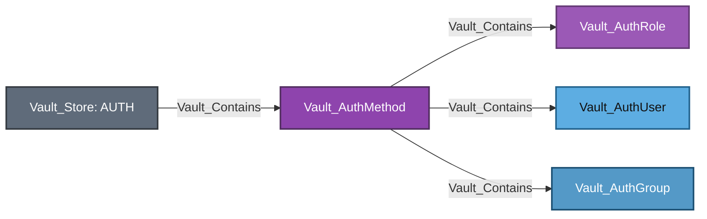

Equivalent Cypher query:

```cypher
MATCH p = (:Vault_Namespace)-[:Vault_Contains]->(store:Vault_Store)-[:Vault_Contains*1..]->(n)
WHERE store.`Store Type` = "Authentication"
RETURN p
```

Specific mounts carry their specific kind first and `Vault_AuthMethod` second. Child records use `Vault_AuthRole`, `Vault_AuthUser`, or `Vault_AuthGroup` as a base kind where applicable. Per-method layout diagrams are structural: policy grants, identity correlation, administrative access, and security outcomes appear in the relevant tables, prose, and attack-path sections instead. Only concrete auth users and groups supported by the collector's alias-correlation logic use `Vault_MapsTo`; auth roles are login selectors rather than identity representations.

### Common Nodes

| Type | Meaning |
| --- | --- |
| `Vault_AuthMethod` | Base node for an auth method mount. |
| `Vault_AuthRole` | Base node for role-like login configuration. |
| `Vault_AuthUser` | Base node for user-like login configuration. |
| `Vault_AuthGroup` | Base node for group-like policy mapping. |

### Common Edges

In every edge table in this guide, `Policy` or `Vault_Policy` denotes [policy authority](../MODEL.md#declared-and-derived-authority): normally the declaring policy node, or the referenced entity, alias, or group when an Identity template produces an effective rendered edge.

| Edge | Source | Destination | Traversable | Meaning |
| --- | --- | --- | :---: | --- |
| `Vault_ReadConfig` | `Vault_Policy` | `Vault_AuthMethod` | :x: | Reads mount, tuning, or backend-wide authentication configuration. |
| `Vault_ManageConfig` | `Vault_Policy` | `Vault_AuthMethod` | :x: | Changes mount tuning, backend configuration, root credentials, or maintenance state. |
| `Vault_ListObjects` | `Vault_Policy` | `Vault_AuthMethod` | :x: | Lists roles, users, groups, CRLs, or another method-specific child collection. |
| `Vault_CreateObject` | `Vault_Policy` | `Vault_AuthMethod` or exact synthetic child | :x: | Creates a child object or records authority to create an unobserved exact target. |
| `Vault_ReadObject` | `Vault_Policy` | Concrete auth child | :x: | Reads durable role, user, group, CRL, or other child configuration. |
| `Vault_ManageObject` | `Vault_Policy` | Concrete auth child | :x: | Updates, patches, deletes, or otherwise administers a child without proving takeover. |
| `Vault_ControlObject` | `Vault_Policy` | Concrete auth child or trust target | :white_check_mark: | Performs a parameter-aware mutation that proves takeover of the target authentication outcome. |
| `Vault_PotentialAccess` | `Vault_Policy` | Unobserved or unresolved auth target | :x: | Preserves a possible authentication or takeover outcome whose prerequisites are not proven. |
| `Vault_OnAuthMethod` | `Vault_EntityAlias` or `Vault_GroupAlias` | `Vault_AuthMethod` | :x: | Identifies the auth method mount on which the Identity alias exists. |

### Common Properties

The tables in each method section list only stable properties beyond the common contract in [the graph model](../MODEL.md#property-contract). Vault-version-specific `alias_metadata_<key>` values are exported dynamically with humanized labels.

| Node/Edge Type | Property | Description |
| --- | --- | --- |
| Aggregated auth configuration and object-operation edges | `Auth Method Types` | Lists the authentication backend families represented when method-specific operations are merged into a common edge. Auth method mount nodes use the common `Type` property instead. |
| `Vault_AuthRole` | `Policies` | Lists policies granted by concrete login-role kinds. `Vault_AuthTokenRole` instead constrains delegation through its allowed and disallowed policy properties. |
| `Vault_AuthRole` | `Token Policies` | Lists policies encoded into tokens issued through concrete login-role kinds. This property is not emitted for `Vault_AuthTokenRole`. |
| `Vault_AuthUserpassUser` | `Token Policies` | Lists policies encoded into tokens issued after successful UserPass authentication. Other `Vault_AuthUser` kinds expose backend mapping policies in their method-specific property tables. |
| `Vault_AuthRole`<br>`Vault_AuthUserpassUser` | `Token Bound CIDRs` | Limits use of issued tokens to the listed client network ranges. |
| `Vault_AuthRole`<br>`Vault_AuthUserpassUser` | `Token TTL` | Records the initial lifetime requested for issued tokens. This property is not emitted for `Vault_AuthTokenRole`. |
| `Vault_AuthRole`<br>`Vault_AuthUserpassUser` | `Token Max TTL` | Records the maximum lifetime permitted for issued tokens. This property is not emitted for `Vault_AuthTokenRole`. |
| `Vault_AuthRole`<br>`Vault_AuthUserpassUser` | `Token Explicit Max TTL` | Records the explicit hard lifetime cap applied to issued tokens. |
| `Vault_AuthRole`<br>`Vault_AuthUserpassUser` | `Token No Default Policy` | Indicates whether Vault omits the built-in `default` policy from issued tokens. |
| `Vault_AuthRole`<br>`Vault_AuthUserpassUser` | `Token Num Uses` | Records the maximum number of uses allowed for an issued token. |
| `Vault_AuthRole`<br>`Vault_AuthUserpassUser` | `Token Period` | Records the renewal period for periodic tokens. |
| `Vault_AuthRole`<br>`Vault_AuthUserpassUser` | `Token Type` | Identifies the type of token issued by the authentication object. |

Collection globs expand read and manage rights to compatible observed children. Collection-wide creation remains anchored to the auth method and is non-traversable. Exact missing children may be emitted as detached synthetic nodes.

### Common Attack Paths

Method-wide defaults are represented directly on the auth method:


Equivalent Cypher query:

```cypher
MATCH p = (:Vault_Store)-[:Vault_Contains]->(:Vault_AuthMethod)-[:Vault_LinksPolicy]->(:Vault_Policy)
RETURN p
```

| Auth Methods | Policy Link Type | Meaning |
| --- | --- | --- |
| GitHub, LDAP, Okta, RADIUS, and Kerberos | `Auth Method Default` | Policy configured as a method-wide login default. For Kerberos, this comes from the LDAP authorization configuration. |
| RADIUS | `Unregistered User Default` | Policy granted after successful RADIUS authentication when no configured user record matches. |

These links describe the policy outcome after successful external authentication. They do not prove possession of GitHub, LDAP, Okta, RADIUS, or Kerberos credentials.

Auth configuration enters policy and Identity paths in three ways:

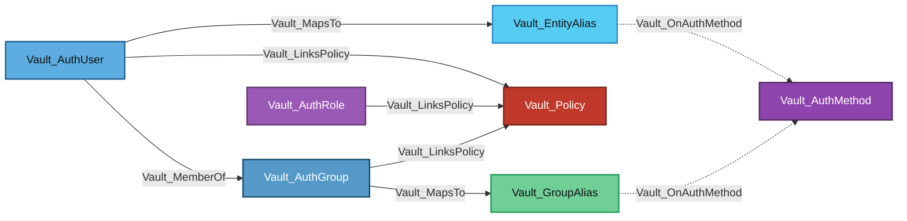

Equivalent Cypher query:

```cypher
MATCH p = (s)-[:Vault_MemberOf|Vault_MapsTo|Vault_OnAuthMethod|Vault_LinksPolicy]->(d)
WHERE (s:Vault_AuthUser OR s:Vault_AuthGroup OR s:Vault_AuthRole OR s:Vault_EntityAlias OR s:Vault_GroupAlias)
  AND (d:Vault_AuthMethod OR d:Vault_AuthGroup OR d:Vault_EntityAlias OR d:Vault_GroupAlias OR d:Vault_Policy)
RETURN p
```

The `Vault_LinksPolicy` branches record policies configured directly on auth roles, users, and groups. `Vault_MemberOf` records auth-backend group membership. For correlatable auth users and groups, `Vault_MapsTo` stops at the corresponding `Vault_EntityAlias` or `Vault_GroupAlias`, while `Vault_OnAuthMethod` identifies the auth mount that owns that alias. Canonical alias resolution, Identity group membership, and Identity policy propagation are documented under [Identity Administration](IDENTITY.md#identity-administration). These relationships describe outcomes after successful external authentication; the collector does not assert possession of the external credential.

The canonical definition of `Vault_LinksPolicy.Policy Link Types`, including auth-object and backend-default values, lives under [Policy Assignment](POLICIES.md#policy-assignment).

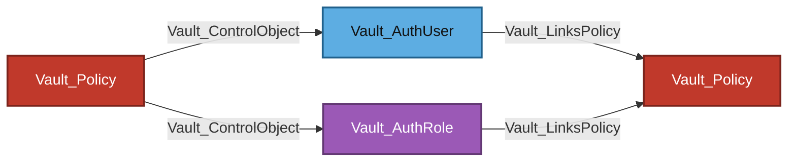

Equivalent Cypher query:

```cypher
MATCH p = (authority)-[:Vault_ControlObject]->(x)-[:Vault_LinksPolicy]->(:Vault_Policy)
WHERE (authority:Vault_Policy
    OR authority:Vault_Entity
    OR authority:Vault_EntityAlias
    OR authority:Vault_Group)
  AND (x:Vault_AuthUser OR x:Vault_AuthRole)
RETURN p
```

This chain is emitted only when parameter-aware mutation proves takeover of the concrete object and that object has an observed policy link. Ordinary `Vault_ManageObject` and `Vault_ManageConfig` remain non-traversable. Policy-assignment parameters remain evidence on the relevant management or control edge but do not synthesize a direct policy-to-policy relationship.

AppRole SecretID generation and privileged token issuance have their own traversable edge families because those endpoints can produce authentication material directly.

## AliCloud

AliCloud roles capture RAM role and principal constraints, token policy behavior, TTLs, CIDRs, and alias metadata. The auth method is supported even though the AliCloud secrets engine is not collected as a first-class backend.


Equivalent Cypher query:

```cypher
MATCH mount = (:Vault_Store)-[:Vault_Contains]->(method:Vault_AuthMethodAliCloud)
OPTIONAL MATCH roles = (method)-[:Vault_Contains]->(:Vault_AuthAliCloudRole)
RETURN mount, roles
```

Configuration uses `Vault_ReadConfig` and `Vault_ManageConfig`; role CRUD uses generic object edges. No login edge is emitted because the login endpoint is the unauthenticated authentication surface.

### Nodes

| Node | Description |
| --- | --- |
| `Vault_AuthMethodAliCloud` | AliCloud authentication mount and backend configuration. |
| `Vault_AuthAliCloudRole` | RAM role and principal constraints used to authorize AliCloud login. |

### Specialized Edges

This authentication method does not define any specialized edges.

### Properties

| Node/Edge Type | Property | Description |
| --- | --- | --- |
| `Vault_AuthAliCloudRole` | `Role Name` | Names the Vault role used for AliCloud login. |
| `Vault_AuthAliCloudRole` | `ARN` | Identifies the RAM role or principal ARN accepted by the role. |
| `Vault_AuthAliCloudRole` | `Alias Metadata Keys` | Lists AliCloud values copied into Identity alias metadata. |

### Attack Paths

AliCloud roles link the policies granted after a successful external login, but VaultHound emits no policy-to-login attack edge. Role management and mount configuration are non-traversable unless a separate parameter-aware control derivation proves takeover.

## AppRole

AppRole roles include RoleID state, SecretID binding, CIDR restrictions, SecretID limits, token policies, TTLs, periods, and token type.


Equivalent Cypher query:

```cypher
MATCH mount = (:Vault_Store)-[:Vault_Contains]->(method:Vault_AuthMethodApprole)
OPTIONAL MATCH roles = (method)-[:Vault_Contains]->(:Vault_AuthApproleRole)
RETURN mount, roles
```

### Nodes

| Node | Description |
| --- | --- |
| `Vault_AuthMethodApprole` | AppRole authentication mount and backend configuration. |
| `Vault_AuthApproleRole` | AppRole login configuration, RoleID behavior, SecretID constraints, and granted policies. |

### Specialized Edges

| Edge | Source | Destination | Traversable | Meaning |
| --- | --- | --- | :---: | --- |
| `Vault_AuthApproleReadSecretId` | Policy | AppRole role | :x: | Reads SecretID accessor metadata. |
| `Vault_AuthApproleGenerateSecretId` | Policy | AppRole role | :white_check_mark: | Generates a SecretID when a usable RoleID is known or independently readable. |
| `Vault_AuthApproleManageSecretId` | Policy | AppRole role | :x: | Destroys SecretIDs or SecretID accessors. |

### Properties

| Node/Edge Type | Property | Description |
| --- | --- | --- |
| `Vault_AuthApproleRole` | `Role Name` | Names the AppRole login role. |
| `Vault_AuthApproleRole` | `Role ID` | Records the non-secret RoleID required to identify the role during login. |
| `Vault_AuthApproleRole` | `Bind Secret ID` | Indicates whether login also requires a valid SecretID. |
| `Vault_AuthApproleRole` | `Local Secret IDs` | Indicates whether generated SecretIDs are local to the performance replication cluster. |
| `Vault_AuthApproleRole` | `Secret ID Bound CIDRs` | Lists network ranges from which generated SecretIDs may be used. |
| `Vault_AuthApproleRole` | `Secret ID Num Uses` | Records the maximum uses permitted for each generated SecretID. |
| `Vault_AuthApproleRole` | `Secret ID TTL` | Records how long generated SecretIDs remain valid. |
| `Vault_AuthApproleRole` | `Alias Metadata Keys` | Lists AppRole fields copied into Identity alias metadata. |
| `Vault_AuthApproleGenerateSecretId` | `Authorization Modes` | Lists the AppRole login-material modes authorized by the matched policy paths. |
| `Vault_AuthApproleGenerateSecretId` | `Role ID Required` | Indicates whether a RoleID is required to use generated authentication material. |
| `Vault_AuthApproleGenerateSecretId` | `Role ID Observed` | Indicates whether collection retrieved the role's current RoleID. |
| `Vault_AuthApproleGenerateSecretId` | `Role ID Obtainable` | Indicates whether the source can independently read the RoleID. |
| `Vault_AuthApproleGenerateSecretId` | `Role ID Access Capabilities` | Lists the capabilities proving access to the RoleID endpoint. |
| `Vault_AuthApproleGenerateSecretId` | `Role ID Sources` | Identifies the observed or policy-derived sources of RoleID availability. |
| `Vault_AuthApproleGenerateSecretId` | `Secret ID Required` | Indicates whether a generated SecretID is required for login. |
| `Vault_AuthApproleGenerateSecretId` | `Local Secret IDs` | Records whether the affected role issues replication-local SecretIDs. |
| `Vault_AuthApproleGenerateSecretId` | `Secret ID Bound CIDRs` | Carries the network restrictions applied to generated SecretIDs. |
| `Vault_AuthApproleGenerateSecretId` | `Secret ID Num Uses` | Carries the use limit applied to generated SecretIDs. |
| `Vault_AuthApproleGenerateSecretId` | `Secret ID TTL` | Carries the validity period applied to generated SecretIDs. |

RoleID is always required for login. SecretID generation alone is not treated as a complete credential path when RoleID is unavailable.

### Attack Paths


Equivalent Cypher query:

```cypher
MATCH p = (n)-[:Vault_AuthApproleGenerateSecretId]->(:Vault_AuthApproleRole)-[:Vault_LinksPolicy]->(:Vault_Policy)
RETURN p
```

The chain is traversable only when RoleID is known or independently readable. Without RoleID, SecretID generation becomes `Vault_PotentialAccess`. SecretID accessor reads and SecretID destruction remain non-traversable.

## AWS

AWS roles cover IAM and EC2 authentication modes, principal ARNs, account/region restrictions, AMIs, VPCs, subnets, instances, role tags, inferred aliases, and token behavior.


Equivalent Cypher query:

```cypher
MATCH mount = (:Vault_Store)-[:Vault_Contains]->(method:Vault_AuthMethodAws)
OPTIONAL MATCH roles = (method)-[:Vault_Contains]->(:Vault_AuthAwsRole)
RETURN mount, roles
```

`Vault_AuthAwsCreateRoleTag` represents creation of a role tag that can satisfy a login prerequisite; it is not itself a complete AWS login credential. Method configuration records STS and IAM endpoints, client credentials where exposed, and root rotation behavior through generic config edges.

### Nodes

| Node | Description |
| --- | --- |
| `Vault_AuthMethodAws` | AWS authentication mount and IAM/STS verification configuration. |
| `Vault_AuthAwsRole` | IAM or EC2 login selector, constraints, and token-policy outcome. |

### Specialized Edges

| Edge | Source | Destination | Traversable | Meaning |
| --- | --- | --- | :---: | --- |
| `Vault_AuthAwsCreateRoleTag` | Policy | AWS role | :x: | Creates a role tag that may satisfy one AWS login prerequisite. |

### Properties

| Node/Edge Type | Property | Description |
| --- | --- | --- |
| `Vault_AuthMethodAws` | `Endpoint` | Records the general AWS API endpoint override used by the auth backend. |
| `Vault_AuthMethodAws` | `EC2 Endpoint` | Records the EC2 API endpoint used for instance validation. |
| `Vault_AuthMethodAws` | `IAM Endpoint` | Records the IAM API endpoint used for principal validation. |
| `Vault_AuthMethodAws` | `STS Endpoint` | Records the STS API endpoint used for signed-request validation. |
| `Vault_AuthMethodAws` | `STS Region` | Identifies the region used for STS requests. |
| `Vault_AuthMethodAws` | `Use STS Region From Client` | Indicates whether Vault accepts the STS region supplied by the login client. |
| `Vault_AuthMethodAws` | `IAM Server ID Header Value` | Records the required value of the IAM server-ID protection header. |
| `Vault_AuthMethodAws` | `Max Retries` | Records the maximum number of retries for AWS API operations. |
| `Vault_AuthMethodAws` | `IAM Alias` | Identifies the IAM value used to construct Identity aliases. |
| `Vault_AuthMethodAws` | `IAM Metadata` | Lists IAM fields projected into alias metadata. |
| `Vault_AuthMethodAws` | `EC2 Alias` | Identifies the EC2 value used to construct Identity aliases. |
| `Vault_AuthMethodAws` | `EC2 Metadata` | Lists EC2 fields projected into alias metadata. |
| `Vault_AuthMethodAws` | `Certificate Configured` | Indicates whether a certificate is configured for EC2 identity-document validation. |
| `Vault_AuthAwsRole` | `Role Name` | Names the AWS authentication role. |
| `Vault_AuthAwsRole` | `Role ID` | Records Vault's stable identifier for the AWS role. |
| `Vault_AuthAwsRole` | `Auth Type` | Identifies whether the role accepts IAM, EC2, or both login modes. |
| `Vault_AuthAwsRole` | `Inferred AWS Region` | Records the AWS region inferred for identity alias construction. |
| `Vault_AuthAwsRole` | `Inferred Entity Type` | Identifies the AWS resource type from which an entity alias is inferred. |
| `Vault_AuthAwsRole` | `IAM Alias` | Identifies the IAM attribute used as the alias name for this role. |
| `Vault_AuthAwsRole` | `EC2 Alias` | Identifies the EC2 attribute used as the alias name for this role. |
| `Vault_AuthAwsRole` | `Bound Account IDs` | Lists AWS accounts permitted to authenticate through the role. |
| `Vault_AuthAwsRole` | `Bound AMI IDs` | Lists AMI IDs permitted for EC2 authentication. |
| `Vault_AuthAwsRole` | `Bound EC2 Instance IDs` | Lists EC2 instance IDs permitted for authentication. |
| `Vault_AuthAwsRole` | `Bound IAM Principal ARNs` | Lists IAM principal ARNs permitted for authentication. |
| `Vault_AuthAwsRole` | `Bound IAM Role ARNs` | Lists IAM role ARNs permitted for authentication. |
| `Vault_AuthAwsRole` | `Bound IAM Instance Profile ARNs` | Lists instance-profile ARNs permitted for EC2 authentication. |
| `Vault_AuthAwsRole` | `Bound Regions` | Lists AWS regions permitted for authentication. |
| `Vault_AuthAwsRole` | `Bound Subnet IDs` | Lists subnets permitted for EC2 authentication. |
| `Vault_AuthAwsRole` | `Bound VPC IDs` | Lists VPCs permitted for EC2 authentication. |
| `Vault_AuthAwsRole` | `Bound Role Tag` | Records the role tag value required for EC2 authentication. |
| `Vault_AuthAwsRole` | `Disallow Reauthentication` | Indicates whether an EC2 instance may authenticate more than once. |
| `Vault_AuthAwsRole` | `Allow Instance Migration` | Indicates whether a previously authenticated EC2 instance may migrate and authenticate again. |
| `Vault_AuthAwsRole` | `Resolve AWS Unique IDs` | Indicates whether Vault resolves configured IAM ARNs to immutable AWS unique IDs. |
| `Vault_AuthAwsRole` | `Alias Metadata Keys` | Lists AWS fields copied into Identity alias metadata. |
| `Vault_ReadConfig`<br>`Vault_ManageConfig` | `Config Surfaces` | Lists the AWS auth configuration collections covered by the edge. |
| `Vault_ReadConfig`<br>`Vault_ManageConfig` | `Surface Entry Type` | Identifies the access-list or role-tag deny-list entry family affected by the edge. |
| `Vault_ManageConfig` | `Tidy Scope` | Identifies whether the policy can configure or run an AWS auth tidy operation. |
| `Vault_ManageConfig` | `Tidy Surfaces` | Lists the AWS auth tidy endpoints represented by the edge. |

### Attack Paths

AWS auth roles link policies that would be granted after successful IAM or EC2 authentication. `Vault_AuthAwsCreateRoleTag` is non-traversable because the tag is only one login prerequisite. No direct attack path is asserted without a valid AWS identity document or independently resolved identity correlation.

## Azure

Azure roles capture tenant and resource context, subscriptions, resource groups, locations, VM and scale-set identities, service principals, audiences, token settings, and alias metadata.

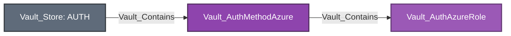

Equivalent Cypher query:

```cypher
MATCH mount = (:Vault_Store)-[:Vault_Contains]->(method:Vault_AuthMethodAzure)
OPTIONAL MATCH roles = (method)-[:Vault_Contains]->(:Vault_AuthAzureRole)
RETURN mount, roles
```

Mount-wide tenant, environment, resource, and identity credential settings use generic config edges. VaultHound does not validate Azure workload identity or live tenant state.

### Nodes

| Node | Description |
| --- | --- |
| `Vault_AuthMethodAzure` | Azure authentication mount and tenant/resource verification configuration. |
| `Vault_AuthAzureRole` | Azure identity, group, subscription, resource, and service-principal login constraints. |

### Specialized Edges

This authentication method does not define any specialized edges.

### Properties

| Node/Edge Type | Property | Description |
| --- | --- | --- |
| `Vault_AuthMethodAzure` | `Tenant ID` | Identifies the Microsoft Entra tenant trusted by the auth mount. |
| `Vault_AuthMethodAzure` | `Resource` | Identifies the Azure resource audience expected in login tokens. |
| `Vault_AuthMethodAzure` | `Client ID` | Identifies the Azure application used by Vault for API access. |
| `Vault_AuthMethodAzure` | `Environment` | Records the Azure cloud environment used by the backend. |
| `Vault_AuthMethodAzure` | `Identity Token Audience` | Records the audience requested for Vault workload identity tokens. |
| `Vault_AuthMethodAzure` | `Identity Token TTL` | Records the lifetime requested for Vault workload identity tokens. |
| `Vault_AuthMethodAzure` | `Max Retries` | Records the maximum number of Azure API retries. |
| `Vault_AuthMethodAzure` | `Retry Delay` | Records the initial delay between Azure API retries. |
| `Vault_AuthMethodAzure` | `Max Retry Delay` | Records the maximum delay permitted between Azure API retries. |
| `Vault_AuthMethodAzure` | `Rotation Period` | Records the interval for automatic client-credential rotation. |
| `Vault_AuthMethodAzure` | `Rotation Schedule` | Records the schedule used for client-credential rotation. |
| `Vault_AuthMethodAzure` | `Rotation Window` | Records the permitted window for scheduled rotation. |
| `Vault_AuthMethodAzure` | `Disable Automated Rotation` | Indicates whether automatic client-credential rotation is disabled. |
| `Vault_AuthMethodAzure` | `Authentication Type` | Identifies the credential mechanism Vault uses to call Azure. |
| `Vault_AuthMethodAzure` | `Login Required Fields` | Lists fields required in an Azure login request. |
| `Vault_AuthMethodAzure` | `Login Optional Fields` | Lists fields accepted but not required in an Azure login request. |
| `Vault_AuthAzureRole` | `Role Name` | Names the Azure authentication role. |
| `Vault_AuthAzureRole` | `Bound Service Principal IDs` | Lists service-principal object IDs permitted to authenticate. |
| `Vault_AuthAzureRole` | `Bound Group IDs` | Lists Microsoft Entra group IDs permitted to authenticate. |
| `Vault_AuthAzureRole` | `Bound Locations` | Lists Azure locations permitted for workload authentication. |
| `Vault_AuthAzureRole` | `Bound Subscription IDs` | Lists Azure subscriptions permitted for authentication. |
| `Vault_AuthAzureRole` | `Bound Resource Groups` | Lists Azure resource groups permitted for authentication. |
| `Vault_AuthAzureRole` | `Bound Scale Sets` | Lists virtual-machine scale sets permitted for authentication. |
| `Vault_AuthAzureRole` | `Bound Resource IDs` | Lists exact Azure resource IDs permitted for authentication. |
| `Vault_AuthAzureRole` | `Max TTL` | Records the maximum lifetime of tokens issued through the role. |
| `Vault_AuthAzureRole` | `Max JWT Exp` | Records the maximum accepted remaining lifetime of an Azure JWT. |
| `Vault_AuthAzureRole` | `Primary Binding Type` | Identifies the principal Azure binding used by the role. |
| `Vault_AuthAzureRole` | `Binding Configuration Valid` | Indicates whether the collected role has a usable Azure binding. |
| `Vault_AuthAzureRole` | `Login Validation Surface` | Summarizes the Azure identity surface validated during login. |
| `Vault_AuthAzureRole` | `Login Required Fields` | Lists fields required to authenticate against the role. |
| `Vault_AuthAzureRole` | `Login Required Instance Fields` | Lists VM or scale-set fields required for instance-bound login. |
| `Vault_AuthAzureRole` | `Alias Metadata Keys` | Lists Azure fields copied into Identity alias metadata. |

### Attack Paths

Azure roles describe login constraints and the policies granted after successful Azure authentication. They are not identity principals and do not map to entity aliases. Reading or managing the role does not prove possession of an Azure workload credential, so no policy-to-login edge is emitted.

## Cloud Foundry

Cloud Foundry roles capture API and certificate trust configuration, signature validity, organization, space, application constraints, certificate requirements, and token settings.


Equivalent Cypher query:

```cypher
MATCH mount = (:Vault_Store)-[:Vault_Contains]->(method:Vault_AuthMethodCf)
OPTIONAL MATCH roles = (method)-[:Vault_Contains]->(:Vault_AuthCfRole)
RETURN mount, roles
```

Unrestricted replacement of `identity_ca_certificates` derives `Vault_ControlObject` to each observed CF role. Value-constrained replacement emits `Vault_PotentialAccess`, while writes limited to routing, timeout, or CF API client settings remain ordinary non-traversable configuration management.

### Nodes

| Node | Description |
| --- | --- |
| `Vault_AuthMethodCf` | Cloud Foundry authentication mount and trusted platform configuration. |
| `Vault_AuthCfRole` | Organization, space, application, and certificate constraints for Cloud Foundry login. |

### Specialized Edges

This authentication method does not define any specialized edges.

### Properties

| Node/Edge Type | Property | Description |
| --- | --- | --- |
| `Vault_AuthMethodCf` | `CF API Address` | Records the Cloud Foundry API endpoint trusted by the auth mount. |
| `Vault_AuthMethodCf` | `CF Username` | Identifies the Cloud Foundry account used for API validation. |
| `Vault_AuthMethodCf` | `Identity CA Certificates Set` | Indicates whether instance-identity CA certificates are configured. |
| `Vault_AuthMethodCf` | `Identity CA Certificate Count` | Counts the configured instance-identity CA certificates. |
| `Vault_AuthMethodCf` | `CF API Trusted Certificates Set` | Indicates whether custom CA certificates are configured for the Cloud Foundry API. |
| `Vault_AuthMethodCf` | `CF API Trusted Certificate Count` | Counts custom CA certificates trusted for Cloud Foundry API connections. |
| `Vault_AuthMethodCf` | `Login Max Seconds Not Before` | Records the allowed clock skew before an instance-identity certificate becomes valid. |
| `Vault_AuthMethodCf` | `Login Max Seconds Not After` | Records the allowed clock skew after an instance-identity certificate expires. |
| `Vault_AuthMethodCf` | `CF Timeout` | Records the timeout for Cloud Foundry API requests. |
| `Vault_AuthMethodCf` | `Force New Client` | Indicates whether Vault creates a new Cloud Foundry API client for each operation. |
| `Vault_AuthMethodCf` | `CF API Mutual TLS Certificate Configured` | Indicates whether a client certificate is configured for mutual TLS to the Cloud Foundry API. |
| `Vault_AuthMethodCf` | `CF API Mutual TLS Key Configured` | Indicates whether the corresponding mutual-TLS private key is configured without exposing it. |
| `Vault_AuthCfRole` | `Role Name` | Names the Cloud Foundry authentication role. |
| `Vault_AuthCfRole` | `Bound Application IDs` | Lists Cloud Foundry applications permitted to authenticate. |
| `Vault_AuthCfRole` | `Bound Space IDs` | Lists Cloud Foundry spaces permitted to authenticate. |
| `Vault_AuthCfRole` | `Bound Organization IDs` | Lists Cloud Foundry organizations permitted to authenticate. |
| `Vault_AuthCfRole` | `Bound Instance IDs` | Lists application instances permitted to authenticate. |
| `Vault_AuthCfRole` | `Bound CIDRs` | Lists network ranges permitted for role login. |
| `Vault_AuthCfRole` | `Disable IP Matching` | Indicates whether Vault skips source-IP matching against the instance identity. |
| `Vault_AuthCfRole` | `Alias Metadata Keys` | Lists Cloud Foundry fields copied into Identity alias metadata. |

### Attack Paths

Cloud Foundry uses the common object-takeover-to-policy path only when configuration and parameter constraints prove that the caller can replace the instance-identity CA trust with attacker-controlled values. Role CIDRs, instance-IP matching, and token-bound CIDRs are retained as requirements on the edge. Ordinary CF configuration access remains non-traversable.

## GCP

GCP roles distinguish IAM and GCE login modes and include projects, service accounts, zones, regions, instance groups, labels, token settings, and alias metadata.


Equivalent Cypher query:

```cypher
MATCH mount = (:Vault_Store)-[:Vault_Contains]->(method:Vault_AuthMethodGcp)
OPTIONAL MATCH roles = (method)-[:Vault_Contains]->(:Vault_AuthGcpRole)
RETURN mount, roles
```

The collector models Vault's binding configuration but does not independently prove Google Cloud IAM membership or possession of a valid signed identity document.

### Nodes

| Node | Description |
| --- | --- |
| `Vault_AuthMethodGcp` | GCP authentication mount and identity-verification configuration. |
| `Vault_AuthGcpRole` | IAM or GCE login role with service-account, project, zone, and instance constraints. |

### Specialized Edges

This authentication method does not define any specialized edges.

### Properties

| Node/Edge Type | Property | Description |
| --- | --- | --- |
| `Vault_AuthMethodGcp` | `Client Email` | Identifies the GCP client credential account configured for validation. |
| `Vault_AuthMethodGcp` | `Client ID` | Records the configured Google client identifier. |
| `Vault_AuthMethodGcp` | `Private Key ID` | Identifies the configured private-key version without exposing key material. |
| `Vault_AuthMethodGcp` | `Project ID` | Identifies the GCP project associated with backend credentials. |
| `Vault_AuthMethodGcp` | `IAM Alias` | Identifies the IAM value used to construct Identity aliases. |
| `Vault_AuthMethodGcp` | `IAM Metadata` | Lists IAM fields projected into alias metadata. |
| `Vault_AuthMethodGcp` | `GCE Alias` | Identifies the GCE value used to construct Identity aliases. |
| `Vault_AuthMethodGcp` | `GCE Metadata` | Lists GCE fields projected into alias metadata. |
| `Vault_AuthMethodGcp` | `Service Account Email` | Records the service account used by Vault's workload identity. |
| `Vault_AuthMethodGcp` | `Identity Token Audience` | Records the audience requested for Vault workload identity tokens. |
| `Vault_AuthMethodGcp` | `Identity Token TTL` | Records the lifetime requested for Vault workload identity tokens. |
| `Vault_AuthMethodGcp` | `Rotation Period` | Records the interval for automatic credential rotation. |
| `Vault_AuthMethodGcp` | `Rotation Schedule` | Records the schedule used for credential rotation. |
| `Vault_AuthMethodGcp` | `Rotation Window` | Records the permitted window for scheduled rotation. |
| `Vault_AuthMethodGcp` | `Disable Automated Rotation` | Indicates whether automatic credential rotation is disabled. |
| `Vault_AuthMethodGcp` | `Custom API Endpoint` | Records the general Google API endpoint override. |
| `Vault_AuthMethodGcp` | `Custom IAM Endpoint` | Records the IAM API endpoint override. |
| `Vault_AuthMethodGcp` | `Custom CRM Endpoint` | Records the Cloud Resource Manager endpoint override. |
| `Vault_AuthMethodGcp` | `Custom Compute Endpoint` | Records the Compute Engine API endpoint override. |
| `Vault_AuthGcpRole` | `Role Name` | Names the GCP authentication role. |
| `Vault_AuthGcpRole` | `Role Type` | Identifies whether the role accepts IAM or GCE login. |
| `Vault_AuthGcpRole` | `Role ID` | Records Vault's stable identifier for the GCP role. |
| `Vault_AuthGcpRole` | `Project ID` | Identifies the project context used by the role. |
| `Vault_AuthGcpRole` | `GCE Alias` | Identifies the GCE attribute used as the Identity alias name. |
| `Vault_AuthGcpRole` | `IAM Alias` | Identifies the IAM attribute used as the Identity alias name. |
| `Vault_AuthGcpRole` | `Bound Projects` | Lists GCP projects permitted to authenticate. |
| `Vault_AuthGcpRole` | `Bound Service Accounts` | Lists service accounts permitted to authenticate. |
| `Vault_AuthGcpRole` | `Bound Zones` | Lists Compute Engine zones permitted to authenticate. |
| `Vault_AuthGcpRole` | `Bound Regions` | Lists Compute Engine regions permitted to authenticate. |
| `Vault_AuthGcpRole` | `Bound Instance Groups` | Lists instance groups permitted to authenticate. |
| `Vault_AuthGcpRole` | `Bound Labels` | Lists required resource-label matches. |
| `Vault_AuthGcpRole` | `Max JWT Exp` | Records the maximum accepted remaining lifetime of a login JWT. |
| `Vault_AuthGcpRole` | `Allow GCE Inference` | Indicates whether IAM login may infer a GCE instance identity. |
| `Vault_AuthGcpRole` | `Add Group Aliases` | Indicates whether Google group memberships become Vault group aliases. |
| `Vault_AuthGcpRole` | `Login Validation Surface` | Summarizes the GCP identity surface validated during login. |
| `Vault_AuthGcpRole` | `Login Required Fields` | Lists fields required in a login request for the role. |
| `Vault_AuthGcpRole` | `Alias Metadata Keys` | Lists GCP fields copied into Identity alias metadata. |

### Attack Paths

GCP roles describe IAM or GCE login constraints and link policies available after successful authentication. They are not identity principals and do not map to entity aliases. Role management alone is not an authentication path.

## GitHub

GitHub auth stores organization configuration plus Vault-local user and team mappings. Teams use the generic auth-group base type.

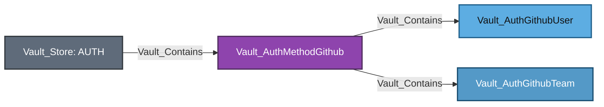

Equivalent Cypher query:

```cypher
MATCH mount = (:Vault_Store)-[:Vault_Contains]->(method:Vault_AuthMethodGithub)
OPTIONAL MATCH users = (method)-[:Vault_Contains]->(:Vault_AuthGithubUser)
OPTIONAL MATCH teams = (method)-[:Vault_Contains]->(:Vault_AuthGithubTeam)
RETURN mount, users, teams
```

User and team CRUD uses generic object edges. External organization membership is not independently queried, so mappings describe what Vault grants if GitHub authentication succeeds.

### Nodes

| Node | Description |
| --- | --- |
| `Vault_AuthMethodGithub` | GitHub authentication mount and organization configuration. |
| `Vault_AuthGithubUser` | GitHub user-to-policy mapping known to Vault. |
| `Vault_AuthGithubTeam` | GitHub team-to-policy mapping known to Vault. |

### Specialized Edges

This authentication method does not define any specialized edges.

### Properties

| Node/Edge Type | Property | Description |
| --- | --- | --- |
| `Vault_AuthMethodGithub` | `Organization` | Names the GitHub organization whose members may authenticate. |
| `Vault_AuthMethodGithub` | `Organization ID` | Records the immutable GitHub organization identifier when available. |
| `Vault_AuthMethodGithub` | `Base URL` | Records the GitHub API base URL, including Enterprise Server overrides. |
| `Vault_AuthMethodGithub` | `Authentication Type` | Identifies the GitHub authentication flow exposed by the mount. |
| `Vault_AuthMethodGithub` | `Login Requires Scope` | Indicates whether login requires a token carrying the configured GitHub scope. |
| `Vault_AuthMethodGithub` | `Login Metadata Fields` | Lists GitHub response fields relevant to login and alias construction. |
| `Vault_AuthMethodGithub` | `TTL` | Records the default lifetime of tokens issued through the mount. |
| `Vault_AuthMethodGithub` | `Max TTL` | Records the maximum lifetime of tokens issued through the mount. |
| `Vault_AuthMethodGithub` | `Alias Metadata Keys` | Lists GitHub fields copied into Identity alias metadata. |
| `Vault_AuthGithubUser` | `Username` | Names the GitHub user in the Vault-local mapping. |
| `Vault_AuthGithubUser` | `Policies` | Lists policies granted to the mapped GitHub user. |
| `Vault_AuthGithubTeam` | `Team Name` | Names the GitHub team in the Vault-local mapping. |
| `Vault_AuthGithubTeam` | `Policies` | Lists policies granted to members of the mapped GitHub team. |

### Attack Paths

GitHub users and teams use the common auth-native policy links and, when correlatable, enter Identity through `Vault_MapsTo` edges to entity or group aliases. Canonical resolution beyond those aliases is documented under [Identity Administration](IDENTITY.md#identity-administration). These relationships do not prove control of the GitHub account or membership in the external organization.

## JWT/OIDC

The JWT/OIDC auth method validates inbound JWTs or performs inbound OIDC login. It is separate from the Identity Store's outbound OIDC provider model.


Equivalent Cypher query:

```cypher
MATCH mount = (:Vault_Store)-[:Vault_Contains]->(method:Vault_AuthMethodJwtOidc)
OPTIONAL MATCH roles = (method)-[:Vault_Contains]->(:Vault_AuthJwtOidcRole)
RETURN mount, roles
```

Mount properties include discovery, verification keys, bound issuer, algorithms, default role, and provider configuration. Roles include role type, audiences, subjects, bound claims, redirect URIs, scopes, claim mappings, groups, and token settings. Unrestricted trust replacement can derive `Vault_ControlObject`; parameter-constrained replacement remains ordinary or potential management.

### Nodes

| Node | Description |
| --- | --- |
| `Vault_AuthMethodJwtOidc` | JWT/OIDC authentication mount and token-verification trust configuration. |
| `Vault_AuthJwtOidcRole` | JWT or OIDC login role with claim, audience, redirect, and policy mappings. |

### Specialized Edges

This authentication method does not define any specialized edges.

### Properties

| Node/Edge Type | Property | Description |
| --- | --- | --- |
| `Vault_AuthMethodJwtOidc` | `OIDC Discovery URL` | Records the OpenID Provider discovery endpoint trusted by the mount. |
| `Vault_AuthMethodJwtOidc` | `OIDC Client ID` | Identifies Vault's registered OIDC client at the provider. |
| `Vault_AuthMethodJwtOidc` | `OIDC Response Mode` | Records the response mode requested during browser authentication. |
| `Vault_AuthMethodJwtOidc` | `OIDC Response Types` | Lists the response types accepted during the OIDC flow. |
| `Vault_AuthMethodJwtOidc` | `Namespace In State` | Indicates whether the Vault namespace is encoded into the OIDC state value. |
| `Vault_AuthMethodJwtOidc` | `JWKS URL` | Records the remote JSON Web Key Set used to validate JWT signatures. |
| `Vault_AuthMethodJwtOidc` | `JWKS Pair Count` | Counts configured issuer-to-JWKS URL pairs. |
| `Vault_AuthMethodJwtOidc` | `JWKS Pair URLs` | Lists additional JWKS endpoints selected by issuer. |
| `Vault_AuthMethodJwtOidc` | `JWT Validation Pubkeys` | Records configured static public keys used for JWT verification. |
| `Vault_AuthMethodJwtOidc` | `JWT Supported Algs` | Lists JWT signature algorithms accepted by the mount. |
| `Vault_AuthMethodJwtOidc` | `Bound Issuer` | Records the issuer claim required in accepted tokens. |
| `Vault_AuthMethodJwtOidc` | `Default Role` | Names the role selected when login omits an explicit role. |
| `Vault_AuthMethodJwtOidc` | `Provider Config Keys` | Lists provider-specific configuration keys present on the mount. |
| `Vault_AuthMethodJwtOidc` | `Fetch Groups` | Indicates whether Vault retrieves group information from the provider. |
| `Vault_AuthMethodJwtOidc` | `OIDC Client Secret Set` | Indicates whether a confidential OIDC client secret is configured without exposing it. |
| `Vault_AuthMethodJwtOidc` | `JWKS CA PEM Set` | Indicates whether custom CA trust is configured for JWKS retrieval. |
| `Vault_AuthMethodJwtOidc` | `OIDC Discovery CA PEM Set` | Indicates whether custom CA trust is configured for OIDC discovery. |
| `Vault_AuthMethodJwtOidc` | `Validation Method` | Summarizes whether validation uses discovery, remote JWKS, or static keys. |
| `Vault_AuthMethodJwtOidc` | `Supports Browser Flow` | Indicates whether the configuration supports interactive OIDC login. |
| `Vault_AuthMethodJwtOidc` | `Supports Direct JWT Login` | Indicates whether the configuration supports direct JWT submission. |
| `Vault_AuthJwtOidcRole` | `Role Name` | Names the JWT/OIDC role. |
| `Vault_AuthJwtOidcRole` | `Role Type` | Identifies whether the role uses JWT or OIDC semantics. |
| `Vault_AuthJwtOidcRole` | `User Claim` | Names the claim used to construct the Identity alias. |
| `Vault_AuthJwtOidcRole` | `Groups Claim` | Names the claim used to derive Identity group aliases. |
| `Vault_AuthJwtOidcRole` | `Bound Subject` | Records the required token subject. |
| `Vault_AuthJwtOidcRole` | `Bound Audiences` | Lists audiences accepted by the role. |
| `Vault_AuthJwtOidcRole` | `Bound Claims` | Records additional claim values required by the role. |
| `Vault_AuthJwtOidcRole` | `Bound Claims Type` | Identifies whether bound claims use literal or glob matching. |
| `Vault_AuthJwtOidcRole` | `Claim Mappings` | Maps token claims into alias or token metadata fields. |
| `Vault_AuthJwtOidcRole` | `Allowed Redirect URIs` | Lists callback URIs permitted for OIDC login. |
| `Vault_AuthJwtOidcRole` | `OIDC Scopes` | Lists additional scopes requested from the provider. |
| `Vault_AuthJwtOidcRole` | `User Claim JSON Pointer` | Indicates whether the user claim is interpreted as a JSON Pointer. |
| `Vault_AuthJwtOidcRole` | `Clock Skew Leeway` | Records tolerated clock skew during token validation. |
| `Vault_AuthJwtOidcRole` | `Expiration Leeway` | Records additional tolerance applied to token expiration. |
| `Vault_AuthJwtOidcRole` | `Not Before Leeway` | Records additional tolerance applied to the token's not-before time. |
| `Vault_AuthJwtOidcRole` | `Verbose OIDC Logging` | Indicates whether verbose OIDC diagnostic logging is enabled. |
| `Vault_AuthJwtOidcRole` | `Max Age` | Records the maximum accepted age of the upstream authentication event. |
| `Vault_AuthJwtOidcRole` | `Validation Method` | Summarizes the validation path applicable to the role. |
| `Vault_AuthJwtOidcRole` | `Binding Configuration Valid` | Indicates whether the role has sufficient claim or audience bindings. |
| `Vault_AuthJwtOidcRole` | `Login Required Fields` | Lists fields required in a login request for the role. |
| `Vault_AuthJwtOidcRole` | `Login Optional Fields` | Lists fields accepted but not required by the role. |
| `Vault_AuthJwtOidcRole` | `Supports Browser Flow` | Indicates whether this role can be used for browser-based OIDC login. |
| `Vault_AuthJwtOidcRole` | `Supports Direct JWT Login` | Indicates whether this role accepts direct JWT login. |
| `Vault_AuthJwtOidcRole` | `Alias Metadata Keys` | Lists token claims copied into Identity alias metadata. |

### Attack Paths

JWT/OIDC uses the common object-takeover-to-policy path only when attacker-controlled issuer, discovery, verification-key, or claim values can satisfy the concrete role. Constrained trust changes produce `Vault_PotentialAccess` or ordinary management instead.

## Kerberos

Kerberos models mount-wide Kerberos/LDAP configuration and Vault group policy mappings. It does not ingest a complete Kerberos directory.

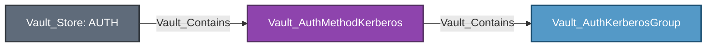

Equivalent Cypher query:

```cypher
MATCH mount = (:Vault_Store)-[:Vault_Contains]->(method:Vault_AuthMethodKerberos)
OPTIONAL MATCH groups = (method)-[:Vault_Contains]->(:Vault_AuthKerberosGroup)
RETURN mount, groups
```

SPN, keytab, LDAP, case behavior, and token configuration use method properties and generic config edges. Group aliases model canonical Vault group resolution after authentication.

### Nodes

| Node | Description |
| --- | --- |
| `Vault_AuthMethodKerberos` | Kerberos authentication mount and SPN, keytab, and LDAP configuration. |
| `Vault_AuthKerberosGroup` | Kerberos or LDAP group-to-policy mapping known to Vault. |

### Specialized Edges

This authentication method does not define any specialized edges.

### Properties

| Node/Edge Type | Property | Description |
| --- | --- | --- |
| `Vault_AuthMethodKerberos` | `Kerberos Configured` | Indicates whether the Kerberos service configuration was readable. |
| `Vault_AuthMethodKerberos` | `LDAP Configured` | Indicates whether LDAP authorization and group lookup are configured. |
| `Vault_AuthMethodKerberos` | `Service Account` | Records the Kerberos service principal used by the mount. |
| `Vault_AuthMethodKerberos` | `Add Group Aliases` | Indicates whether LDAP groups are emitted as Identity group aliases. |
| `Vault_AuthMethodKerberos` | `Remove Instance Name` | Indicates whether the instance component is removed from Kerberos principal names. |
| `Vault_AuthMethodKerberos` | `LDAP URL` | Records the LDAP server URL used for authorization lookups. |
| `Vault_AuthMethodKerberos` | `LDAP Bind DN` | Records the distinguished name used for LDAP searches. |
| `Vault_AuthMethodKerberos` | `Bind Password Set` | Indicates whether an LDAP bind password is configured without exposing it. |
| `Vault_AuthMethodKerberos` | `LDAP User DN` | Records the LDAP subtree searched for users. |
| `Vault_AuthMethodKerberos` | `LDAP Group DN` | Records the LDAP subtree searched for groups. |
| `Vault_AuthMethodKerberos` | `LDAP User Attribute` | Names the LDAP attribute used to identify users. |
| `Vault_AuthMethodKerberos` | `LDAP Group Attribute` | Names the LDAP attribute used to identify groups. |
| `Vault_AuthMethodKerberos` | `LDAP UPN Domain` | Records the UPN domain appended during LDAP user lookup. |
| `Vault_AuthMethodKerberos` | `Case Sensitive Names` | Indicates whether LDAP user and group names are case-sensitive. |
| `Vault_AuthMethodKerberos` | `Discover DN` | Indicates whether Vault discovers each user's distinguished name. |
| `Vault_AuthMethodKerberos` | `Anonymous Group Search` | Indicates whether group searches may run without the user bind. |
| `Vault_AuthMethodKerberos` | `Deny Null Bind` | Indicates whether LDAP null-bind responses are rejected. |
| `Vault_AuthMethodKerberos` | `User Filter` | Records the LDAP filter used to locate users. |
| `Vault_AuthMethodKerberos` | `Group Filter` | Records the LDAP filter used to resolve group membership. |
| `Vault_AuthMethodKerberos` | `Start TLS` | Indicates whether the LDAP connection upgrades with StartTLS. |
| `Vault_AuthMethodKerberos` | `TLS Min Version` | Records the minimum TLS version accepted for LDAP connections. |
| `Vault_AuthMethodKerberos` | `TLS Max Version` | Records the maximum TLS version accepted for LDAP connections. |
| `Vault_AuthMethodKerberos` | `Insecure TLS` | Indicates whether LDAP certificate verification is disabled. |
| `Vault_AuthMethodKerberos` | `Certificate Set` | Indicates whether custom LDAP CA certificates are configured. |
| `Vault_AuthMethodKerberos` | `Alias Metadata Keys` | Lists Kerberos or LDAP fields copied into Identity alias metadata. |
| `Vault_AuthKerberosGroup` | `Group Name` | Names the LDAP/Kerberos group in the Vault-local mapping. |
| `Vault_AuthKerberosGroup` | `Policies` | Lists policies granted to members of the mapped group. |

### Attack Paths

Kerberos groups use the common auth-group policy links and can enter Identity through a group alias only when the method is configured to add group aliases. Canonical group resolution and policy propagation are documented under [Identity Administration](IDENTITY.md#identity-administration). These relationships do not prove Kerberos credential possession or external directory membership.

## Kubernetes

Kubernetes roles bind service accounts, namespaces, namespace selectors, audiences, alias metadata, and token settings to Vault policies.

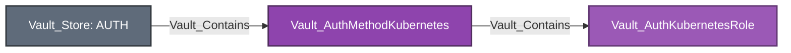

Equivalent Cypher query:

```cypher
MATCH mount = (:Vault_Store)-[:Vault_Contains]->(method:Vault_AuthMethodKubernetes)
OPTIONAL MATCH roles = (method)-[:Vault_Contains]->(:Vault_AuthKubernetesRole)
RETURN mount, roles
```

The mount records Kubernetes host, CA, token reviewer, issuer validation, and service-account behavior. Replacing unrestricted reviewer or cluster trust can derive control of compatible roles; ordinary role management remains non-traversable.

### Nodes

| Node | Description |
| --- | --- |
| `Vault_AuthMethodKubernetes` | Kubernetes authentication mount and token-review trust configuration. |
| `Vault_AuthKubernetesRole` | Service-account, namespace, audience, and token-policy login constraints. |

### Specialized Edges

This authentication method does not define any specialized edges.

### Properties

| Node/Edge Type | Property | Description |
| --- | --- | --- |
| `Vault_AuthMethodKubernetes` | `Kubernetes Host` | Records the Kubernetes API server used for token validation. |
| `Vault_AuthMethodKubernetes` | `Kubernetes CA Cert Set` | Indicates whether custom Kubernetes API CA trust is configured. |
| `Vault_AuthMethodKubernetes` | `PEM Keys Set` | Indicates whether static public keys are configured for JWT verification. |
| `Vault_AuthMethodKubernetes` | `Token Reviewer JWT Set` | Indicates whether a token-reviewer credential is configured without exposing it. |
| `Vault_AuthMethodKubernetes` | `Disable Local CA JWT` | Indicates whether Vault avoids loading the local service-account token and CA. |
| `Vault_AuthMethodKubernetes` | `Disable ISS Validation` | Indicates whether service-account issuer validation is disabled. |
| `Vault_AuthMethodKubernetes` | `Use Annotations As Alias Metadata` | Indicates whether service-account annotations are copied into alias metadata. |
| `Vault_AuthMethodKubernetes` | `Issuer` | Records the required service-account token issuer. |
| `Vault_AuthMethodKubernetes` | `Kubernetes CA Source` | Identifies whether Kubernetes CA trust is configured, local, or unavailable. |
| `Vault_AuthMethodKubernetes` | `Token Reviewer Source` | Identifies whether token review uses configured, local, or client JWT credentials. |
| `Vault_AuthKubernetesRole` | `Role Name` | Names the Kubernetes authentication role. |
| `Vault_AuthKubernetesRole` | `Bound Service Account Names` | Lists service-account names permitted to authenticate. |
| `Vault_AuthKubernetesRole` | `Bound Service Account Namespaces` | Lists namespaces from which service accounts may authenticate. |
| `Vault_AuthKubernetesRole` | `Bound Service Account Namespace Selector` | Records the label selector used to admit namespaces. |
| `Vault_AuthKubernetesRole` | `Audience` | Records the required service-account token audience. |
| `Vault_AuthKubernetesRole` | `Alias Name Source` | Identifies the Kubernetes value used as the Identity alias name. |
| `Vault_AuthKubernetesRole` | `Namespace Binding Mode` | Summarizes whether namespaces are matched by name, selector, or wildcard. |
| `Vault_AuthKubernetesRole` | `TTL` | Records the initial lifetime of tokens issued through the role. |
| `Vault_AuthKubernetesRole` | `Max TTL` | Records the maximum lifetime of tokens issued through the role. |
| `Vault_AuthKubernetesRole` | `Period` | Records the renewal period for periodic tokens issued through the role. |
| `Vault_AuthKubernetesRole` | `Binding Configuration Valid` | Indicates whether the role has a usable service-account and namespace binding. |
| `Vault_AuthKubernetesRole` | `Login Required Fields` | Lists fields required in a Kubernetes login request. |
| `Vault_AuthKubernetesRole` | `Kubernetes Identity Surface` | Summarizes the Kubernetes identity attributes validated by the role. |
| `Vault_AuthKubernetesRole` | `Alias Metadata Keys` | Lists Kubernetes fields copied into Identity alias metadata. |

### Attack Paths

Kubernetes uses the common object-takeover-to-policy path only when unrestricted trust or reviewer replacement makes an attacker-controlled Kubernetes token satisfy the observed role. Merely editing the role or reading cluster configuration does not create that path.

## LDAP

LDAP auth models Vault-local LDAP user and group mappings plus mount connection and bind configuration.

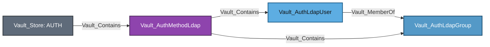

Equivalent Cypher query:

```cypher
MATCH mount = (:Vault_Store)-[:Vault_Contains]->(method:Vault_AuthMethodLdap)
OPTIONAL MATCH users = (method)-[:Vault_Contains]->(user:Vault_AuthLdapUser)
OPTIONAL MATCH groups = (method)-[:Vault_Contains]->(group:Vault_AuthLdapGroup)
OPTIONAL MATCH memberships = (user)-[:Vault_MemberOf]->(group)
RETURN mount, users, groups, memberships
```

Configuration includes URLs, bind DN behavior, user/group search, nested groups, case sensitivity, certificates, token settings, and root credential rotation. The user/group nodes are mappings known to Vault, not a complete LDAP inventory.

### Nodes

| Node | Description |
| --- | --- |
| `Vault_AuthMethodLdap` | LDAP authentication mount and directory search/bind configuration. |
| `Vault_AuthLdapUser` | LDAP user-to-policy mapping known to Vault. |
| `Vault_AuthLdapGroup` | LDAP group-to-policy mapping known to Vault. |

### Specialized Edges

This authentication method does not define any specialized edges.

### Properties

| Node/Edge Type | Property | Description |
| --- | --- | --- |
| `Vault_AuthMethodLdap` | `LDAP URL` | Records the LDAP server URLs used for authentication and searches. |
| `Vault_AuthMethodLdap` | `LDAP Bind DN` | Records the distinguished name used for authenticated directory searches. |
| `Vault_AuthMethodLdap` | `Bind Password Set` | Indicates whether a directory bind password is configured without exposing it. |
| `Vault_AuthMethodLdap` | `LDAP User DN` | Records the directory subtree searched for users. |
| `Vault_AuthMethodLdap` | `LDAP Group DN` | Records the directory subtree searched for groups. |
| `Vault_AuthMethodLdap` | `LDAP User Attribute` | Names the LDAP attribute used to identify users. |
| `Vault_AuthMethodLdap` | `LDAP Group Attribute` | Names the LDAP attribute used to identify groups. |
| `Vault_AuthMethodLdap` | `LDAP UPN Domain` | Records the UPN domain appended during user lookup. |
| `Vault_AuthMethodLdap` | `Case Sensitive Names` | Indicates whether user and group names are matched case-sensitively. |
| `Vault_AuthMethodLdap` | `Connection Timeout` | Records the timeout for establishing LDAP connections. |
| `Vault_AuthMethodLdap` | `Request Timeout` | Records the timeout for LDAP requests after connection. |
| `Vault_AuthMethodLdap` | `Discover DN` | Indicates whether Vault discovers each user's distinguished name. |
| `Vault_AuthMethodLdap` | `Deny Null Bind` | Indicates whether LDAP null-bind responses are rejected. |
| `Vault_AuthMethodLdap` | `Anonymous Group Search` | Indicates whether group searches may run without the authenticating user's bind. |
| `Vault_AuthMethodLdap` | `User Filter` | Records the LDAP filter used to locate user entries. |
| `Vault_AuthMethodLdap` | `Group Filter` | Records the LDAP filter used to resolve group membership. |
| `Vault_AuthMethodLdap` | `Username As Alias` | Indicates whether the login username, rather than a directory attribute, becomes the alias name. |
| `Vault_AuthMethodLdap` | `Dereference Aliases` | Records how LDAP aliases are dereferenced during searches. |
| `Vault_AuthMethodLdap` | `Max Page Size` | Records the maximum LDAP paged-search result size. |
| `Vault_AuthMethodLdap` | `Use Token Groups` | Indicates whether Active Directory tokenGroups are used for membership resolution. |
| `Vault_AuthMethodLdap` | `Enable SAM Account Name Login` | Indicates whether Active Directory sAMAccountName login is enabled. |
| `Vault_AuthMethodLdap` | `Start TLS` | Indicates whether LDAP connections upgrade with StartTLS. |
| `Vault_AuthMethodLdap` | `TLS Min Version` | Records the minimum TLS version accepted for LDAP connections. |
| `Vault_AuthMethodLdap` | `TLS Max Version` | Records the maximum TLS version accepted for LDAP connections. |
| `Vault_AuthMethodLdap` | `Insecure TLS` | Indicates whether LDAP certificate verification is disabled. |
| `Vault_AuthMethodLdap` | `Certificate Set` | Indicates whether custom LDAP CA certificates are configured. |
| `Vault_AuthMethodLdap` | `Client TLS Certificate Set` | Indicates whether an LDAP mutual-TLS client certificate is configured. |
| `Vault_AuthMethodLdap` | `Client TLS Key Set` | Indicates whether the corresponding client private key is configured without exposing it. |
| `Vault_AuthMethodLdap` | `Schema` | Identifies the directory schema mode used by the backend. |
| `Vault_AuthMethodLdap` | `Rotation URL` | Records the endpoint used to rotate the LDAP bind credential. |
| `Vault_AuthMethodLdap` | `Rotation Period` | Records the interval for automatic bind-credential rotation. |
| `Vault_AuthMethodLdap` | `Rotation Schedule` | Records the schedule used for bind-credential rotation. |
| `Vault_AuthMethodLdap` | `Rotation Window` | Records the permitted window for scheduled rotation. |
| `Vault_AuthMethodLdap` | `Disable Automated Rotation` | Indicates whether automatic bind-credential rotation is disabled. |
| `Vault_AuthMethodLdap` | `Alias Metadata Keys` | Lists LDAP fields copied into Identity alias metadata. |
| `Vault_AuthLdapUser` | `Username` | Names the LDAP user in the Vault-local mapping. |
| `Vault_AuthLdapUser` | `Policies` | Lists policies granted directly to the mapped LDAP user. |
| `Vault_AuthLdapUser` | `Groups` | Lists collected LDAP auth groups associated with the user. |
| `Vault_AuthLdapGroup` | `Group Name` | Names the LDAP group in the Vault-local mapping. |
| `Vault_AuthLdapGroup` | `Policies` | Lists policies granted to members of the mapped LDAP group. |

### Attack Paths

LDAP users and groups use the common auth-native policy links, and `Vault_MemberOf` exposes policies inherited from collected LDAP group mappings. Correlatable LDAP users can enter Identity through entity aliases; LDAP auth-group records are not correlated to Vault group aliases by the collector. Canonical alias resolution is documented under [Identity Administration](IDENTITY.md#identity-administration). These relationships do not assert live LDAP credentials or complete directory membership.

## OCI

OCI roles capture group and dynamic-group OCIDs, tenancy constraints, request-header validation, alias metadata, and token policies.


Equivalent Cypher query:

```cypher
MATCH mount = (:Vault_Store)-[:Vault_Contains]->(method:Vault_AuthMethodOci)
OPTIONAL MATCH roles = (method)-[:Vault_Contains]->(:Vault_AuthOciRole)
RETURN mount, roles
```

VaultHound preserves the configured OCI selectors but does not independently resolve dynamic-group membership or verify signed request credentials.

### Nodes

| Node | Description |
| --- | --- |
| `Vault_AuthMethodOci` | OCI authentication mount and signed-request verification configuration. |
| `Vault_AuthOciRole` | OCI group, dynamic-group, tenancy, and compartment login constraints. |

### Specialized Edges

This authentication method does not define any specialized edges.

### Properties

| Node/Edge Type | Property | Description |
| --- | --- | --- |
| `Vault_AuthMethodOci` | `Home Tenancy ID` | Identifies the OCI tenancy trusted by the auth mount. |
| `Vault_AuthMethodOci` | `Supported Login Types` | Lists OCI signed-request login modes supported by the mount. |
| `Vault_AuthMethodOci` | `Login Request Fields` | Lists request fields accepted by the OCI login endpoint. |
| `Vault_AuthOciRole` | `Role Name` | Names the OCI authentication role. |
| `Vault_AuthOciRole` | `OCID List` | Lists explicitly permitted OCI principal identifiers. |
| `Vault_AuthOciRole` | `OCI Group OCIDs` | Lists OCI identity groups permitted to authenticate. |
| `Vault_AuthOciRole` | `OCI Dynamic Group OCIDs` | Lists OCI dynamic groups permitted to authenticate. |
| `Vault_AuthOciRole` | `Login Validation Surface` | Summarizes the OCI identity attributes validated during login. |
| `Vault_AuthOciRole` | `Login Request Fields` | Lists request fields required or consumed by the role. |
| `Vault_AuthOciRole` | `Alias Metadata Keys` | Lists OCI fields copied into Identity alias metadata. |

### Attack Paths

OCI roles participate in policy-grant and alias-resolution chains after external OCI authentication. No direct login edge is emitted because the collector cannot prove possession of a signed OCI request or group membership.

## Okta

Okta auth contains Vault-local user and group policy mappings and method-wide Okta organization/API configuration.

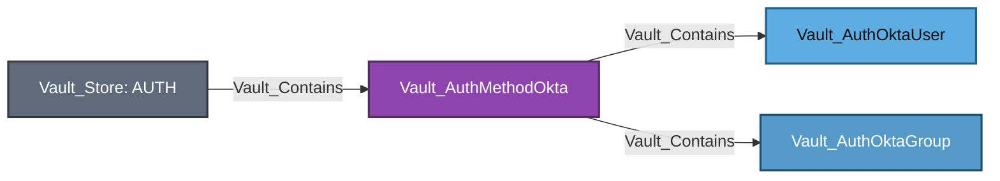

Equivalent Cypher query:

```cypher
MATCH mount = (:Vault_Store)-[:Vault_Contains]->(method:Vault_AuthMethodOkta)
OPTIONAL MATCH users = (method)-[:Vault_Contains]->(:Vault_AuthOktaUser)
OPTIONAL MATCH groups = (method)-[:Vault_Contains]->(:Vault_AuthOktaGroup)
RETURN mount, users, groups
```

Okta's API token is a write-only configuration input and is not returned by the configuration read endpoint. Configuration and mapping reads therefore remain non-traversable and do not produce `Vault_ReadCredential`.

### Nodes

| Node | Description |
| --- | --- |
| `Vault_AuthMethodOkta` | Okta authentication mount and organization/API configuration. |
| `Vault_AuthOktaUser` | Okta user-to-policy mapping known to Vault. |
| `Vault_AuthOktaGroup` | Okta group-to-policy mapping known to Vault. |

### Specialized Edges

This authentication method does not define any specialized edges.

### Properties

| Node/Edge Type | Property | Description |
| --- | --- | --- |
| `Vault_AuthMethodOkta` | `Org Name` | Names the Okta organization used for authentication. |
| `Vault_AuthMethodOkta` | `Base URL` | Records the Okta domain or API base URL. |
| `Vault_AuthMethodOkta` | `API Token Status` | Indicates whether an Okta API token is configured and whether its value was exposed by the read response. |
| `Vault_AuthMethodOkta` | `Group Membership Source` | Identifies how Vault obtains Okta group membership. |
| `Vault_AuthMethodOkta` | `Bypass Okta MFA` | Indicates whether Vault asks Okta to bypass its MFA challenge. |
| `Vault_AuthMethodOkta` | `Authentication Type` | Identifies the Okta authentication flow used by the mount. |
| `Vault_AuthMethodOkta` | `Login Metadata Fields` | Lists Okta values relevant to login and alias construction. |
| `Vault_AuthMethodOkta` | `Alias Metadata Keys` | Lists Okta fields copied into Identity alias metadata. |
| `Vault_AuthOktaUser` | `Username` | Names the Okta user in the Vault-local mapping. |
| `Vault_AuthOktaUser` | `Policies` | Lists policies granted directly to the mapped Okta user. |
| `Vault_AuthOktaUser` | `Groups` | Lists Okta groups associated with the user during collection. |
| `Vault_AuthOktaUser` | `Membership Evaluation Time` | Records when external group membership was evaluated. |
| `Vault_AuthOktaGroup` | `Group Name` | Names the Okta group in the Vault-local mapping. |
| `Vault_AuthOktaGroup` | `Policies` | Lists policies granted to members of the mapped Okta group. |

### Attack Paths

Okta users and groups use the common auth-native policy links and, when correlatable, enter Identity through entity or group aliases. Canonical resolution beyond those aliases is documented under [Identity Administration](IDENTITY.md#identity-administration). External Okta authentication and live group membership are not independently proven. Alias correlation records matching Vault Identity aliases without claiming that Vault returned the configured Okta API token.

## RADIUS

RADIUS stores mount-wide server/NAS configuration and optional Vault-local user-to-policy mappings.

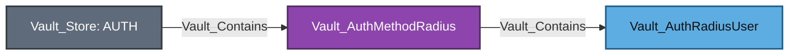

Equivalent Cypher query:

```cypher
MATCH mount = (:Vault_Store)-[:Vault_Contains]->(method:Vault_AuthMethodRadius)
OPTIONAL MATCH users = (method)-[:Vault_Contains]->(:Vault_AuthRadiusUser)
RETURN mount, users
```

Server, port, shared-secret-related configuration, NAS settings, and token behavior use generic config edges. Login ability is not represented as an ACL edge.

### Nodes

| Node | Description |
| --- | --- |
| `Vault_AuthMethodRadius` | RADIUS authentication mount and server/NAS configuration. |
| `Vault_AuthRadiusUser` | RADIUS username-to-policy mapping known to Vault. |

### Specialized Edges

This authentication method does not define any specialized edges.

### Properties

| Node/Edge Type | Property | Description |
| --- | --- | --- |
| `Vault_AuthMethodRadius` | `Host` | Records the RADIUS server hostname or address. |
| `Vault_AuthMethodRadius` | `Port` | Records the UDP port used for RADIUS authentication. |
| `Vault_AuthMethodRadius` | `Secret Set` | Indicates whether the RADIUS shared secret is configured without exposing it. |
| `Vault_AuthMethodRadius` | `NAS Port` | Records the NAS-Port value sent in RADIUS requests. |
| `Vault_AuthMethodRadius` | `NAS Identifier` | Records the NAS-Identifier value sent in RADIUS requests. |
| `Vault_AuthMethodRadius` | `Dictionary Path` | Records the custom RADIUS attribute dictionary path. |
| `Vault_AuthMethodRadius` | `Dial Timeout` | Records the timeout for establishing communication with the RADIUS server. |
| `Vault_AuthMethodRadius` | `Read Timeout` | Records the timeout for receiving a RADIUS response. |
| `Vault_AuthMethodRadius` | `Retries` | Records the number of RADIUS request retries. |
| `Vault_AuthMethodRadius` | `Username Template` | Records the template used to transform the submitted username. |
| `Vault_AuthMethodRadius` | `Alias Metadata Keys` | Lists RADIUS values copied into Identity alias metadata. |
| `Vault_AuthMethodRadius` | `Unregistered User Policies` | Lists fallback policies granted to authenticated users without a Vault-local user record. |
| `Vault_AuthRadiusUser` | `Username` | Names the RADIUS user in the Vault-local mapping. |
| `Vault_AuthRadiusUser` | `Policies` | Lists policies granted to the mapped RADIUS user. |

### Attack Paths

RADIUS users use the common auth-native policy links and, when correlatable, enter Identity through entity aliases. Canonical resolution beyond those aliases is documented under [Identity Administration](IDENTITY.md#identity-administration). No policy-to-login path is emitted because the RADIUS password exchange is external and unauthenticated from Vault's ACL perspective.

## SAML

SAML models IdP trust at the method and attribute/subject matching at roles.

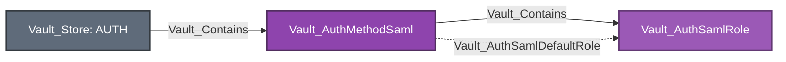

Equivalent Cypher query:

```cypher
MATCH mount = (:Vault_Store)-[:Vault_Contains]->(method:Vault_AuthMethodSaml)
OPTIONAL MATCH roles = (method)-[:Vault_Contains]->(role:Vault_AuthSamlRole)
OPTIONAL MATCH defaults = (method)-[:Vault_AuthSamlDefaultRole]->(role)
RETURN mount, roles, defaults
```

Configuration includes IdP metadata or certificate trust, entity IDs, SSO URLs, default role, and assertion behavior. Roles capture bound subjects, attributes, group attributes, and policies. Unrestricted trust replacement may derive control of observed roles.

### Nodes

| Node | Description |
| --- | --- |
| `Vault_AuthMethodSaml` | SAML authentication mount and identity-provider trust configuration. |
| `Vault_AuthSamlRole` | SAML subject, attribute, group, and policy constraints. |

### Specialized Edges

| Edge | Source | Destination | Traversable | Meaning |
| --- | --- | --- | :---: | --- |
| `Vault_AuthSamlDefaultRole` | SAML method | SAML role | :x: | Identifies the role selected when login omits an explicit role. |

### Properties

| Node/Edge Type | Property | Description |
| --- | --- | --- |
| `Vault_AuthMethodSaml` | `IDP Metadata URL` | Records the remote identity-provider metadata endpoint. |
| `Vault_AuthMethodSaml` | `IDP SSO URL` | Records the identity provider's single sign-on endpoint. |
| `Vault_AuthMethodSaml` | `IDP Entity ID` | Identifies the trusted SAML identity provider. |
| `Vault_AuthMethodSaml` | `IDP Certificate Set` | Indicates whether an identity-provider signing certificate is configured. |
| `Vault_AuthMethodSaml` | `IDP Configuration Mode` | Identifies whether trust comes from metadata, explicit endpoints, or certificates. |
| `Vault_AuthMethodSaml` | `Entity ID` | Identifies Vault as the SAML service provider. |
| `Vault_AuthMethodSaml` | `ACS URLs` | Lists assertion-consumer service callback URLs accepted by the mount. |
| `Vault_AuthMethodSaml` | `Default Role Name` | Names the role selected when login omits an explicit role. |
| `Vault_AuthMethodSaml` | `Role Parameter Required` | Indicates whether login must explicitly select a role. |
| `Vault_AuthMethodSaml` | `Verbose Logging` | Indicates whether verbose SAML diagnostic logging is enabled. |
| `Vault_AuthMethodSaml` | `Validate Response Signature` | Indicates whether Vault requires a valid signature on the SAML response. |
| `Vault_AuthMethodSaml` | `Validate Assertion Signature` | Indicates whether Vault requires a valid signature on the SAML assertion. |
| `Vault_AuthMethodSaml` | `Signature Validation Mode` | Summarizes the response and assertion signature requirements. |
| `Vault_AuthMethodSaml` | `Supported Login Types` | Lists login flows supported by the SAML mount. |
| `Vault_AuthMethodSaml` | `Login Flow Request Fields` | Lists fields used to initiate the SAML login flow. |
| `Vault_AuthSamlRole` | `Role Name` | Names the SAML authentication role. |
| `Vault_AuthSamlRole` | `Bound Subjects` | Lists SAML subjects permitted to use the role. |
| `Vault_AuthSamlRole` | `Bound Subjects Type` | Identifies how bound-subject values are matched. |
| `Vault_AuthSamlRole` | `Bound Attributes` | Records SAML attribute values required by the role. |
| `Vault_AuthSamlRole` | `Bound Attributes Type` | Identifies how bound-attribute values are matched. |
| `Vault_AuthSamlRole` | `Groups Attribute` | Names the assertion attribute used to create group aliases. |
| `Vault_AuthSamlRole` | `Creates Group Aliases` | Indicates whether successful login emits Vault Identity group aliases. |
| `Vault_AuthSamlRole` | `Is Default Role` | Indicates whether the mount selects this role by default. |
| `Vault_AuthSamlRole` | `Alias Metadata Keys` | Lists SAML assertion fields copied into Identity alias metadata. |

### Attack Paths

SAML uses the common object-takeover-to-policy path only when unrestricted attacker-controlled IdP metadata, certificate, or assertion-routing values are compatible with the role. Routing-only writes or constrained trust replacement remain non-traversable or potential.

## SCEP

SCEP auth supports static-challenge and Intune-style authentication used by compatible PKI issuance protocol configuration.

```mermaid
flowchart LR
    store[Vault_Store: AUTH]:::storeNode -->|Vault_Contains| method[Vault_AuthMethodScep]:::authMethodNode
    method -->|Vault_Contains| role[Vault_AuthScepRole]:::authRoleNode
    pki[Vault_SecretsEnginePki]:::mountNode -.->|Vault_References| method
    pki -.->|Vault_References| role

    classDef storeNode fill:#5F6B7A,color:#fff,stroke:#343A40,stroke-width:2px
    classDef authMethodNode fill:#8E44AD,color:#fff,stroke:#512E5F,stroke-width:2px
    classDef authRoleNode fill:#9B59B6,color:#fff,stroke:#633974,stroke-width:2px
    classDef mountNode fill:#D35400,color:#fff,stroke:#873600,stroke-width:2px
```

Equivalent Cypher query:

```cypher
MATCH mount = (:Vault_Store)-[:Vault_Contains]->(method:Vault_AuthMethodScep)
OPTIONAL MATCH roles = (method)-[:Vault_Contains]->(role:Vault_AuthScepRole)
OPTIONAL MATCH methodReferences = (:Vault_SecretsEnginePki)-[:Vault_References]->(method)
OPTIONAL MATCH roleReferences = (:Vault_SecretsEnginePki)-[:Vault_References]->(role)
RETURN mount, roles, methodReferences, roleReferences
```

Challenge, validation, authentication type, role compatibility, and token policy properties are collected where Vault returns them. PKI-to-auth dependencies use `Vault_References` with evidence properties instead of separate near-duplicate edge kinds.

### Nodes

| Node | Description |
| --- | --- |
| `Vault_AuthMethodScep` | SCEP authentication mount and enrollment-challenge configuration. |
| `Vault_AuthScepRole` | SCEP enrollment authentication and token-policy constraints. |

### Specialized Edges

This authentication method does not define any specialized edges.

### Properties

| Node/Edge Type | Property | Description |
| --- | --- | --- |
| `Vault_AuthMethodScep` | `Delegated Authentication Only` | Indicates whether SCEP enrollment must delegate authentication to another backend. |
| `Vault_AuthMethodScep` | `Supported Authentication Types` | Lists SCEP challenge-authentication modes supported by the mount. |
| `Vault_AuthMethodScep` | `Login Invocation` | Describes how the SCEP auth endpoint is invoked during enrollment. |
| `Vault_AuthMethodScep` | `Role Selection Behavior` | Describes how SCEP enrollment selects an authentication role. |
| `Vault_AuthScepRole` | `Role Name` | Names the SCEP authentication role. |
| `Vault_AuthScepRole` | `Display Name` | Records the display name propagated into issued identity data. |
| `Vault_AuthScepRole` | `Authentication Type` | Identifies the challenge or delegated authentication mode required by the role. |
| `Vault_AuthScepRole` | `Challenge Authentication Required` | Indicates whether enrollment must present a valid SCEP challenge. |
| `Vault_AuthScepRole` | `Delegated Authentication Only` | Indicates whether the role accepts only delegated authentication. |
| `Vault_AuthScepRole` | `Alias Metadata Keys` | Lists SCEP values copied into Identity alias metadata. |
| `Vault_References` | `Reference Types` | Lists the PKI-to-SCEP dependency types represented by the edge. |
| `Vault_References` | `Reference Evidence` | Records the configuration values that establish the dependency. |
| `Vault_References` | `Authenticator Type` | Identifies the delegated authentication backend family. |
| `Vault_References` | `Delegated Auth Accessor` | Records the mount accessor of the selected delegated auth method. |
| `Vault_References` | `Delegation Allowed` | Indicates whether the PKI protocol configuration permits delegation. |
| `Vault_References` | `SCEP Enabled` | Indicates whether the referencing PKI SCEP surface is enabled. |
| `Vault_References` | `Expected Authentication Type` | Records the SCEP authentication type expected by the PKI configuration. |
| `Vault_References` | `Role Selections` | Lists explicit or compatible SCEP roles selected by the PKI configuration. |

### Attack Paths

SCEP configuration and PKI references are non-traversable evidence. VaultHound does not infer enrollment or Vault policy acquisition from the reference alone; a concrete PKI issuance edge must establish the certificate outcome.

## SPIFFE

SPIFFE roles match workload identities validated by trust-domain, JWT, or X.509 profiles.

```mermaid
flowchart LR
    store[Vault_Store: AUTH]:::storeNode -->|Vault_Contains| method[Vault_AuthMethodSpiffe]:::authMethodNode
    method -->|Vault_Contains| role[Vault_AuthSpiffeRole]:::authRoleNode
    alias[Vault_EntityAlias]:::entityAliasNode -.->|Vault_AuthSpiffeMayMatchRole| role

    classDef storeNode fill:#5F6B7A,color:#fff,stroke:#343A40,stroke-width:2px
    classDef authMethodNode fill:#8E44AD,color:#fff,stroke:#512E5F,stroke-width:2px
    classDef authRoleNode fill:#9B59B6,color:#fff,stroke:#633974,stroke-width:2px
    classDef entityAliasNode fill:#56CCF2,color:#111,stroke:#2E86C1,stroke-width:2px
```

Equivalent Cypher query:

```cypher
MATCH mount = (:Vault_Store)-[:Vault_Contains]->(method:Vault_AuthMethodSpiffe)
OPTIONAL MATCH roles = (method)-[:Vault_Contains]->(role:Vault_AuthSpiffeRole)
OPTIONAL MATCH matches = (:Vault_EntityAlias)-[:Vault_AuthSpiffeMayMatchRole]->(role)
RETURN mount, roles, matches
```

`Vault_AuthSpiffeMayMatchRole` records observed alias compatibility; it is non-traversable because possession of a currently valid SPIFFE credential is not proven. Trust domain, bundle, workload ID templates, audiences, and token settings are retained.

### Nodes

| Node | Description |
| --- | --- |
| `Vault_AuthMethodSpiffe` | SPIFFE authentication mount and bundle/trust-domain configuration. |
| `Vault_AuthSpiffeRole` | JWT or X.509 SVID workload selectors and token-policy constraints. |

### Specialized Edges

| Edge | Source | Destination | Traversable | Meaning |
| --- | --- | --- | :---: | --- |
| `Vault_AuthSpiffeMayMatchRole` | Entity Alias | SPIFFE role | :x: | Records selector compatibility without proving possession of a valid SPIFFE credential. |

### Properties

| Node/Edge Type | Property | Description |
| --- | --- | --- |
| `Vault_AuthMethodSpiffe` | `Trust Domain` | Records the SPIFFE trust domain accepted by the mount. |
| `Vault_AuthMethodSpiffe` | `Trust Domain Configured` | Indicates whether an explicit trust domain is configured. |
| `Vault_AuthMethodSpiffe` | `Profile` | Identifies the SPIFFE authentication profile used by the mount. |
| `Vault_AuthMethodSpiffe` | `Audience` | Records the audience required in JWT-SVIDs. |
| `Vault_AuthMethodSpiffe` | `Trust Bundle Configuration Present` | Indicates whether trust-bundle retrieval is configured. |
| `Vault_AuthMethodSpiffe` | `Cached Trust Bundle Available` | Indicates whether Vault has a cached trust bundle available for validation. |
| `Vault_AuthMethodSpiffe` | `Trust Bundle Format` | Identifies the format of the configured or cached trust bundle. |
| `Vault_AuthMethodSpiffe` | `Bundle Fetch Deferred` | Indicates whether trust-bundle retrieval was deferred during collection. |
| `Vault_AuthMethodSpiffe` | `Endpoint URL` | Records the SPIFFE Workload API or bundle endpoint. |
| `Vault_AuthMethodSpiffe` | `Endpoint SPIFFE ID` | Records the SPIFFE ID expected from the configured endpoint. |
| `Vault_AuthMethodSpiffe` | `Endpoint Root CA Truststore Configured` | Indicates whether custom root trust is configured for the endpoint. |
| `Vault_AuthMethodSpiffe` | `Cached Bundle Config Version` | Records the configuration version associated with the cached bundle. |
| `Vault_AuthMethodSpiffe` | `Cached Bundle Fetched At` | Records when the cached trust bundle was fetched. |
| `Vault_AuthMethodSpiffe` | `Cached Bundle Refresh Hint` | Records the provider's suggested bundle refresh interval. |
| `Vault_AuthMethodSpiffe` | `Cached Bundle Sequence Number` | Records the sequence number of the cached trust bundle. |
| `Vault_AuthMethodSpiffe` | `Configuration Version` | Records the SPIFFE backend configuration version. |
| `Vault_AuthMethodSpiffe` | `Passthrough Request Headers` | Lists request headers forwarded to the SPIFFE endpoint. |
| `Vault_AuthMethodSpiffe` | `Authorization Passthrough Header Configured` | Indicates whether an authorization header is forwarded to the endpoint. |
| `Vault_AuthMethodSpiffe` | `Listener Client Certificate Support` | Indicates whether the Vault listener can supply client-certificate identity. |
| `Vault_AuthMethodSpiffe` | `JWT SVID Authentication Prerequisites Present` | Indicates whether the mount has the trust and audience data required for JWT-SVID login. |
| `Vault_AuthMethodSpiffe` | `X.509 SVID Authentication Prerequisites Present` | Indicates whether the mount has the trust and listener data required for X.509-SVID login. |
| `Vault_AuthMethodSpiffe` | `JWT SVID Readiness` | Summarizes whether JWT-SVID authentication is operational or missing prerequisites. |
| `Vault_AuthMethodSpiffe` | `X.509 SVID Readiness` | Summarizes whether X.509-SVID authentication is operational or missing prerequisites. |
| `Vault_AuthMethodSpiffe` | `Supported SVID Types` | Lists SVID types proven usable by the collected configuration. |
| `Vault_AuthMethodSpiffe` | `Potential SVID Types` | Lists SVID types that may be usable when unresolved prerequisites are satisfied. |
| `Vault_AuthMethodSpiffe` | `Login Role Selection` | Describes how a SPIFFE login selects a role. |
| `Vault_AuthSpiffeRole` | `Role Name` | Names the SPIFFE authentication role. |
| `Vault_AuthSpiffeRole` | `Display Name` | Records the display name assigned to tokens created through the role. |
| `Vault_AuthSpiffeRole` | `Workload ID Patterns` | Lists SPIFFE workload-ID selectors accepted by the role. |
| `Vault_AuthSpiffeRole` | `Has Wildcard Workload ID Patterns` | Indicates whether any workload selector contains a wildcard. |
| `Vault_AuthSpiffeRole` | `Alias Metadata Keys` | Lists SPIFFE values copied into Identity alias metadata. |
| `Vault_AuthSpiffeRole` | `Template` | Records the original identity template associated with the role. |
| `Vault_AuthSpiffeRole` | `Canonical Template` | Records the normalized form used for template comparison. |
| `Vault_AuthSpiffeRole` | `Template Format` | Identifies the syntax used by the role template. |
| `Vault_AuthSpiffeRole` | `Template Claims` | Lists identity claims referenced by the template. |
| `Vault_AuthSpiffeRole` | `Subject Template` | Records the template used to match the SPIFFE subject. |
| `Vault_AuthSpiffeRole` | `Resolved Subject Template` | Records the subject template after resolvable values are substituted. |
| `Vault_AuthSpiffeRole` | `Subject Scope` | Describes the workload-ID scope selected by the subject template. |
| `Vault_AuthSpiffeRole` | `Subject Is Templated` | Indicates whether role matching depends on template expansion. |
| `Vault_AuthSpiffeRole` | `Identity Template References` | Lists Vault Identity values referenced by the template. |
| `Vault_AuthSpiffeMayMatchRole` | `Workload ID` | Records the observed SPIFFE workload ID evaluated against the role. |
| `Vault_AuthSpiffeMayMatchRole` | `Matched Patterns` | Lists role selectors matched by the workload ID. |
| `Vault_AuthSpiffeMayMatchRole` | `Match Types` | Identifies whether compatibility came from exact, wildcard, or template matching. |

### Attack Paths

SPIFFE aliases can enter the canonical topology documented under [Identity Administration](IDENTITY.md#identity-administration), but `Vault_AuthSpiffeMayMatchRole` is not an attack-path hop. It records compatibility only; a valid workload credential is an unresolved external prerequisite.

## TLS Certificate

TLS Certificate auth contains trusted certificate roles and CRL records.

```mermaid
flowchart LR
    store[Vault_Store: AUTH]:::storeNode -->|Vault_Contains| method[Vault_AuthMethodTlsCert]:::authMethodNode
    method -->|Vault_Contains| role[Vault_AuthTlsCertRole]:::authRoleNode
    method -->|Vault_Contains| crl[Vault_AuthTlsCertCrl]:::authObjectNode

    classDef storeNode fill:#5F6B7A,color:#fff,stroke:#343A40,stroke-width:2px
    classDef authMethodNode fill:#8E44AD,color:#fff,stroke:#512E5F,stroke-width:2px
    classDef authRoleNode fill:#9B59B6,color:#fff,stroke:#633974,stroke-width:2px
    classDef authObjectNode fill:#AF7AC5,color:#fff,stroke:#76448A,stroke-width:2px
```

Equivalent Cypher query:

```cypher
MATCH mount = (:Vault_Store)-[:Vault_Contains]->(method:Vault_AuthMethodTlsCert)
OPTIONAL MATCH roles = (method)-[:Vault_Contains]->(:Vault_AuthTlsCertRole)
OPTIONAL MATCH crls = (method)-[:Vault_Contains]->(:Vault_AuthTlsCertCrl)
RETURN mount, roles, crls
```

Roles include trusted certificate material, names, DNS/email/URI constraints, organizational units, extensions, token settings, and OCSP behavior. Unrestricted replacement of trusted material can derive `Vault_ControlObject`; constrained replacement remains management or potential access.

### Nodes

| Node | Description |
| --- | --- |
| `Vault_AuthMethodTlsCert` | TLS certificate authentication mount and certificate-validation configuration. |
| `Vault_AuthTlsCertRole` | Trusted certificate role and subject, SAN, extension, or OCSP constraints. |
| `Vault_AuthTlsCertCrl` | Certificate revocation list configured for TLS certificate authentication. |

### Specialized Edges

This authentication method does not define any specialized edges.

### Properties

| Node/Edge Type | Property | Description |
| --- | --- | --- |
| `Vault_AuthMethodTlsCert` | `Disable Binding` | Indicates whether renewed tokens may be used without presenting the original client certificate. |
| `Vault_AuthMethodTlsCert` | `Enable Identity Alias Metadata` | Indicates whether certificate metadata is written to Identity aliases. |
| `Vault_AuthMethodTlsCert` | `Enable Metadata On Failures` | Indicates whether certificate metadata is returned for failed authentication attempts. |
| `Vault_AuthMethodTlsCert` | `OCSP Cache Size` | Records the maximum number of OCSP responses retained in cache. |
| `Vault_AuthMethodTlsCert` | `Role Cache Size` | Records the maximum number of certificate roles retained in cache. |
| `Vault_AuthTlsCertRole` | `Role Name` | Names the TLS certificate authentication role. |
| `Vault_AuthTlsCertRole` | `Display Name` | Records the display name assigned to tokens issued through the role. |
| `Vault_AuthTlsCertRole` | `Certificate Set` | Indicates whether trusted certificate material is configured on the role. |
| `Vault_AuthTlsCertRole` | `OCSP Enabled` | Indicates whether the role validates certificate status through OCSP. |
| `Vault_AuthTlsCertRole` | `OCSP CA Certificates Set` | Indicates whether custom CA certificates are configured for OCSP validation. |
| `Vault_AuthTlsCertRole` | `OCSP Servers Override` | Lists OCSP responders that override certificate-provided locations. |
| `Vault_AuthTlsCertRole` | `OCSP Fail Open` | Indicates whether authentication may continue when OCSP responders are unavailable. |
| `Vault_AuthTlsCertRole` | `OCSP Query All Servers` | Indicates whether Vault queries every configured OCSP responder. |
| `Vault_AuthTlsCertRole` | `OCSP This Update Max Age` | Records the maximum accepted age of an OCSP response's `thisUpdate` value. |
| `Vault_AuthTlsCertRole` | `OCSP Max Retries` | Records the maximum number of OCSP request retries. |
| `Vault_AuthTlsCertRole` | `Allowed Names` | Lists legacy certificate names accepted by the role. |
| `Vault_AuthTlsCertRole` | `Required Extensions` | Records certificate extensions and values required by the role. |
| `Vault_AuthTlsCertRole` | `Allowed Common Names` | Lists certificate common names accepted by the role. |
| `Vault_AuthTlsCertRole` | `Allowed DNS SANs` | Lists DNS subject-alternative names accepted by the role. |
| `Vault_AuthTlsCertRole` | `Allowed Email SANs` | Lists email subject-alternative names accepted by the role. |
| `Vault_AuthTlsCertRole` | `Allowed URI SANs` | Lists URI subject-alternative names accepted by the role. |
| `Vault_AuthTlsCertRole` | `Allowed Organizational Units` | Lists certificate organizational units accepted by the role. |
| `Vault_AuthTlsCertRole` | `Allowed Organizations` | Lists certificate organizations accepted by the role. |
| `Vault_AuthTlsCertRole` | `Allowed Metadata Extensions` | Lists certificate extensions copied into alias metadata. |
| `Vault_AuthTlsCertRole` | `TTL` | Records the initial lifetime of tokens issued through the role. |
| `Vault_AuthTlsCertRole` | `Max TTL` | Records the maximum lifetime of tokens issued through the role. |
| `Vault_AuthTlsCertRole` | `Period` | Records the renewal period for periodic tokens issued through the role. |
| `Vault_AuthTlsCertRole` | `Alias Metadata Keys` | Lists certificate fields copied into Identity alias metadata. |
| `Vault_AuthTlsCertCrl` | `CRL Name` | Names the certificate revocation list record. |
| `Vault_AuthTlsCertCrl` | `Configured` | Indicates whether the CRL record was successfully collected. |
| `Vault_AuthTlsCertCrl` | `Source Type` | Identifies whether revocation data is stored directly or retrieved from a distribution point. |
| `Vault_AuthTlsCertCrl` | `Revoked Serial Count` | Counts certificate serial numbers present in the CRL. |
| `Vault_AuthTlsCertCrl` | `Revoked Serials` | Lists revoked certificate serial numbers when exposed by Vault. |
| `Vault_AuthTlsCertCrl` | `CRL Distribution Point URL` | Records the remote location used to retrieve revocation data. |
| `Vault_AuthTlsCertCrl` | `CRL Valid Until` | Records when the collected CRL expires. |

### Attack Paths

TLS Certificate auth uses the common object-takeover-to-policy path only when the caller can replace trusted certificate material or matching constraints with attacker-controlled values. CRL maintenance and constrained role changes do not automatically confer login ability.

## Token

Token auth contains token roles but does not enumerate ordinary live tokens. A root token can authenticate without any token role because the built-in token auth method validates issued tokens directly; roles are optional issuance templates.

```mermaid
flowchart LR
    store[Vault_Store: AUTH]:::storeNode -->|Vault_Contains| method[Vault_AuthMethodToken]:::authMethodNode
    method -->|Vault_Contains| role[Vault_AuthTokenRole]:::authRoleNode

    classDef storeNode fill:#5F6B7A,color:#fff,stroke:#343A40,stroke-width:2px
    classDef authMethodNode fill:#8E44AD,color:#fff,stroke:#512E5F,stroke-width:2px
    classDef authRoleNode fill:#9B59B6,color:#fff,stroke:#633974,stroke-width:2px
```

Equivalent Cypher query:

```cypher
MATCH mount = (:Vault_Store)-[:Vault_Contains]->(method:Vault_AuthMethodToken)
OPTIONAL MATCH roles = (method)-[:Vault_Contains]->(:Vault_AuthTokenRole)
RETURN mount, roles
```

### Nodes

| Node | Description |
| --- | --- |
| `Vault_AuthMethodToken` | Built-in token authentication and token-management endpoint family. |
| `Vault_AuthTokenRole` | Named token-creation constraints, allowed policies, aliases, TTLs, and token behavior. |

### Specialized Edges

| Edge | Source | Destination | Traversable | Meaning |
| --- | --- | --- | :---: | --- |
| `Vault_AuthTokenReadToken` | Policy | Token method or role context | :x: | Looks up token or accessor state. |
| `Vault_AuthTokenCreateRestrictedToken` | Policy | Token method or role | :x: | Creates a token constrained to the caller's policy subset. |
| `Vault_AuthTokenCreatePrivilegedToken` | Policy | Token role, Policy Store, or Entity Alias | :white_check_mark: | Creates a token with proven policy expansion through a role, sudo, or privileged alias. |
| `Vault_AuthTokenManageToken` | Policy | Token method or role context | :x: | Renews or revokes tokens. |
| `Vault_AuthTokenListAccessors` | Policy | Token method | :x: | Lists token accessors through the sudo-gated endpoint. |

### Properties

| Node/Edge Type | Property | Description |
| --- | --- | --- |
| `Vault_AuthTokenRole` | `Role Name` | Names the token creation role. |
| `Vault_AuthTokenRole` | `Allowed Policies` | Lists policies the role may explicitly add to created tokens. |
| `Vault_AuthTokenRole` | `Disallowed Policies` | Lists policies the role may not add to created tokens. |
| `Vault_AuthTokenRole` | `Allowed Policies Glob` | Lists policy-name patterns the role may add to created tokens. |
| `Vault_AuthTokenRole` | `Disallowed Policies Glob` | Lists policy-name patterns excluded from created tokens. |
| `Vault_AuthTokenRole` | `Allowed Entity Aliases` | Lists entity aliases that may be selected when creating a token. |
| `Vault_AuthTokenRole` | `Orphan` | Indicates whether created tokens omit a parent-token relationship. |
| `Vault_AuthTokenRole` | `Renewable` | Indicates whether tokens created through the role may be renewed. |
| `Vault_AuthTokenRole` | `Path Suffix` | Records the suffix appended to generated token paths. |
| `Vault_AuthTokenCreateRestrictedToken`<br>`Vault_AuthTokenCreatePrivilegedToken`<br>`Vault_PotentialAccess` | `Authorization Modes` | Lists the token creation modes authorized or potentially authorized by the matched endpoints. |
| `Vault_AuthTokenCreateRestrictedToken`<br>`Vault_AuthTokenCreatePrivilegedToken`<br>`Vault_PotentialAccess` | `Token Lineages` | Identifies whether the issued or potentially issuable token is orphaned or parented. |
| `Vault_AuthTokenCreateRestrictedToken`<br>`Vault_AuthTokenCreatePrivilegedToken`<br>`Vault_PotentialAccess` | `Role Names` | Lists token roles through which issuance is authorized or potentially authorized. |
| `Vault_AuthTokenCreateRestrictedToken`<br>`Vault_AuthTokenCreatePrivilegedToken`<br>`Vault_PotentialAccess` | `Allowed Policies` | Lists exact policies exposed by the token role. |
| `Vault_AuthTokenCreateRestrictedToken`<br>`Vault_AuthTokenCreatePrivilegedToken`<br>`Vault_PotentialAccess` | `Allowed Policy Globs` | Lists policy-name patterns exposed by the token role. |
| `Vault_AuthTokenCreateRestrictedToken`<br>`Vault_AuthTokenCreatePrivilegedToken`<br>`Vault_PotentialAccess` | `Allowed Entity Aliases` | Lists entity aliases exposed by the token role. |
| `Vault_AuthTokenCreatePrivilegedToken` | `Policy Selection Scopes` | Describes the namespace-wide policy selection granted by sudo-authorized bare token creation. |
| `Vault_AuthTokenCreateRestrictedToken`<br>`Vault_AuthTokenCreatePrivilegedToken` | `Restriction Bases` | Lists the constraints used to classify issuance or determine its privilege-expansion basis. |
| `Vault_AuthTokenCreateRestrictedToken`<br>`Vault_AuthTokenCreatePrivilegedToken` | `Can Expand Privileges` | Indicates whether the issued token can provably exceed the caller's effective policy baseline. |
| `Vault_AuthTokenCreateRestrictedToken`<br>`Vault_AuthTokenCreatePrivilegedToken`<br>`Vault_PotentialAccess` | `Token Bound CIDRs` | Lists network ranges that constrain the issued or potentially issuable token. |
| `Vault_AuthTokenCreateRestrictedToken`<br>`Vault_AuthTokenCreatePrivilegedToken`<br>`Vault_PotentialAccess` | `Token Type` | Identifies the type of token produced or potentially produced by the issuance path. |
| `Vault_AuthTokenCreateRestrictedToken`<br>`Vault_AuthTokenCreatePrivilegedToken`<br>`Vault_PotentialAccess` | `Token Num Uses` | Records the maximum uses permitted for the issued or potentially issuable token. |
| `Vault_AuthTokenCreateRestrictedToken`<br>`Vault_AuthTokenCreatePrivilegedToken`<br>`Vault_PotentialAccess` | `Token Period` | Records the renewal period applied to the issued or potentially issuable periodic token. |
| `Vault_AuthTokenCreateRestrictedToken`<br>`Vault_AuthTokenCreatePrivilegedToken`<br>`Vault_PotentialAccess` | `Token Explicit Max TTL` | Records the hard lifetime cap applied to the issued or potentially issuable token. |
| `Vault_AuthTokenCreateRestrictedToken`<br>`Vault_AuthTokenCreatePrivilegedToken`<br>`Vault_PotentialAccess` | `Token No Default Policy` | Indicates whether the issued or potentially issuable token omits Vault's built-in `default` policy. |
| `Vault_AuthTokenCreateRestrictedToken`<br>`Vault_AuthTokenCreatePrivilegedToken`<br>`Vault_PotentialAccess` | `Requirements` | Lists token-role or sudo constraints that must hold for issuance. |
| `Vault_AuthTokenReadToken` | `Requirements` | Lists the capability required for each represented token lookup operation. |
| `Vault_AuthTokenManageToken` | `Requirements` | Lists sudo requirements for renewal or revocation operations that require elevated authorization. |

Token roles include allowed/disallowed policies, orphan behavior, renewable state, path suffix, CIDRs, TTLs, periods, explicit maximum TTL, and token type.

### Attack Paths

```mermaid
flowchart LR
    P1[Vault_Policy]:::policyNode -->|Vault_AuthTokenCreatePrivilegedToken| PS["Vault_Store: POLICIES"]:::storeNode
    PS -->|Vault_Contains| P2[Vault_Policy]:::policyNode

    classDef policyNode fill:#C0392B,color:#fff,stroke:#7B241C,stroke-width:2px
    classDef storeNode fill:#5F6B7A,color:#fff,stroke:#343A40,stroke-width:2px
```

Equivalent Cypher query:

```cypher
MATCH p = (authority)-[:Vault_AuthTokenCreatePrivilegedToken]->(:Vault_Store)-[:Vault_Contains]->(:Vault_Policy)
WHERE authority:Vault_Policy
   OR authority:Vault_Entity
   OR authority:Vault_EntityAlias
   OR authority:Vault_Group
RETURN p
```

```mermaid
flowchart LR
    P1[Vault_Policy]:::policyNode -->|Vault_AuthTokenCreatePrivilegedToken| AR[Vault_AuthTokenRole]:::authRoleNode
    AR -->|Vault_LinksPolicy| P2[Vault_Policy]:::policyNode

    classDef policyNode fill:#C0392B,color:#fff,stroke:#7B241C,stroke-width:2px
    classDef authRoleNode fill:#9B59B6,color:#fff,stroke:#633974,stroke-width:2px
```

Equivalent Cypher query:

```cypher
MATCH p = (authority)-[:Vault_AuthTokenCreatePrivilegedToken]->(:Vault_AuthTokenRole)-[:Vault_LinksPolicy]->(:Vault_Policy)
WHERE authority:Vault_Policy
   OR authority:Vault_Entity
   OR authority:Vault_EntityAlias
   OR authority:Vault_Group
RETURN p
```

```mermaid
flowchart LR
    P1[Vault_Policy]:::policyNode -->|Vault_AuthTokenCreatePrivilegedToken| EA[Vault_EntityAlias]:::entityAliasNode

    classDef policyNode fill:#C0392B,color:#fff,stroke:#7B241C,stroke-width:2px
    classDef entityAliasNode fill:#56CCF2,color:#111,stroke:#2E86C1,stroke-width:2px
```

Equivalent Cypher query:

```cypher
MATCH p = (authority)-[:Vault_AuthTokenCreatePrivilegedToken]->(:Vault_EntityAlias)
WHERE authority:Vault_Policy
   OR authority:Vault_Entity
   OR authority:Vault_EntityAlias
   OR authority:Vault_Group
RETURN p
```

The role target is used when an observed role delegates policies beyond the caller's baseline. The Policy Store target represents sudo-authorized bare `/create` or `/create-orphan` issuance with namespace-wide policy selection. The entity-alias target is used when an observed `allowed_entity_aliases` selection resolves to an entity with additional effective policies; the canonical continuation from that alias is documented under [Identity Administration](IDENTITY.md#identity-administration). `Vault_AuthTokenCreateRestrictedToken` remains non-traversable because it cannot normally grant more than the caller's policy subset. Token lookup, renewal, revocation, and accessor listing are also non-traversable.

## UserPass

UserPass stores local username records with password state, token policies, TTLs, periods, CIDRs, and token type.

```mermaid
flowchart LR
    store[Vault_Store: AUTH]:::storeNode -->|Vault_Contains| method[Vault_AuthMethodUserpass]:::authMethodNode
    method -->|Vault_Contains| user[Vault_AuthUserpassUser]:::authUserNode

    classDef storeNode fill:#5F6B7A,color:#fff,stroke:#343A40,stroke-width:2px
    classDef authMethodNode fill:#8E44AD,color:#fff,stroke:#512E5F,stroke-width:2px
    classDef authUserNode fill:#5DADE2,color:#111,stroke:#21618C,stroke-width:2px
```

Equivalent Cypher query:

```cypher
MATCH mount = (:Vault_Store)-[:Vault_Contains]->(method:Vault_AuthMethodUserpass)
OPTIONAL MATCH users = (method)-[:Vault_Contains]->(:Vault_AuthUserpassUser)
RETURN mount, users
```

Password, policy, and token-setting updates are generic object management. An unrestricted password reset derives traversable `Vault_ControlObject` because it allows authentication as the concrete user.

### Nodes

| Node | Description |
| --- | --- |
| `Vault_AuthMethodUserpass` | UserPass authentication mount and backend configuration. |
| `Vault_AuthUserpassUser` | Local username, password state, token settings, and policy grants. |

### Specialized Edges

This authentication method does not define any specialized edges.

### Properties

| Node/Edge Type | Property | Description |
| --- | --- | --- |
| `Vault_AuthUserpassUser` | `Username` | Names the local UserPass account. |
| `Vault_AuthUserpassUser` | `Alias Metadata Keys` | Lists UserPass fields copied into Identity alias metadata; password material is never collected. |
| `Vault_ControlObject` | `Policy Assignment States` | Indicates whether policy selection is unrestricted or value-constrained. |
| `Vault_ControlObject` | `Unresolved Policy Selectors` | Records policy selectors whose possible targets could not be fully resolved. |

The canonical `Vault_ControlObject` properties are documented in [Cross-Cutting Properties](../MODEL.md#cross-cutting-properties). For UserPass, `Control Methods` identifies password replacement, while policy-assignment fields preserve whether a controlled update can select additional policies.

### Attack Paths

UserPass uses the common object-takeover-to-policy path when a policy can set an attacker-controlled password for the concrete user. The user retains its auth-native policy links and, when correlatable, enters Identity through an entity alias; canonical resolution beyond that alias is documented under [Identity Administration](IDENTITY.md#identity-administration). Possible assignment of other policies remains edge evidence rather than a synthetic shortcut.
