# Auth Store

The Auth Store represents the namespace-local authentication-method registry at `sys/auth`. It contains auth method mounts; each supported method contains its observed role, user, group, CRL, or other durable configuration objects.

VaultHound does not invoke login endpoints or assert that a collected external principal possesses valid credentials. It models the configuration that controls matching, the policies granted after authentication, and policy authority over durable auth objects.

## Common Topology

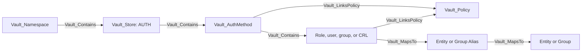

Specific mounts carry their specific kind first and `Vault_AuthMethod` second. Child records use `Vault_AuthRole`, `Vault_AuthUser`, or `Vault_AuthGroup` as a base kind where applicable.

## Common Nodes And Edges

| Type | Meaning |
| --- | --- |
| `Vault_AuthMethod` | Base node for an auth method mount. |
| `Vault_AuthRole` | Base node for role-like login configuration. |
| `Vault_AuthUser` | Base node for user-like login configuration. |
| `Vault_AuthGroup` | Base node for group-like policy mapping. |
| `Vault_Contains` | Auth Store to method, and method to immediate observed children. |
| `Vault_ListObjects` | List child roles, users, groups, CRLs, or related records. |
| `Vault_CreateObject` | Create a child object or target an exact synthetic child. |
| `Vault_ReadObject` | Read a concrete child configuration. |
| `Vault_ManageObject` | Update or delete a concrete child configuration. |
| `Vault_ReadConfig` | Read mount, tuning, or method-wide configuration. |
| `Vault_ManageConfig` | Change method configuration, tuning, credentials, or maintenance state. |
| `Vault_ControlObject` | Perform a parameter-aware mutation that proves takeover of a concrete auth object. |
| `Vault_LinksPolicy` | Role, user, group, or backend default grants a policy after authentication. |
| `Vault_MapsTo` | Auth principal resolves through an alias into canonical Vault identity. |

Collection globs expand read and manage rights to compatible observed children. Collection-wide creation remains anchored to the auth method and is non-traversable. Exact missing children may be emitted as detached synthetic nodes.

## Common Attack-Path Patterns

Auth configuration participates in attack paths in four ways:

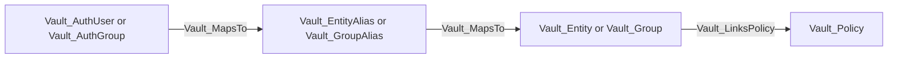

This identity-resolution chain describes the policies reached if the represented external authentication succeeds. The collector does not assert possession of the external credential.

Method-wide defaults are represented directly on the auth method:

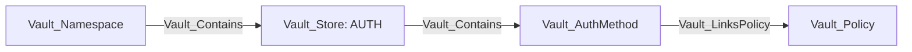

| Auth Methods | Policy Link Type | Meaning |
| --- | --- | --- |
| GitHub, LDAP, Okta, and RADIUS | `Auth Method Default` | Policy configured as a method-wide login default. |
| RADIUS | `Unregistered User Default` | Policy granted after successful RADIUS authentication when no configured user record matches. |

These links describe the policy outcome after successful external authentication. They do not prove possession of GitHub, LDAP, Okta, or RADIUS credentials.

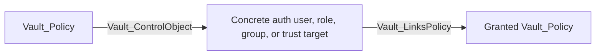

This chain is emitted only when parameter-aware mutation proves takeover of the concrete object and that object has an observed policy link. Ordinary `Vault_ManageObject` and `Vault_ManageConfig` remain non-traversable. Policy-assignment parameters remain evidence on the relevant management or control edge but do not synthesize a direct policy-to-policy relationship.

AppRole SecretID generation and privileged token issuance have their own traversable edge families because those endpoints can produce authentication material directly.

## Supported Methods

| Method | Mount node | Child nodes |
| --- | --- | --- |
| AliCloud | `Vault_AuthMethodAliCloud` | `Vault_AuthAliCloudRole` |
| AppRole | `Vault_AuthMethodApprole` | `Vault_AuthApproleRole` |
| AWS | `Vault_AuthMethodAws` | `Vault_AuthAwsRole` |
| Azure | `Vault_AuthMethodAzure` | `Vault_AuthAzureRole` |
| Cloud Foundry | `Vault_AuthMethodCf` | `Vault_AuthCfRole` |
| GCP | `Vault_AuthMethodGcp` | `Vault_AuthGcpRole` |
| GitHub | `Vault_AuthMethodGithub` | `Vault_AuthGithubUser`, `Vault_AuthGithubTeam` |
| JWT/OIDC | `Vault_AuthMethodJwtOidc` | `Vault_AuthJwtOidcRole` |
| Kerberos | `Vault_AuthMethodKerberos` | `Vault_AuthKerberosGroup` |
| Kubernetes | `Vault_AuthMethodKubernetes` | `Vault_AuthKubernetesRole` |
| LDAP | `Vault_AuthMethodLdap` | `Vault_AuthLdapUser`, `Vault_AuthLdapGroup` |
| OCI | `Vault_AuthMethodOci` | `Vault_AuthOciRole` |
| Okta | `Vault_AuthMethodOkta` | `Vault_AuthOktaUser`, `Vault_AuthOktaGroup` |
| RADIUS | `Vault_AuthMethodRadius` | `Vault_AuthRadiusUser` |
| SAML | `Vault_AuthMethodSaml` | `Vault_AuthSamlRole` |
| SCEP | `Vault_AuthMethodScep` | `Vault_AuthScepRole` |
| SPIFFE | `Vault_AuthMethodSpiffe` | `Vault_AuthSpiffeRole` |
| TLS Certificate | `Vault_AuthMethodTlsCert` | `Vault_AuthTlsCertRole`, `Vault_AuthTlsCertCrl` |
| Token | `Vault_AuthMethodToken` | `Vault_AuthTokenRole` |
| UserPass | `Vault_AuthMethodUserpass` | `Vault_AuthUserpassUser` |

## AliCloud

AliCloud roles capture RAM role and principal constraints, token policy behavior, TTLs, CIDRs, and alias metadata. The auth method is supported even though the AliCloud secrets engine is not collected as a first-class backend.

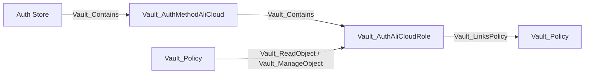

Configuration uses `Vault_ReadConfig` and `Vault_ManageConfig`; role CRUD uses generic object edges. No login edge is emitted because the login endpoint is the unauthenticated authentication surface.

### Attack Paths

AliCloud roles link the policies granted after a successful external login, but VaultHound emits no policy-to-login attack edge. Role management and mount configuration are non-traversable unless a separate parameter-aware control derivation proves takeover.

## AppRole

AppRole roles include RoleID state, SecretID binding, CIDR restrictions, SecretID limits, token policies, TTLs, periods, and token type.

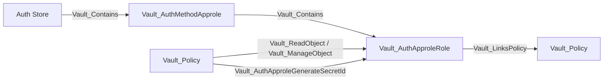

| Edge | Target | Meaning |
| --- | --- | --- |
| `Vault_AuthApproleReadSecretId` | Role | Read SecretID accessor metadata. |
| `Vault_AuthApproleGenerateSecretId` | Role | Generate a SecretID; traversable only when a usable RoleID is known or independently readable. |
| `Vault_AuthApproleManageSecretId` | Role | Destroy SecretIDs or accessors. |
| `Vault_PotentialAccess` | Role | SecretID generation where RoleID availability or another prerequisite is unresolved. |

RoleID is always required for login. SecretID generation alone is not treated as a complete credential path when RoleID is unavailable.

### Attack Paths

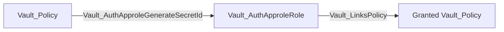

The chain is traversable only when RoleID is known or independently readable. Without RoleID, SecretID generation becomes `Vault_PotentialAccess`. SecretID accessor reads and SecretID destruction remain non-traversable.

## AWS

AWS roles cover IAM and EC2 authentication modes, principal ARNs, account/region restrictions, AMIs, VPCs, subnets, instances, role tags, inferred aliases, and token behavior.

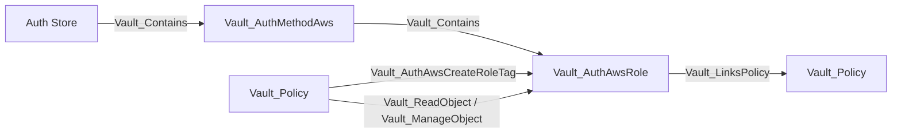

`Vault_AuthAwsCreateRoleTag` represents creation of a role tag that can satisfy a login prerequisite; it is not itself a complete AWS login credential. Method configuration records STS and IAM endpoints, client credentials where exposed, and root rotation behavior through generic config edges.

### Attack Paths

AWS auth roles link policies that would be granted after successful IAM or EC2 authentication. `Vault_AuthAwsCreateRoleTag` is non-traversable because the tag is only one login prerequisite. No direct attack path is asserted without a valid AWS identity document or independently resolved identity correlation.

## Azure

Azure roles capture tenant and resource context, subscriptions, resource groups, locations, VM and scale-set identities, service principals, audiences, token settings, and alias metadata.

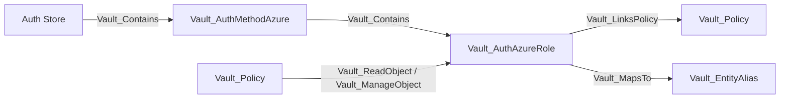

Mount-wide tenant, environment, resource, and identity credential settings use generic config edges. VaultHound does not validate Azure workload identity or live tenant state.

### Attack Paths

Azure roles participate in the common identity-to-policy chain when a collected alias correlation exists. Reading or managing the role does not prove possession of an Azure workload credential, so no policy-to-login edge is emitted.

## Cloud Foundry

Cloud Foundry roles capture API and certificate trust configuration, signature validity, organization, space, application constraints, certificate requirements, and token settings.


Unrestricted replacement of `identity_ca_certificates` derives `Vault_ControlObject` to each observed CF role. Value-constrained replacement emits `Vault_PotentialAccess`, while writes limited to routing, timeout, or CF API client settings remain ordinary non-traversable configuration management.

### Attack Paths

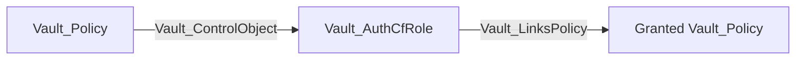

This path is derived only when configuration and parameter constraints prove that the caller can replace the instance-identity CA trust with attacker-controlled values. Role CIDRs, instance-IP matching, and token-bound CIDRs are retained as requirements on the edge. Ordinary CF configuration access remains non-traversable.

## GCP

GCP roles distinguish IAM and GCE login modes and include projects, service accounts, zones, regions, instance groups, labels, token settings, and alias metadata.


The collector models Vault's binding configuration but does not independently prove Google Cloud IAM membership or possession of a valid signed identity document.

### Attack Paths

GCP roles link policies available after a successful IAM or GCE login. Alias correlation can connect an observed GCP representation to canonical Vault identity, but role management alone is not an authentication path.

## GitHub

GitHub auth stores organization configuration plus Vault-local user and team mappings. Teams use the generic auth-group base type.

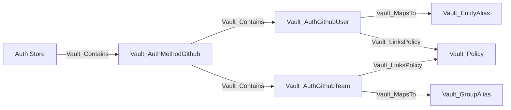

User and team CRUD uses generic object edges. External organization membership is not independently queried, so mappings describe what Vault grants if GitHub authentication succeeds.

### Attack Paths

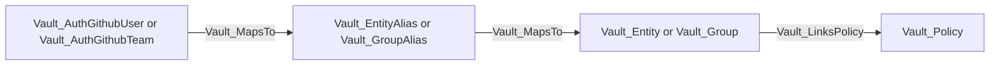

The chain exposes policy accumulation for a correlated GitHub principal. It does not prove control of the GitHub account or membership in the external organization.

## JWT/OIDC

The JWT/OIDC auth method validates inbound JWTs or performs inbound OIDC login. It is separate from the Identity Store's outbound OIDC provider model.

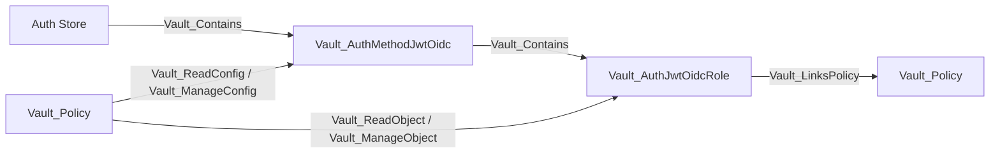

Mount properties include discovery, verification keys, bound issuer, algorithms, default role, and provider configuration. Roles include role type, audiences, subjects, bound claims, redirect URIs, scopes, claim mappings, groups, and token settings. Unrestricted trust replacement can derive `Vault_ControlObject`; parameter-constrained replacement remains ordinary or potential management.

### Attack Paths

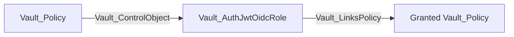

The path requires proof that attacker-controlled issuer, discovery, verification-key, or claim values can satisfy the concrete role. Constrained trust changes produce `Vault_PotentialAccess` or ordinary management instead.

## Kerberos

Kerberos models mount-wide Kerberos/LDAP configuration and Vault group policy mappings. It does not ingest a complete Kerberos directory.

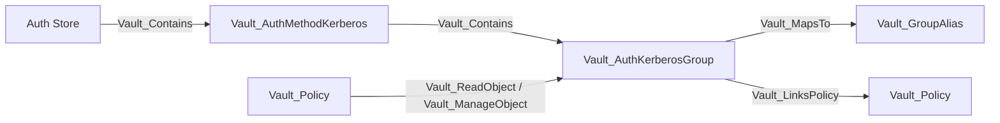

SPN, keytab, LDAP, case behavior, and token configuration use method properties and generic config edges. Group aliases model canonical Vault group resolution after authentication.

### Attack Paths

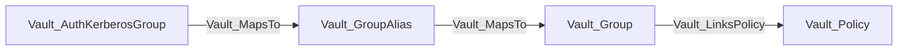

This shows the policy consequence of a correlated Kerberos group. It does not prove Kerberos credential possession or external directory membership.

## Kubernetes

Kubernetes roles bind service accounts, namespaces, namespace selectors, audiences, alias metadata, and token settings to Vault policies.

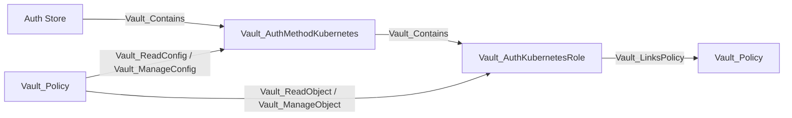

The mount records Kubernetes host, CA, token reviewer, issuer validation, and service-account behavior. Replacing unrestricted reviewer or cluster trust can derive control of compatible roles; ordinary role management remains non-traversable.

### Attack Paths

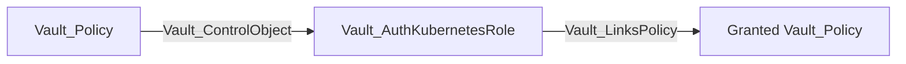

This requires an unrestricted trust or reviewer replacement that makes an attacker-controlled Kubernetes token satisfy the observed role. Merely editing the role or reading cluster configuration does not create the path.

## LDAP

LDAP auth models Vault-local LDAP user and group mappings plus mount connection and bind configuration.

```mermaid
flowchart LR
    store[Auth Store] -->|Vault_Contains| method[Vault_AuthMethodLdap]
    method -->|Vault_Contains| user[Vault_AuthLdapUser]
    method -->|Vault_Contains| group[Vault_AuthLdapGroup]
    user -->|Vault_MemberOf| group
    group -->|Vault_LinksPolicy| policy
    user -->|Vault_LinksPolicy| policy[Vault_Policy]
```

Configuration includes URLs, bind DN behavior, user/group search, nested groups, case sensitivity, certificates, token settings, and root credential rotation. The user/group nodes are mappings known to Vault, not a complete LDAP inventory.

### Attack Paths

```mermaid
flowchart LR
    user[Vault_AuthLdapUser] -->|Vault_MemberOf| authGroup[Vault_AuthLdapGroup]
    authGroup -->|Vault_LinksPolicy| policy[Vault_Policy]
    principal["Vault_AuthLdapUser or Vault_AuthLdapGroup"] -->|Vault_MapsTo| alias["Vault_EntityAlias or Vault_GroupAlias"]
    alias -->|Vault_MapsTo| identity["Vault_Entity or Vault_Group"]
```

The graph exposes mapped and inherited Vault policies for LDAP names returned by Vault. It does not assert live LDAP credentials or complete directory membership.

## OCI

OCI roles capture group and dynamic-group OCIDs, tenancy constraints, request-header validation, alias metadata, and token policies.

```mermaid
flowchart LR
    store[Auth Store] -->|Vault_Contains| method[Vault_AuthMethodOci]
    method -->|Vault_Contains| role[Vault_AuthOciRole]
    admin[Vault_Policy] -->|Vault_ReadObject / Vault_ManageObject| role
    role -->|Vault_LinksPolicy| granted[Vault_Policy]
```

VaultHound preserves the configured OCI selectors but does not independently resolve dynamic-group membership or verify signed request credentials.

### Attack Paths

OCI roles participate in policy-grant and alias-resolution chains after external OCI authentication. No direct login edge is emitted because the collector cannot prove possession of a signed OCI request or group membership.

## Okta

Okta auth contains Vault-local user and group policy mappings and method-wide Okta organization/API configuration.

```mermaid
flowchart LR
    store[Auth Store] -->|Vault_Contains| method[Vault_AuthMethodOkta]
    method -->|Vault_Contains| user[Vault_AuthOktaUser]
    method -->|Vault_Contains| group[Vault_AuthOktaGroup]
    user -->|Vault_MapsTo| alias[Vault_EntityAlias]
    group -->|Vault_MapsTo| groupAlias[Vault_GroupAlias]
    user -->|Vault_LinksPolicy| policy[Vault_Policy]
    group -->|Vault_LinksPolicy| policy
```

Okta's API token is a write-only configuration input and is not returned by the configuration read endpoint. Configuration and mapping reads therefore remain non-traversable and do not produce `Vault_ReadCredential`.

### Attack Paths

```mermaid
flowchart LR
    principal["Vault_AuthOktaUser or Vault_AuthOktaGroup"] -->|Vault_MapsTo| alias["Vault_EntityAlias or Vault_GroupAlias"]
    alias -->|Vault_MapsTo| identity["Vault_Entity or Vault_Group"]
    identity -->|Vault_LinksPolicy| policy[Vault_Policy]
```

External Okta authentication and live group membership are not independently proven. Alias correlation records matching Vault Identity aliases without claiming that Vault returned the configured Okta API token.

## RADIUS

RADIUS stores mount-wide server/NAS configuration and optional Vault-local user-to-policy mappings.

```mermaid
flowchart LR
    store[Auth Store] -->|Vault_Contains| method[Vault_AuthMethodRadius]
    method -->|Vault_Contains| user[Vault_AuthRadiusUser]
    user -->|Vault_MapsTo| alias[Vault_EntityAlias]
    user -->|Vault_LinksPolicy| policy[Vault_Policy]
    admin[Vault_Policy] -->|Vault_ReadObject / Vault_ManageObject| user
```

Server, port, shared-secret-related configuration, NAS settings, and token behavior use generic config edges. Login ability is not represented as an ACL edge.

### Attack Paths

`Vault_AuthRadiusUser` can map through an entity alias and link configured policies, but no policy-to-login path is emitted. The RADIUS password exchange is external and unauthenticated from Vault's ACL perspective.

## SAML

SAML models IdP trust at the method and attribute/subject matching at roles.

```mermaid
flowchart LR
    store[Auth Store] -->|Vault_Contains| method[Vault_AuthMethodSaml]
    method -->|Vault_Contains| role[Vault_AuthSamlRole]
    method -->|Vault_AuthSamlDefaultRole| role
    admin[Vault_Policy] -->|Vault_ReadConfig / Vault_ManageConfig| method
    role -->|Vault_LinksPolicy| granted[Vault_Policy]
```

Configuration includes IdP metadata or certificate trust, entity IDs, SSO URLs, default role, and assertion behavior. Roles capture bound subjects, attributes, group attributes, and policies. Unrestricted trust replacement may derive control of observed roles.

### Attack Paths

```mermaid
flowchart LR
    policy[Vault_Policy] -->|Vault_ControlObject| role[Vault_AuthSamlRole]
    role -->|Vault_LinksPolicy| granted["Granted Vault_Policy"]
```

The edge requires unrestricted attacker-controlled IdP metadata, certificate, or assertion-routing values compatible with the role. Routing-only writes or constrained trust replacement remain non-traversable or potential.

## SCEP

SCEP auth supports static-challenge and Intune-style authentication used by compatible PKI issuance protocol configuration.

```mermaid
flowchart LR
    store[Auth Store] -->|Vault_Contains| method[Vault_AuthMethodScep]
    method -->|Vault_Contains| role[Vault_AuthScepRole]
    pki[Vault_SecretsEnginePki] -->|Vault_References| method
    pki -->|Vault_References| role
    role -->|Vault_LinksPolicy| granted[Vault_Policy]
```

Challenge, validation, authentication type, role compatibility, and token policy properties are collected where Vault returns them. PKI-to-auth dependencies use `Vault_References` with evidence properties instead of separate near-duplicate edge kinds.

### Attack Paths

SCEP configuration and PKI references are non-traversable evidence. VaultHound does not infer enrollment or Vault policy acquisition from the reference alone; a concrete PKI issuance edge must establish the certificate outcome.

## SPIFFE

SPIFFE roles match workload identities validated by trust-domain, JWT, or X.509 profiles.

```mermaid
flowchart LR
    store[Auth Store] -->|Vault_Contains| method[Vault_AuthMethodSpiffe]
    method -->|Vault_Contains| role[Vault_AuthSpiffeRole]
    alias[Vault_EntityAlias] -->|Vault_AuthSpiffeMayMatchRole| role
    role -->|Vault_LinksPolicy| granted[Vault_Policy]
    admin[Vault_Policy] -->|Vault_ReadObject / Vault_ManageObject| role
```

`Vault_AuthSpiffeMayMatchRole` records observed alias compatibility; it is non-traversable because possession of a currently valid SPIFFE credential is not proven. Trust domain, bundle, workload ID templates, audiences, and token settings are retained.

### Attack Paths

SPIFFE aliases can resolve into canonical identity through `Vault_MapsTo`, but `Vault_AuthSpiffeMayMatchRole` is not an attack-path hop. It records compatibility only; a valid workload credential is an unresolved external prerequisite.

## TLS Certificate

TLS Certificate auth contains trusted certificate roles and CRL records.

```mermaid
flowchart LR
    store[Auth Store] -->|Vault_Contains| method[Vault_AuthMethodTlsCert]
    method -->|Vault_Contains| role[Vault_AuthTlsCertRole]
    method -->|Vault_Contains| crl[Vault_AuthTlsCertCrl]
    role -->|Vault_LinksPolicy| granted[Vault_Policy]
    admin[Vault_Policy] -->|Vault_ReadObject / Vault_ManageObject| role
    admin -->|Vault_ReadObject / Vault_ManageObject| crl
```

Roles include trusted certificate material, names, DNS/email/URI constraints, organizational units, extensions, token settings, and OCSP behavior. Unrestricted replacement of trusted material can derive `Vault_ControlObject`; constrained replacement remains management or potential access.

### Attack Paths

```mermaid
flowchart LR
    policy[Vault_Policy] -->|Vault_ControlObject| role[Vault_AuthTlsCertRole]
    role -->|Vault_LinksPolicy| granted["Granted Vault_Policy"]
```

This requires the ability to replace trusted certificate material or matching constraints with values controlled by the attacker. CRL maintenance and constrained role changes do not automatically confer login ability.

## Token

Token auth contains token roles but does not enumerate ordinary live tokens. A root token can authenticate without any token role because the built-in token auth method validates issued tokens directly; roles are optional issuance templates.

```mermaid
flowchart LR
    store[Auth Store] -->|Vault_Contains| method[Vault_AuthMethodToken]
    method -->|Vault_Contains| role[Vault_AuthTokenRole]
    admin[Vault_Policy] -->|Vault_AuthTokenCreateRestrictedToken| method
    admin -->|Vault_AuthTokenCreatePrivilegedToken| role
    admin -->|Vault_AuthTokenCreatePrivilegedToken| policyStore[Policy Store]
    admin -->|Vault_AuthTokenCreatePrivilegedToken| alias[Vault_EntityAlias]
    role -->|Vault_LinksPolicy| granted[Vault_Policy]
```

| Edge | Target | Meaning |
| --- | --- | --- |
| `Vault_AuthTokenReadToken` | Token method or role context | Lookup token or accessor state. |
| `Vault_AuthTokenCreateRestrictedToken` | Method or role | Create a token constrained to the caller's policy subset; non-traversable. |
| `Vault_AuthTokenCreatePrivilegedToken` | Concrete role, Policy Store, or entity alias | Create a token with proven policy expansion: delegated role policies, sudo-authorized bare issuance, or a privileged allowed entity alias; traversable. |
| `Vault_AuthTokenManageToken` | Method or role context | Renew or revoke tokens. |
| `Vault_AuthTokenListAccessors` | Token method | List token accessors on the sudo-gated endpoint. |

Token roles include allowed/disallowed policies, orphan behavior, renewable state, path suffix, CIDRs, TTLs, periods, explicit maximum TTL, and token type.

### Attack Paths

```mermaid
flowchart LR
    policy[Vault_Policy] -->|Vault_AuthTokenCreatePrivilegedToken| role[Vault_AuthTokenRole]
    role -->|Vault_LinksPolicy| granted["Granted Vault_Policy"]
```

```mermaid
flowchart LR
    policy[Vault_Policy] -->|Vault_AuthTokenCreatePrivilegedToken| store["Policy Store"]
```

```mermaid
flowchart LR
    policy[Vault_Policy] -->|Vault_AuthTokenCreatePrivilegedToken| alias[Vault_EntityAlias]
    alias -->|Vault_MapsTo| entity[Vault_Entity]
    entity -->|Vault_LinksPolicy| granted["Granted Vault_Policy"]
```

The role target is used when an observed role delegates policies beyond the caller's baseline. The Policy Store target represents sudo-authorized bare `/create` or `/create-orphan` issuance with namespace-wide policy selection. The entity-alias target is used when an observed `allowed_entity_aliases` selection resolves to an entity with additional effective policies. `Vault_AuthTokenCreateRestrictedToken` remains non-traversable because it cannot normally grant more than the caller's policy subset. Token lookup, renewal, revocation, and accessor listing are also non-traversable.

## UserPass

UserPass stores local username records with password state, token policies, TTLs, periods, CIDRs, and token type.

```mermaid
flowchart LR
    store[Auth Store] -->|Vault_Contains| method[Vault_AuthMethodUserpass]
    method -->|Vault_Contains| user[Vault_AuthUserpassUser]
    user -->|Vault_MapsTo| alias[Vault_EntityAlias]
    alias -->|Vault_MapsTo| entity[Vault_Entity]
    user -->|Vault_LinksPolicy| granted[Vault_Policy]
    admin[Vault_Policy] -->|Vault_ControlObject| user
```

Password, policy, and token-setting updates are generic object management. An unrestricted password reset derives traversable `Vault_ControlObject` because it allows authentication as the concrete user.

### Attack Paths

```mermaid
flowchart LR
    policyA["Vault_Policy A"] -->|Vault_ControlObject| user[Vault_AuthUserpassUser]
    user -->|Vault_MapsTo| alias[Vault_EntityAlias]
    alias -->|Vault_MapsTo| entity[Vault_Entity]
    entity -->|Vault_LinksPolicy| policyB["Vault_Policy B"]
```

The control edge exists only when Policy A can set an attacker-controlled password for the concrete user. Traversal reaches Policy B through the user's observed identity mapping and policy links; possible assignment of other policies remains edge evidence rather than a synthetic shortcut.

## Glob, Synthetic, And Control Behavior

- `auth/<mount>/role/*`-style paths expand read/manage rights to compatible observed roles.
- Exact missing role, user, or group names can create detached synthetic targets.
- Collection creation is anchored to the method with `can_create_unobserved_objects` evidence.
- SecretID, privileged token, and takeover edges require their method-specific prerequisites even under a broad glob.
- Broad `auth/*` and method-specific globs use the same endpoint-routing logic, so equivalent rights normalize to equivalent edges.

## Limitations

- VaultHound does not attempt logins or validate external credentials.
- External user/group membership is limited to Vault mappings and aliases returned by the API.
- MFA, control groups, quotas, token wrapping, and runtime token state can impose additional conditions.
- A role describes who may authenticate and which policies would be granted; it does not prove credential possession.
