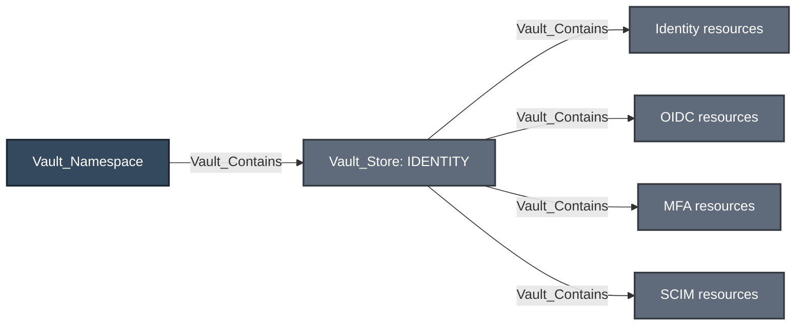
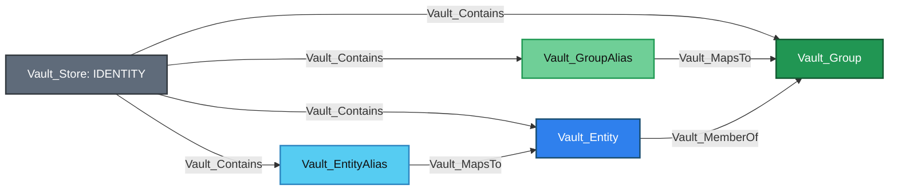
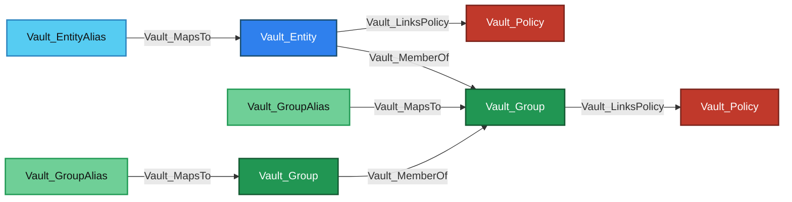
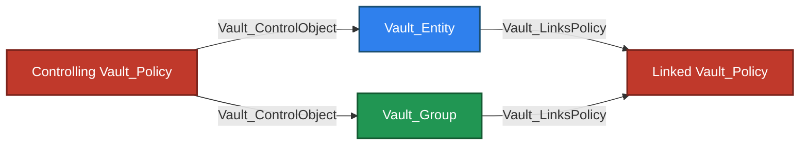
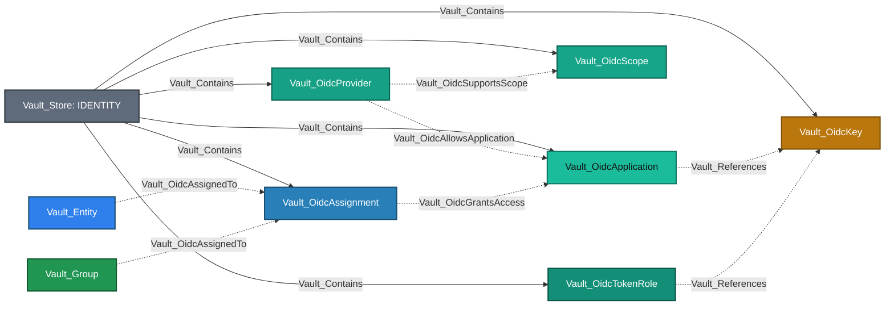
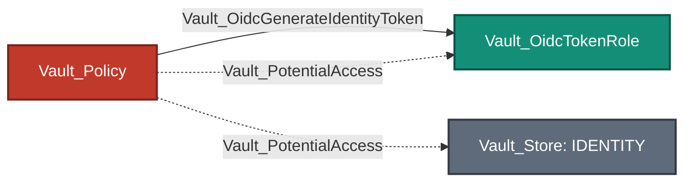
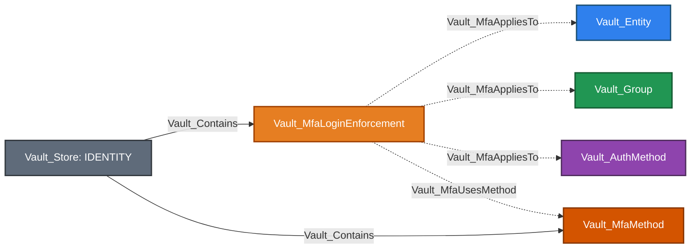
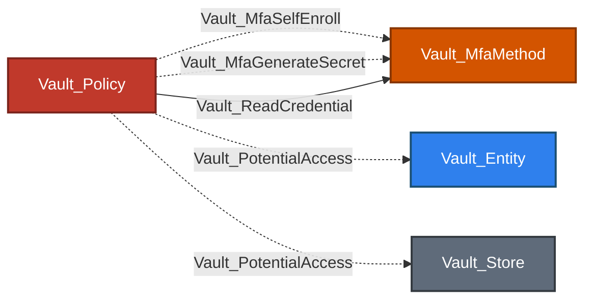
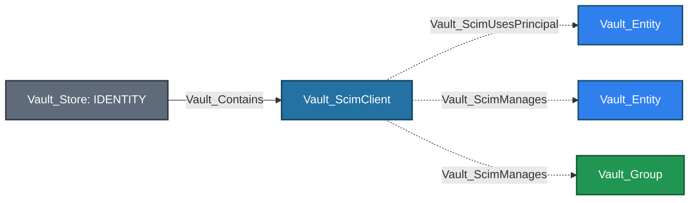
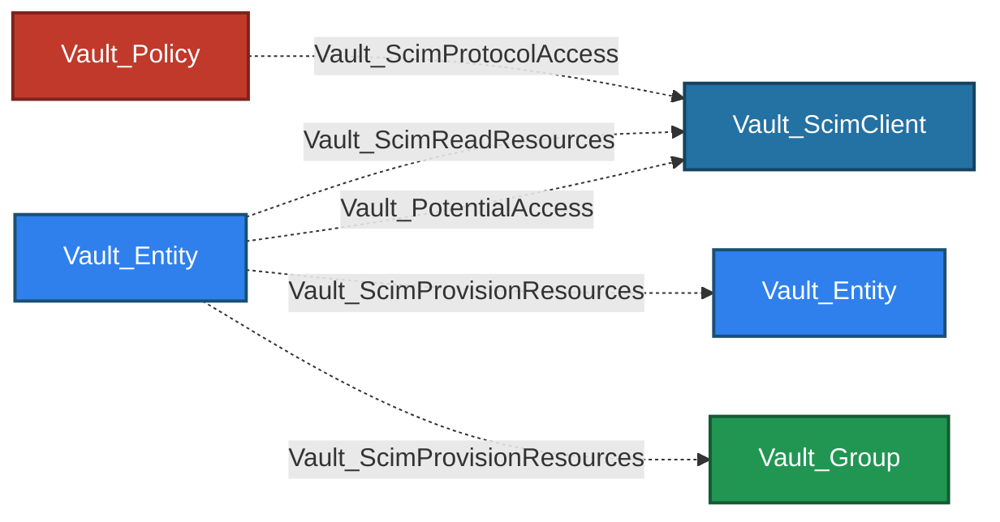

# Identity Store

The Identity Store represents Vault's namespace-local identity subsystem under `identity/`. Unlike the Auth and Mount stores, it is not a catalogue of interchangeable backends. It is one store containing four distinct technologies: canonical identity administration, outbound OIDC, MFA, and Enterprise SCIM.

## Store Topology

Mermaid diagrams in this guide use solid arrows for traversable relationships and dashed arrows for non-traversable configuration, constraint, ownership, or evidence relationships.



Equivalent Cypher query:

```cypher
MATCH p = (:Vault_Namespace)-[:Vault_Contains]->(store:Vault_Store)-[:Vault_Contains]->(d)
WHERE store.`Store Type` = "Identity"
RETURN p
```

The Identity `Vault_Store` is the shared namespace anchor. Each technology section shows the concrete observed nodes contained by that store; the overview deliberately avoids conceptual resource boxes that could be mistaken for schema kinds.

Generic store machinery is defined once in the graph model: [base structural edges](../MODEL.md#base-structural-edges), [base access edges](../MODEL.md#base-access-edges), and [policy-derived edge metadata](../MODEL.md#policy-derived-edge-metadata). The technology sections below list only node and edge kinds introduced specifically for that technology. They may still use generic edges such as `Vault_Contains`, `Vault_References`, `Vault_ListObjects`, `Vault_CreateObject`, `Vault_ManageObject`, `Vault_ReadConfig`, `Vault_ManageConfig`, `Vault_ReadCredential`, `Vault_ControlObject`, `Vault_DenyAccess`, and `Vault_PotentialAccess` in topology, administration, or attack-path examples.

## Subsystems At A Glance

| Subsystem | Purpose | Primary Nodes | Security-Relevant Outcomes |
| --- | --- | --- | --- |
| Identity Administration | Canonical entities, aliases, groups, membership, and policy propagation. | `Vault_Entity`, `Vault_EntityAlias`, `Vault_Group`, `Vault_GroupAlias` | Policy inheritance and parameter-aware identity takeover. |
| Outbound OIDC | Makes Vault an OIDC identity provider for applications and identity-token roles. | `Vault_OidcProvider`, `Vault_OidcApplication`, `Vault_OidcKey`, `Vault_OidcScope`, `Vault_OidcAssignment`, `Vault_OidcTokenRole` | Application authentication, identity-token generation, and confidential client-secret exposure. |
| MFA | Configures MFA methods and login-enforcement constraints. | `Vault_MfaMethod`, `Vault_MfaLoginEnforcement` | Integration-credential exposure and conditional TOTP enrollment. |
| SCIM | Provisions Vault entities and groups through Enterprise SCIM clients. | `Vault_ScimClient`, client-owned `Vault_Entity` and `Vault_Group` | Principal-qualified read and provisioning evidence. |

## Identity Store Semantics

- Every Identity Store and its resources are namespace-scoped. MFA objects can additionally record owning and visible namespace IDs returned by Vault Enterprise.
- Entity and group aliases are resolved through their canonical IDs and auth mount accessors; matching names alone do not prove identity equivalence.
- Entities and groups can carry policies, while `Vault_MemberOf` propagates policy authority through direct and nested membership.
- Collection-wide authority terminates at the Identity Store. Exact read and management authority targets concrete objects whenever the collector can resolve them.
- Creation authority for unobserved Identity objects remains anchored to the Identity Store, including exact unresolved names; the collector does not materialize synthetic Identity subsystem nodes.
- Generic glob, deny, sudo, and template behavior follows the [Policy Store ACL evaluation contract](POLICIES.md#acl-evaluation); Identity creation uses the store-anchored behavior described above.

## Common Administration

Policy-derived administration uses the same generic edge families across all four Identity subsystems. Concrete observed objects are targeted directly; collection creation, aggregate operations, and unresolved object references remain anchored to the namespace's Identity Store.

| Generic Edge | Destination | Identity Store Meaning |
| --- | --- | --- |
| `Vault_ReadConfig` | Identity Store | Reads namespace-level Identity configuration. |
| `Vault_ManageConfig` | Identity Store | Changes namespace-level Identity configuration, such as the outbound OIDC issuer. |
| `Vault_ListObjects` | Identity Store | Enumerates one or more Identity object collections. `Object Types` identifies the collections. |
| `Vault_CreateObject` | Identity Store | Represents collection-wide, patterned, or exact unresolved authority to create Identity objects. |
| `Vault_ReadObject` | Concrete observed Identity object | Reads a resolved entity, alias, group, OIDC object, MFA object, or SCIM client. |
| `Vault_ManageObject` | Concrete observed Identity object | Updates or deletes a resolved object after impossible operations and known constraints are applied. |
| `Vault_ReadIdentity` | Identity Store | Represents store-level lookup, introspection, aggregate visibility, or an unresolved Identity read. It is not used for a resolved concrete object. |
| `Vault_ReadCredential` | Concrete secret-bearing Identity object | Records a confirmed credential returned by an authenticated read. |
| `Vault_ControlObject` | Concrete entity or group | Records a parameter-aware mutation that proves control over a policy-bearing identity. |
| `Vault_PotentialAccess` | Concrete object or subsystem anchor | Preserves a security-relevant outcome whose target or prerequisite cannot be proven. |

Common access edges use the [base access-edge contract](../MODEL.md#base-access-edges) and [policy-derived metadata](../MODEL.md#policy-derived-edge-metadata). Identity-specific values commonly carried by those edges are:

| Edge Type | Property | Description |
| --- | --- | --- |
| `Vault_ListObjects`<br>`Vault_CreateObject`<br>`Vault_ReadObject`<br>`Vault_ManageObject` | `Object Types` | Identifies the concrete Identity resource families represented by the edge. |
| `Vault_ReadObject` | `Read Targets` | Identifies the configuration or record returned by a concrete object read. |
| `Vault_ReadIdentity` | `Identity Targets` | Identifies the aggregate or unresolved Identity resource families represented at the store. |
| `Vault_ReadIdentity` | `Read Targets` | Identifies the store-level records, lookup results, or service data exposed by the read. |
| `Vault_ReadIdentity` | `Lookup Targets` | Identifies whether a store-native lookup can return entity records, group records, or both. |
| `Vault_ReadObject`<br>`Vault_ReadIdentity` | `Operations` | Lists the concrete read or store-native Identity operation represented by the edge. |
| `Vault_ManageObject`<br>`Vault_ManageConfig` | `Operations` | Lists the viable administrative operations retained after known constraints are applied. |

### Store Properties

| Node Type | Property | Description |
| --- | --- | --- |
| `Vault_Store` | `Identity Token Issuer` | Records the namespace-level issuer returned by `identity/oidc/config`, when configured. |

## Identity Administration

Canonical identity administration owns Vault entities, aliases, and groups. Auth-specific users and groups enter this subsystem only when `Vault_MapsTo` proves a matching alias on the same auth mount accessor and external name.

### Topology



Equivalent Cypher query:

```cypher
MATCH p = (s)-[r]->(d)
WHERE type(r) IN ["Vault_Contains", "Vault_MapsTo", "Vault_MemberOf", "Vault_OnAuthMethod"]
  AND (s:Vault_Store OR s:Vault_Entity OR s:Vault_EntityAlias OR s:Vault_Group OR s:Vault_GroupAlias)
  AND (d:Vault_Entity OR d:Vault_EntityAlias OR d:Vault_Group OR d:Vault_GroupAlias OR d:Vault_AuthMethod)
RETURN p
```

### Nodes

| Type | Meaning |
| --- | --- |
| `Vault_Entity` | Canonical identity with direct policies, effective groups, metadata, aliases, creation time, and update time. |
| `Vault_EntityAlias` | Auth-mount-specific external name that resolves to a canonical entity. |
| `Vault_Group` | Internal or external group with policies, member entities, child groups, aliases, and metadata. |
| `Vault_GroupAlias` | External group name on an auth mount that resolves to a canonical group. |

### Edges

In every access-control example in this guide, `Policy` denotes [policy authority](../MODEL.md#declared-and-derived-authority): normally the declaring `Vault_Policy`, or the referenced entity, alias, or group when an Identity template produces an effective rendered edge.

| Edge | Source | Destination | Traversable | Meaning |
| --- | --- | --- | :---: | --- |
| `Vault_MapsTo` | Auth principal or alias | Alias or canonical identity | :white_check_mark: | Correlates an external representation with Vault identity. |
| `Vault_MemberOf` | Entity or child group | Group | :white_check_mark: | Carries policy-bearing membership. |

The cross-store `Vault_OnAuthMethod` relationship shown in the topology is defined in [Auth Store common edges](AUTH.md#common-edges), because it identifies the auth mount that owns an Identity alias.

Group membership returned by Vault is modeled; VaultHound does not independently query external directories to prove upstream membership.

Generic administration follows [Common Administration](#common-administration). Concrete entity, alias, group, and group-alias reads use `Vault_ReadObject`; store-native lookup, introspection, aggregate, and unresolved surfaces use `Vault_ReadIdentity`. `Vault_ControlObject` appears only when an otherwise generic mutation proves concrete control, such as rebinding an alias, changing membership in a policy-bearing group, or assigning policies to an identity already controlled by the source.

### Node Properties

| Node Type | Property | Description |
| --- | --- | --- |
| `Vault_Entity` | `Entity ID` | Records Vault's canonical identity identifier. |
| `Vault_Entity` | `Entity Name` | Records the canonical identity's display name. |
| `Vault_Entity` | `Disabled` | Indicates whether authentication through the entity is disabled. |
| `Vault_Entity` | `Bucket Key Hash` | Records Vault's internal storage-bucket hash for the entity. |
| `Vault_Entity` | `External ID` | Records the external identifier associated with the entity when present. |
| `Vault_Entity`<br>`Vault_Group` | `Policies` | Lists policies assigned directly to the canonical identity object. |
| `Vault_Entity` | `Entity Alias IDs` | Lists aliases that resolve to the entity. |
| `Vault_Entity` | `Direct Group IDs` | Lists groups in which the entity has direct membership. |
| `Vault_Entity` | `Effective Group IDs` | Lists all groups affecting the entity after hierarchy expansion. |
| `Vault_Entity` | `Inherited Group IDs` | Lists effective groups reached through nested group membership. |
| `Vault_Entity` | `Merged Entity IDs` | Lists canonical entities merged into this entity. |
| `Vault_EntityAlias` | `Entity Alias ID` | Records Vault's stable identifier for the entity alias. |
| `Vault_EntityAlias` | `Entity Alias Name` | Records the external login name represented by the alias. |
| `Vault_EntityAlias`<br>`Vault_GroupAlias` | `Mount Path` | Identifies the auth mount path on which the alias exists. |
| `Vault_EntityAlias`<br>`Vault_GroupAlias` | `Mount Accessor` | Identifies the auth mount accessor used to resolve the alias. |
| `Vault_EntityAlias`<br>`Vault_GroupAlias` | `Mount Type` | Identifies the authentication backend type associated with the alias. |
| `Vault_EntityAlias` | `Entity ID` | Identifies the canonical entity to which the alias resolves. |
| `Vault_EntityAlias`<br>`Vault_GroupAlias` | `Local` | Indicates whether the alias is local to the performance replication cluster. |
| `Vault_EntityAlias`<br>`Vault_GroupAlias` | `Merged From Canonical IDs` | Lists prior canonical IDs represented by the alias after identity merging. |
| `Vault_Entity`<br>`Vault_EntityAlias`<br>`Vault_Group`<br>`Vault_GroupAlias` | `Metadata <key>` | Exposes each dynamic metadata entry returned by Vault as a flattened property. The suffix is the original metadata key. |
| `Vault_EntityAlias`<br>`Vault_GroupAlias` | `Custom Metadata <key>` | Exposes each dynamic alias custom-metadata entry as a flattened property. The suffix is the original custom-metadata key. |
| `Vault_Group` | `Group ID` | Records Vault's canonical group identifier. |
| `Vault_Group` | `Group Name` | Records the group's display name. |
| `Vault_Group` | `Group Type` | Identifies whether the group is internal or external. |
| `Vault_Group` | `Member Entity IDs` | Lists entities with direct membership in the group. |
| `Vault_Group` | `Member Group IDs` | Lists child groups directly included in the group. |
| `Vault_Group` | `Parent Group IDs` | Lists groups that contain this group. |
| `Vault_Group` | `Modify Index` | Records Vault's modification index for the group. |
| `Vault_GroupAlias` | `Group Alias ID` | Records Vault's stable identifier for the group alias. |
| `Vault_GroupAlias` | `Group Alias Name` | Records the external group name represented by the alias. |
| `Vault_GroupAlias` | `Group ID` | Identifies the canonical group to which the alias resolves. |
| `Vault_Entity`<br>`Vault_EntityAlias`<br>`Vault_Group`<br>`Vault_GroupAlias` | `Creation Time` | Records when Vault created the identity object. |
| `Vault_Entity`<br>`Vault_EntityAlias`<br>`Vault_Group`<br>`Vault_GroupAlias` | `Last Update Time` | Records the identity object's most recent update time. |

Identifier-list properties preserve the values returned by Vault. Resolved relationships such as `Vault_MapsTo` and `Vault_MemberOf` provide the graph topology; the properties remain useful when a referenced object was not collected or could not be resolved.

### Edge Properties

Identity administration introduces no additional properties on `Vault_MapsTo` or `Vault_MemberOf`. Their source, destination, and edge kind are the relationship evidence. Generic read and management properties are documented under [Common Administration](#common-administration), while the Identity-specific `Vault_ControlObject` values are listed under [Attack Paths](#attack-paths).

The canonical `Vault_LinksPolicy.Policy Link Types` contract is documented once under [Policy Assignment](POLICIES.md#policy-assignment). Identity uses the direct assignment values from that shared contract; group inheritance remains structural through `Vault_MemberOf`.

### Template Participation

`Vault_Entity`, `Vault_EntityAlias`, and `Vault_Group` can become effective sources for successfully rendered Identity-template policy paths. They do not introduce template-specific edge kinds: the destination subsystem's ordinary edge is emitted with template and policy-provenance properties.

The canonical rendering, source-selection, wildcard, and unresolved-template rules live under [Identity Templates](POLICIES.md#identity-templates). In particular, unresolved expressions emit no effective edge, and group inheritance alone does not make a group the source unless the resolved template context selects that group.

### Attack Paths

Auth-specific users and groups enter these paths only when `Vault_MapsTo` proves a matching alias. From that point, alias resolution, canonical membership, and policy propagation are Identity responsibilities:



Equivalent Cypher query:

```cypher
MATCH p = (s)-[:Vault_MapsTo|Vault_MemberOf|Vault_LinksPolicy*1..]->(:Vault_Policy)
WHERE (s:Vault_EntityAlias OR s:Vault_GroupAlias OR s:Vault_Entity OR s:Vault_Group)
RETURN p
```

An entity receives directly linked policies and policies inherited through every traversable `Vault_MemberOf` chain. A group can likewise inherit from a parent group. Alias nodes resolve identity but do not carry policy assignments themselves.

Parameter-aware alias rebinding, group-membership changes, and policy assignment to an already controlled entity can turn administrative authority into control over a policy-bearing canonical identity:



Equivalent Cypher query:

```cypher
MATCH p = (authority)-[:Vault_ControlObject]->(identity)-[:Vault_LinksPolicy]->(:Vault_Policy)
WHERE (authority:Vault_Policy
    OR authority:Vault_Entity
    OR authority:Vault_EntityAlias
    OR authority:Vault_Group)
  AND (identity:Vault_Entity OR identity:Vault_Group)
RETURN p
```

| Control Method | Control Target | Evidence |
| --- | --- | --- |
| `Modify Group Membership` | Internal `Vault_Group` | Membership parameters on the group operation. |
| `Rebind Controlled Entity Alias` | Candidate `Vault_Entity` | Controlled `Vault_EntityAlias` in `Via Object IDs` and `Via Object Names`. |
| `Rebind Controlled Group Alias` | Candidate `Vault_Group` | Controlled `Vault_GroupAlias` in `Via Object IDs` and `Via Object Names`. |
| `Assign Policies to Controlled Identity` | Controlled `Vault_Entity` | `Assignable Policies`, policy-assignment parameters and states, and the source's proven control of the entity. If control is not proven, the collector emits `Vault_PotentialAccess` instead. |

The takeover edge terminates directly at the canonical entity or group selected by the operation. The controlled alias is preserved as evidence; it is not inserted as an additional attack-path hop.

## Outbound OIDC

The outbound OIDC model is distinct from the JWT/OIDC authentication method. Here Vault is the identity provider and applications consume Vault-issued identity tokens.

### Topology



Equivalent Cypher query:

```cypher
MATCH p = (s)-[r]->(d)
WHERE type(r) IN [
  "Vault_Contains",
  "Vault_OidcAllowsApplication",
  "Vault_OidcSupportsScope",
  "Vault_References",
  "Vault_OidcAssignedTo",
  "Vault_OidcGrantsAccess"
]
  AND (s:Vault_Store OR s:Vault_OidcProvider OR s:Vault_OidcApplication
    OR s:Vault_OidcAssignment OR s:Vault_OidcTokenRole OR s:Vault_Entity OR s:Vault_Group)
  AND (d:Vault_OidcProvider OR d:Vault_OidcApplication OR d:Vault_OidcScope
    OR d:Vault_OidcKey OR d:Vault_OidcAssignment OR d:Vault_OidcTokenRole)
RETURN p
```

This opening diagram is configuration topology only. The composed `Vault_OidcAuthenticateTo` relationship and policy-authorized token generation are documented in the Attack Paths subsection below.

### Nodes

| Node | Description |
| --- | --- |
| `Vault_OidcApplication` | Outbound OIDC client application configured to trust Vault as its identity provider. |
| `Vault_OidcKey` | Signing key used by an outbound OIDC application or identity-token role. |
| `Vault_OidcAssignment` | Assignment selecting entities or groups eligible to access applications. |
| `Vault_OidcProvider` | Provider configuration through which Vault exposes OIDC authorization and token endpoints. |
| `Vault_OidcScope` | Named scope and claims template exposed by a provider. |
| `Vault_OidcTokenRole` | Named role used to generate Vault identity tokens. |

### Edges

OIDC signing-key dependencies use the generic non-traversable `Vault_References` relationship documented in the [base structural edges](../MODEL.md#base-structural-edges). It is shown in the topology but is not repeated in this edge catalogue.

| Edge | Source | Destination | Traversable | Meaning |
| --- | --- | --- | :---: | --- |
| `Vault_OidcAllowsApplication` | Provider | Application | :x: | Provider configuration allows the client application. |
| `Vault_OidcSupportsScope` | Provider | Scope | :x: | Provider exposes the scope. |
| `Vault_OidcAssignedTo` | Entity or group | Assignment | :x: | Principal is selected by the assignment. |
| `Vault_OidcGrantsAccess` | Assignment | Application | :x: | Assignment grants application eligibility. |
| `Vault_OidcAuthorize` | Policy | Observed OIDC provider or Identity Store | :x: | ACL permits an authenticated OIDC provider authorization endpoint. Exact paths and non-template patterns with observed matches target those providers. When no concrete provider can be selected, unresolved patterned authority is anchored to the Identity Store. This edge never targets applications. |
| `Vault_OidcAuthenticateTo` | Entity | Application | :white_check_mark: | Assignment and provider constraints compose into proven application access. |
| `Vault_OidcGenerateIdentityToken` | Policy authority | Observed OIDC token role | :white_check_mark: | The role is observed and its collected signing key permits the role client ID. Patterned and templated paths expand to each eligible observed role. |

The direct authentication edge is derived from collected configuration; the intermediate assignment and provider edges remain visible as non-traversable evidence. `Vault_OidcAuthorize` records ACL authority over provider authorization endpoints only. Application eligibility and proven application authentication remain represented by `Vault_OidcGrantsAccess` and `Vault_OidcAuthenticateTo`, respectively. Generic OIDC administration follows [Common Administration](#common-administration): concrete reads use `Vault_ReadObject`, while namespace-level OIDC configuration uses `Vault_ReadConfig` and `Vault_ManageConfig` on the Identity Store.

### Node Properties

| Node Type | Property | Description |
| --- | --- | --- |
| `Vault_OidcApplication`<br>`Vault_OidcTokenRole` | `Client ID` | Identifies the OIDC client or audience associated with the object. |
| `Vault_OidcApplication` | `Access Token TTL` | Records the configured access-token lifetime. |
| `Vault_OidcApplication` | `ID Token TTL` | Records the configured ID-token lifetime. |
| `Vault_OidcApplication` | `Client Secret Set` | Indicates whether the confidential application has a configured client secret. |
| `Vault_OidcApplication` | `Redirect URIs` | Lists the redirect destinations allowed for the application. |
| `Vault_OidcApplication` | `Assignments` | Lists assignment names allowed to access the application. |
| `Vault_OidcApplication`<br>`Vault_OidcTokenRole` | `Key` | Names the OIDC signing key selected by the object. |
| `Vault_OidcApplication` | `Client Type` | Distinguishes public from confidential clients. |
| `Vault_OidcApplication` | `PKCE Requirement` | Records whether the client must use Proof Key for Code Exchange. |
| `Vault_OidcProvider` | `Issuer` | Records the provider issuer URL. |
| `Vault_OidcProvider`<br>`Vault_OidcKey` | `Allowed Client IDs` | Lists client IDs permitted by the provider or signing key; `*` permits every application. |
| `Vault_OidcProvider` | `Scopes Supported` | Lists scopes advertised by the provider. |
| `Vault_OidcProvider`<br>`Vault_OidcKey`<br>`Vault_OidcScope`<br>`Vault_OidcAssignment` | `Built In` | Indicates that Vault provides the object as a built-in resource. |
| `Vault_OidcProvider`<br>`Vault_OidcKey` | `Delete Protected` | Indicates that Vault prevents deletion of the object. |
| `Vault_OidcKey` | `Algorithm` | Identifies the signing algorithm used by the key. |
| `Vault_OidcKey` | `Rotation Period` | Records the automatic key-rotation interval. |
| `Vault_OidcKey` | `Verification TTL` | Records how long prior public keys remain available for token verification. |
| `Vault_OidcScope` | `Description` | Stores the human-readable scope description. |
| `Vault_OidcScope`<br>`Vault_OidcTokenRole` | `Template` | Stores the claims template used by the object. |
| `Vault_OidcScope`<br>`Vault_OidcAssignment` | `Immutable` | Indicates that Vault does not permit the object to be changed. |
| `Vault_OidcAssignment` | `Entity IDs` | Lists canonical entities selected by the assignment. |
| `Vault_OidcAssignment` | `Group IDs` | Lists canonical groups selected by the assignment. |
| `Vault_OidcTokenRole` | `TTL` | Records the generated identity-token lifetime. |

### Edge Properties

| Edge Type | Property | Description |
| --- | --- | --- |
| `Vault_References` | `Reference Types` | Classifies the referenced object as an OIDC signing key. |
| `Vault_References` | `Reference Evidence` | Identifies whether the reference came from an application or token-role key setting. |
| `Vault_References` | `Key References` | Preserves the configured signing-key name. |
| `Vault_OidcAuthenticateTo` | `Assignment Names` | Lists assignments that make the entity eligible for the application. |
| `Vault_OidcAuthenticateTo`<br>`Vault_OidcAuthorize` | `Provider Names` | Lists OIDC providers associated with the represented access. |
| `Vault_OidcAuthenticateTo` | `Matched Paths` | Lists authorization endpoints whose effective ACLs were evaluated. |
| `Vault_OidcAuthenticateTo` | `ACL Basis` | Explains the ACL evidence used to derive application access. |
| `Vault_OidcAuthorize` | `Provider References` | Preserves the provider segment written in a patterned authorization path, such as `+`, `*`, or a template expression. The fully global `*` policy path has no provider reference. |
| `Vault_ReadCredential` | `Credential Types` | Identifies a returned confidential OIDC client secret. |
| `Vault_ReadCredential` | `Credential Uses` | Records that the returned secret can authenticate the OIDC application. |
| `Vault_ReadCredential` | `Returned Fields` | Lists the credential-bearing application fields returned by Vault. |
| `Vault_ReadCredential` | `Exposure Confirmed` | Indicates that the collected application is confidential and Vault returned a populated client secret. |
| `Vault_OidcGenerateIdentityToken`<br>`Vault_PotentialAccess` | `Key Eligibility` | Records whether each resolved signing key permits the token role's client ID. |
| `Vault_OidcGenerateIdentityToken`<br>`Vault_PotentialAccess` | `Signing Key Names` | Lists signing keys considered for identity-token generation. |
| `Vault_OidcGenerateIdentityToken` | `Eligible Role Names` | Lists observed token roles whose signing-key constraints are satisfied. |
| `Vault_PotentialAccess` | `Unresolved Role Names` | Lists token roles whose signing-key prerequisite could not be resolved. |
| `Vault_ManageObject` | `Immutable Fields` | Records application fields that Vault cannot change in place: `Key` and `Client Type`. |
| `Vault_ManageObject` | `Protected Built-in Targets` | On patterned management authority, lists built-in OIDC objects for which one or more requested operations are unavailable. |

Built-in and delete-protected OIDC nodes retain their protection properties. The collector removes operations that Vault cannot perform against a concrete protected object rather than documenting impossible authority.

### Attack Paths

The policy-sourced diagrams and queries below show declared ACL authority. Successfully rendered Identity-template variants use the same edge kinds from their resolved entity, alias, or group source as described under [Template Participation](#template-participation).


Equivalent Cypher query:

```cypher
MATCH p = (:Vault_Entity)-[:Vault_OidcAuthenticateTo]->(:Vault_OidcApplication)
RETURN p
```

This derived edge requires an applicable assignment, an allowing provider, and compatible application/provider configuration. The assignment and provider edges alone do not create an attack path.



Equivalent Cypher query:

```cypher
MATCH p = (:Vault_Policy)-[r]->(target)
WHERE (type(r) = "Vault_OidcGenerateIdentityToken" AND target:Vault_OidcTokenRole)
   OR (type(r) = "Vault_PotentialAccess"
       AND "Generate Identity Token" IN r.`Potential Outcomes`
       AND (target:Vault_OidcTokenRole
         OR (target:Vault_Store AND target.`Store Type` = "Identity")))
RETURN p
```

The solid path represents the ability to mint a Vault identity token through an observed signing role. Patterned and templated role paths expand onto each observed eligible role; a traversable generation edge is never retained on the Identity Store. If a role's collected signing-key allowlist is incompatible, no attack edge is emitted. An unresolved signing key produces `Vault_PotentialAccess` to the observed role, while an unresolved role reference can remain potential on the Identity Store.

Reading a confidential application can expose its client secret directly:


Equivalent Cypher query:

```cypher
MATCH p = (:Vault_Policy)-[:Vault_ReadCredential]->(:Vault_OidcApplication)
RETURN p
```

The generic `Vault_ReadCredential` edge is emitted only when the collected application is confidential and the authenticated read returns a populated client secret. Ordinary application reads remain non-traversable.

## MFA

MFA models configured methods and login-enforcement rules. It also records policy authority over enrollment and the narrow cases where reading method configuration returns usable integration credentials.

### Topology



Equivalent Cypher query:

```cypher
MATCH p = (s)-[r]->(d)
WHERE (
    type(r) = "Vault_Contains"
    AND s:Vault_Store
    AND (d:Vault_MfaLoginEnforcement OR d:Vault_MfaMethod)
  ) OR (
    type(r) IN ["Vault_MfaAppliesTo", "Vault_MfaUsesMethod"]
    AND s:Vault_MfaLoginEnforcement
  )
RETURN p
```

This opening diagram shows only durable MFA constraints. Policy-derived enrollment and secret-generation evidence is shown under Attack Paths.

### Nodes

| Node | Description |
| --- | --- |
| `Vault_MfaMethod` | Configured MFA method, such as TOTP, Duo, Okta, or PingID. |
| `Vault_MfaLoginEnforcement` | Rule applying one or more MFA methods to selected identities or authentication surfaces. |

### Edges

Unresolved MFA outcomes use the generic `Vault_PotentialAccess` family documented in the [base access edges](../MODEL.md#base-access-edges); it is not an MFA-specific edge.

| Edge | Source | Destination | Traversable | Meaning |
| --- | --- | --- | :---: | --- |
| `Vault_MfaUsesMethod` | MFA login enforcement | MFA method | :x: | Records the method required or referenced by the enforcement. |
| `Vault_MfaAppliesTo` | MFA login enforcement | Entity, group, or auth method | :x: | Records the collected identity or login surface governed by the enforcement. |
| `Vault_MfaSelfEnroll` | Policy authority | MFA method | :x: | Permits MFA self-enrollment. |
| `Vault_MfaGenerateSecret` | Policy authority | MFA method | :x: | Permits generation of TOTP enrollment material for the caller entity. |

MFA methods and enforcements describe login prerequisites. The collector does not perform enrollment or login challenges. Generic administration follows [Common Administration](#common-administration): reads of observed methods and enforcements use `Vault_ReadObject`; only aggregate or unresolved reads remain on the Identity Store as `Vault_ReadIdentity`.

### Node Properties

| Node Type | Property | Applies To | Description |
| --- | --- | --- | --- |
| `Vault_MfaMethod` | `Method ID` | All method types | Identifies the MFA method. |
| `Vault_MfaMethod` | `Method Name` | All method types | Stores the configured MFA method name. |
| `Vault_MfaMethod` | `Method Type` | All method types | Identifies the MFA implementation, such as TOTP, Duo, Okta, or PingID. |
| `Vault_MfaMethod`<br>`Vault_MfaLoginEnforcement` | `Owning Namespace ID` | All MFA objects | Identifies the namespace that owns the MFA object. |
| `Vault_MfaMethod`<br>`Vault_MfaLoginEnforcement` | `Visible From Namespace IDs` | All MFA objects | Lists namespaces from which the MFA object is visible. |
| `Vault_MfaMethod` | `Issuer` | TOTP | Records the issuer shown in generated enrollment information. |
| `Vault_MfaMethod` | `Algorithm` | TOTP | Identifies the TOTP hash algorithm. |
| `Vault_MfaMethod` | `Digits` | TOTP | Records the number of digits in generated TOTP codes. |
| `Vault_MfaMethod` | `Period` | TOTP | Records the TOTP time-step duration. |
| `Vault_MfaMethod` | `Key Size` | TOTP | Records the generated TOTP seed size. |
| `Vault_MfaMethod` | `QR Size` | TOTP | Records the generated enrollment QR-code size. |
| `Vault_MfaMethod` | `Skew` | TOTP | Records the accepted TOTP clock skew. |
| `Vault_MfaMethod` | `Max Validation Attempts` | Method types returning the field | Records the maximum failed validation attempts permitted by the method. |
| `Vault_MfaMethod` | `Self Enrollment Enabled` | Method types returning the field | Indicates whether users may enroll themselves. |
| `Vault_MfaMethod` | `Username Format` | External-provider methods | Stores the external-provider username template. |
| `Vault_MfaMethod` | `API Hostname` | Provider-specific | Identifies the external MFA provider API host. |
| `Vault_MfaMethod` | `Push Info` | Provider-specific | Records provider-specific push-notification context. |
| `Vault_MfaMethod` | `Use Passcode` | Provider-specific | Indicates whether passcode authentication is enabled. |
| `Vault_MfaMethod` | `Organization Name` | Provider-specific | Stores the external MFA organization name. |
| `Vault_MfaMethod` | `Base URL` | Provider-specific | Stores the external MFA provider base URL. |
| `Vault_MfaLoginEnforcement` | `Enforcement ID` | Login enforcement | Identifies the MFA enforcement rule. |
| `Vault_MfaLoginEnforcement` | `MFA Method IDs` | Login enforcement | Lists MFA methods that can satisfy the enforcement. |
| `Vault_MfaLoginEnforcement` | `Auth Method Accessors` | Login enforcement | Lists auth mount accessors selected by the enforcement. |
| `Vault_MfaLoginEnforcement` | `Auth Method Types` | Login enforcement | Lists auth backend types selected by the enforcement. |
| `Vault_MfaLoginEnforcement` | `Identity Entity IDs` | Login enforcement | Lists canonical entities selected by the enforcement. |
| `Vault_MfaLoginEnforcement` | `Identity Group IDs` | Login enforcement | Lists canonical groups selected by the enforcement. |
| `Vault_MfaLoginEnforcement` | `Unresolved Identity Entity IDs` | Login enforcement | Lists configured entity selectors that did not resolve to a collected `Vault_Entity`. |
| `Vault_MfaLoginEnforcement` | `Unresolved Identity Group IDs` | Login enforcement | Lists configured group selectors that did not resolve to a collected `Vault_Group`. |
| `Vault_MfaLoginEnforcement` | `Satisfaction Mode` | Login enforcement | Describes how configured MFA methods satisfy the enforcement. |
| `Vault_MfaLoginEnforcement` | `Method Selection Mode` | Login enforcement | Describes how Vault chooses among configured MFA methods. |

Method-specific fields are exported only when Vault returns them for the collected method type. Their absence should not be interpreted as a false value.

### Edge Properties

| Edge Type | Property | Description |
| --- | --- | --- |
| `Vault_MfaAppliesTo` | `Selector Types` | Distinguishes entity, group, auth accessor, and auth-type selectors. |
| `Vault_MfaGenerateSecret` | `Subject Scopes` | Records that ordinary TOTP secret generation applies to the caller entity. |
| `Vault_ReadCredential` | `Credential Types` | Identifies a returned Duo integration credential or Okta API token. |
| `Vault_ReadCredential` | `Credential Uses` | Describes the external integration that can be authenticated with the returned credential. |
| `Vault_ReadCredential` | `Returned Fields` | Lists secret-bearing MFA configuration fields returned by Vault. |
| `Vault_ReadCredential` | `Exposure Confirmed` | Indicates that the collected MFA method contains credential material returned by the read endpoint. |
| `Vault_PotentialAccess` | `Potential Outcomes` | Identifies administrative TOTP enrollment as the possible result. |
| `Vault_PotentialAccess` | `Credential Types` | Identifies the returned enrollment material. |
| `Vault_PotentialAccess` | `Credential Uses` | Describes how the enrollment material could be used. |
| `Vault_PotentialAccess` | `Subject Entity IDs` | Lists observed entities selected by constrained administrative TOTP enrollment requests. |
| `Vault_PotentialAccess` | `Requirements` | Lists the primary-credential and enrollment-state prerequisites. |
| `Vault_PotentialAccess` | `Resolution Status` | Explains why administrative enrollment remains conditional. |
| `Vault_ManageObject` | `Blocked Operations` | Lists concrete operations removed because an observed MFA method is referenced by a login enforcement. |
| `Vault_ManageObject` | `Conditionally Blocked Operations` | Lists patterned or unresolved delete authority that may be blocked by a login enforcement. |
| `Vault_ManageObject` | `Blocking Login Enforcements` | Names the collected enforcement rules preventing or conditionally preventing method deletion. |

### Attack Paths

MFA topology edges and self-enrollment permissions are non-traversable because configuration or enrollment eligibility does not by itself bypass MFA. `identity/mfa/method/totp/admin-generate` resolves `entity_id` parameter constraints to observed entities and emits `Vault_PotentialAccess` with the returned TOTP enrollment secret, the primary-credential prerequisite, and the requirement that no enrollment exists or that it can first be destroyed. An unresolved entity selector remains anchored to the Identity Store. This is deliberately not `Vault_ReadCredential`: a TOTP seed alone is only one factor and does not prove control of the entity's primary login.



Equivalent declared-authority Cypher query:

```cypher
MATCH p = (:Vault_Policy)-[r]->(d)
WHERE (type(r) IN ["Vault_MfaSelfEnroll", "Vault_MfaGenerateSecret", "Vault_ReadCredential"]
       AND d:Vault_MfaMethod)
   OR (type(r) = "Vault_PotentialAccess"
       AND "Satisfy TOTP Challenge for Entity" IN r.`Potential Outcomes`
       AND (d:Vault_Entity OR (d:Vault_Store AND d.`Store Type` = "Identity")))
RETURN p
```

Successfully rendered Identity templates can emit the same MFA edge kinds from their resolved effective source.

`Vault_ReadCredential` is limited to observed Duo or Okta methods whose authenticated configuration response includes usable integration credentials. TOTP administrative generation remains `Vault_PotentialAccess` because the enrollment secret alone does not prove control of the entity's primary login.

## SCIM

SCIM models Enterprise provisioning clients, their configured access-grant principals, and ownership of canonical entities and groups. Declared policy access and principal-effective provisioning are kept separate because both conditions are required.

### Topology



Equivalent Cypher query:

```cypher
MATCH p = (s)-[r]->(d)
WHERE (
    type(r) = "Vault_Contains"
    AND s:Vault_Store
    AND d:Vault_ScimClient
  ) OR (
    type(r) IN ["Vault_ScimUsesPrincipal", "Vault_ScimManages"]
    AND s:Vault_ScimClient
    AND (d:Vault_Entity OR d:Vault_Group)
  )
RETURN p
```

This opening diagram shows configured principal selection and client ownership only. Declared protocol rights and principal-effective SCIM access are documented under Attack Paths.

### Nodes

| Node | Description |
| --- | --- |
| `Vault_ScimClient` | Enterprise SCIM client and access-grant configuration. |

### Edges

Unresolved SCIM outcomes use the generic `Vault_PotentialAccess` family documented in the [base access edges](../MODEL.md#base-access-edges); it is not a SCIM-specific edge.

| Edge | Source | Destination | Traversable | Meaning |
| --- | --- | --- | :---: | --- |
| `Vault_ScimUsesPrincipal` | SCIM client | Entity | :x: | Identifies the client's configured access-grant principal. |
| `Vault_ScimManages` | SCIM client | Entity or group | :x: | Records that the resource is owned by that SCIM client. |
| `Vault_ScimProtocolAccess` | Policy | SCIM client | :x: | Declared ACL access to authenticated SCIM surfaces. |
| `Vault_ScimReadResources` | Access-grant entity | SCIM client | :x: | Derived effective permission to query, read, list, or discover SCIM resources. |
| `Vault_ScimProvisionResources` | Access-grant entity | Observed entity or group | :x: | Derived effective permission to create, update, patch, or delete the concrete client-owned resource. |

`Vault_ScimProtocolAccess` preserves the declaring policy's authority but does not prove that the policy belongs to the client's configured access-grant principal. Effective read and provisioning relationships are derived only after that principal resolves to an enabled entity and its effective ACLs are evaluated. Provisioning reaches an observed client-owned resource directly; collection creation and unresolved targets remain potential access anchored to the client.

Generic SCIM administration follows [Common Administration](#common-administration). A concrete client read uses `Vault_ReadObject`; `Vault_PotentialAccess` remains on the SCIM client when collection creation, resource ownership, or a provisioning target cannot be proven. Effective protocol use still requires the access-grant principal checks described below.

### Node Properties

| Node Type | Property | Description |
| --- | --- | --- |
| `Vault_ScimClient` | `Client Name` | Stores the configured SCIM client name. |
| `Vault_ScimClient` | `Client ID` | Identifies the SCIM client and correlates client-owned resources. |
| `Vault_ScimClient` | `Access Grant Principal` | Identifies the entity authorized to use the client. |
| `Vault_ScimClient` | `Alias Mount Accessor` | Identifies the auth mount used to correlate SCIM-created aliases. |
| `Vault_ScimClient` | `Deleting` | Indicates that client deletion is in progress. |
| `Vault_Entity`<br>`Vault_Group` | `SCIM Client ID` | Identifies the SCIM client that owns the canonical resource. |
| `Vault_Entity`<br>`Vault_Group` | `SCIM Managed` | Indicates that the canonical resource is managed through SCIM. |

### Edge Properties

| Edge Type | Property | Description |
| --- | --- | --- |
| `Vault_ScimProtocolAccess` | `SCIM Targets` | Identifies Users, Groups, or discovery collections authorized by the policy. |
| `Vault_ScimProtocolAccess` | `Surfaces` | Lists the authenticated SCIM protocol surfaces matched by the ACL. |
| `Vault_ScimProtocolAccess`<br>`Vault_ScimReadResources`<br>`Vault_ScimProvisionResources`<br>`Vault_PotentialAccess` | `Operations` | Lists the declared, effective, or potential SCIM operations represented by the edge. |
| `Vault_ScimProtocolAccess`<br>`Vault_ScimReadResources`<br>`Vault_ScimProvisionResources`<br>`Vault_PotentialAccess` | `Client Names` | Lists SCIM clients associated with the represented access. |
| `Vault_ScimProtocolAccess` | `Access Grant Principals` | Lists principals that must own the effective ACL for client use. |
| `Vault_ScimProtocolAccess` | `Principal Match Required` | Indicates that policy access alone is insufficient without the configured principal match. |
| `Vault_ScimReadResources`<br>`Vault_ScimProvisionResources`<br>`Vault_PotentialAccess` | `SCIM Client IDs` | Lists client identifiers used to prove resource ownership. |
| `Vault_ScimReadResources`<br>`Vault_ScimProvisionResources`<br>`Vault_PotentialAccess` | `Scopes` | Distinguishes exact resource access from patterned collection access. |
| `Vault_ScimProvisionResources` | `Target Resource Observed` | Indicates that the edge reaches a concrete resource owned by the client. |
| `Vault_PotentialAccess` | `Potential Outcomes` | Describes unobserved SCIM resource creation or unresolved provisioning. |
| `Vault_PotentialAccess` | `Requirements` | Lists unresolved ownership, selector, or target prerequisites. |
| `Vault_PotentialAccess` | `Resolution Status` | Explains why concrete resource access could not be proven. |
| `Vault_ManageObject` | `Immutable Fields` | Records `Alias Mount Accessor` when update authority reaches a SCIM client, because Vault cannot change that field in place. |
| `Vault_ManageObject` | `Delete Cascade Targets` | Lists the entities, entity aliases, and groups removed asynchronously when a SCIM client is deleted. |
| `Vault_ManageObject` | `Delete Is Async` | Indicates that SCIM client deletion and its resource cascade complete asynchronously. |
| `Vault_ManageObject` | `SCIM Restricted` | Indicates that the target entity or group is SCIM-managed and ordinary Identity APIs cannot perform all requested mutations. |
| `Vault_ManageObject` | `SCIM Client IDs` | Identifies the SCIM client that owns a restricted canonical entity or group. |
| `Vault_ManageObject` | `Restricted Operations` | Lists removed operations, including deletion or modification of SCIM-managed fields. Viable updates are narrowed to `Update Non-SCIM Fields`. |

### Attack Paths

SCIM read, protocol, provisioning, ownership, and principal relationships are currently non-traversable evidence. `Vault_ScimManages` describes configured ownership but is not used as a containment fan-out or attack-path hop. This prevents read-only, collection-level, or unresolved SCIM access from implying control of every entity and group.



Equivalent Cypher query:

```cypher
MATCH p = (s)-[r]->(d)
WHERE (type(r) = "Vault_ScimProtocolAccess" AND s:Vault_Policy AND d:Vault_ScimClient)
   OR (type(r) = "Vault_ScimReadResources" AND s:Vault_Entity AND d:Vault_ScimClient)
   OR (type(r) = "Vault_ScimProvisionResources" AND s:Vault_Entity
       AND (d:Vault_Entity OR d:Vault_Group))
   OR (type(r) = "Vault_PotentialAccess" AND (s:Vault_Policy OR s:Vault_Entity)
       AND d:Vault_ScimClient)
RETURN p
```

## Limitations

- VaultHound does not authenticate as collected entities or validate external identity-provider credentials.
- External directory membership is represented only where Vault returns aliases or mappings that prove it.
- Static ACL and configuration collection cannot prove runtime token state, successful OIDC protocol completion, or satisfaction of an MFA challenge.
- Control groups and runtime request parameters can impose conditions not visible from static policy evaluation.
- Administrative TOTP enrollment remains potential because the generated factor does not prove possession of the entity's primary credential.
- SCIM provisioning remains non-traversable evidence and is conditional on the configured access-grant principal, effective ACLs, and collected client ownership.
- Identity-template expressions that cannot be resolved for a collected identity context produce no effective relationship.
