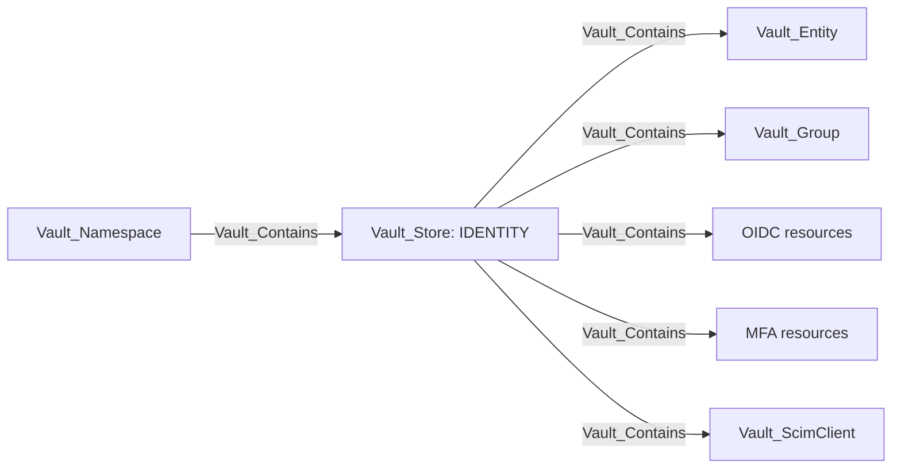
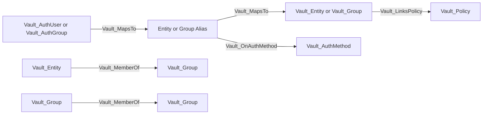
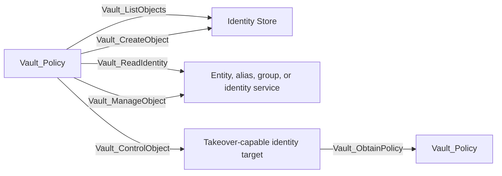
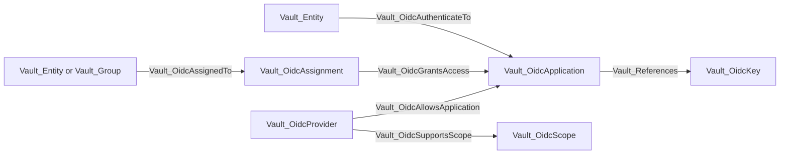
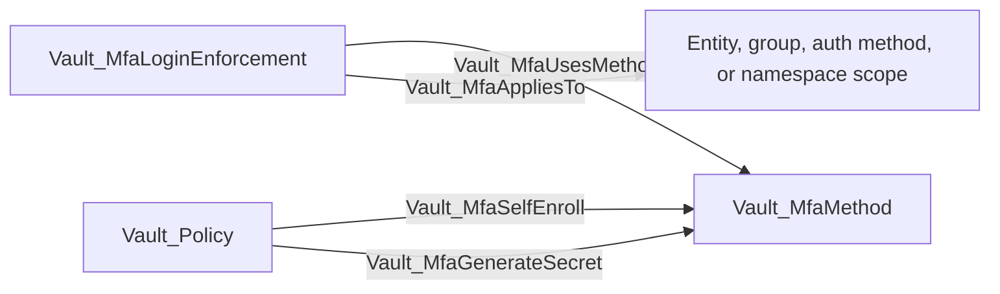
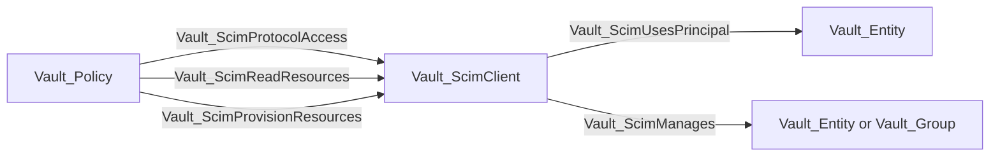

# Identity Store

The Identity Store represents Vault's namespace-local identity subsystem under `identity/`. It contains canonical identities, external identity mappings, outbound OIDC resources, MFA configuration, and Enterprise SCIM clients.



The store is the destination for collection-wide list/create and identity configuration rights. Exact reads and management rights target concrete identity objects.

## Nodes

| Node | Description |
| --- | --- |
| `Vault_Entity` | Canonical identity with direct policies, effective groups, metadata, aliases, creation time, and update time. |
| `Vault_EntityAlias` | Auth-mount-specific external name that resolves to a canonical entity. |
| `Vault_Group` | Internal or external group with policies, member entities, child groups, aliases, and metadata. |
| `Vault_GroupAlias` | External group name on an auth mount that resolves to a canonical group. |
| `Vault_OidcApplication` | Outbound OIDC client application configured to trust Vault as an identity provider. |
| `Vault_OidcKey` | Signing key used by outbound OIDC applications or providers. |
| `Vault_OidcAssignment` | Assignment object selecting entities or groups that may access applications. |
| `Vault_OidcProvider` | Outbound OIDC provider configuration where Vault acts as the identity provider. |
| `Vault_OidcScope` | OIDC scope and claim template exposed by a provider. |
| `Vault_OidcTokenRole` | Named identity-token signing role. |
| `Vault_MfaMethod` | Configured MFA method, such as TOTP, Duo, Okta, or PingID. |
| `Vault_MfaLoginEnforcement` | Rule that applies one or more MFA methods to selected identities or auth surfaces. |
| `Vault_ScimClient` | Enterprise SCIM client and access-grant configuration. |

## Identity Resolution

Auth-specific principals do not replace canonical Vault identity. Where mount accessor and name correlation are available, they resolve through aliases.



| Edge | Source | Destination | Traversable | Meaning |
| --- | --- | --- | --- | --- |
| `Vault_MapsTo` | Auth principal or alias | Alias or canonical identity | Yes | Correlates an external representation with Vault identity. |
| `Vault_OnAuthMethod` | Entity or group alias | Auth method | No | Records the mount accessor on which the alias exists. |
| `Vault_MemberOf` | Entity or child group | Group | Yes | Carries policy-bearing membership. |
| `Vault_LinksPolicy` | Entity or group | Policy | Yes | Direct or inherited policy assignment, with link type properties. |

Group membership returned by Vault is modeled; VaultHound does not independently query external directories to prove upstream membership.

## Identity Administration



| Edge | Destination | Meaning |
| --- | --- | --- |
| `Vault_ListObjects` | Identity Store | List entity, alias, group, OIDC, MFA, or SCIM collections. |
| `Vault_CreateObject` | Identity Store or synthetic exact target | Create an identity-subsystem object. |
| `Vault_ReadIdentity` | Concrete object or Identity Store for store-native surfaces | Read non-secret identity data. |
| `Vault_ReadCredential` | Secret-bearing OIDC or MFA object | Read a returned credential such as a confidential OIDC client secret. |
| `Vault_ReadObject` | Concrete generic identity object | Read durable configuration through the generic family. |
| `Vault_ManageObject` | Concrete object | Update or delete ordinary identity configuration. |
| `Vault_ControlObject` | Concrete entity, alias, group, or trust object | Perform a parameter-aware mutation that proves identity takeover. |
| `Vault_ObtainPolicy` | Policy | Assign a concrete policy through an object the caller can control. |
| `Vault_ReadConfig` | Identity Store | Read subsystem configuration such as OIDC configuration. |
| `Vault_ManageConfig` | Identity Store | Change subsystem-wide configuration. |
| `Vault_DenyAccess` | Matching target | Preserve an overriding deny rule. |
| `Vault_PotentialAccess` | Unresolved target | Record an unproven identity-control or credential outcome. |

Creating or managing an object is not automatically traversable. `Vault_ControlObject` is derived only when the controlled parameters establish a concrete takeover mechanism, such as changing canonical alias ownership, adding an attacker-controlled entity to a policy-bearing internal group, or replacing unrestricted trust configuration.

### Attack Paths

Identity takeover can expose every policy linked to the controlled identity object:

```text
Vault_Policy A
  -> Vault_ControlObject
Vault_Group
  -> Vault_LinksPolicy
Vault_Policy B
```

If Policy A can add an attacker-controlled entity to the internal group without restrictive parameter constraints, `Vault_ObtainPolicy` can summarize the proven composition directly from Policy A to Policy B with the group recorded as the via object.

```text
Vault_Policy
  -> Vault_ReadCredential
Vault_OidcApplication or Vault_MfaMethod
```

This path is emitted only when the authenticated read returns usable secret material, such as a confidential OIDC client secret or an enrollment/integration credential. Ordinary identity reads remain non-traversable.

## Outbound OIDC

The outbound OIDC model is distinct from the JWT/OIDC authentication method. Here Vault is the identity provider and applications consume Vault-issued identity tokens.



| Edge | Source | Destination | Traversable | Meaning |
| --- | --- | --- | --- | --- |
| `Vault_OidcAllowsApplication` | Provider | Application | No | Provider configuration allows the client application. |
| `Vault_OidcSupportsScope` | Provider | Scope | No | Provider exposes the scope. |
| `Vault_References` | Application or provider | OIDC key | No | Configuration uses the signing key. |
| `Vault_OidcAssignedTo` | Entity or group | Assignment | No | Principal is selected by the assignment. |
| `Vault_OidcGrantsAccess` | Assignment | Application | No | Assignment grants application eligibility. |
| `Vault_OidcAuthorize` | Policy | Provider or application target | No | ACL permits the authenticated authorization surface. |
| `Vault_OidcAuthenticateTo` | Entity | Application | Yes | Assignment and provider constraints compose into proven application access. |
| `Vault_GenerateIdentityToken` | Policy | OIDC token role | Yes | Policy can invoke a concrete identity-token signing role. |

The direct authentication edge is derived from collected configuration; the intermediate assignment and provider edges remain visible as non-traversable evidence.

### Attack Paths

```text
Vault_Entity
  -> Vault_OidcAuthenticateTo
Vault_OidcApplication
```

This derived edge requires an applicable assignment, an allowing provider, and compatible application/provider configuration. The assignment and provider edges alone do not create an attack path.

```text
Vault_Policy
  -> Vault_GenerateIdentityToken
Vault_OidcTokenRole
```

The path represents the ability to mint a Vault identity token through an observed signing role. If the role's signing-key allowlist is empty or incompatible, no attack edge is emitted; an unresolved signing key produces `Vault_PotentialAccess`.

## MFA



| Edge | Meaning |
| --- | --- |
| `Vault_MfaUsesMethod` | Login enforcement requires or references an MFA method. |
| `Vault_MfaAppliesTo` | Enforcement applies to a collected identity or login surface. |
| `Vault_MfaSelfEnroll` | Policy can perform MFA self-enrollment. |
| `Vault_MfaGenerateSecret` | Policy can generate enrollment secret material where supported. |

MFA methods and enforcements describe login prerequisites. The collector does not perform enrollment or login challenges.

### Attack Paths

MFA topology edges and self-enrollment permissions are non-traversable because configuration or enrollment eligibility does not by itself bypass MFA. Only a read that actually returns reusable credential material can produce `Vault_ReadCredential`.

## SCIM



| Edge | Traversable | Meaning |
| --- | --- | --- |
| `Vault_ScimUsesPrincipal` | No | Client uses the entity as its access-grant principal. |
| `Vault_ScimManages` | No | Client is configured to provision the identity resource. |
| `Vault_ScimProtocolAccess` | No | Discovery or general SCIM protocol access. |
| `Vault_ScimReadResources` | No | Read/list SCIM users or groups. |
| `Vault_ScimProvisionResources` | No | Create/update/delete SCIM resources when the access-grant principal and ACL prerequisites are satisfied. |

SCIM fan-out is kept as explicit evidence rather than making the client a traversable container. This avoids implying control of every identity merely from read-only protocol access.

### Attack Paths

SCIM read, protocol, and provisioning edges are currently non-traversable evidence. A client-to-resource `Vault_ScimManages` edge describes configured scope but is not used as a containment fan-out. This prevents read-only or collection-level SCIM access from implying control of every entity and group.

## Template Policies

Identity templates can reference entity fields, an entity alias on a specific accessor, or an identity group by ID. The rendered effective edge originates from the referenced identity representation:

| Template reference | Effective source |
| --- | --- |
| `identity.entity.*` | `Vault_Entity` |
| `identity.entity.aliases.<accessor>.*` | Matching `Vault_EntityAlias` |
| `identity.groups.ids.<group-id>.*` | Referenced `Vault_Group` |

Policy inheritance from a group remains provenance on the edge. It does not make the group the source unless the template expression itself references that group.

### Attack Paths

A rendered template edge can originate directly from the referenced entity representation and reach a concrete subsystem target. The destination subsystem documents the resulting security edge, such as `Vault_KvReadSecret` in the [KV section](MOUNTS.md#kv). `Matched Policy Paths`, rendered `Matched Paths`, and `Via Policies` preserve why the effective identity-specific edge exists.

## Limitations

- External identity-provider state is not independently validated.
- Login MFA, control groups, Sentinel policy, quotas, and token wrapping can add runtime conditions beyond static ACLs.
- Sensitive-read edges identify returned secret fields but do not exercise the credential.
- SCIM and OIDC behavior depends on Enterprise features and Vault version.
