# Identity Store

The Identity Store represents Vault's namespace-local identity subsystem under `identity/`. It contains canonical identities, external identity mappings, outbound OIDC resources, MFA configuration, and Enterprise SCIM clients.

## Glob, Synthetic, And Control Behavior

- Collection globs expand read and manage rights to compatible observed identity objects.
- Exact missing object names may create detached synthetic targets without asserting that the object exists.
- Collection-wide creation remains anchored to the Identity Store with object-type and creation evidence.
- `Vault_ControlObject` is emitted only when parameter-aware mutation proves a concrete identity or trust takeover.
- Templated paths derive effective principal-to-target edges only after their referenced identity fields resolve.

## Limitations

- VaultHound does not authenticate as collected entities or validate external identity-provider credentials.
- External directory membership is represented only where Vault returns aliases or mappings that prove it.
- Runtime MFA challenges, control groups, and token state can impose conditions not visible from static ACLs.
- SCIM provisioning is conditional on the configured access-grant principal and collected client ownership.

## Common Topology

Mermaid diagrams in this guide use solid arrows for traversable relationships and dashed arrows for non-traversable configuration, constraint, ownership, or evidence relationships.

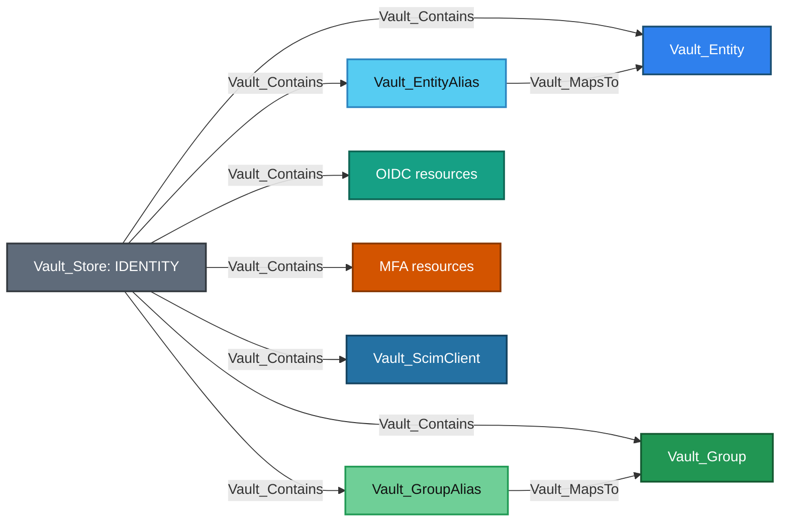

Equivalent Cypher query:

```cypher
MATCH p = (:Vault_Store)-[:Vault_Contains]->(n)
WHERE n:Vault_Entity
   OR n:Vault_EntityAlias
   OR n:Vault_Group
   OR n:Vault_GroupAlias
   OR n:Vault_OidcApplication
   OR n:Vault_OidcKey
   OR n:Vault_OidcAssignment
   OR n:Vault_OidcProvider
   OR n:Vault_OidcScope
   OR n:Vault_OidcTokenRole
   OR n:Vault_MfaMethod
   OR n:Vault_MfaLoginEnforcement
   OR n:Vault_ScimClient
RETURN p
```

The store is the destination for collection-wide list/create and identity configuration rights. Exact reads and management rights target concrete identity objects.

### Common Nodes

| Type | Meaning |
| --- | --- |
| `Vault_Entity` | Canonical identity with direct policies, effective groups, metadata, aliases, creation time, and update time. |
| `Vault_EntityAlias` | Auth-mount-specific external name that resolves to a canonical entity. |
| `Vault_Group` | Internal or external group with policies, member entities, child groups, aliases, and metadata. |
| `Vault_GroupAlias` | External group name on an auth mount that resolves to a canonical group. |

### Common Edges

In every edge table in this guide, `Policy` denotes [policy authority](../MODEL.md#declared-and-derived-authority): normally the declaring `Vault_Policy`, or the referenced entity, alias, or group when an Identity template produces an effective rendered edge.

Auth-specific principals do not replace canonical Vault identity. A correlatable auth user or group enters the canonical Identity graph through the matching entity or group alias for the same auth mount accessor and external name. Policies remain linked to the canonical entity or group, never to the alias itself.

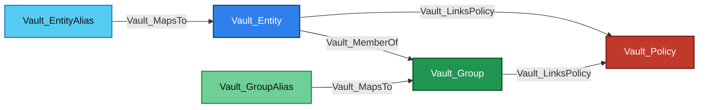

Equivalent Cypher query:

```cypher
MATCH p = (s)-[:Vault_MapsTo|Vault_MemberOf|Vault_LinksPolicy*1..]->(d)
WHERE (s:Vault_Entity OR s:Vault_EntityAlias OR s:Vault_Group OR s:Vault_GroupAlias)
  AND (d:Vault_Entity OR d:Vault_EntityAlias OR d:Vault_Group OR d:Vault_GroupAlias OR d:Vault_Policy)
RETURN p
```

The table below combines durable Identity relationships with store-wide generic edge families applicable across Identity services. Feature-level Specialized Edges tables list only edge kinds introduced by that feature.

| Edge | Source | Destination | Traversable | Meaning |
| --- | --- | --- | :---: | --- |
| `Vault_MapsTo` | Auth principal or alias | Alias or canonical identity | :white_check_mark: | Correlates an external representation with Vault identity. |
| `Vault_OnAuthMethod` | Entity or group alias | Auth method | :x: | Records the mount accessor on which the alias exists. |
| `Vault_MemberOf` | Entity or child group | Group | :white_check_mark: | Carries policy-bearing membership. |
| `Vault_LinksPolicy` | Entity or group | Policy | :white_check_mark: | Direct or inherited policy assignment, with link type properties. |
| `Vault_References` | Configured identity object | Referenced identity dependency | :x: | Records a non-owning dependency, such as an outbound OIDC application or provider selecting a signing key. |
| `Vault_ListObjects` | Policy | Identity Store | :x: | Lists entity, alias, group, OIDC, MFA, or SCIM collections. |
| `Vault_CreateObject` | Policy | Identity Store or synthetic exact target | :x: | Creates an identity-subsystem object. |
| `Vault_ReadObject` | Policy | Concrete generic identity object | :x: | Reads durable identity-object configuration through the generic family. |
| `Vault_ManageObject` | Policy | Concrete identity object | :x: | Updates or deletes ordinary identity-object configuration. |
| `Vault_ReadCredential` | Policy | Secret-bearing OIDC or MFA object | :white_check_mark: | Reads returned credential material such as a confidential OIDC client secret. |
| `Vault_ControlObject` | Policy | Concrete entity, group, or trust target | :white_check_mark: | Performs a parameter-aware mutation that proves identity takeover. |
| `Vault_ReadConfig` | Policy | Identity Store | :x: | Reads subsystem configuration such as OIDC configuration. |
| `Vault_ManageConfig` | Policy | Identity Store | :x: | Changes subsystem-wide configuration. |
| `Vault_DenyAccess` | Policy | Matching target | :x: | Preserves an overriding deny rule. |
| `Vault_PotentialAccess` | Policy or resolved principal | Unresolved target | :x: | Records an unproven identity-control or credential outcome. |

Group membership returned by Vault is modeled; VaultHound does not independently query external directories to prove upstream membership.

### Common Properties

| Node/Edge Type | Property | Description |
| --- | --- | --- |
| `Vault_Entity` | `Entity ID` | Records Vault's canonical identity identifier. |
| `Vault_Entity` | `Entity Name` | Records the canonical identity's display name. |
| `Vault_Entity` | `Disabled` | Indicates whether authentication through the entity is disabled. |
| `Vault_Entity` | `Bucket Key Hash` | Records Vault's internal storage-bucket hash for the entity. |
| `Vault_Entity` | `External ID` | Records the external identifier associated with the entity when present. |
| `Vault_Entity` | `Policies` | Lists policies assigned directly to the entity. |
| `Vault_Entity` | `Entity Alias IDs` | Lists aliases that resolve to the entity. |
| `Vault_Entity` | `Direct Group IDs` | Lists groups in which the entity has direct membership. |
| `Vault_Entity` | `Effective Group IDs` | Lists all groups affecting the entity after hierarchy expansion. |
| `Vault_Entity` | `Inherited Group IDs` | Lists effective groups reached through nested group membership. |
| `Vault_Entity` | `Merged Entity IDs` | Lists canonical entities merged into this entity. |
| `Vault_Entity` | `SCIM Client ID` | Identifies the SCIM client that owns the entity when SCIM-managed. |
| `Vault_Entity` | `SCIM Managed` | Indicates whether the entity is managed through SCIM. |
| `Vault_Entity` | `Creation Time` | Records when Vault created the entity. |
| `Vault_Entity` | `Last Update Time` | Records the entity's most recent update time. |
| `Vault_EntityAlias` | `Entity Alias ID` | Records Vault's stable identifier for the entity alias. |
| `Vault_EntityAlias` | `Entity Alias Name` | Records the external login name represented by the alias. |
| `Vault_EntityAlias` | `Mount Path` | Identifies the auth mount path on which the alias exists. |
| `Vault_EntityAlias` | `Mount Accessor` | Identifies the auth mount accessor used to resolve the alias. |
| `Vault_EntityAlias` | `Mount Type` | Identifies the authentication backend type associated with the alias. |
| `Vault_EntityAlias` | `Entity ID` | Identifies the canonical entity to which the alias resolves. |
| `Vault_EntityAlias` | `Local` | Indicates whether the alias is local to the performance replication cluster. |
| `Vault_EntityAlias` | `Merged From Canonical IDs` | Lists prior canonical IDs represented after entity merging. |
| `Vault_EntityAlias` | `Creation Time` | Records when Vault created the alias. |
| `Vault_EntityAlias` | `Last Update Time` | Records the alias's most recent update time. |
| `Vault_Group` | `Group ID` | Records Vault's canonical group identifier. |
| `Vault_Group` | `Group Name` | Records the group's display name. |
| `Vault_Group` | `Group Type` | Identifies whether the group is internal or external. |
| `Vault_Group` | `Policies` | Lists policies assigned directly to the group. |
| `Vault_Group` | `Member Entity IDs` | Lists entities with direct membership in the group. |
| `Vault_Group` | `Member Group IDs` | Lists child groups directly included in the group. |
| `Vault_Group` | `Parent Group IDs` | Lists groups that contain this group. |
| `Vault_Group` | `Modify Index` | Records Vault's modification index for the group. |
| `Vault_Group` | `SCIM Client ID` | Identifies the SCIM client that owns the group when SCIM-managed. |
| `Vault_Group` | `SCIM Managed` | Indicates whether the group is managed through SCIM. |
| `Vault_Group` | `Creation Time` | Records when Vault created the group. |
| `Vault_Group` | `Last Update Time` | Records the group's most recent update time. |
| `Vault_GroupAlias` | `Group Alias ID` | Records Vault's stable identifier for the group alias. |
| `Vault_GroupAlias` | `Group Alias Name` | Records the external group name represented by the alias. |
| `Vault_GroupAlias` | `Mount Path` | Identifies the auth mount path on which the group alias exists. |
| `Vault_GroupAlias` | `Mount Accessor` | Identifies the auth mount accessor used to resolve the group alias. |
| `Vault_GroupAlias` | `Mount Type` | Identifies the authentication backend type associated with the group alias. |
| `Vault_GroupAlias` | `Group ID` | Identifies the canonical group to which the alias resolves. |
| `Vault_GroupAlias` | `Local` | Indicates whether the group alias is local to the performance replication cluster. |
| `Vault_GroupAlias` | `Merged From Canonical IDs` | Lists prior canonical group IDs represented after merging. |
| `Vault_GroupAlias` | `Creation Time` | Records when Vault created the group alias. |
| `Vault_GroupAlias` | `Last Update Time` | Records the group alias's most recent update time. |

The canonical `Vault_LinksPolicy.Policy Link Types` contract is documented once in [Policy Store common properties](POLICIES.md#common-properties). Identity uses the direct entity, direct group, and inherited group values from that shared contract.

### Common Attack Paths

Auth-specific users and groups enter these paths only when `Vault_MapsTo` proves a matching alias. From that point, alias resolution, canonical membership, and policy propagation are Identity responsibilities:

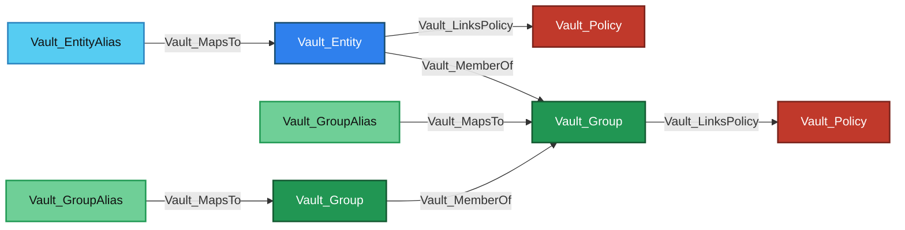

Equivalent Cypher query:

```cypher
MATCH p = (source)-[:Vault_MapsTo|Vault_MemberOf|Vault_LinksPolicy*1..]->(:Vault_Policy)
WHERE source:Vault_AuthUser
   OR source:Vault_AuthGroup
   OR source:Vault_EntityAlias
   OR source:Vault_GroupAlias
   OR source:Vault_Entity
   OR source:Vault_Group
RETURN p
```

An entity receives directly linked policies and policies inherited through every traversable `Vault_MemberOf` chain. A group can likewise inherit from a parent group. Alias nodes resolve identity but do not carry policy assignments themselves.

Parameter-aware alias rebinding and group-membership changes can turn administrative authority into control over a policy-bearing canonical identity:


Equivalent Cypher query:

```cypher
MATCH p = (:Vault_Policy)-[:Vault_ControlObject]->(identity)-[:Vault_LinksPolicy]->(:Vault_Policy)
WHERE identity:Vault_Entity OR identity:Vault_Group
RETURN p
```

| Control Method | Control Target | Evidence |
| --- | --- | --- |
| `Modify Group Membership` | Internal `Vault_Group` | Membership parameters on the group operation. |
| `Rebind Controlled Entity Alias` | Candidate `Vault_Entity` | Controlled `Vault_EntityAlias` in `Via Object IDs` and `Via Object Names`. |
| `Rebind Controlled Group Alias` | Candidate `Vault_Group` | Controlled `Vault_GroupAlias` in `Via Object IDs` and `Via Object Names`. |

The takeover edge terminates directly at the canonical entity or group selected by the operation. The controlled alias is preserved as evidence; it is not inserted as an additional attack-path hop.

## Identity Administration

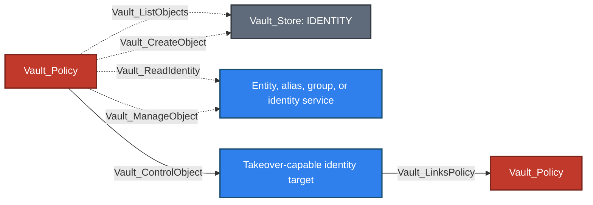

Equivalent Cypher query:

```cypher
MATCH p = (:Vault_Policy)-[:Vault_ListObjects|Vault_CreateObject|Vault_ReadIdentity|Vault_ManageObject|Vault_ControlObject|Vault_LinksPolicy*1..2]->(d)
WHERE d:Vault_Store
   OR d:Vault_Entity
   OR d:Vault_EntityAlias
   OR d:Vault_Group
   OR d:Vault_GroupAlias
   OR d:Vault_Policy
RETURN p
```

### Nodes

Identity administration introduces no additional durable object kind. It targets the Identity `Vault_Store` for collection-wide operations and the concrete core identity, OIDC, MFA, or SCIM nodes catalogued in their respective sections.

### Specialized Edges

Shared object, configuration, reference, deny, potential-access, credential-read, and takeover families are catalogued under [Common Edges](#common-edges). Identity administration adds one identity-specific read edge:

| Edge | Source | Destination | Traversable | Meaning |
| --- | --- | --- | :---: | --- |
| `Vault_ReadIdentity` | Policy | Concrete object or Identity Store | :x: | Reads non-secret identity data or a store-native identity surface. |

Creating or managing an object is not automatically traversable. `Vault_ControlObject` is derived only when the controlled parameters establish a concrete takeover mechanism, such as changing canonical alias ownership, adding an attacker-controlled entity to a policy-bearing internal group, or replacing unrestricted trust configuration.

### Properties

Generic object-operation, takeover, and unresolved-outcome properties follow the canonical [cross-cutting properties](../MODEL.md#cross-cutting-properties). The table below retains Identity-specific targets, configuration context, indirect-control evidence, and confirmed credential-exposure context.

| Node/Edge Type | Property | Description |
| --- | --- | --- |
| `Vault_ReadIdentity` | `Identity Targets` | Identifies the entity, group, alias, lookup, or identity-service data that can be read. |
| `Vault_ReadIdentity` | `Operations` | Lists the authenticated identity-read operations represented by the edge. |
| `Vault_ReadCredential` | `Identity Targets` | Identifies the secret-bearing OIDC or MFA object read by the policy. |
| `Vault_ReadCredential` | `Operations` | Lists the authenticated read operations that return credential material. |
| `Vault_ReadCredential` | `Exposure Confirmed` | Indicates that the authenticated response is proven to return usable credential material. |
| `Vault_ReadConfig`<br>`Vault_ManageConfig` | `Operations` | Lists the configuration operations represented by the edge. |

Canonical configuration-target and `Vault_ControlObject` evidence fields are documented in [Cross-Cutting Properties](../MODEL.md#cross-cutting-properties). Identity-specific indirect takeover evidence uses those shared `Via Object IDs` and `Via Object Names` fields.

### Attack Paths

Canonical alias resolution, membership inheritance, and the resulting alias- or group-takeover paths are documented under [Common Attack Paths](#common-attack-paths). Policy-assignment parameters remain evidence on the relevant management or control edge and do not create a direct policy-to-policy relationship.

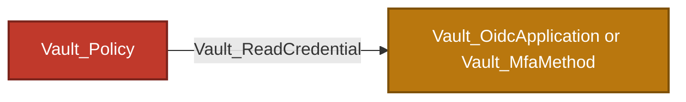

Equivalent Cypher query:

```cypher
MATCH p = (:Vault_Policy)-[:Vault_ReadCredential]->(credential)
WHERE credential:Vault_OidcApplication OR credential:Vault_MfaMethod
RETURN p
```

This path is emitted only when the authenticated read returns usable secret material, such as a confidential OIDC client secret or an enrollment/integration credential. Ordinary identity reads remain non-traversable.

## Outbound OIDC

The outbound OIDC model is distinct from the JWT/OIDC authentication method. Here Vault is the identity provider and applications consume Vault-issued identity tokens.

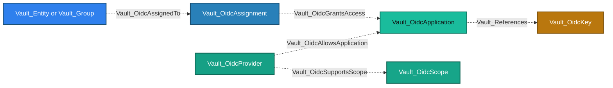

Equivalent Cypher query:

```cypher
MATCH p = (s)-[:Vault_OidcAllowsApplication|Vault_OidcSupportsScope|Vault_References|Vault_OidcAssignedTo|Vault_OidcGrantsAccess*1..3]->(d)
WHERE s:Vault_OidcProvider OR s:Vault_OidcApplication OR s:Vault_Entity OR s:Vault_Group
RETURN p
```

This opening diagram is configuration topology only. The composed `Vault_OidcAuthenticateTo` relationship and policy-authorized token generation are documented in the Attack Paths subsection below.

### Nodes

| Node | Description |
| --- | --- |
| `Vault_OidcApplication` | Outbound OIDC client application configured to trust Vault as its identity provider. |
| `Vault_OidcKey` | Signing key used by an outbound OIDC application, provider, or token role. |
| `Vault_OidcAssignment` | Assignment selecting entities or groups eligible to access applications. |
| `Vault_OidcProvider` | Provider configuration through which Vault exposes OIDC authorization and token endpoints. |
| `Vault_OidcScope` | Named scope and claims template exposed by a provider. |
| `Vault_OidcTokenRole` | Named role used to generate Vault identity tokens. |

### Specialized Edges

The common non-owning `Vault_References` relationship is catalogued under [Common Edges](#common-edges); its OIDC-specific evidence remains documented under Properties.

| Edge | Source | Destination | Traversable | Meaning |
| --- | --- | --- | :---: | --- |
| `Vault_OidcAllowsApplication` | Provider | Application | :x: | Provider configuration allows the client application. |
| `Vault_OidcSupportsScope` | Provider | Scope | :x: | Provider exposes the scope. |
| `Vault_OidcAssignedTo` | Entity or group | Assignment | :x: | Principal is selected by the assignment. |
| `Vault_OidcGrantsAccess` | Assignment | Application | :x: | Assignment grants application eligibility. |
| `Vault_OidcAuthorize` | Policy | Provider or application target | :x: | ACL permits the authenticated authorization surface. |
| `Vault_OidcAuthenticateTo` | Entity | Application | :white_check_mark: | Assignment and provider constraints compose into proven application access. |
| `Vault_GenerateIdentityToken` | Policy | OIDC token role | :white_check_mark: | Policy can invoke a concrete identity-token signing role. |

The direct authentication edge is derived from collected configuration; the intermediate assignment and provider edges remain visible as non-traversable evidence.

### Properties

| Node/Edge Type | Property | Description |
| --- | --- | --- |
| `Vault_OidcApplication` | `Client ID` | Identifies the application in outbound OIDC requests. |
| `Vault_OidcApplication` | `Access Token TTL` | Records the configured access-token lifetime. |
| `Vault_OidcApplication` | `ID Token TTL` | Records the configured ID-token lifetime. |
| `Vault_OidcApplication` | `Client Secret Set` | Indicates whether the confidential application has a configured client secret. |
| `Vault_OidcApplication` | `Redirect URIs` | Lists the redirect destinations allowed for the application. |
| `Vault_OidcApplication` | `Assignments` | Lists assignment names allowed to access the application. |
| `Vault_OidcApplication` | `Key` | Names the OIDC signing key selected by the application. |
| `Vault_OidcApplication` | `Client Type` | Distinguishes public from confidential clients. |
| `Vault_OidcApplication` | `PKCE Requirement` | Records whether the client must use Proof Key for Code Exchange. |
| `Vault_OidcProvider` | `Issuer` | Records the provider issuer URL. |
| `Vault_OidcProvider` | `Allowed Client IDs` | Lists client IDs exposed by the provider; `*` permits every application. |
| `Vault_OidcProvider` | `Scopes Supported` | Lists scopes advertised by the provider. |
| `Vault_OidcProvider` | `Built In` | Indicates a Vault-provided provider object. |
| `Vault_OidcProvider` | `Delete Protected` | Indicates that Vault prevents deletion of the provider. |
| `Vault_OidcKey` | `Algorithm` | Identifies the signing algorithm used by the key. |
| `Vault_OidcKey` | `Allowed Client IDs` | Lists clients permitted to use the signing key. |
| `Vault_OidcKey` | `Rotation Period` | Records the automatic key-rotation interval. |
| `Vault_OidcKey` | `Verification TTL` | Records how long prior public keys remain available for token verification. |
| `Vault_OidcKey` | `Built In` | Indicates a Vault-provided signing key. |
| `Vault_OidcKey` | `Delete Protected` | Indicates that Vault prevents deletion of the key. |
| `Vault_OidcScope` | `Description` | Stores the human-readable scope description. |
| `Vault_OidcScope` | `Template` | Stores the claims template added when the scope is requested. |
| `Vault_OidcScope` | `Built In` | Indicates a Vault-provided scope. |
| `Vault_OidcScope` | `Immutable` | Indicates that the scope cannot be changed. |
| `Vault_OidcAssignment` | `Entity IDs` | Lists canonical entities selected by the assignment. |
| `Vault_OidcAssignment` | `Group IDs` | Lists canonical groups selected by the assignment. |
| `Vault_OidcAssignment` | `Built In` | Indicates a Vault-provided assignment. |
| `Vault_OidcAssignment` | `Immutable` | Indicates that the assignment cannot be changed. |
| `Vault_OidcTokenRole` | `Client ID` | Identifies the audience/client encoded into generated identity tokens. |
| `Vault_OidcTokenRole` | `Key` | Names the signing key used by the token role. |
| `Vault_OidcTokenRole` | `Template` | Stores the claims template used for generated identity tokens. |
| `Vault_OidcTokenRole` | `TTL` | Records the generated identity-token lifetime. |
| `Vault_References` | `Reference Types` | Classifies the referenced object as an OIDC signing key. |
| `Vault_References` | `Reference Evidence` | Identifies whether the reference came from an application or token-role key setting. |
| `Vault_References` | `Key References` | Preserves the configured signing-key name. |
| `Vault_OidcAuthenticateTo` | `Assignment Names` | Lists assignments that make the entity eligible for the application. |
| `Vault_OidcAuthenticateTo` | `Provider Names` | Lists providers through which the application can be reached. |
| `Vault_OidcAuthenticateTo` | `Matched Paths` | Lists authorization endpoints whose effective ACLs were evaluated. |
| `Vault_OidcAuthenticateTo` | `ACL Basis` | Explains the ACL evidence used to derive application access. |
| `Vault_GenerateIdentityToken`<br>`Vault_PotentialAccess` | `Key Eligibility` | Records whether each resolved signing key permits the token role's client ID. |
| `Vault_GenerateIdentityToken`<br>`Vault_PotentialAccess` | `Signing Key Names` | Lists signing keys considered for identity-token generation. |
| `Vault_GenerateIdentityToken` | `Eligible Role Names` | Lists observed token roles whose signing-key constraints are satisfied. |
| `Vault_PotentialAccess` | `Unresolved Role Names` | Lists token roles whose signing-key prerequisite could not be resolved. |
| `Vault_GenerateIdentityToken`<br>`Vault_PotentialAccess` | `Blocked Role Names` | Lists observed roles rejected by signing-key client restrictions. |

### Attack Paths


Equivalent Cypher query:

```cypher
MATCH p = (:Vault_Entity)-[:Vault_OidcAuthenticateTo]->(:Vault_OidcApplication)
RETURN p
```

This derived edge requires an applicable assignment, an allowing provider, and compatible application/provider configuration. The assignment and provider edges alone do not create an attack path.


Equivalent Cypher query:

```cypher
MATCH p = (:Vault_Policy)-[:Vault_GenerateIdentityToken]->(:Vault_OidcTokenRole)
RETURN p
```

The path represents the ability to mint a Vault identity token through an observed signing role. If the role's signing-key allowlist is empty or incompatible, no attack edge is emitted; an unresolved signing key produces `Vault_PotentialAccess`.

## MFA

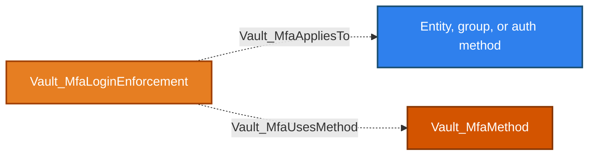

Equivalent Cypher query:

```cypher
MATCH p = (:Vault_MfaLoginEnforcement)-[:Vault_MfaAppliesTo|Vault_MfaUsesMethod]->(d)
RETURN p
```

This opening diagram shows only durable MFA constraints. Policy-derived enrollment and secret-generation evidence is shown under Conditional Access.

### Nodes

| Node | Description |
| --- | --- |
| `Vault_MfaMethod` | Configured MFA method, such as TOTP, Duo, Okta, or PingID. |
| `Vault_MfaLoginEnforcement` | Rule applying one or more MFA methods to selected identities or authentication surfaces. |

### Specialized Edges

Unresolved MFA outcomes use the store-wide `Vault_PotentialAccess` family documented under [Common Edges](#common-edges).

| Edge | Source | Destination | Traversable | Meaning |
| --- | --- | --- | :---: | --- |
| `Vault_MfaUsesMethod` | MFA login enforcement | MFA method | :x: | Records the method required or referenced by the enforcement. |
| `Vault_MfaAppliesTo` | MFA login enforcement | Entity, group, or auth method | :x: | Records the collected identity or login surface governed by the enforcement. |
| `Vault_MfaSelfEnroll` | Policy | MFA method | :x: | Permits MFA self-enrollment. |
| `Vault_MfaGenerateSecret` | Policy | MFA method | :x: | Generates enrollment secret material where supported. |

MFA methods and enforcements describe login prerequisites. The collector does not perform enrollment or login challenges.

### Properties

| Node/Edge Type | Property | Description |
| --- | --- | --- |
| `Vault_MfaMethod` | `Method ID` | Identifies the MFA method. |
| `Vault_MfaMethod` | `Method Name` | Stores the configured MFA method name. |
| `Vault_MfaMethod` | `Method Type` | Identifies the MFA implementation, such as TOTP, Duo, Okta, or PingID. |
| `Vault_MfaMethod` | `Owning Namespace ID` | Identifies the namespace that owns the method. |
| `Vault_MfaMethod` | `Visible From Namespace IDs` | Lists namespaces from which the method is visible. |
| `Vault_MfaMethod` | `Issuer` | Records the issuer shown in generated TOTP enrollment information. |
| `Vault_MfaMethod` | `Algorithm` | Identifies the TOTP hash algorithm. |
| `Vault_MfaMethod` | `Digits` | Records the number of digits in generated TOTP codes. |
| `Vault_MfaMethod` | `Period` | Records the TOTP time-step duration. |
| `Vault_MfaMethod` | `Key Size` | Records the generated TOTP seed size. |
| `Vault_MfaMethod` | `QR Size` | Records the generated enrollment QR-code size. |
| `Vault_MfaMethod` | `Skew` | Records the accepted TOTP clock skew. |
| `Vault_MfaMethod` | `Max Validation Attempts` | Records the maximum failed validation attempts permitted by the method. |
| `Vault_MfaMethod` | `Self Enrollment Enabled` | Indicates whether users may enroll themselves. |
| `Vault_MfaMethod` | `Username Format` | Stores the external-provider username template. |
| `Vault_MfaMethod` | `API Hostname` | Identifies the external MFA provider API host. |
| `Vault_MfaMethod` | `Push Info` | Records provider-specific push-notification context. |
| `Vault_MfaMethod` | `Use Passcode` | Indicates whether passcode authentication is enabled. |
| `Vault_MfaMethod` | `Organization Name` | Stores the external MFA organization name. |
| `Vault_MfaMethod` | `Base URL` | Stores the external MFA provider base URL. |
| `Vault_MfaLoginEnforcement` | `Enforcement ID` | Identifies the MFA enforcement rule. |
| `Vault_MfaLoginEnforcement` | `MFA Method IDs` | Lists MFA methods that can satisfy the enforcement. |
| `Vault_MfaLoginEnforcement` | `Auth Method Accessors` | Lists auth mount accessors selected by the enforcement. |
| `Vault_MfaLoginEnforcement` | `Auth Method Types` | Lists auth backend types selected by the enforcement. |
| `Vault_MfaLoginEnforcement` | `Identity Entity IDs` | Lists canonical entities selected by the enforcement. |
| `Vault_MfaLoginEnforcement` | `Identity Group IDs` | Lists canonical groups selected by the enforcement. |
| `Vault_MfaLoginEnforcement` | `Satisfaction Mode` | Describes how configured MFA methods satisfy the enforcement. |
| `Vault_MfaLoginEnforcement` | `Method Selection Mode` | Describes how Vault chooses among configured MFA methods. |
| `Vault_MfaLoginEnforcement` | `Owning Namespace ID` | Identifies the namespace that owns the enforcement. |
| `Vault_MfaLoginEnforcement` | `Visible From Namespace IDs` | Lists namespaces from which the enforcement is visible. |
| `Vault_MfaAppliesTo` | `Selector Types` | Distinguishes entity, group, auth accessor, and auth-type selectors. |
| `Vault_MfaSelfEnroll`<br>`Vault_MfaGenerateSecret` | `Operations` | Lists the MFA enrollment operations represented by the edge. |
| `Vault_PotentialAccess` | `Potential Outcomes` | Identifies administrative TOTP enrollment as the possible result. |
| `Vault_PotentialAccess` | `Credential Types` | Identifies the returned enrollment material. |
| `Vault_PotentialAccess` | `Credential Uses` | Describes how the enrollment material could be used. |
| `Vault_PotentialAccess` | `Requirements` | Lists the primary-credential and enrollment-state prerequisites. |
| `Vault_PotentialAccess` | `Resolution Status` | Explains why administrative enrollment remains conditional. |

### Conditional Access

MFA topology edges and self-enrollment permissions are non-traversable because configuration or enrollment eligibility does not by itself bypass MFA. `identity/mfa/method/totp/admin-generate` resolves `entity_id` parameter constraints to observed entities and emits `Vault_PotentialAccess` with the returned TOTP enrollment secret, the primary-credential prerequisite, and the requirement that no enrollment exists or that it can first be destroyed. An unresolved entity selector remains anchored to the Identity Store. This is deliberately not `Vault_ReadCredential`: a TOTP seed alone is only one factor and does not prove control of the entity's primary login.

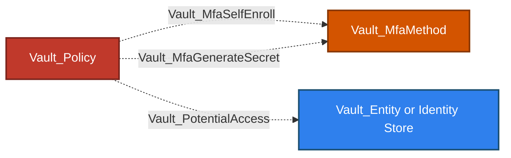

Equivalent Cypher query:

```cypher
MATCH p = (:Vault_Policy)-[:Vault_MfaSelfEnroll|Vault_MfaGenerateSecret|Vault_PotentialAccess]->(d)
WHERE d:Vault_MfaMethod OR d:Vault_Entity OR d:Vault_Store
RETURN p
```

## SCIM

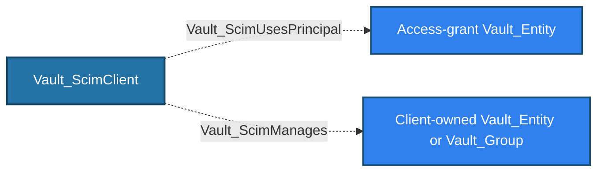

Equivalent Cypher query:

```cypher
MATCH p = (:Vault_ScimClient)-[:Vault_ScimUsesPrincipal|Vault_ScimManages]->(d)
RETURN p
```

This opening diagram shows configured principal selection and client ownership only. Declared protocol rights and principal-effective SCIM access are documented under Conditional Access.

### Nodes

| Node | Description |
| --- | --- |
| `Vault_ScimClient` | Enterprise SCIM client and access-grant configuration. |
| `Vault_Entity` | Canonical identity that may act as the SCIM access-grant principal or a managed User resource. |
| `Vault_Group` | Canonical group that may be managed as a SCIM Group resource. |

### Specialized Edges

Unresolved SCIM outcomes use the store-wide `Vault_PotentialAccess` family documented under [Common Edges](#common-edges).

| Edge | Source | Destination | Traversable | Meaning |
| --- | --- | --- | :---: | --- |
| `Vault_ScimUsesPrincipal` | SCIM client | Entity | :x: | Identifies the client's configured access-grant principal. |
| `Vault_ScimManages` | SCIM client | Entity or group | :x: | Records that the resource is owned by that SCIM client. |
| `Vault_ScimProtocolAccess` | Policy | SCIM client | :x: | Declared ACL access to authenticated SCIM surfaces. |
| `Vault_ScimReadResources` | Access-grant entity | SCIM client | :x: | Derived effective permission to query, read, list, or discover SCIM resources. |
| `Vault_ScimProvisionResources` | Access-grant entity | Observed entity or group | :x: | Derived effective permission to create, update, patch, or delete the concrete client-owned resource. |

`Vault_ScimProtocolAccess` preserves the declaring policy's authority but does not prove that the policy belongs to the client's configured access-grant principal. Effective read and provisioning relationships are derived only after that principal resolves to an enabled entity and its effective ACLs are evaluated. Provisioning reaches an observed client-owned resource directly; collection creation and unresolved targets remain potential access anchored to the client.

### Properties

| Node/Edge Type | Property | Description |
| --- | --- | --- |
| `Vault_ScimClient` | `Client Name` | Stores the configured SCIM client name. |
| `Vault_ScimClient` | `Client ID` | Identifies the SCIM client and correlates client-owned resources. |
| `Vault_ScimClient` | `Access Grant Principal` | Identifies the entity authorized to use the client. |
| `Vault_ScimClient` | `Alias Mount Accessor` | Identifies the auth mount used to correlate SCIM-created aliases. |
| `Vault_ScimClient` | `Deleting` | Indicates that client deletion is in progress. |
| `Vault_ScimProtocolAccess` | `SCIM Targets` | Identifies Users, Groups, or discovery collections authorized by the policy. |
| `Vault_ScimProtocolAccess` | `Surfaces` | Lists the authenticated SCIM protocol surfaces matched by the ACL. |
| `Vault_ScimProtocolAccess` | `Operations` | Lists the allowed SCIM protocol operations. |
| `Vault_ScimProtocolAccess` | `Client Names` | Lists SCIM clients to which the declared policy access applies. |
| `Vault_ScimProtocolAccess` | `Access Grant Principals` | Lists principals that must own the effective ACL for client use. |
| `Vault_ScimProtocolAccess` | `Principal Match Required` | Indicates that policy access alone is insufficient without the configured principal match. |
| `Vault_ScimReadResources`<br>`Vault_ScimProvisionResources`<br>`Vault_PotentialAccess` | `Client Names` | Lists the SCIM clients through which resource access is evaluated. |
| `Vault_ScimReadResources`<br>`Vault_ScimProvisionResources`<br>`Vault_PotentialAccess` | `SCIM Client IDs` | Lists client identifiers used to prove resource ownership. |
| `Vault_ScimReadResources`<br>`Vault_ScimProvisionResources`<br>`Vault_PotentialAccess` | `Scopes` | Distinguishes exact resource access from patterned collection access. |
| `Vault_ScimReadResources`<br>`Vault_ScimProvisionResources`<br>`Vault_PotentialAccess` | `Operations` | Lists the effective SCIM read or mutation operations. |
| `Vault_ScimProvisionResources` | `Target Resource Observed` | Indicates that the edge reaches a concrete resource owned by the client. |
| `Vault_PotentialAccess` | `Potential Outcomes` | Describes unobserved SCIM resource creation or unresolved provisioning. |
| `Vault_PotentialAccess` | `Requirements` | Lists unresolved ownership, selector, or target prerequisites. |
| `Vault_PotentialAccess` | `Resolution Status` | Explains why concrete resource access could not be proven. |

### Conditional Access

SCIM read, protocol, provisioning, ownership, and principal relationships are currently non-traversable evidence. `Vault_ScimManages` describes configured ownership but is not used as a containment fan-out or attack-path hop. This prevents read-only, collection-level, or unresolved SCIM access from implying control of every entity and group.

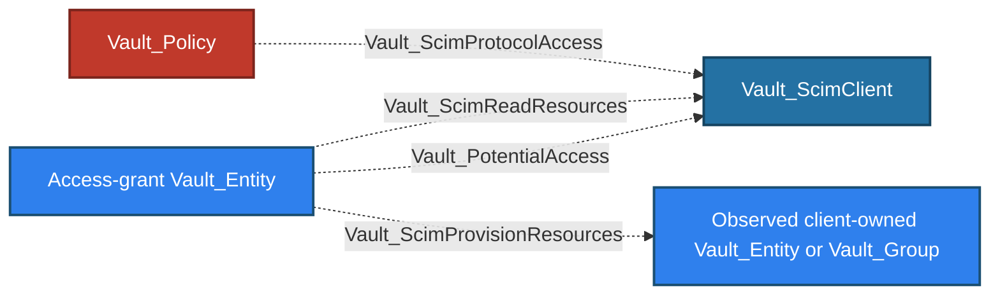

Equivalent Cypher query:

```cypher
MATCH p = (s)-[:Vault_ScimProtocolAccess|Vault_ScimReadResources|Vault_ScimProvisionResources|Vault_PotentialAccess]->(d)
WHERE s:Vault_Policy OR s:Vault_Entity
RETURN p
```

## Template Policies

Identity templates can reference entity fields, an entity alias on a specific accessor, or an identity group by ID. The rendered effective edge originates from the referenced identity representation:

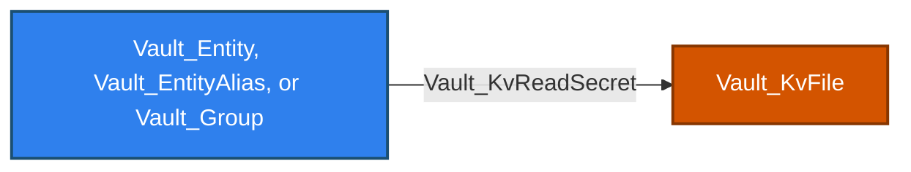

Equivalent Cypher query:

```cypher
MATCH p = (source)-[r:Vault_KvReadSecret]->(target:Vault_KvFile)
WHERE r.templated = true
  AND (source:Vault_Entity OR source:Vault_EntityAlias OR source:Vault_Group)
RETURN p
```

The KV read is a concrete example. Template resolution can emit any compatible destination subsystem edge while retaining the same provenance properties.

### Nodes

Template resolution introduces no template-specific node kind. It uses an observed `Vault_Entity`, `Vault_EntityAlias`, or `Vault_Group` as the effective source and a concrete node from the destination subsystem as the target.

### Specialized Edges

Template resolution introduces no template-only edge kind. The collector emits the destination subsystem's ordinary operation edge and marks it with template and policy-provenance properties.

| Template reference | Effective source |
| --- | --- |
| `identity.entity.*` | `Vault_Entity` |
| `identity.entity.aliases.<accessor>.*` | Matching `Vault_EntityAlias` |
| `identity.groups.ids.<group-id>.*` | Referenced `Vault_Group` |

Policy inheritance from a group remains provenance on the edge. It does not make the group the source unless the template expression itself references that group.

### Properties

Rendered template relationships use the destination subsystem's exact operation edge kind and its ordinary properties; for example, a rendered KV read remains `Vault_KvReadSecret`. There is no template-only relationship kind to own a separate property table.

The cross-cutting `Templated`, `Template Entity Fields`, `Resolved For Entity IDs`, `Resolved Source Types`, `Matched Policy Paths`, `Matched Paths`, and `Via Policies` metadata is documented by the shared [Policy-Derived Edge Metadata](../MODEL.md#policy-derived-edge-metadata) contract. Destination-store catalogues document properties specific to each concrete edge kind.

### Attack Paths

A rendered template edge can originate directly from the referenced entity representation and reach a concrete subsystem target. The destination subsystem documents the resulting security edge, such as `Vault_KvReadSecret` in the [KV section](MOUNTS.md#kv). `Matched Policy Paths`, rendered `Matched Paths`, and `Via Policies` preserve why the effective identity-specific edge exists.
