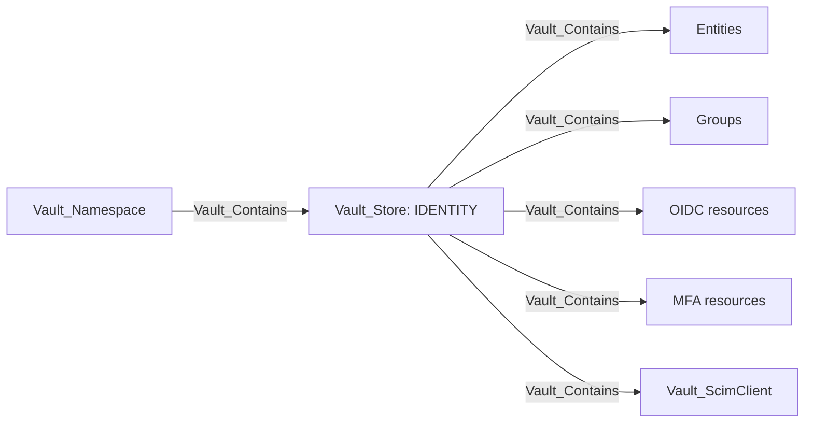
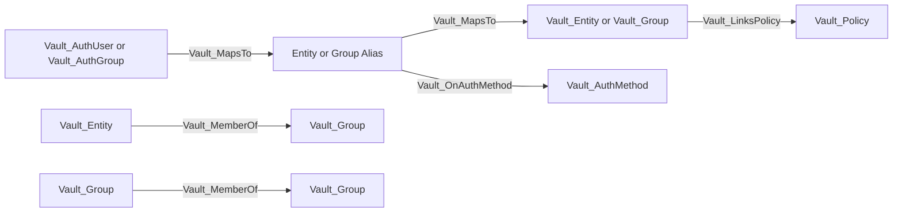
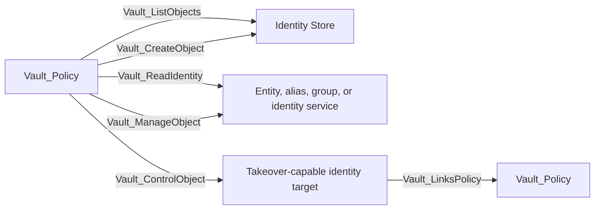
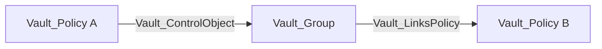
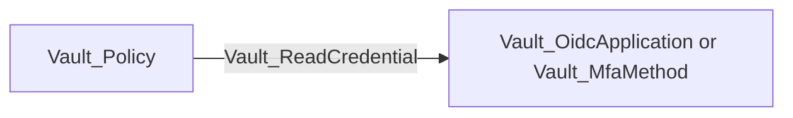
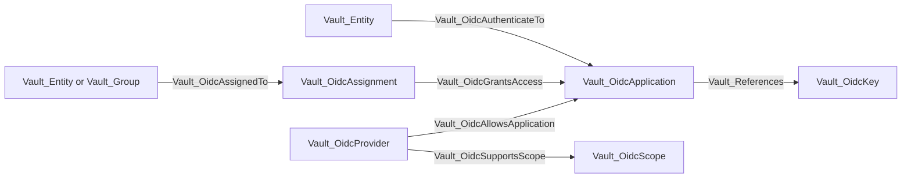
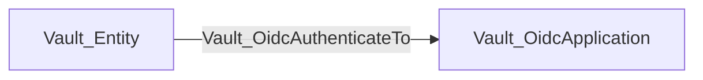
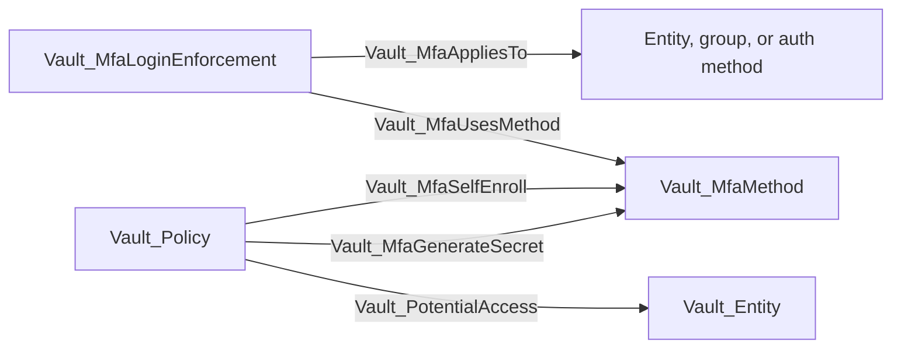
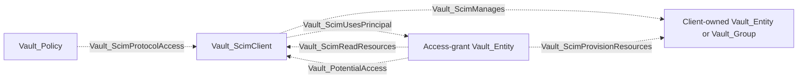

# Identity Store

The Identity Store represents Vault's namespace-local identity subsystem under `identity/`. It contains canonical identities, external identity mappings, outbound OIDC resources, MFA configuration, and Enterprise SCIM clients.

The store is the destination for collection-wide list/create and identity configuration rights. Exact reads and management rights target concrete identity objects.

## Nodes

| Node | Description |
| --- | --- |
| `Vault_Entity` | Canonical identity with direct policies, effective groups, metadata, aliases, creation time, and update time. |
| `Vault_EntityAlias` | Auth-mount-specific external name that resolves to a canonical entity. |
| `Vault_Group` | Internal or external group with policies, member entities, child groups, aliases, and metadata. |
| `Vault_GroupAlias` | External group name on an auth mount that resolves to a canonical group. |
| `Vault_OidcApplication` | Outbound OIDC client application configured to trust Vault as an identity provider. |
| `Vault_OidcKey` | Signing key used by outbound OIDC applications or providers. |
| `Vault_OidcAssignment` | Assignment object selecting entities or groups that may access applications. |
| `Vault_OidcProvider` | Outbound OIDC provider configuration where Vault acts as the identity provider. |
| `Vault_OidcScope` | OIDC scope and claim template exposed by a provider. |
| `Vault_OidcTokenRole` | Named identity-token signing role. |
| `Vault_MfaMethod` | Configured MFA method, such as TOTP, Duo, Okta, or PingID. |
| `Vault_MfaLoginEnforcement` | Rule that applies one or more MFA methods to selected identities or auth surfaces. |
| `Vault_ScimClient` | Enterprise SCIM client and access-grant configuration. |

## Identity Resolution

Auth-specific principals do not replace canonical Vault identity. Where mount accessor and name correlation are available, they resolve through aliases.

| Edge | Source | Destination | Traversable | Meaning |
| --- | --- | --- | --- | --- |
| `Vault_MapsTo` | Auth principal or alias | Alias or canonical identity | :white_check_mark: | Correlates an external representation with Vault identity. |
| `Vault_OnAuthMethod` | Entity or group alias | Auth method | :x: | Records the mount accessor on which the alias exists. |
| `Vault_MemberOf` | Entity or child group | Group | :white_check_mark: | Carries policy-bearing membership. |
| `Vault_LinksPolicy` | Entity or group | Policy | :white_check_mark: | Direct or inherited policy assignment, with link type properties. |

Group membership returned by Vault is modeled; VaultHound does not independently query external directories to prove upstream membership.

### Properties

| Applies to | Non-common properties | Meaning |
| --- | --- | --- |
| `Vault_Entity` | `Entity ID`, `Entity Name`, `Disabled`, `Bucket Key Hash`, `External ID`, `Policies`, `Entity Alias IDs`, `Direct Group IDs`, `Effective Group IDs`, `Inherited Group IDs`, `Merged Entity IDs`, `SCIM Client ID`, `SCIM Managed`, `Creation Time`, `Last Update Time` | Canonical identity state, policy inputs, resolved group context, merge history, and SCIM ownership. |
| `Vault_EntityAlias` | `Entity Alias ID`, `Entity Alias Name`, `Mount Path`, `Mount Accessor`, `Mount Type`, `Entity ID`, `Local`, `Merged From Canonical IDs`, `Creation Time`, `Last Update Time` | The external identity name, its auth mount, and the canonical entity to which it resolves. |
| `Vault_Group` | `Group ID`, `Group Name`, `Group Type`, `Policies`, `Member Entity IDs`, `Member Group IDs`, `Parent Group IDs`, `Modify Index`, `SCIM Client ID`, `SCIM Managed`, `Creation Time`, `Last Update Time` | Internal or external group state, membership, policy inputs, hierarchy, and SCIM ownership. |
| `Vault_GroupAlias` | `Group Alias ID`, `Group Alias Name`, `Mount Path`, `Mount Accessor`, `Mount Type`, `Group ID`, `Local`, `Merged From Canonical IDs`, `Creation Time`, `Last Update Time` | The external group name, its auth mount, and the canonical group to which it resolves. |
| `Vault_MapsTo` | Correlation evidence such as mount accessor, external name, and canonical ID | Explains why two representations were correlated; absence of sufficient evidence prevents the edge. |
| `Vault_MemberOf` | Membership source and direct/effective context where available | Distinguishes collected direct membership from hierarchy-derived effective membership. |
| `Vault_LinksPolicy` | `Policy Link Types` | Distinguishes direct entity assignment, group assignment or inheritance, and other configured policy-grant sources. |

## Identity Administration

| Edge | Source | Destination | Traversable | Meaning |
| --- | --- | --- | --- | --- |
| `Vault_ListObjects` | Policy | Identity Store | :x: | Lists entity, alias, group, OIDC, MFA, or SCIM collections. |
| `Vault_CreateObject` | Policy | Identity Store or synthetic exact target | :x: | Creates an identity-subsystem object. |
| `Vault_ReadIdentity` | Policy | Concrete object or Identity Store | :x: | Reads non-secret identity data or a store-native identity surface. |
| `Vault_ReadCredential` | Policy | Secret-bearing OIDC or MFA object | :white_check_mark: | Reads returned credential material such as a confidential OIDC client secret. |
| `Vault_ReadObject` | Policy | Concrete generic identity object | :x: | Reads durable configuration through the generic family. |
| `Vault_ManageObject` | Policy | Concrete identity object | :x: | Updates or deletes ordinary identity configuration. |
| `Vault_ControlObject` | Policy | Concrete entity, group, or trust target | :white_check_mark: | Performs a parameter-aware mutation that proves identity takeover. |
| `Vault_ReadConfig` | Policy | Identity Store | :x: | Reads subsystem configuration such as OIDC configuration. |
| `Vault_ManageConfig` | Policy | Identity Store | :x: | Changes subsystem-wide configuration. |
| `Vault_DenyAccess` | Policy | Matching target | :x: | Preserves an overriding deny rule. |
| `Vault_PotentialAccess` | Policy or resolved principal | Unresolved target | :x: | Records an unproven identity-control or credential outcome. |

Creating or managing an object is not automatically traversable. `Vault_ControlObject` is derived only when the controlled parameters establish a concrete takeover mechanism, such as changing canonical alias ownership, adding an attacker-controlled entity to a policy-bearing internal group, or replacing unrestricted trust configuration.

### Properties

| Applies to | Non-common properties | Meaning |
| --- | --- | --- |
| `Vault_ListObjects`, `Vault_CreateObject`, `Vault_ReadObject`, `Vault_ManageObject` | `Object Types`, `Operations` | Identifies the identity collection or concrete object kinds and actions represented by a generic edge. |
| `Vault_ReadIdentity` | `Identity Targets`, `Operations` | Identifies the entity, group, alias, lookup, or identity-service data that can be read. |
| `Vault_ReadCredential` | `Identity Targets`, `Operations`, `Exposure Confirmed` | Identifies the secret-bearing identity object and whether the authenticated response is proven to return usable credential material. |
| `Vault_ReadConfig`, `Vault_ManageConfig` | `Config Targets`, `Operations` | Names the identity-wide configuration surface, such as outbound OIDC or MFA configuration. |
| `Vault_ControlObject` | Control-context properties documented in [MODEL.md](../MODEL.md#control-context) | Records the exact takeover mechanism, affected parameters, controlled object, and parameter constraints. |
| `Vault_PotentialAccess` | Potential outcomes and prerequisite properties documented in [MODEL.md](../MODEL.md#derivation-and-uncertainty) | Preserves unresolved selectors or prerequisites without creating a traversable takeover path. |

### Attack Paths

Identity takeover can expose every policy linked to the controlled identity object:

This path reaches only policies observed as linked to the controlled group. Policy-assignment parameters remain evidence on the relevant management or control edge and do not create a direct policy-to-policy relationship.

Rebinding an alias under attacker control targets the candidate canonical identity directly:

The `Vault_ControlObject` properties distinguish this path from membership takeover:

| Control Method | Control Target | Via Object |
| --- | --- | --- |
| `Modify Group Membership` | Internal `Vault_Group` | Membership parameters on the group operation |
| `Rebind Controlled Entity Alias` | Candidate `Vault_Entity` | Controlled `Vault_EntityAlias` in `Via Object IDs` and `Via Object Names` |
| `Rebind Controlled Group Alias` | Candidate `Vault_Group` | Controlled `Vault_GroupAlias` in `Via Object IDs` and `Via Object Names` |

No additional alias hop follows `Vault_ControlObject`: the collector derives control over the canonical entity or group selected by the alias rebinding operation.

This path is emitted only when the authenticated read returns usable secret material, such as a confidential OIDC client secret or an enrollment/integration credential. Ordinary identity reads remain non-traversable.

## Outbound OIDC

The outbound OIDC model is distinct from the JWT/OIDC authentication method. Here Vault is the identity provider and applications consume Vault-issued identity tokens.

| Edge | Source | Destination | Traversable | Meaning |
| --- | --- | --- | --- | --- |
| `Vault_OidcAllowsApplication` | Provider | Application | :x: | Provider configuration allows the client application. |
| `Vault_OidcSupportsScope` | Provider | Scope | :x: | Provider exposes the scope. |
| `Vault_References` | Application or provider | OIDC key | :x: | Configuration uses the signing key. |
| `Vault_OidcAssignedTo` | Entity or group | Assignment | :x: | Principal is selected by the assignment. |
| `Vault_OidcGrantsAccess` | Assignment | Application | :x: | Assignment grants application eligibility. |
| `Vault_OidcAuthorize` | Policy | Provider or application target | :x: | ACL permits the authenticated authorization surface. |
| `Vault_OidcAuthenticateTo` | Entity | Application | :white_check_mark: | Assignment and provider constraints compose into proven application access. |
| `Vault_GenerateIdentityToken` | Policy | OIDC token role | :white_check_mark: | Policy can invoke a concrete identity-token signing role. |

The direct authentication edge is derived from collected configuration; the intermediate assignment and provider edges remain visible as non-traversable evidence.

### Properties

| Applies to | Non-common properties | Meaning |
| --- | --- | --- |
| `Vault_OidcApplication` | `Client ID`, `Access Token TTL`, `ID Token TTL`, `Client Secret Set`, `Redirect URIs`, `Assignments`, `Key`, `Client Type`, `PKCE Requirement` | Application registration, token lifetime, redirect, assignment, signing-key, and client-authentication configuration. |
| `Vault_OidcProvider` | `Issuer`, `Allowed Client IDs`, `Scopes Supported`, `Built In`, `Delete Protected` | Provider issuer and the applications and scopes it exposes. |
| `Vault_OidcKey` | `Algorithm`, `Allowed Client IDs`, `Rotation Period`, `Verification TTL`, `Built In`, `Delete Protected` | Signing-key algorithm, consumers, rotation, and verification lifetime. Raw signing material is not collected. |
| `Vault_OidcScope` | `Description`, `Template`, `Built In`, `Immutable` | Scope definition and the claim template added to issued tokens. |
| `Vault_OidcAssignment` | `Entity IDs`, `Group IDs`, `Built In`, `Immutable` | Canonical identities selected by the assignment. |
| `Vault_OidcTokenRole` | `Client ID`, `Key`, `Template`, `TTL` | Named identity-token role and its signing and token settings. |
| OIDC structural edges | Provider, assignment, scope, application, and key selectors where applicable | Preserves the configuration rule responsible for each non-traversable OIDC relationship. |
| `Vault_OidcAuthenticateTo` | `Assignment Names`, `Provider Names`, `Matched Paths`, `ACL Basis` | Evidence that assignment eligibility, provider configuration, and authorization compose into application access. |
| `Vault_GenerateIdentityToken` | `Key Eligibility` and operation requirements | Records whether the role can use its configured signing key and any unresolved prerequisite. |

### Attack Paths

This derived edge requires an applicable assignment, an allowing provider, and compatible application/provider configuration. The assignment and provider edges alone do not create an attack path.

The path represents the ability to mint a Vault identity token through an observed signing role. If the role's signing-key allowlist is empty or incompatible, no attack edge is emitted; an unresolved signing key produces `Vault_PotentialAccess`.

## MFA

| Edge | Source | Destination | Traversable | Meaning |
| --- | --- | --- | --- | --- |
| `Vault_MfaUsesMethod` | MFA login enforcement | MFA method | :x: | Records the method required or referenced by the enforcement. |
| `Vault_MfaAppliesTo` | MFA login enforcement | Entity, group, or auth method | :x: | Records the collected identity or login surface governed by the enforcement. |
| `Vault_MfaSelfEnroll` | Policy | MFA method | :x: | Permits MFA self-enrollment. |
| `Vault_MfaGenerateSecret` | Policy | MFA method | :x: | Generates enrollment secret material where supported. |
| `Vault_PotentialAccess` | Policy | Entity or Identity Store | :x: | Records administrative TOTP enrollment material without proving the entity's primary credential. |

MFA methods and enforcements describe login prerequisites. The collector does not perform enrollment or login challenges.

### Properties

| Applies to | Non-common properties | Meaning |
| --- | --- | --- |
| `Vault_MfaMethod` | `Method ID`, `Method Name`, `Method Type`, `Owning Namespace ID`, `Visible From Namespace IDs` | Stable MFA identity, type, owning namespace, and namespace visibility. |
| `Vault_MfaMethod` | `Issuer`, `Algorithm`, `Digits`, `Period`, `Key Size`, `QR Size`, `Skew`, `Max Validation Attempts`, `Self Enrollment Enabled`, `Username Format`, `API Hostname`, `Push Info`, `Use Passcode`, `Organization Name`, `Base URL` | Type-specific method configuration returned by Vault. Only fields applicable to the collected method are present. Sensitive credentials are excluded unless an authenticated API response explicitly exposes them through `Vault_ReadCredential`. |
| `Vault_MfaLoginEnforcement` | `Enforcement ID`, `MFA Method IDs`, `Auth Method Accessors`, `Auth Method Types`, `Identity Entity IDs`, `Identity Group IDs`, `Satisfaction Mode`, `Method Selection Mode`, `Owning Namespace ID`, `Visible From Namespace IDs` | Method selection and the auth or identity selectors governed by the enforcement. |
| `Vault_MfaUsesMethod`, `Vault_MfaAppliesTo` | Enforcement and selector evidence | Identifies which enforcement rule produced the topology relationship. |
| `Vault_MfaSelfEnroll`, `Vault_MfaGenerateSecret` | `Operations`, enrollment target and method context | Describes the enrollment action without asserting successful login or identity takeover. |
| Administrative TOTP `Vault_PotentialAccess` | `Potential Outcomes`, `Credential Types`, `Credential Uses`, `Requirements`, `Resolution Status` | Records returned enrollment material and why it remains conditional rather than traversable. |

### Attack Paths

MFA topology edges and self-enrollment permissions are non-traversable because configuration or enrollment eligibility does not by itself bypass MFA. `identity/mfa/method/totp/admin-generate` resolves `entity_id` parameter constraints to observed entities and emits `Vault_PotentialAccess` with the returned TOTP enrollment secret, the primary-credential prerequisite, and the requirement that no enrollment exists or that it can first be destroyed. An unresolved entity selector remains anchored to the Identity Store. This is deliberately not `Vault_ReadCredential`: a TOTP seed alone is only one factor and does not prove control of the entity's primary login.

## SCIM

| Edge | Source | Destination | Traversable | Meaning |
| --- | --- | --- | --- | --- |
| `Vault_ScimUsesPrincipal` | SCIM client | Entity | :x: | Identifies the client's configured access-grant principal. |
| `Vault_ScimManages` | SCIM client | Entity or group | :x: | Records that the resource is owned by that SCIM client. |
| `Vault_ScimProtocolAccess` | Policy | SCIM client | :x: | Declared ACL access to authenticated SCIM surfaces. |
| `Vault_ScimReadResources` | Access-grant entity | SCIM client | :x: | Derived effective permission to query, read, list, or discover SCIM resources. |
| `Vault_ScimProvisionResources` | Access-grant entity | Observed entity or group | :x: | Derived effective permission to create, update, patch, or delete the concrete client-owned resource. |
| `Vault_PotentialAccess` | Access-grant entity | SCIM client | :x: | Provisioning may create an unobserved resource, or target ownership and resolution are incomplete. |

`Vault_ScimProtocolAccess` preserves the declaring policy's authority but does not prove that the policy belongs to the client's configured access-grant principal. Effective read and provisioning relationships are derived only after that principal resolves to an enabled entity and its effective ACLs are evaluated. Provisioning reaches an observed client-owned resource directly; collection creation and unresolved targets remain potential access anchored to the client.

### Properties

| Applies to | Non-common properties | Meaning |
| --- | --- | --- |
| `Vault_ScimClient` | `Client Name`, `Client ID`, `Access Grant Principal`, `Alias Mount Accessor`, `Deleting` | SCIM client identity, the entity authorized to use it, alias correlation surface, and deletion state. |
| `Vault_ScimProtocolAccess` | `SCIM Targets`, `Surfaces`, `Operations` | Declared policy access to Users, Groups, discovery, or other SCIM protocol surfaces. |
| `Vault_ScimReadResources` | `Client Names`, `SCIM Client IDs`, `Scopes`, `Operations` | Proves which access-grant entity can query or discover resources through which client. |
| `Vault_ScimProvisionResources` | `Client Names`, `SCIM Client IDs`, `Scopes`, `Operations` | Proves which access-grant entity can mutate the concrete client-owned entity or group. |
| SCIM `Vault_PotentialAccess` | Unresolved resource, ownership, selector, and operation requirements | Preserves possible collection creation or incomplete client/resource resolution without fan-out. |

### Attack Paths

SCIM read, protocol, provisioning, ownership, and principal relationships are currently non-traversable evidence. `Vault_ScimManages` describes configured ownership but is not used as a containment fan-out or attack-path hop. This prevents read-only, collection-level, or unresolved SCIM access from implying control of every entity and group.

## Template Policies

Identity templates can reference entity fields, an entity alias on a specific accessor, or an identity group by ID. The rendered effective edge originates from the referenced identity representation:

| Template reference | Effective source |
| --- | --- |
| `identity.entity.*` | `Vault_Entity` |
| `identity.entity.aliases.<accessor>.*` | Matching `Vault_EntityAlias` |
| `identity.groups.ids.<group-id>.*` | Referenced `Vault_Group` |

Policy inheritance from a group remains provenance on the edge. It does not make the group the source unless the template expression itself references that group.

### Properties

Rendered template relationships use the destination subsystem's normal edge kind and properties. They additionally carry the common template provenance documented in [MODEL.md](../MODEL.md#identity-templates-and-provenance): `Templated`, `Template Entity Fields`, `Resolved For Entity IDs`, `Resolved Source Types`, `Matched Policy Paths`, rendered `Matched Paths`, and `Via Policies`. There is no separate template-only relationship family.

### Attack Paths

A rendered template edge can originate directly from the referenced entity representation and reach a concrete subsystem target. The destination subsystem documents the resulting security edge, such as `Vault_KvReadSecret` in the [KV section](MOUNTS.md#kv). `Matched Policy Paths`, rendered `Matched Paths`, and `Via Policies` preserve why the effective identity-specific edge exists.

## Limitations

- External identity-provider state is not independently validated.
- Login MFA, control groups, Sentinel policy, quotas, and token wrapping can add runtime conditions beyond static ACLs.
- Sensitive-read edges identify returned secret fields but do not exercise the credential.
- SCIM and OIDC behavior depends on Enterprise features and Vault version.
