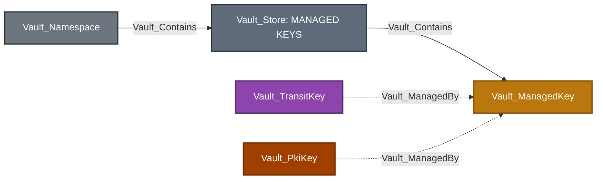
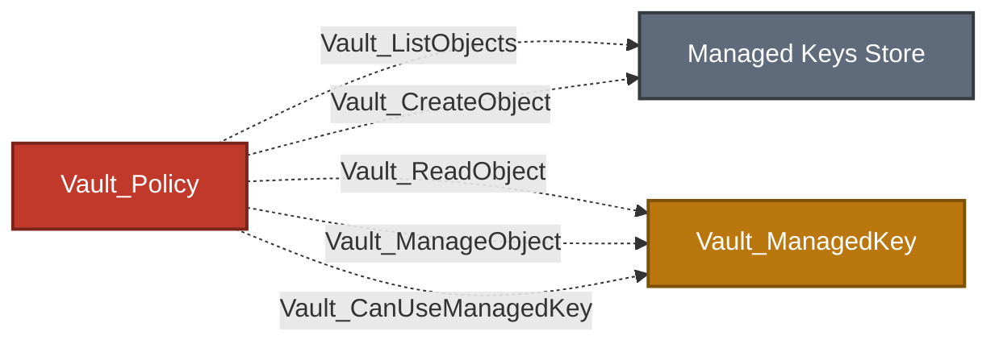
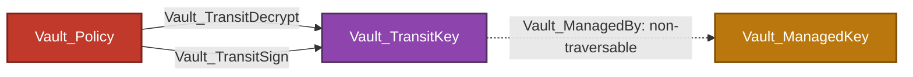

# Managed Keys Store

The Managed Keys Store represents the namespace-local Enterprise registry at `sys/managed-keys`. A managed key delegates cryptographic operations to an external KMS or HSM while Vault stores the registration and provider configuration.

## Glob, Synthetic, And Control Behavior

- Collection globs expand read, manage, and use rights to observed compatible managed-key registrations.
- Exact missing names may create synthetic targets, but synthetic registrations do not prove a usable external key.
- Collection-wide creation is anchored to the Managed Keys Store.
- Mechanism, backend, mount-allowlist, and operation compatibility remain explicit edge prerequisites.

## Limitations

- VaultHound does not independently inspect the external KMS or HSM that owns the key material.
- Provider IAM, network reachability, and provider-side key state remain outside the Vault graph.
- A managed-key registration does not imply exportability or control of the external key.
- Traversable cryptographic outcomes are modeled on compatible consuming objects rather than the registration itself.

## Common Topology



Solid arrows represent traversable relationships; dashed arrows represent non-traversable relationships. Edge labels and descriptions distinguish containment from configured references independently of line style.

Equivalent Cypher query:

```cypher
MATCH p = (s)-[:Vault_Contains|Vault_ManagedBy*1..2]->(managed:Vault_ManagedKey)
WHERE s:Vault_Namespace
   OR s:Vault_TransitKey
   OR s:Vault_PkiKey
RETURN p
```

### Common Nodes

| Type | Meaning |
| --- | --- |
| `Vault_Store` | Namespace-local Managed Keys registry and collection anchor. |
| `Vault_ManagedKey` | Named Enterprise external-key registration, including provider type, key identifier, library or endpoint settings, mechanism configuration, and returned status. |

Provider-specific configuration is retained in human-readable properties where possible. The collector does not retrieve raw external key material.

### Common Edges

| Edge | Source | Destination | Traversable | Meaning |
| --- | --- | --- | :---: | --- |
| `Vault_Contains` | Managed Keys Store | Managed key | :white_check_mark: | The observed registration belongs to this namespace. |
| `Vault_ManagedBy` | Transit key, PKI key, or compatible Vault object | Managed key | :x: | The Vault resource delegates cryptographic operations to the external key. |
| `Vault_References` | Other configured object | Managed key | :x: | A non-owning configuration reference where managed-key semantics are less specific. |

`Vault_ManagedBy` points from the Vault object that performs an operation to the external managed-key registration. It does not imply that reading the registration reveals the external key.

### Common Properties

| Node/Edge Type | Property | Description |
| --- | --- | --- |
| Managed Keys `Vault_Store` | `Store Type` | Identifies the store as the namespace-local managed-key registry. |
| Managed Keys `Vault_Store` | `Path` | Records the registry API path, normally `sys/managed-keys`. |
| Managed Keys `Vault_Store` | `Built In` | Indicates whether the store is an intrinsic namespace subsystem. |
| Managed Keys `Vault_Store` | `Enterprise` | Indicates that the registry requires Vault Enterprise. |
| `Vault_ManagedKey` | `Managed Key Name` | Names the managed-key registration. |
| `Vault_ManagedKey` | `Managed Key ID` | Records Vault's stable identifier for the registration. |
| `Vault_ManagedKey` | `Backend Type` | Identifies the external KMS or HSM backend type. |
| `Vault_ManagedKey` | `Usages` | Lists cryptographic operations supported by the registration. |
| `Vault_ManagedKey` | `Allow Generate Key` | Indicates whether Vault may generate external key material through the provider. |
| `Vault_ManagedKey` | `Allow Replace Key` | Indicates whether Vault may replace the provider key associated with the registration. |
| `Vault_ManagedKey` | `Allow Store Key` | Indicates whether Vault may send key material to the provider for storage. |
| `Vault_ManagedKey` | `Any Mount` | Indicates whether any compatible mount may use the registration without an explicit allowlist entry. |
| `Vault_ManagedKey` | `Synthetic` | Indicates that the node was inferred from policy or configuration rather than read from the registry. |
| `Vault_ManagedKey` | `Exists` | Indicates whether collection confirmed the registration through the managed-key API. |
| `Vault_ManagedKey` | `Potential Only` | Indicates that the node preserves an unresolved possible target without asserting usability. |
| `Vault_ManagedKey` | `Discovered Via Mount Allowlist` | Indicates that a mount's managed-key allowlist exposed the registration name. |
| `Vault_ManagedKey` | `Managed Key Evidence` | Describes the collection source that established or inferred the registration. |

Provider-returned PKCS#11, AWS KMS, Azure Key Vault, and GCP Cloud KMS fields are exported dynamically in human-readable form. PINs, access keys, secret keys, client secrets, and credential blobs are removed.

## Managed Key Administration



Equivalent Cypher query:

```cypher
MATCH p = (:Vault_Policy)-[:Vault_ListObjects|Vault_CreateObject|Vault_ReadObject|Vault_ManageObject|Vault_CanUseManagedKey]->(d)
WHERE d:Vault_Store OR d:Vault_ManagedKey
RETURN p
```

### Nodes

Managed-key administration uses the common `Vault_Store` and `Vault_ManagedKey` node kinds. It introduces no additional durable node type.

### Edges

| Edge | Source | Destination | Traversable | Meaning |
| --- | --- | --- | :---: | --- |
| `Vault_ListObjects` | Policy | Managed Keys Store | :x: | Lists registered managed keys. |
| `Vault_CreateObject` | Policy | Store or synthetic exact key | :x: | Registers a new managed key. |
| `Vault_ReadObject` | Policy | Concrete managed key | :x: | Reads registration and provider configuration. |
| `Vault_ManageObject` | Policy | Concrete managed key | :x: | Updates or deletes the registration where supported. |
| `Vault_CanUseManagedKey` | Policy | Concrete managed key | :x: | Invokes a managed-key operation with mechanisms and operations preserved as properties. |

Managed-key use remains non-traversable by itself because provider mechanisms differ and using a registration does not necessarily reveal or control the external key. Traversable outcomes are represented at the consuming object when the operation is concrete, such as signing or decryption through a compatible Transit key.

### Properties

| Node/Edge Type | Property | Description |
| --- | --- | --- |
| `Vault_ManagedBy` | `Reference Evidence` | Identifies the Transit, PKI, SSH, or other configuration that proves external-key backing. |
| `Vault_References` | `Reference Types` | Classifies the non-owning managed-key dependency. |
| `Vault_References` | `Reference Evidence` | Records the configuration values used to resolve the dependency. |
| `Vault_CanUseManagedKey` | `Authorization Sources` | Identifies whether use is enabled by `Any Mount`, a mount allowlist, or policy authority. |
| `Vault_CanUseManagedKey` | `Compatible Usages` | Lists collected managed-key usages compatible with the source mount. |
| `Vault_CanUseManagedKey` | `Compatibility Known` | Indicates whether collected usage metadata was sufficient to evaluate compatibility. |
| `Vault_CanUseManagedKey` | `Operations` | Lists managed-key API operations authorized by the edge. |
| `Vault_CanUseManagedKey` | `Viable Operations` | Lists operations whose observed prerequisites are currently satisfied. |
| `Vault_CanUseManagedKey` | `Backend Types` | Lists external backend types applicable to the operation. |
| `Vault_CanUseManagedKey` | `Mechanisms` | Lists provider mechanisms selected by the request surface. |
| `Vault_CanUseManagedKey` | `Requirements` | Lists endpoint and provider prerequisites for the operation. |
| `Vault_CanUseManagedKey` | `Operation Effects` | Describes externally visible effects such as validating signing configuration or generating an external key. |
| `Vault_ListObjects`<br>`Vault_CreateObject`<br>`Vault_ReadObject`<br>`Vault_ManageObject` | `Object Types` | Identifies the managed-key object family affected by the generic edge. |
| `Vault_ListObjects`<br>`Vault_CreateObject`<br>`Vault_ReadObject`<br>`Vault_ManageObject` | `Operations` | Lists registry actions represented by the generic edge. |
| `Vault_ListObjects`<br>`Vault_CreateObject`<br>`Vault_ReadObject`<br>`Vault_ManageObject` | `Surfaces` | Identifies the managed-key registry endpoint family matched by the policy. |

### Attack Paths

There is no direct traversable edge into `Vault_ManagedKey`. The registration is an external cryptographic dependency, not raw key material:



Equivalent Cypher query:

```cypher
MATCH p = (:Vault_Policy)-[:Vault_TransitDecrypt|Vault_TransitSign]->(:Vault_TransitKey)-[:Vault_ManagedBy]->(:Vault_ManagedKey)
RETURN p
```

The attack path terminates at the Transit operation. `Vault_ManagedBy` remains non-traversable evidence showing which external key backs that operation. `Vault_CanUseManagedKey` is also non-traversable because system mechanisms can expose materially different outcomes and do not necessarily reveal or confer control of the provider key.

## System Endpoints

VaultHound distinguishes registry CRUD from managed-key use:

- Collection endpoints become `Vault_ListObjects` or `Vault_CreateObject` on the store.
- Exact registration endpoints become `Vault_ReadObject` or `Vault_ManageObject` on the key.
- Cryptographic system endpoints become `Vault_CanUseManagedKey` on the key with operation, mechanism, and request-surface properties.

Globs expand exact read/manage/use rights to observed compatible keys. Exact missing keys may be represented as synthetic, but do not receive traversable cryptographic outcomes.

## External-System Boundary

The model proves what Vault is configured and authorized to request. It does not independently validate:

- External KMS or HSM IAM policy.
- Provider-side key enablement, destruction, or rotation state.
- Network reachability to the provider.
- Whether a mechanism is permitted outside the state returned by Vault.

Hybrid edges should be added by an external-system collector only when the provider key can be resolved unambiguously.
