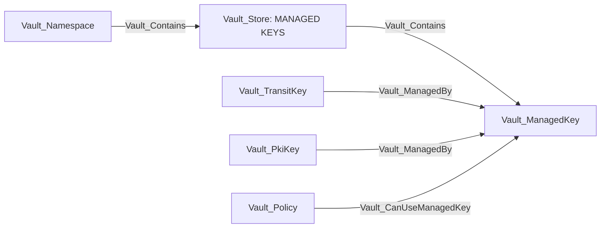
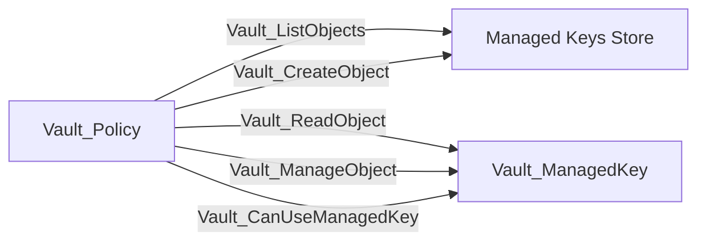
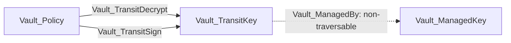

# Managed Keys Store

The Managed Keys Store represents the namespace-local Enterprise registry at `sys/managed-keys`. A managed key delegates cryptographic operations to an external KMS or HSM while Vault stores the registration and provider configuration.

## Nodes

| Node | Description |
| --- | --- |
| `Vault_Store` | Namespace-local Managed Keys registry and collection anchor. |
| `Vault_ManagedKey` | Named Enterprise external-key registration, including provider type, key identifier, library or endpoint settings, mechanism configuration, and returned status. |

Provider-specific configuration is retained in human-readable properties where possible. The collector does not retrieve raw external key material.

### Properties

| Applies to | Non-common properties | Meaning |
| --- | --- | --- |
| Managed Keys `Vault_Store` | `Store Type`, `Path`, `Built In`, `Enterprise` | Identifies the namespace-local Enterprise registry at `sys/managed-keys`. |
| `Vault_ManagedKey` | `Managed Key Name`, `Managed Key ID`, `Backend Type`, `Usages`, `Allow Generate Key`, `Allow Replace Key`, `Allow Store Key`, `Any Mount` | Stable provider registration identity, supported mechanisms, and mount-use controls. |
| `Vault_ManagedKey` | `Synthetic`, `Exists`, `Potential Only`, `Discovered Via Mount Allowlist`, `Managed Key Evidence` | Distinguishes a direct registry read from a key inferred through mount configuration or policy references. |
| `Vault_ManagedKey` | Provider-returned non-secret fields in human-readable form | Retains PKCS#11, AWS KMS, Azure Key Vault, or GCP Cloud KMS configuration and status returned by Vault. Credential fields such as PINs, access keys, secret keys, client secrets, and credential blobs are removed. |

## Containment And References

| Edge | Source | Destination | Traversable | Meaning |
| --- | --- | --- | :---: | --- |
| `Vault_Contains` | Managed Keys Store | Managed key | :white_check_mark: | The observed registration belongs to this namespace. |
| `Vault_ManagedBy` | Transit key, PKI key, or compatible Vault object | Managed key | :x: | The Vault resource delegates cryptographic operations to the external key. |
| `Vault_References` | Other configured object | Managed key | :x: | A non-owning configuration reference where managed-key semantics are less specific. |

`Vault_ManagedBy` points from the Vault object that performs an operation to the external managed-key registration. It does not imply that reading the registration reveals the external key.

## Access Edges

| Edge | Source | Destination | Traversable | Meaning |
| --- | --- | --- | :---: | --- |
| `Vault_ListObjects` | Policy | Managed Keys Store | :x: | Lists registered managed keys. |
| `Vault_CreateObject` | Policy | Store or synthetic exact key | :x: | Registers a new managed key. |
| `Vault_ReadObject` | Policy | Concrete managed key | :x: | Reads registration and provider configuration. |
| `Vault_ManageObject` | Policy | Concrete managed key | :x: | Updates or deletes the registration where supported. |
| `Vault_CanUseManagedKey` | Policy | Concrete managed key | :x: | Invokes a managed-key operation with mechanisms and operations preserved as properties. |

Managed-key use remains non-traversable by itself because provider mechanisms differ and using a registration does not necessarily reveal or control the external key. Traversable outcomes are represented at the consuming object when the operation is concrete, such as signing or decryption through a compatible Transit key.

### Properties

| Applies to | Non-common properties | Meaning |
| --- | --- | --- |
| `Vault_ManagedBy` | Managed-key reference and compatibility context where available | Identifies the external registration backing a Transit, PKI, or other compatible cryptographic object. |
| `Vault_References` | `Reference Types` and reference evidence where available | Records a non-owning managed-key dependency that is not strong enough for `Vault_ManagedBy`. |
| `Vault_CanUseManagedKey` from a mount | `Authorization Sources`, `Compatible Usages`, `Compatibility Known` | Shows whether use is enabled by `Any Mount` or a mount allowlist and which collected usages are compatible with the engine. |
| `Vault_CanUseManagedKey` from a policy | `Operations`, `Viable Operations`, `Backend Types`, `Mechanisms`, `Requirements`, `Operation Effects` | Identifies the exact system operation, backend/mechanism constraints, proven viable variants, prerequisites, and externally visible effect. |
| Generic object edges | `Object Types`, `Operations`, `Surfaces` | Identifies managed-key list, registration, read, update, or delete behavior represented by the generic edge family. |

## Attack-Path Semantics

There is no direct traversable edge into `Vault_ManagedKey`. The registration is an external cryptographic dependency, not raw key material:

The attack path terminates at the Transit operation. `Vault_ManagedBy` remains non-traversable evidence showing which external key backs that operation. `Vault_CanUseManagedKey` is also non-traversable because system mechanisms can expose materially different outcomes and do not necessarily reveal or confer control of the provider key.

## System Endpoints

VaultHound distinguishes registry CRUD from managed-key use:

- Collection endpoints become `Vault_ListObjects` or `Vault_CreateObject` on the store.
- Exact registration endpoints become `Vault_ReadObject` or `Vault_ManageObject` on the key.
- Cryptographic system endpoints become `Vault_CanUseManagedKey` on the key with operation, mechanism, and request-surface properties.

Globs expand exact read/manage/use rights to observed compatible keys. Exact missing keys may be represented as synthetic, but do not receive traversable cryptographic outcomes.

## External-System Boundary

The model proves what Vault is configured and authorized to request. It does not independently validate:

- External KMS or HSM IAM policy.
- Provider-side key enablement, destruction, or rotation state.
- Network reachability to the provider.
- Whether a mechanism is permitted outside the state returned by Vault.

Hybrid edges should be added by an external-system collector only when the provider key can be resolved unambiguously.
