# Mount Store

The Mount Store represents the namespace-local secrets-engine registry at `sys/mounts`. It contains every observed secrets-engine mount. Supported engines receive a specific node kind, child-resource collection, and endpoint-aware access edges; unsupported engines remain generic `Vault_SecretsEngine` nodes with existence, path, type, and mount properties only.

## Common Topology

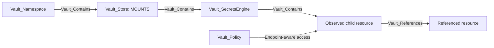

Specific mounts carry their display kind first and `Vault_SecretsEngine` as a base kind. Role-like child nodes carry `Vault_SecretsRole` where useful for cross-engine queries.

## Common Nodes And Edges

| Type | Meaning |
| --- | --- |
| `Vault_SecretsEngine` | Base node for a mounted secrets backend. |
| `Vault_SecretsRole` | Base node for role-like secrets-engine resources. |
| `Vault_Contains` | Mount Store to engine, and engine/resource to immediate observed children. |
| `Vault_References` | Non-owning dependency such as issuer-to-key or role-to-connection. |
| `Vault_ListObjects` | List roles, keys, accounts, connections, KV children, or similar collections. |
| `Vault_CreateObject` | Create an object at a collection or exact synthetic target. |
| `Vault_ReadObject` | Read durable configuration on a concrete child. |
| `Vault_ManageObject` | Update, delete, rotate, import, or otherwise administer a concrete child. |
| `Vault_ReadConfig` | Read mount, tuning, or backend-wide configuration. |
| `Vault_ManageConfig` | Change configuration, tuning, root credentials, or maintenance state. |
| `Vault_GenerateCredentials` | Obtain dynamic credentials from a concrete viable role. |
| `Vault_ReadStaticCredentials` | Read a managed static credential from a concrete role or account. |

Generic edges retain `Engine Types`, `Object Types`, `Role Types`, `Operations`, `Credential Types`, `Read Targets`, `Config Targets`, request surfaces, and prerequisites.

## Supported Engines

| Engine | Mount node | Child nodes |
| --- | --- | --- |
| AWS | `Vault_SecretsEngineAws` | `Vault_AwsRole`, `Vault_AwsStaticRole` |
| Azure | `Vault_SecretsEngineAzure` | `Vault_AzureRole`, `Vault_AzureStaticRole` |
| Database | `Vault_SecretsEngineDatabase` | `Vault_DatabaseConnection`, `Vault_DatabaseRole`, `Vault_DatabaseStaticRole` |
| GCP | `Vault_SecretsEngineGcp` | `Vault_GcpRoleset`, `Vault_GcpStaticAccount`, `Vault_GcpImpersonatedAccount` |
| GCP KMS | `Vault_SecretsEngineGcpKms` | `Vault_GcpKmsKey` |
| KV | `Vault_SecretsEngineKv` | `Vault_KvDirectory`, `Vault_KvFile`, `Vault_KvPair` |
| Kubernetes | `Vault_SecretsEngineKubernetes` | `Vault_KubernetesRole` |
| LDAP | `Vault_SecretsEngineLdap` | `Vault_LdapDynamicRole`, `Vault_LdapStaticRole`, `Vault_LdapLibrarySet`, `Vault_LdapServiceAccount` |
| PKI | `Vault_SecretsEnginePki` | `Vault_PkiRole`, `Vault_PkiIssuer`, `Vault_PkiKey` |
| SSH | `Vault_SecretsEngineSsh` | `Vault_SshRole` |
| Terraform Cloud | `Vault_SecretsEngineTerraform` | `Vault_TerraformRole` |
| TOTP | `Vault_SecretsEngineTotp` | `Vault_TotpKey` |
| Transit | `Vault_SecretsEngineTransit` | `Vault_TransitKey` |

## AWS

AWS dynamic roles describe IAM user, assumed role, federation token, or session token modes. Static roles map existing IAM users managed by Vault.

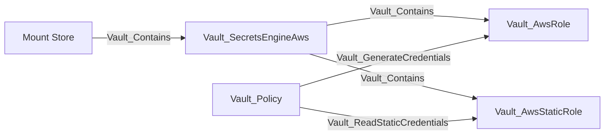

Dynamic-role properties include policy documents and ARNs, role ARNs, IAM groups, tags, permissions boundaries, credential modes, TTLs, and MFA configuration. Traversable generation requires at least one proven viable mode; session-token-only access requiring an MFA code becomes `Vault_PotentialAccess` when that prerequisite is unresolved.

Root credentials, lease settings, root rotation, and mount tuning use generic config edges. Role CRUD and collection operations use generic object edges.

### Attack Paths

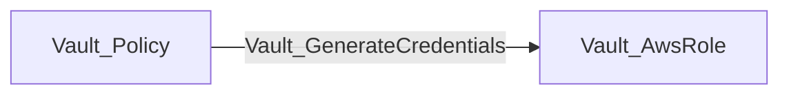

The destination role records whether Vault returns an IAM user, assumed-role credential, federation token, or session token. The edge is traversable only when at least one configured mode is viable. A session-token-only role that requires an unproven MFA code instead produces `Vault_PotentialAccess`.

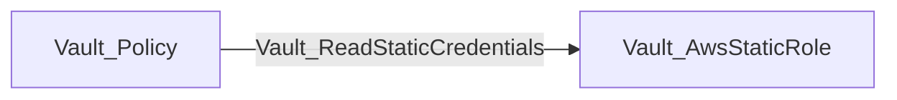

This yields the managed IAM user's current credential through Vault. Neither path proves the generated principal's downstream AWS permissions; those require correlation with AWS graph data.

## Azure

Azure dynamic roles generate service principals; static roles map existing applications or service principals and credential rotation state.

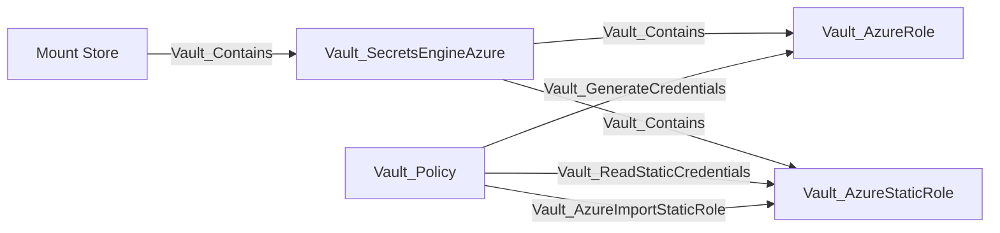

Roles retain Azure role assignments, groups, application settings, TTL behavior, and generated credential effects. `Vault_AzureImportStaticRole` is a specialized non-traversable administrative operation; ordinary role CRUD uses generic object edges.

### Attack Paths

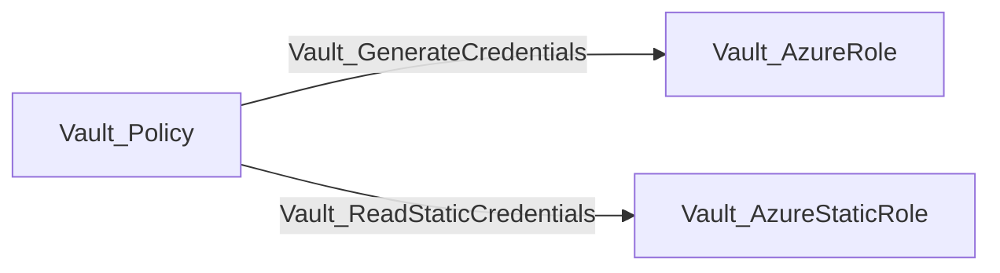

The first path obtains a generated Azure service-principal credential constrained by the dynamic role. The second reads the current credential managed through the concrete static role. Importing or managing a static role is not itself traversable because it does not prove that usable credential material is returned.

## Database

Database mounts contain plugin connections, dynamic roles, and static roles. Roles reference rather than contain their connection.

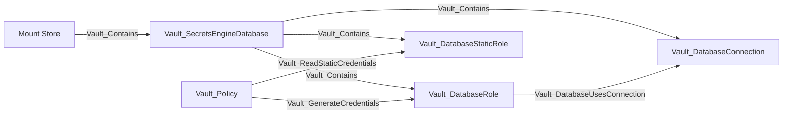

| Edge | Meaning |
| --- | --- |
| `Vault_DatabaseUsesConnection` | Role references a database connection. |
| `Vault_DatabaseResetConnection` | Reset the connection state; non-traversable maintenance. |
| `Vault_DatabaseReloadPlugin` | Reload a database plugin; non-traversable maintenance. |
| `Vault_GenerateCredentials` | Generate a dynamic database credential from a viable role. |
| `Vault_ReadStaticCredentials` | Read the current static-role credential. |

Dynamic credential generation requires an observed compatible connection and an `allowed_roles` match. Missing or incompatible connection evidence downgrades the result to potential access.

### Attack Paths

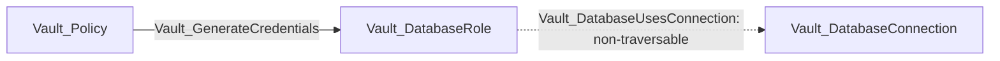

The attack path terminates at the role; `Vault_DatabaseUsesConnection` is supporting evidence, not a traversable hop. Generation is traversable only when the referenced connection was observed, uses a compatible plugin, and permits the role through `allowed_roles`. Incomplete collection emits `Vault_PotentialAccess`.

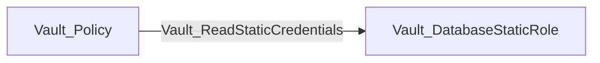

Static credential reads target the exact managed account and do not depend on dynamic-role connection viability in the same way.

## GCP

The GCP engine models rolesets, static service accounts, and impersonated accounts.

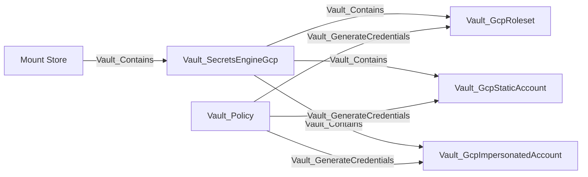

Rolesets retain secret type, project, IAM bindings, token scopes, rotation, and credential effects. Static and impersonated accounts retain OAuth token or service-account-key surfaces supported by their endpoint. The collector does not independently verify Google Cloud IAM.

### Attack Paths

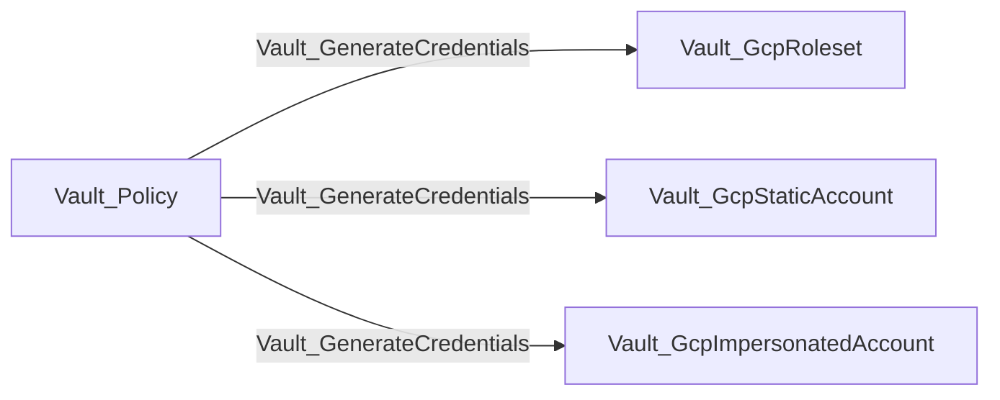

The edge represents the ability to request a credential from the concrete GCP object. Rolesets support OAuth access tokens or service-account keys according to their configured secret type; static accounts expose OAuth access-token or service-account-key endpoints; impersonated accounts expose OAuth access tokens. The paths prove Vault-side credential acquisition, not the resulting Google Cloud IAM permissions.

## GCP KMS

GCP KMS nodes represent Vault registrations of external Google Cloud KMS keys.

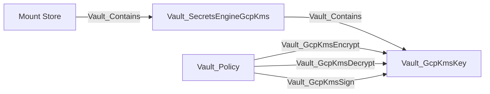

| Edge | Traversable | Meaning |
| --- | --- | --- |
| `Vault_GcpKmsEncrypt` | No | Encrypt plaintext with a compatible key. |
| `Vault_GcpKmsDecrypt` | Yes | Recover plaintext with a compatible observed key purpose. |
| `Vault_GcpKmsReencrypt` | No | Re-encrypt ciphertext. |
| `Vault_GcpKmsSign` | Yes | Produce a signature with a compatible signing key. |
| `Vault_GcpKmsVerify` | No | Verify a signature or MAC. |

Unknown key purpose produces `Vault_PotentialAccess` rather than a traversable decrypt or sign edge.

### Attack Paths

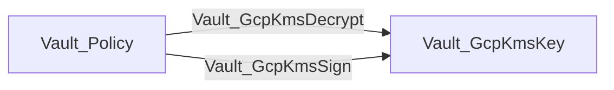

Decrypt represents a plaintext oracle; sign represents use of signing authority. Both require a compatible observed key purpose. Encrypt, re-encrypt, and verify remain non-traversable because they do not reveal plaintext or confer signing authority.

## KV

KV models path hierarchy without collecting plaintext values. Directories and files are intentionally separate node kinds and do not share a KV object base type.

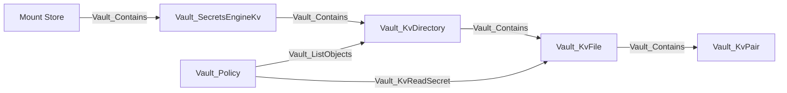

`Vault_KvDirectory` is a logical path prefix, not a mutable Vault object. `Vault_KvFile` is a secret path. `Vault_KvPair` exposes only top-level key names; values are never exported.

### KV v1 And v2

| Surface | Purpose | Exported edges |
| --- | --- | --- |
| KV v1 path | Secret read/write/delete/list | `Vault_KvReadSecret`, `Vault_KvManageSecret`, `Vault_ListObjects` |
| `data/:path` | KV v2 data and versions | `Vault_KvReadSecret`, `Vault_KvManageSecret` |
| `metadata/:path` | Listing, version metadata, custom metadata | `Vault_ListObjects`, `Vault_KvReadMetadata`, `Vault_KvManageMetadata` |
| `delete/:path` | Soft-delete versions | `Vault_KvManageSecret` |
| `undelete/:path` | Recover versions | `Vault_KvManageSecret` |
| `destroy/:path` | Permanently destroy versions | `Vault_KvManageSecret` |
| `subkeys/:path` | Subkey structure plus selected-version metadata | `Vault_KvReadMetadata` with read-target properties |
| `config` | CAS, version retention, delete-after | Generic config edges to the mount |

Only `Vault_KvReadSecret` is traversable. Lifecycle and metadata operations do not reveal secret data. KV v2 mount and per-key metadata contribute effective CAS requirements to write-edge properties.

Exact paths target the compatible file or directory. Globs expand to observed compatible descendants. Template-effective edges originate from the entity, alias, or group representation referenced by the template expression.

### Attack Paths

A policy-backed identity path can reach a concrete secret file:

```mermaid
flowchart LR
    user[Vault_AuthUser] -->|Vault_MapsTo| alias[Vault_EntityAlias]
    alias -->|Vault_MapsTo| entity[Vault_Entity]
    entity -->|Vault_MemberOf| group[Vault_Group]
    group -->|Vault_LinksPolicy| policy[Vault_Policy]
    policy -->|Vault_KvReadSecret| file[Vault_KvFile]
    file -->|Vault_Contains| pair[Vault_KvPair]
```

The file read exposes plaintext at request time. The pair node records only a top-level key name; VaultHound does not store its value.

For an identity template such as:

```hcl
path "kv/data/dept/{{identity.entity.metadata.department}}/*" {
  capabilities = ["read"]
}
```

an entity with `department=engineering` receives effective `Vault_KvReadSecret` edges to matching observed files. The edge preserves both the rendered path and original policy path. An alias or group becomes the source only when the template expression references that representation.

`Vault_ListObjects`, `Vault_KvReadMetadata`, and KV management edges are non-traversable. They expose names or metadata, or alter lifecycle state, but do not return secret plaintext.

## Kubernetes

Kubernetes secrets roles describe the service account and optional RBAC objects Vault creates or uses when generating credentials.

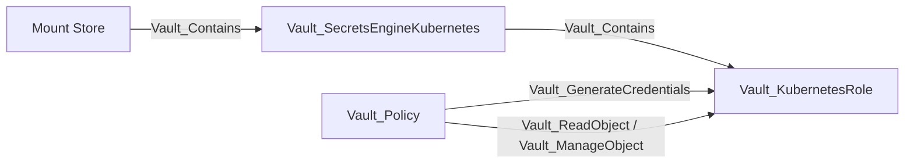

Roles retain service-account name, allowed namespaces, namespace selectors, token TTL, generated role or cluster-role bindings, and request parameters. Generation effects identify namespaced versus cluster-scoped outcomes. Live Kubernetes RBAC is not independently verified.

### Attack Paths

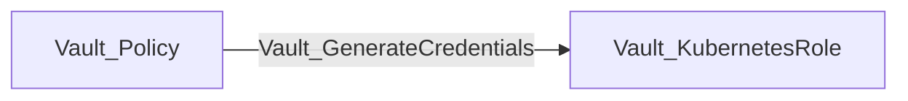

The edge represents generation of a Kubernetes service-account token through the concrete role. Role properties describe namespace selectors and generated namespaced or cluster-scoped bindings. The path does not independently prove the live Kubernetes RBAC attached to the resulting token.

## LDAP

The LDAP secrets engine manages dynamic credentials, static accounts, and service-account libraries.

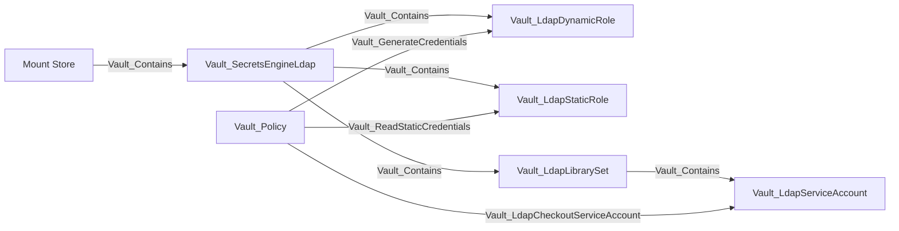

| Edge | Meaning |
| --- | --- |
| `Vault_LdapReadLibraryStatus` | Read account availability and checkout state. |
| `Vault_LdapCheckoutServiceAccount` | Check out an observed currently available account; traversable. |
| `Vault_LdapCheckinServiceAccount` | Return a checked-out account. |
| `Vault_LdapForceCheckinServiceAccount` | Administratively force an account check-in. |

Unknown account availability becomes potential access. Checkout is not routed through a traversable library container because Vault returns one available account rather than every member.

### Attack Paths

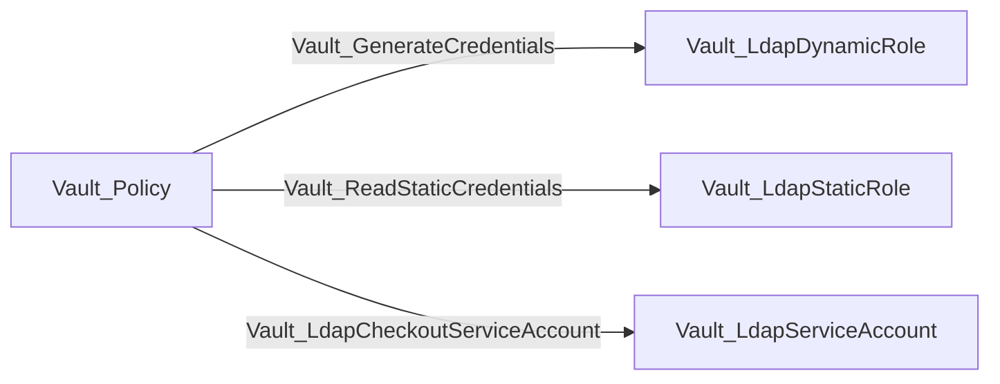

Dynamic and static role paths yield LDAP credentials according to their role mode. Checkout targets only an observed account currently marked available. Unknown availability emits `Vault_PotentialAccess`; it does not create a traversable edge to the library set and fan out through containment.

## PKI

PKI mounts contain roles, issuers, and keys. An issuer references its key; it does not contain it.

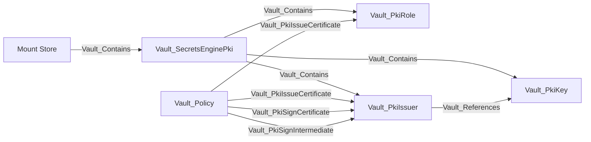

### PKI Access Families

| Edge | Target | Traversable | Meaning |
| --- | --- | --- | --- |
| `Vault_PkiListCertificateInfo` | Mount | No | List authenticated certificate information collections. |
| `Vault_PkiIssueCertificate` | Concrete role or issuer | Yes | Issue a certificate through a role, or through an issuer-scoped external-policy endpoint. |
| `Vault_PkiSignCertificate` | Concrete role or issuer | Yes | Sign a CSR through a role, or through an issuer-scoped external-policy endpoint. |
| `Vault_PkiSignVerbatim` | Concrete role or issuer | Yes | Sign through the role-less or issuer-specific verbatim surface when target resolution is concrete. |
| `Vault_PkiSignIntermediate` | Concrete issuer | Yes | Sign an intermediate CA certificate. |
| `Vault_PkiSignSelfIssued` | Concrete issuer | Yes | Sign a self-issued CA certificate. |
| `Vault_PkiRevokeCertificate` | Mount or issuer context | No | Revoke a certificate. |
| `Vault_PkiRevokeIssuer` | Concrete issuer | No | Revoke an issuer. |
| `Vault_PkiProvisionIssuer` | Mount | No | Generate/import issuer material or generate an intermediate CSR. |
| `Vault_PkiManageRoot` | Mount | No | Root CA lifecycle operation. |
| `Vault_PkiDeleteRoot` | Mount | No | Delete all issuer and key material. |
| `Vault_PkiManageIntermediate` | Mount | No | Intermediate CA lifecycle workflow. |
| `Vault_PkiAcmeCreateEab` | Mount or protocol context | No | Create ACME external-account-binding material. |
| `Vault_PkiAcmeManageAccounts` | Mount | No | Manage ACME account records. |

Traversable issuance and signing edges do not terminate at the mount when doing so would imply control of every role, issuer, and key through containment. Role/issuer globs expand to observed compatible children; unresolved mount-native outcomes remain potential or non-traversable.

Authenticated ACME, CMP, EST, and SCEP policy surfaces fold into existing issue, sign, and config families. `Issuance Protocols`, `Protocol Paths`, directory scope, role, issuer, format, and target properties retain the protocol context. Public CA, chain, CRL, OCSP, and similar unauthenticated authority-information endpoints are not modeled as policy authority.

### Attack Paths

Certificate issuance and signing target the concrete resource that constrains the operation:

```mermaid
flowchart LR
    policy[Vault_Policy] -->|Vault_PkiIssueCertificate| role[Vault_PkiRole]
    policy -->|Vault_PkiSignCertificate| role
    policy -->|Vault_PkiSignVerbatim: role-qualified| role
    policy -->|Vault_PkiIssueCertificate: issuer external policy| issuer[Vault_PkiIssuer]
    policy -->|Vault_PkiSignCertificate: issuer external policy| issuer
    policy -->|Vault_PkiSignVerbatim: resolved default or selected issuer| issuer
    policy -->|Vault_PkiSignIntermediate| issuer
    policy -->|Vault_PkiSignSelfIssued| issuer
```

A role glob such as:

```hcl
path "pki/issue/*" {
  capabilities = ["create", "update"]
}
```

expands `Vault_PkiIssueCertificate` to every observed compatible role. It does not create a traversable edge to the PKI mount, because traversable containment would incorrectly imply control of every issuer and key.

Role-less, issuer-selected, and protocol issuance paths remain traversable only when the collector can resolve a concrete compatible role or issuer. Runtime-selected mount outcomes become potential or non-traversable.

Revocation, issuer provisioning, root/intermediate lifecycle, and ordinary issuer management can be operationally severe but remain non-traversable. Destroying an issuer does not grant its signing authority.

## SSH

SSH uses one role node kind for OTP and CA role modes. The role properties identify which operations are valid.

```mermaid
flowchart LR
    store[Mount Store] -->|Vault_Contains| mount[Vault_SecretsEngineSsh]
    mount -->|Vault_Contains| role[Vault_SshRole]
    policy[Vault_Policy] -->|Vault_SshGenerateOtp| role
    policy -->|Vault_SshSignKey| role
    policy -->|Vault_SshIssueKeyPair| role
```

| Edge | Compatible target | Traversable | Meaning |
| --- | --- | --- | --- |
| `Vault_SshGenerateOtp` | OTP role | Yes | Generate an SSH one-time password. |
| `Vault_SshSignKey` | CA role | Yes | Sign a supplied SSH public key. |
| `Vault_SshIssueKeyPair` | CA role | Yes | Issue a new SSH key pair and certificate. |
| `Vault_SshLookupRoles` | Mount | No | Discover roles matching supplied connection attributes. |

CA and zero-address configuration uses generic config edges. CA public keys are mount properties; unauthenticated public-key retrieval is not modeled as ACL authority. Role globs expand security outcomes to compatible observed roles.

### Attack Paths

```mermaid
flowchart LR
    policy[Vault_Policy] -->|Vault_SshGenerateOtp| otp["Vault_SshRole: OTP"]
    policy -->|Vault_SshSignKey| ca["Vault_SshRole: CA"]
    policy -->|Vault_SshIssueKeyPair| ca
```

OTP generation returns a usable one-time password. Signing turns an attacker-supplied public key into an SSH certificate. Key-pair issuance returns new private-key material and its certificate. Role-mode compatibility is checked before any of these traversable edges are emitted.

## Terraform Cloud

Terraform Cloud roles generate organization, team, or user API tokens.

```mermaid
flowchart LR
    store[Mount Store] -->|Vault_Contains| mount[Vault_SecretsEngineTerraform]
    mount -->|Vault_Contains| role[Vault_TerraformRole]
    policy[Vault_Policy] -->|Vault_GenerateCredentials| role
    policy -->|Vault_ReadObject / Vault_ManageObject| role
```

The mount stores Terraform Cloud address and token configuration. Role and generation properties identify token mode, organization, team or user target, TTL, and generated credential material.

### Attack Paths

```mermaid
flowchart LR
    policy[Vault_Policy] -->|Vault_GenerateCredentials| role[Vault_TerraformRole]
```

The path yields a Terraform Cloud organization, team, or user API token according to the role. It proves token generation through Vault, while the resulting Terraform Cloud authorization remains an external-system concern.

## TOTP

TOTP mounts contain named key configurations.

```mermaid
flowchart LR
    store[Mount Store] -->|Vault_Contains| mount[Vault_SecretsEngineTotp]
    mount -->|Vault_Contains| key[Vault_TotpKey]
    policy[Vault_Policy] -->|Vault_TotpGenerateCode| key
    policy -->|Vault_TotpValidateCode| key
```

| Edge | Traversable | Meaning |
| --- | --- | --- |
| `Vault_TotpGenerateCode` | Yes | Return a current usable TOTP code. |
| `Vault_TotpValidateCode` | No | Validate a submitted code without yielding credential material. |

Keys include issuer, account name, period, algorithm, digits, skew, key size, and export state where Vault returns them.

### Attack Paths

```mermaid
flowchart LR
    policy[Vault_Policy] -->|Vault_TotpGenerateCode| key[Vault_TotpKey]
```

The edge is traversable because the endpoint returns a currently usable code. `Vault_TotpValidateCode` remains non-traversable because validation accepts a candidate code but does not reveal one.

## Transit

Transit mounts contain cryptographic keys and expose operations without returning raw key material unless export is explicitly enabled.

```mermaid
flowchart LR
    store[Mount Store] -->|Vault_Contains| mount[Vault_SecretsEngineTransit]
    mount -->|Vault_Contains| key[Vault_TransitKey]
    key -->|Vault_ManagedBy| managed[Vault_ManagedKey]
    policy[Vault_Policy] -->|Vault_TransitDecrypt| key
    policy -->|Vault_TransitSign| key
    policy -->|Vault_TransitExportKey| key
```

| Edge | Traversable | Meaning |
| --- | --- | --- |
| `Vault_TransitEncrypt` | No | Encrypt plaintext. |
| `Vault_TransitDecrypt` | Yes | Recover plaintext. |
| `Vault_TransitGenerateDataKey` | No | Generate a data key; its security meaning depends on returned plaintext/ciphertext mode and is retained as operation context. |
| `Vault_TransitRewrap` | No | Rewrap ciphertext without revealing plaintext. |
| `Vault_TransitSign` | Yes | Produce a signature with a compatible key. `Signing Targets` distinguishes ordinary message/digest signing from CSR signing. |
| `Vault_TransitGenerateCmac` | Yes | Generate a CMAC with a compatible key. |
| `Vault_TransitGenerateHmac` | Yes | Generate an HMAC with a compatible key. |
| `Vault_TransitVerify` | No | Verify signatures, HMACs, or CMACs. |
| `Vault_TransitExportKey` | Yes | Export compatible secret key material when the observed key is exportable. |
| `Vault_TransitExportByokKey` | No | Return BYOK-wrapped material rather than raw secret key material. |

Key properties include type, versions, derivation, convergent encryption, exportability, plaintext backup, rotation, operation support, and managed-key references. Key-type compatibility and exportability are enforced before traversable edges are emitted. Public key/certificate-chain reads use `Vault_ReadObject`, not secret export.

### Attack Paths

```mermaid
flowchart LR
    policy[Vault_Policy] -->|Vault_TransitDecrypt| key[Vault_TransitKey]
    policy -->|Vault_TransitSign| key
    policy -->|Vault_TransitGenerateCmac| key
    policy -->|Vault_TransitGenerateHmac| key
    policy -->|Vault_TransitExportKey| key
```

Decrypt is a plaintext oracle. Sign, CMAC, and HMAC exercise concrete cryptographic authority. `/sign/:key` records `Signing Targets: Message or Digest`, while `/keys/:key/csr` records `Signing Targets: Certificate Signing Request`; both merge into the same key edge when both surfaces are authorized. Secret export is emitted only when the observed key type supports the requested export and the key is exportable. Public-key reads use `Vault_ReadObject`, while BYOK-wrapped export uses non-traversable `Vault_TransitExportByokKey`.

For an exact missing path such as `transit/decrypt/future-key`, the collector may create a detached synthetic key but emits `Vault_PotentialAccess` with `Target Observed: false`. The synthetic key is not attached through normal containment and therefore cannot become an asserted attack path.

## Unsupported Mounts

Any observed backend outside the supported table remains a generic `Vault_SecretsEngine`. VaultHound retains its path, type, accessor, local/seal-wrap flags, lease settings, and mount options where available.

Unsupported engines do not receive:

- Child-resource collection.
- Synthetic endpoint objects.
- Generic secret-read or credential-generation edges.
- Guessed endpoint semantics based only on the mount type string.

This keeps unsupported existence visible without inventing attack paths.

## External-System Boundary

Cloud, database, LDAP, Kubernetes, and Terraform properties describe what Vault is configured to request or return. They do not prove downstream IAM, RBAC, directory, or network state. Hybrid graph edges should be added only when another collector resolves the external principal or resource unambiguously.
