# Mount Store

The Mount Store represents the namespace-local secrets-engine registry at `sys/mounts`. It contains every observed non-system secrets-engine mount. Supported engines receive a specific node kind, child-resource collection, and endpoint-aware access edges; unsupported observed non-system engines remain generic `Vault_SecretsEngine` nodes with existence, path, type, and mount properties only. System mounts such as `cubbyhole/` are excluded from Mount Store collection.

The following matrix summarizes secrets-engine implementation and test status:

| Technology | Supported | Tested | Mount Node |
| --- | :---: | :---: | --- |
| Agent Registry | :x: | :x: | N/A |
| AliCloud | :x: | :x: | N/A |
| AWS | :white_check_mark: | :x: | `Vault_SecretsEngineAws` |
| Azure | :white_check_mark: | :x: | `Vault_SecretsEngineAzure` |
| Consul | :x: | :x: | N/A |
| Cubbyhole | :x: | :x: | Excluded system mount |
| Database | :white_check_mark: | :x: | `Vault_SecretsEngineDatabase` |
| GCP | :white_check_mark: | :x: | `Vault_SecretsEngineGcp` |
| GCP KMS | :white_check_mark: | :x: | `Vault_SecretsEngineGcpKms` |
| Key Management | :x: | :x: | N/A |
| KMIP | :x: | :x: | N/A |
| Kubernetes | :white_check_mark: | :x: | `Vault_SecretsEngineKubernetes` |
| K/V | :white_check_mark: | :x: | `Vault_SecretsEngineKv` |
| LDAP | :white_check_mark: | :x: | `Vault_SecretsEngineLdap` |
| MongoDB Atlas | :x: | :x: | N/A |
| Nomad | :x: | :x: | N/A |
| OS Local Accounts | :x: | :x: | N/A |
| PKI | :white_check_mark: | :x: | `Vault_SecretsEnginePki` |
| PKI External CA | :x: | :x: | N/A |
| RabbitMQ | :x: | :x: | N/A |
| SPIFFE | :x: | :x: | N/A |
| SSH | :white_check_mark: | :x: | `Vault_SecretsEngineSsh` |
| Terraform Cloud | :white_check_mark: | :x: | `Vault_SecretsEngineTerraform` |
| TOTP | :white_check_mark: | :x: | `Vault_SecretsEngineTotp` |
| Transform | :x: | :x: | N/A |
| Transit | :white_check_mark: | :x: | `Vault_SecretsEngineTransit` |

`Identity` is modeled as the separate namespace-local [Identity Store](IDENTITY.md), not as a mount-specific secrets-engine implementation. Cubbyhole is excluded as a system mount. Other unsupported non-system engines are still emitted when observed as generic `Vault_SecretsEngine` nodes with their existence, type, path, and common mount properties.

## Glob, Synthetic, And Control Behavior

- Engine-specific collection globs expand security outcomes to compatible observed child resources.
- Exact missing roles, keys, accounts, or objects may create detached synthetic targets.
- Collection-wide creation remains anchored to the mount and records the object type that may be created.
- Unknown external prerequisites or unresolved runtime selectors become `Vault_PotentialAccess` rather than traversable outcomes.
- Unsupported observed non-system engines retain only their generic mount existence and type; their endpoint paths do not emit generic secret-access edges.

## Limitations

- VaultHound does not invoke credential-generation, signing, decryption, or secret-read endpoints.
- External cloud, database, directory, and SaaS permissions are not independently validated.
- Plugin-specific runtime conditions can further restrict an operation after ACL authorization.
- Synthetic and unresolved resources remain non-traversable until a concrete compatible target is observed.

## Unsupported Mounts

Any observed non-system backend outside the supported set remains a generic `Vault_SecretsEngine`. VaultHound retains its path, type, accessor, local/seal-wrap flags, lease settings, and mount options where available. System mounts such as `cubbyhole/` are excluded rather than represented as generic secrets engines.

Unsupported engines do not receive:

- Child-resource collection.
- Synthetic endpoint objects.
- Generic secret-read or credential-generation edges.
- Guessed endpoint semantics based only on the mount type string.

This keeps unsupported existence visible without inventing attack paths.

## External-System Boundary

Cloud, database, LDAP, Kubernetes, and Terraform properties describe what Vault is configured to request or return. They do not prove downstream IAM, RBAC, directory, or network state. Hybrid graph edges should be added only when another collector resolves the external principal or resource unambiguously.

## Store Topology

Across this guide, solid Mermaid arrows represent traversable edges and dashed arrows represent non-traversable edges. Line style describes traversability only; ownership and dependency semantics come from the edge kind and its description.

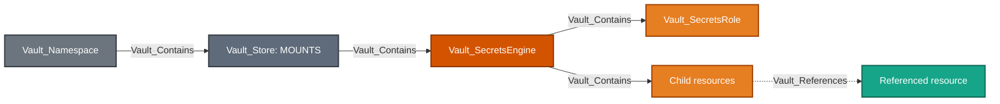

Equivalent Cypher query:

```cypher
MATCH p = (:Vault_Namespace)-[:Vault_Contains]->(store:Vault_Store)-[:Vault_Contains|Vault_References*1..]->(n)
WHERE store.`Store Type` = "Secrets Engines"
RETURN p
```

Specific mounts carry their display kind first and `Vault_SecretsEngine` as a base kind. Role-like child nodes carry `Vault_SecretsRole` where useful for cross-engine queries. Per-engine layout diagrams are structural: policy access and security outcomes appear in the edge descriptions and attack-path sections instead.

### Common Nodes

| Type | Meaning |
| --- | --- |
| `Vault_SecretsEngine` | Base node for a mounted secrets backend. |
| `Vault_SecretsRole` | Base node for role-like secrets-engine resources. |

### Common Edges

In every edge table in this guide, `Policy` denotes [policy authority](../MODEL.md#declared-and-derived-authority): normally the declaring `Vault_Policy`, or the referenced entity, alias, or group when an Identity template produces an effective rendered edge.

| Edge | Source | Destination | Traversable | Meaning |
| --- | --- | --- | :---: | --- |
| `Vault_Contains` | Mount Store, secrets engine, or hierarchical resource | Secrets engine or immediate observed child | :white_check_mark: | Places mounts and their observed resources in the namespace hierarchy. |
| `Vault_References` | Configured secrets-engine resource | Referenced dependency | :x: | Records a non-owning dependency such as issuer-to-key or role-to-connection. |
| `Vault_ManagedBy` | Compatible cryptographic object | Managed key | :x: | Records that a Vault cryptographic object delegates operations or custody to an external managed-key registration. |
| `Vault_ListObjects` | Policy | Secrets engine or collection anchor | :x: | Lists roles, keys, accounts, connections, KV children, or another engine-specific collection. |
| `Vault_CreateObject` | Policy | Secrets engine, collection anchor, or exact synthetic target | :x: | Creates an object or records authority to create an unobserved exact target. |
| `Vault_ReadObject` | Policy | Concrete secrets-engine child | :x: | Reads durable configuration on a concrete child. |
| `Vault_ManageObject` | Policy | Concrete secrets-engine child | :x: | Updates, deletes, rotates, imports, or otherwise administers a concrete child. |
| `Vault_ReadConfig` | Policy | Secrets-engine mount | :x: | Reads mount, tuning, or backend-wide configuration. |
| `Vault_ManageConfig` | Policy | Secrets-engine mount | :x: | Changes configuration, tuning, root credentials, or maintenance state. |
| `Vault_GenerateCredentials` | Policy | Concrete viable secrets role | :white_check_mark: | Obtains dynamic credentials through an endpoint with proven prerequisites. |
| `Vault_ReadStaticCredentials` | Policy | Concrete static role or account | :white_check_mark: | Reads a managed static credential. |
| `Vault_PotentialAccess` | Policy or template-resolved principal | Synthetic or unresolved target | :x: | Records an otherwise security-relevant operation whose target, compatibility, or external prerequisite is not proven. |

Generic edges retain `Engine Types`, `Object Types`, `Role Types`, `Operations`, `Credential Types`, `Read Targets`, `Config Targets`, request surfaces, and prerequisites.

### Common Properties

The tables in each engine section list stable properties beyond the common contract in [the graph model](../MODEL.md#property-contract). Generic object-operation and reference properties are defined by the canonical [cross-cutting properties](../MODEL.md#cross-cutting-properties). Supported plugin APIs may return additional version- or plugin-specific fields; VaultHound exports those fields with humanized labels while suppressing or reducing secret values to presence indicators.

| Node/Edge Type | Property | Description |
| --- | --- | --- |
| `Vault_SecretsEngine` | `KV Version` | Identifies the KV protocol version when the mount is a KV backend. |
| `Vault_SecretsEngine` | `Delegated Auth Accessors` | Lists auth mount accessors delegated by the secrets engine. |
| `Vault_SecretsEngine` | `Allowed Managed Keys` | Lists managed keys the mount is configured to use. |
| `Vault_SecretsRole`<br>`Vault_DatabaseConnection`<br>`Vault_GcpStaticAccount`<br>`Vault_GcpImpersonatedAccount`<br>`Vault_GcpKmsKey`<br>`Vault_KvDirectory`<br>`Vault_KvFile`<br>`Vault_KvPair`<br>`Vault_LdapLibrarySet`<br>`Vault_LdapServiceAccount`<br>`Vault_PkiIssuer`<br>`Vault_PkiKey`<br>`Vault_TotpKey`<br>`Vault_TransitKey` | `Engine Path` | Identifies the parent mount's API path. |
| `Vault_SecretsRole`<br>`Vault_DatabaseConnection`<br>`Vault_GcpStaticAccount`<br>`Vault_GcpImpersonatedAccount`<br>`Vault_GcpKmsKey`<br>`Vault_KvDirectory`<br>`Vault_KvFile`<br>`Vault_KvPair`<br>`Vault_LdapLibrarySet`<br>`Vault_LdapServiceAccount`<br>`Vault_PkiIssuer`<br>`Vault_PkiKey`<br>`Vault_TotpKey`<br>`Vault_TransitKey` | `Logical Path` | Identifies the child object's logical path within the mount. |
| `Vault_GenerateCredentials`<br>`Vault_ReadStaticCredentials` | `Credential Types` | Lists the credential forms returned by the operation. |
| `Vault_GenerateCredentials`<br>`Vault_ReadStaticCredentials` | `Credential Material` | Identifies the secret or token material returned without collecting its value. |
| `Vault_GenerateCredentials`<br>`Vault_ReadStaticCredentials` | `Generation Effects` | Describes external objects or credentials created by the operation. |
| `Vault_GenerateCredentials`<br>`Vault_ReadStaticCredentials` | `Request Surfaces` | Lists the API surfaces that produce the credential outcome. |
| `Vault_GenerateCredentials`<br>`Vault_ReadStaticCredentials` | `Request Methods` | Lists the HTTP methods used by the credential endpoints. |
| `Vault_GenerateCredentials` | `Modes` | Lists viable generation modes for the target role. |
| `Vault_GenerateCredentials`<br>`Vault_ReadStaticCredentials` | `Lease Bound` | For AWS and GCP credential edges, indicates whether the returned credential is bound to a Vault lease. |
| `Vault_GenerateCredentials`<br>`Vault_ReadStaticCredentials` | `Lease Backed` | For engines with conventional Vault-managed leases, such as Database and Terraform, indicates whether Vault leases the returned credential. |
| `Vault_GenerateCredentials`<br>`Vault_ReadStaticCredentials` | `Renewable` | Indicates whether the credential lease can be renewed. |
| `Vault_GenerateCredentials`<br>`Vault_ReadStaticCredentials` | `Revocable` | Indicates whether Vault can revoke the issued credential. |

## AWS

AWS dynamic roles describe IAM user, assumed role, federation token, or session token modes. Static roles map existing IAM users managed by Vault.

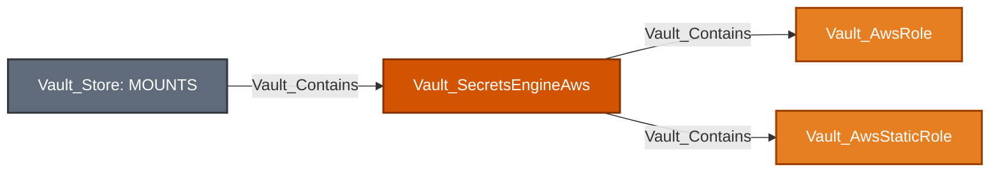

Equivalent Cypher query:

```cypher
MATCH mount = (:Vault_Store)-[:Vault_Contains]->(engine:Vault_SecretsEngineAws)
OPTIONAL MATCH objects = (engine)-[:Vault_Contains*1..]->(n)
RETURN mount, objects
```

Dynamic-role properties include policy documents and ARNs, role ARNs, IAM groups, tags, permissions boundaries, credential modes, TTLs, and MFA configuration. Traversable generation requires at least one proven viable mode; session-token-only access requiring an MFA code becomes `Vault_PotentialAccess` when that prerequisite is unresolved.

Root credentials, lease settings, root rotation, and mount tuning use generic config edges. Role CRUD and collection operations use generic object edges.

### Nodes

| Node | Description |
| --- | --- |
| `Vault_SecretsEngineAws` | AWS secrets-engine mount, root credential mode, lease, and endpoint configuration. |
| `Vault_AwsRole` | Dynamic IAM or STS credential-generation role. |
| `Vault_AwsStaticRole` | Existing IAM user whose credential rotation is managed by Vault. |

### Specialized Edges

Common containment, configuration, object-lifecycle, credential, and potential-access behavior is documented in [Common Edges](#common-edges).

This secrets engine does not define any specialized edges.

### Properties

| Node/Edge Type | Property | Description |
| --- | --- | --- |
| `Vault_SecretsEngineAws` | `Root Auth Mode` | Identifies the credential mechanism used by the AWS backend. |
| `Vault_SecretsEngineAws` | `Can Rotate Root` | Indicates whether Vault can rotate configured AWS root credentials. |
| `Vault_SecretsEngineAws` | `Access Key` | Records the configured AWS access-key identifier when Vault returns it. |
| `Vault_SecretsEngineAws` | `Secret Key Present` | Indicates that an AWS secret access key is configured without exporting it. |
| `Vault_SecretsEngineAws` | `IAM Endpoint` | Stores a custom IAM API endpoint. |
| `Vault_SecretsEngineAws` | `STS Endpoint` | Stores a custom STS API endpoint. |
| `Vault_SecretsEngineAws` | `Max Retries` | Records the configured AWS API retry limit. |
| `Vault_SecretsEngineAws` | `Region` | Identifies the AWS region used by the backend. |
| `Vault_SecretsEngineAws` | `Role ARN` | Records the IAM role assumed by Vault for backend operations. |
| `Vault_SecretsEngineAws` | `Identity Token Audience` | Records the audience for workload-identity authentication. |
| `Vault_SecretsEngineAws` | `Lease` | Records the default AWS credential lease. |
| `Vault_SecretsEngineAws` | `Lease Max` | Records the maximum AWS credential lease. |
| `Vault_AwsRole` | `Role Name` | Identifies the AWS role configuration. |
| `Vault_AwsRole` | `Credential Type` | Records the primary IAM or STS credential mode. |
| `Vault_AwsRole` | `Credential Types` | Lists all credential modes available through the role. |
| `Vault_AwsRole` | `Policy Document` | Stores the inline IAM policy applied to generated credentials. |
| `Vault_AwsRole` | `Policy ARNs` | Lists managed IAM policies applied to generated credentials. |
| `Vault_AwsRole` | `Role ARNs` | Lists IAM roles that may be assumed. |
| `Vault_AwsRole` | `IAM Groups` | Lists IAM groups assigned to generated IAM users. |
| `Vault_AwsRole` | `IAM Tags` | Lists tags assigned to generated IAM users. |
| `Vault_AwsRole` | `Permissions Boundary ARN` | Records the permissions boundary applied to generated IAM users. |
| `Vault_AwsRole` | `MFA Serial Number` | Identifies the MFA device required for session-token generation. |
| `Vault_AwsRole` | `Modeled Request Surfaces` | Lists credential endpoints compatible with the role. |
| `Vault_AwsRole` | `Generation Effects` | Describes the IAM user or STS credential created by each mode. |
| `Vault_AwsRole` | `Surface Restriction Visibility` | Records whether endpoint-specific restrictions were visible to collection. |
| `Vault_AwsRole` | `Requires Role ARN Selection` | Indicates that the caller must select an allowed role ARN. |
| `Vault_AwsRole` | `Role ARN Selection Mode` | Describes fixed or caller-selected role-ARN behavior. |
| `Vault_AwsRole` | `Allowed Role ARNs` | Lists role ARNs the caller may select. |
| `Vault_AwsStaticRole` | `Role Name` | Identifies the static-role configuration. |
| `Vault_AwsStaticRole` | `Username` | Identifies the managed IAM user. |
| `Vault_AwsStaticRole` | `Rotation Period` | Records interval-based credential rotation. |
| `Vault_AwsStaticRole` | `Rotation Schedule` | Records the cron-style rotation schedule. |
| `Vault_AwsStaticRole` | `Rotation Window` | Records the allowed schedule execution window. |
| `Vault_AwsStaticRole` | `Last Vault Rotation` | Records the last time Vault rotated the IAM credential. |
| `Vault_GenerateCredentials`<br>`Vault_ReadStaticCredentials`<br>`Vault_PotentialAccess` | `Request Surfaces` | Lists the AWS `creds` and `sts` endpoints represented by the edge. |
| `Vault_GenerateCredentials`<br>`Vault_ReadStaticCredentials`<br>`Vault_PotentialAccess` | `Request Methods` | Lists the HTTP methods used by the credential endpoints. |
| `Vault_GenerateCredentials`<br>`Vault_ReadStaticCredentials` | `Lease Bound` | Indicates whether Vault leases the returned AWS credential. |
| `Vault_GenerateCredentials`<br>`Vault_PotentialAccess` | `Supports Custom TTL` | Indicates whether the endpoint accepts a caller-selected TTL. |
| `Vault_GenerateCredentials`<br>`Vault_ReadStaticCredentials`<br>`Vault_PotentialAccess` | `Generation Effects` | Describes the IAM or STS credential outcome. |
| `Vault_GenerateCredentials`<br>`Vault_PotentialAccess` | `Requirements` | Lists MFA, role-selection, or other prerequisites. |
| `Vault_PotentialAccess` | `Potential Outcomes` | Describes the credential that could be generated if prerequisites are met. |
| `Vault_PotentialAccess` | `Resolution Status` | Explains why AWS credential generation was not proven viable. |

### Attack Paths


Equivalent Cypher query:

```cypher
MATCH p = (authority)-[:Vault_GenerateCredentials]->(:Vault_AwsRole)
WHERE authority:Vault_Policy
   OR authority:Vault_Entity
   OR authority:Vault_EntityAlias
   OR authority:Vault_Group
RETURN p
```

The destination role records whether Vault returns an IAM user, assumed-role credential, federation token, or session token. The edge is traversable only when at least one configured mode is viable. A session-token-only role that requires an unproven MFA code instead produces `Vault_PotentialAccess`.


Equivalent Cypher query:

```cypher
MATCH p = (authority)-[:Vault_ReadStaticCredentials]->(:Vault_AwsStaticRole)
WHERE authority:Vault_Policy
   OR authority:Vault_Entity
   OR authority:Vault_EntityAlias
   OR authority:Vault_Group
RETURN p
```

This yields the managed IAM user's current credential through Vault. Neither path proves the generated principal's downstream AWS permissions; those require correlation with AWS graph data.

## Azure

Azure dynamic roles generate service principals; static roles map existing applications or service principals and credential rotation state.

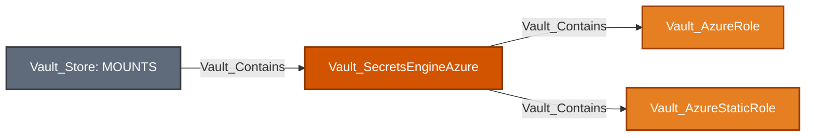

Equivalent Cypher query:

```cypher
MATCH mount = (:Vault_Store)-[:Vault_Contains]->(engine:Vault_SecretsEngineAzure)
OPTIONAL MATCH objects = (engine)-[:Vault_Contains*1..]->(n)
RETURN mount, objects
```

Roles retain Azure role assignments, groups, application settings, TTL behavior, and generated credential effects. `Vault_AzureImportStaticRole` is a specialized non-traversable administrative operation; ordinary role CRUD uses generic object edges.

### Nodes

| Node | Description |
| --- | --- |
| `Vault_SecretsEngineAzure` | Azure secrets-engine mount and tenant, subscription, root credential, and lease configuration. |
| `Vault_AzureRole` | Dynamic Azure service-principal credential-generation role. |
| `Vault_AzureStaticRole` | Existing Azure application whose credential is managed by Vault. |

### Specialized Edges

Common containment, configuration, object-lifecycle, and credential behavior is documented in [Common Edges](#common-edges).

| Edge | Source | Destination | Traversable | Meaning |
| --- | --- | --- | :---: | --- |
| `Vault_AzureImportStaticRole` | Policy | Azure static role or mount | :x: | Imports an existing application credential into Vault management. |

### Properties

| Node/Edge Type | Property | Description |
| --- | --- | --- |
| `Vault_SecretsEngineAzure` | `Subscription ID` | Identifies the Azure subscription used by the backend. |
| `Vault_SecretsEngineAzure` | `Tenant ID` | Identifies the Azure tenant used by the backend. |
| `Vault_SecretsEngineAzure` | `Client ID` | Identifies Vault's configured Azure application. |
| `Vault_SecretsEngineAzure` | `Client Secret Present` | Indicates that a client secret is configured without exporting it. |
| `Vault_SecretsEngineAzure` | `Environment` | Identifies the Azure cloud environment. |
| `Vault_SecretsEngineAzure` | `Root Password TTL` | Records the lifetime of root application credentials. |
| `Vault_AzureRole`<br>`Vault_AzureStaticRole` | `Role Name` | Identifies the Azure role configuration. |
| `Vault_AzureRole`<br>`Vault_AzureStaticRole` | `Azure Roles` | Lists Azure RBAC assignments applied to the service principal. |
| `Vault_AzureRole`<br>`Vault_AzureStaticRole` | `Azure Groups` | Lists Azure groups assigned to the service principal. |
| `Vault_AzureRole`<br>`Vault_AzureStaticRole` | `Application Object ID` | Identifies an existing Azure application used by the role. |
| `Vault_AzureRole`<br>`Vault_AzureStaticRole` | `Permanently Delete` | Indicates whether Vault permanently removes managed Azure objects. |
| `Vault_AzureRole` | `Generation Mode` | Describes whether generation creates a service principal or an additional application secret. |
| `Vault_AzureRole` | `Generation Effects` | Describes the Azure object and credential produced by generation. |
| `Vault_AzureStaticRole` | `Service Principal Name` | Names the managed Azure service principal. |
| `Vault_AzureStaticRole` | `Rotation Period` | Records interval-based secret rotation. |
| `Vault_AzureStaticRole` | `Rotation Schedule` | Records schedule-based secret rotation. |
| `Vault_AzureStaticRole` | `metadata_<key>` | Preserves non-secret metadata returned for the managed application. |
| `Vault_AzureImportStaticRole`<br>`Vault_ManageObject` | `Operations` | Distinguishes metadata-only import, full import, rotation, and ordinary administration. |

### Attack Paths

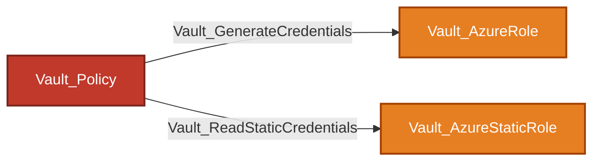

Equivalent Cypher query:

```cypher
MATCH p = (authority)-[:Vault_GenerateCredentials|Vault_ReadStaticCredentials]->(role)
WHERE (authority:Vault_Policy
    OR authority:Vault_Entity
    OR authority:Vault_EntityAlias
    OR authority:Vault_Group)
  AND (role:Vault_AzureRole OR role:Vault_AzureStaticRole)
RETURN p
```

The first path obtains a generated Azure service-principal credential constrained by the dynamic role. The second reads the current credential managed through the concrete static role. Importing or managing a static role is not itself traversable because it does not prove that usable credential material is returned.

## Database

Database mounts contain plugin connections, dynamic roles, and static roles. Roles reference rather than contain their connection.

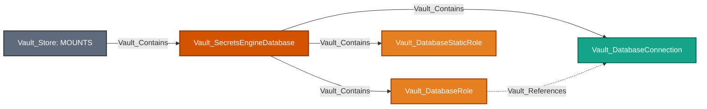

Equivalent Cypher query:

```cypher
MATCH mount = (:Vault_Store)-[:Vault_Contains]->(engine:Vault_SecretsEngineDatabase)
OPTIONAL MATCH objects = (engine)-[:Vault_Contains|Vault_References*1..]->(n)
RETURN mount, objects
```

### Nodes

| Node | Description |
| --- | --- |
| `Vault_SecretsEngineDatabase` | Database secrets-engine mount and backend-wide configuration. |
| `Vault_DatabaseConnection` | Named database plugin connection and allowed-role configuration. |
| `Vault_DatabaseRole` | Dynamic database credential-generation role and creation/revocation statements. |
| `Vault_DatabaseStaticRole` | Existing database account managed and rotated by Vault. |

### Specialized Edges

Common containment, reference, configuration, object-lifecycle, credential, and potential-access behavior is documented in [Common Edges](#common-edges).

This secrets engine does not define any specialized edges.

### Properties

| Node/Edge Type | Property | Description |
| --- | --- | --- |
| `Vault_DatabaseConnection` | `Connection Name` | Identifies the database connection. |
| `Vault_DatabaseConnection` | `Plugin Name` | Identifies the database plugin used by the connection. |
| `Vault_DatabaseConnection` | `Allowed Roles` | Lists dynamic and static roles permitted to use the connection. |
| `Vault_DatabaseConnection` | `Verify Connection` | Indicates whether Vault verifies connectivity when writing the configuration. |
| `Vault_DatabaseConnection` | `Root Rotation Statements` | Lists statements used to rotate the database root credential. |
| `Vault_DatabaseConnection` | `Password Policy` | Names the Vault password policy used for generated passwords. |
| `Vault_DatabaseConnection` | `Username Template` | Stores the template used for generated database usernames. |
| `Vault_DatabaseConnection` | Credential and private-key presence flags | Indicate configured secret material without exporting it. |
| `Vault_DatabaseConnection` | `Supports Root Rotation` | Indicates whether the detected plugin supports root rotation. |
| `Vault_DatabaseConnection` | `Supports Dynamic Roles` | Indicates whether the detected plugin supports dynamic roles. |
| `Vault_DatabaseConnection` | `Supports Static Roles` | Indicates whether the detected plugin supports static roles. |
| `Vault_DatabaseConnection` | `Supported Credential Types` | Lists credential types supported by the detected plugin. |
| `Vault_DatabaseConnection` | `Plugin Capability Source` | Identifies how plugin compatibility was determined. |
| `Vault_DatabaseRole`<br>`Vault_DatabaseStaticRole` | `Role Name` | Identifies the database role. |
| `Vault_DatabaseRole`<br>`Vault_DatabaseStaticRole` | `Role Type` | Distinguishes dynamic and static roles. |
| `Vault_DatabaseRole`<br>`Vault_DatabaseStaticRole` | `Database Name` | Names the referenced database connection. |
| `Vault_DatabaseRole`<br>`Vault_DatabaseStaticRole` | `Creation Statements` | Lists statements used to create or update the account. |
| `Vault_DatabaseRole`<br>`Vault_DatabaseStaticRole` | `Revocation Statements` | Lists statements used to revoke the account. |
| `Vault_DatabaseRole`<br>`Vault_DatabaseStaticRole` | `Rollback Statements` | Lists statements used to roll back failed creation. |
| `Vault_DatabaseRole`<br>`Vault_DatabaseStaticRole` | `Renew Statements` | Lists statements used to renew the account. |
| `Vault_DatabaseRole`<br>`Vault_DatabaseStaticRole` | `Generation Effects` | Describes the database account and credential outcome. |
| `Vault_DatabaseRole`<br>`Vault_DatabaseStaticRole` | `Lease Backed` | Indicates whether Vault leases generated credentials. |
| `Vault_DatabaseStaticRole` | `Username` | Identifies the existing managed database account. |
| `Vault_DatabaseStaticRole` | `Rotation Period` | Records interval-based password rotation. |
| `Vault_DatabaseStaticRole` | `Rotation Schedule` | Records schedule-based password rotation. |
| `Vault_DatabaseStaticRole` | Password-presence flags | Indicate managed password material without exporting it. |
| `Vault_References` | `Allowed Roles` | Preserves the connection's role allowlist. |
| `Vault_References` | `Allowed Role Match Types` | Describes exact, glob, or wildcard allowlist matches. |
| `Vault_References` | `Allowed By Connection` | Indicates whether the connection permits the role. |
| `Vault_References` | `Matched Allowed Role Patterns` | Lists allowlist patterns that matched the role. |
| `Vault_References` | `Reference Types` | Classifies the dependency as a database connection. |
| `Vault_References` | `Reference Evidence` | Identifies the role's configured connection field. |
| `Vault_GenerateCredentials`<br>`Vault_ReadStaticCredentials`<br>`Vault_PotentialAccess` | `Request Surfaces` | Lists dynamic or static credential endpoints. |
| `Vault_GenerateCredentials` | `Modes` | Lists plugin-supported dynamic-role credential generation modes after canonicalization. |
| `Vault_ReadStaticCredentials`<br>`Vault_PotentialAccess` | `Generation Modes` | Distinguishes static-role retrieval from dynamic-role generation when the edge remains static or potential. |
| `Vault_GenerateCredentials`<br>`Vault_ReadStaticCredentials`<br>`Vault_PotentialAccess` | `Credential Types` | Lists credential types returned by the plugin. |
| `Vault_GenerateCredentials`<br>`Vault_ReadStaticCredentials` | `Credential Material` | Identifies returned username, password, private-key, or certificate material. |
| `Vault_GenerateCredentials`<br>`Vault_ReadStaticCredentials`<br>`Vault_PotentialAccess` | `Generation Effects` | Describes the external database account or credential effect. |
| `Vault_GenerateCredentials`<br>`Vault_ReadStaticCredentials` | `Lease Backed` | Indicates whether the returned credential is leased. |
| `Vault_GenerateCredentials`<br>`Vault_PotentialAccess` | `Requirements` | Lists connection, allowlist, and plugin compatibility prerequisites. |
| `Vault_PotentialAccess` | `Resolution Status` | Explains why database credential generation was not proven viable. |
| `Vault_ManageObject`<br>`Vault_ManageConfig` | `Operations` | Identifies connection reset, role rotation, or plugin reload. |
| `Vault_ManageConfig` | `Plugin Names` | Lists plugins affected by a reload operation. |

Dynamic credential generation requires an observed compatible connection and an `allowed_roles` match. Missing or incompatible connection evidence downgrades the result to potential access.

### Attack Paths


Equivalent Cypher query:

```cypher
MATCH p = (authority)-[:Vault_GenerateCredentials]->(:Vault_DatabaseRole)-[:Vault_References]->(:Vault_DatabaseConnection)
WHERE authority:Vault_Policy
   OR authority:Vault_Entity
   OR authority:Vault_EntityAlias
   OR authority:Vault_Group
RETURN p
```

The attack path terminates at the role; `Vault_References` is supporting evidence, not a traversable hop. Generation is traversable only when the referenced connection was observed, uses a compatible plugin, and permits the role through `allowed_roles`. Incomplete collection emits `Vault_PotentialAccess`.


Equivalent Cypher query:

```cypher
MATCH p = (authority)-[:Vault_ReadStaticCredentials]->(:Vault_DatabaseStaticRole)
WHERE authority:Vault_Policy
   OR authority:Vault_Entity
   OR authority:Vault_EntityAlias
   OR authority:Vault_Group
RETURN p
```

Static credential reads target the exact managed account and do not depend on dynamic-role connection viability in the same way.

## GCP

The GCP engine models rolesets, static service accounts, and impersonated accounts.

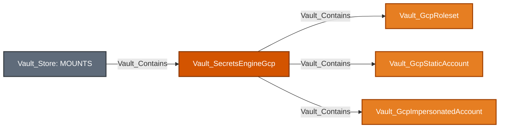

Equivalent Cypher query:

```cypher
MATCH mount = (:Vault_Store)-[:Vault_Contains]->(engine:Vault_SecretsEngineGcp)
OPTIONAL MATCH objects = (engine)-[:Vault_Contains*1..]->(n)
RETURN mount, objects
```

Rolesets retain secret type, project, IAM bindings, token scopes, rotation, and credential effects. Static and impersonated accounts retain OAuth token or service-account-key surfaces supported by their endpoint. The collector does not independently verify Google Cloud IAM.

### Nodes

| Node | Description |
| --- | --- |
| `Vault_SecretsEngineGcp` | GCP secrets-engine mount and credential-source, lease, and identity-token configuration. |
| `Vault_GcpRoleset` | Dynamic GCP roleset that produces OAuth tokens or service-account keys. |
| `Vault_GcpStaticAccount` | Existing GCP service account managed through static-account endpoints. |
| `Vault_GcpImpersonatedAccount` | Account configuration that produces credentials through service-account impersonation. |

### Specialized Edges

Common containment, configuration, object-lifecycle, and credential behavior is documented in [Common Edges](#common-edges).

This secrets engine does not define any specialized edges.

### Properties

| Node/Edge Type | Property | Description |
| --- | --- | --- |
| `Vault_SecretsEngineGcp` | `Credentials Present` | Indicates that GCP backend credentials are configured without exporting them. |
| `Vault_SecretsEngineGcp` | `Credential Source` | Distinguishes static, ambient, and workload-identity credentials. |
| `Vault_SecretsEngineGcp` | `TTL` | Records the default generated credential lifetime. |
| `Vault_SecretsEngineGcp` | `Max TTL` | Records the maximum generated credential lifetime. |
| `Vault_SecretsEngineGcp` | `Service Account Email` | Identifies the service account used by the backend. |
| `Vault_SecretsEngineGcp` | `Identity Token Audience` | Records the audience used for workload-identity authentication. |
| `Vault_GcpRoleset` | `Roleset Name` | Identifies the GCP roleset. |
| `Vault_GcpRoleset`<br>`Vault_GcpStaticAccount`<br>`Vault_GcpImpersonatedAccount` | `Account Ownership` | Distinguishes Vault-created, externally managed, and impersonated service accounts. |
| `Vault_GcpRoleset`<br>`Vault_GcpStaticAccount` | `Project` | Identifies the GCP project affected by bindings or generated credentials. |
| `Vault_GcpRoleset`<br>`Vault_GcpStaticAccount`<br>`Vault_GcpImpersonatedAccount` | `Secret Type` | Distinguishes OAuth access tokens from service-account keys. |
| `Vault_GcpRoleset`<br>`Vault_GcpStaticAccount` | `Bindings` | Lists IAM bindings managed through the object. |
| `Vault_GcpRoleset`<br>`Vault_GcpStaticAccount`<br>`Vault_GcpImpersonatedAccount` | `Token Scopes` | Lists OAuth scopes granted to generated tokens. |
| `Vault_GcpRoleset`<br>`Vault_GcpStaticAccount`<br>`Vault_GcpImpersonatedAccount` | `Generation Effects` | Describes the token or service-account key returned by generation. |
| `Vault_GcpRoleset`<br>`Vault_GcpStaticAccount`<br>`Vault_GcpImpersonatedAccount` | `Revocation Effects` | Describes external cleanup performed when the credential is revoked. |
| `Vault_GcpStaticAccount` | `Static Account Name` | Identifies the static-account configuration. |
| `Vault_GcpStaticAccount` | `Bindings Visibility` | Records whether account IAM bindings were visible to the collector. |
| `Vault_GcpStaticAccount`<br>`Vault_GcpImpersonatedAccount` | `Service Account Email` | Identifies the external or impersonated service account. |
| `Vault_GcpImpersonatedAccount` | `Impersonated Account Name` | Identifies the impersonated-account configuration. |
| `Vault_GenerateCredentials` | `Request Surfaces` | Lists the roleset, static-account, or impersonated-account endpoints represented by the edge. |
| `Vault_GenerateCredentials` | `Request Methods` | Lists supported HTTP methods for the credential request. |
| `Vault_GenerateCredentials` | `Resource Types` | Lists GCP object types through which credentials can be generated. |
| `Vault_GenerateCredentials` | `Credential Types` | Lists token or service-account-key outcomes. |
| `Vault_GenerateCredentials` | `Generation Effects` | Describes the concrete credential and external account effect. |
| `Vault_GenerateCredentials` | `Revocation Effects` | Describes how Vault revokes the generated credential. |
| `Vault_GenerateCredentials` | `Lease Bound` | Indicates whether the generated credential is bound to a Vault lease. |
| `Vault_GenerateCredentials` | `Renewable` | Indicates whether the generated credential can be renewed. |
| `Vault_GenerateCredentials` | `Revocable` | Indicates whether Vault can revoke the credential. |
| `Vault_GenerateCredentials` | `Endpoint Variants` | Lists endpoint variants that produce the merged outcome. |

### Attack Paths

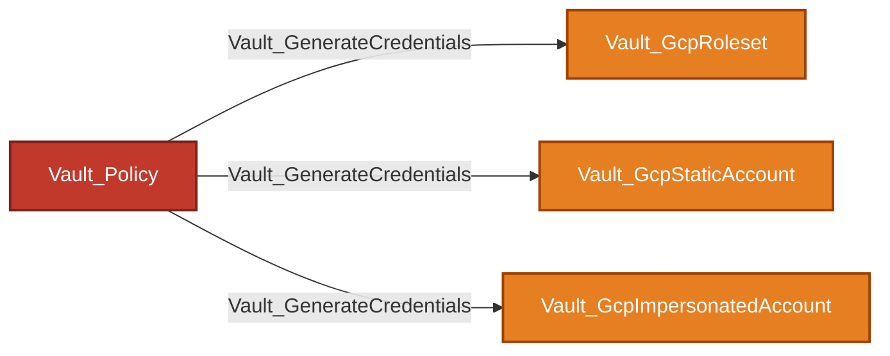

Equivalent Cypher query:

```cypher
MATCH p = (authority)-[:Vault_GenerateCredentials]->(target)
WHERE (authority:Vault_Policy
    OR authority:Vault_Entity
    OR authority:Vault_EntityAlias
    OR authority:Vault_Group)
  AND (target:Vault_GcpRoleset
    OR target:Vault_GcpStaticAccount
    OR target:Vault_GcpImpersonatedAccount)
RETURN p
```

The edge represents the ability to request a credential from the concrete GCP object. Rolesets support OAuth access tokens or service-account keys according to their configured secret type; static accounts expose OAuth access-token or service-account-key endpoints; impersonated accounts expose OAuth access tokens. The paths prove Vault-side credential acquisition, not the resulting Google Cloud IAM permissions.

## GCP KMS

GCP KMS nodes represent Vault registrations of external Google Cloud KMS keys.

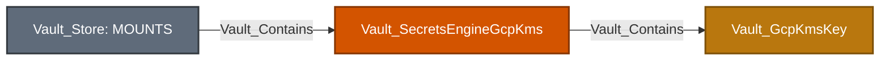

Equivalent Cypher query:

```cypher
MATCH mount = (:Vault_Store)-[:Vault_Contains]->(engine:Vault_SecretsEngineGcpKms)
OPTIONAL MATCH objects = (engine)-[:Vault_Contains*1..]->(n)
RETURN mount, objects
```

### Nodes

| Node | Description |
| --- | --- |
| `Vault_SecretsEngineGcpKms` | GCP KMS secrets-engine mount and provider configuration. |
| `Vault_GcpKmsKey` | Registered Cloud KMS key and its cryptographic purpose and compatibility. |

### Specialized Edges

Common containment, configuration, object-lifecycle, and potential-access behavior is documented in [Common Edges](#common-edges).

| Edge | Source | Destination | Traversable | Meaning |
| --- | --- | --- | :---: | --- |
| `Vault_GcpKmsEncrypt` | Policy | GCP KMS key | :x: | Encrypts plaintext with a compatible key. |
| `Vault_GcpKmsDecrypt` | Policy | GCP KMS key | :white_check_mark: | Recovers plaintext with a compatible observed key purpose. |
| `Vault_GcpKmsReencrypt` | Policy | GCP KMS key | :x: | Re-encrypts ciphertext. |
| `Vault_GcpKmsSign` | Policy | GCP KMS key | :white_check_mark: | Produces a signature with a compatible signing key. |
| `Vault_GcpKmsVerify` | Policy | GCP KMS key | :x: | Verifies a signature or MAC. |

### Properties

| Node/Edge Type | Property | Description |
| --- | --- | --- |
| `Vault_SecretsEngineGcpKms` | `Credentials Visibility` | Records whether the authenticated configuration read exposes credential details. |
| `Vault_SecretsEngineGcpKms` | `Credentials Present` | Indicates that GCP credentials are configured without exporting them. |
| `Vault_SecretsEngineGcpKms` | `Credential Source` | Identifies the static or ambient credential source. |
| `Vault_SecretsEngineGcpKms` | `Scopes` | Lists Google API scopes configured for the backend. |
| `Vault_GcpKmsKey` | `Key Name` | Identifies the Vault key registration. |
| `Vault_GcpKmsKey` | `Crypto Key ID` | Stores the full Google Cloud KMS CryptoKey identifier. |
| `Vault_GcpKmsKey` | `Key Ring` | Identifies the containing Google Cloud KMS key ring. |
| `Vault_GcpKmsKey` | `Purpose` | Identifies the Cloud KMS key purpose used for compatibility checks. |
| `Vault_GcpKmsKey` | `Protection Level` | Identifies software, HSM, or external key protection. |
| `Vault_GcpKmsKey` | `Algorithm` | Identifies the configured Cloud KMS algorithm. |
| `Vault_GcpKmsEncrypt`<br>`Vault_GcpKmsDecrypt`<br>`Vault_GcpKmsReencrypt`<br>`Vault_GcpKmsSign`<br>`Vault_GcpKmsVerify`<br>`Vault_PotentialAccess` | `Key Purposes` | Lists key purposes compatible with the requested operation. |
| `Vault_GcpKmsEncrypt`<br>`Vault_GcpKmsDecrypt`<br>`Vault_GcpKmsReencrypt`<br>`Vault_GcpKmsSign`<br>`Vault_GcpKmsVerify`<br>`Vault_PotentialAccess` | `Compatibility Status` | Records whether the observed key purpose is compatible, blocked, or unknown. |
| `Vault_GcpKmsEncrypt`<br>`Vault_GcpKmsDecrypt`<br>`Vault_GcpKmsReencrypt`<br>`Vault_GcpKmsSign`<br>`Vault_GcpKmsVerify` | `Operations` | Lists cryptographic operations represented by the edge. |
| `Vault_PotentialAccess` | `Requirements` | Lists unresolved key-purpose or collection prerequisites. |
| `Vault_PotentialAccess` | `Resolution Status` | Explains why decrypt or sign authority could not be proven. |

Unknown key purpose produces `Vault_PotentialAccess` rather than a traversable decrypt or sign edge.

### Attack Paths

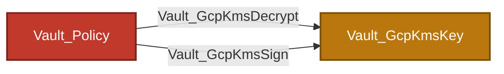

Equivalent Cypher query:

```cypher
MATCH p = (authority)-[:Vault_GcpKmsDecrypt|Vault_GcpKmsSign]->(:Vault_GcpKmsKey)
WHERE authority:Vault_Policy
   OR authority:Vault_Entity
   OR authority:Vault_EntityAlias
   OR authority:Vault_Group
RETURN p
```

Decrypt represents a plaintext oracle; sign represents use of signing authority. Both require a compatible observed key purpose. Encrypt, re-encrypt, and verify remain non-traversable because they do not reveal plaintext or confer signing authority.

## KV

KV models path hierarchy without collecting plaintext values. Directories and files are intentionally separate node kinds and do not share a KV object base type.

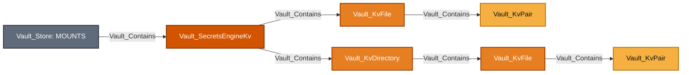

Equivalent Cypher query:

```cypher
MATCH mount = (:Vault_Store)-[:Vault_Contains]->(engine:Vault_SecretsEngineKv)
OPTIONAL MATCH objects = (engine)-[:Vault_Contains*1..]->(n)
RETURN mount, objects
```

`Vault_KvDirectory` is a logical path prefix, not a mutable Vault object. `Vault_KvFile` is a secret path. `Vault_KvPair` exposes only top-level key names; values are never exported.

KV v1 and v2 expose the following API surfaces:

| Surface | Purpose | Exported edges |
| --- | --- | --- |
| KV v1 path | Secret read/write/delete/list | `Vault_KvReadSecret`, `Vault_KvManageSecret`, `Vault_ListObjects` |
| `data/:path` | KV v2 data and versions | `Vault_KvReadSecret`, `Vault_KvManageSecret` |
| `metadata/:path` | Listing, version metadata, custom metadata | `Vault_ListObjects`, `Vault_KvReadMetadata`, `Vault_KvManageMetadata` |
| `delete/:path` | Soft-delete versions | `Vault_KvManageSecret` |
| `undelete/:path` | Recover versions | `Vault_KvManageSecret` |
| `destroy/:path` | Permanently destroy versions | `Vault_KvManageSecret` |
| `subkeys/:path` | Subkey structure plus selected-version metadata | `Vault_KvReadMetadata` with read-target properties |
| `config` | CAS, version retention, delete-after | Generic config edges to the mount |

### Nodes

| Node | Description |
| --- | --- |
| `Vault_SecretsEngineKv` | KV v1 or v2 mount and engine-level retention/CAS configuration. |
| `Vault_KvDirectory` | Observed logical KV directory or path prefix. |
| `Vault_KvFile` | Observed or exact synthetic secret object without plaintext values. |
| `Vault_KvPair` | Top-level key name contained by a collected KV file; the value is not collected. |

### Specialized Edges

Common containment, configuration, object-lifecycle, listing, and potential-access behavior is documented in [Common Edges](#common-edges).

| Edge | Source | Destination | Traversable | Meaning |
| --- | --- | --- | :---: | --- |
| `Vault_KvReadSecret` | Policy or template-resolved principal | KV file | :white_check_mark: | Returns secret plaintext from KV v1 or KV v2 data. |
| `Vault_KvManageSecret` | Policy or template-resolved principal | KV file | :x: | Creates, updates, patches, deletes, undeletes, or destroys secret data or versions. |
| `Vault_KvReadMetadata` | Policy or template-resolved principal | KV file | :x: | Reads version/custom metadata or the subkeys view and selected-version metadata. |
| `Vault_KvManageMetadata` | Policy or template-resolved principal | KV file | :x: | Creates, updates, patches, or deletes KV v2 metadata. |

### Properties

| Node/Edge Type | Property | Description |
| --- | --- | --- |
| `Vault_SecretsEngineKv` | `KV Version` | Distinguishes KV v1 from KV v2. |
| `Vault_SecretsEngineKv` | `CAS Required` | Records the mount-wide KV v2 check-and-set requirement. |
| `Vault_SecretsEngineKv` | `Max Versions` | Records the mount-wide retained-version limit. |
| `Vault_SecretsEngineKv` | `Effective Max Versions` | Records the effective retained-version limit after Vault defaults are applied. |
| `Vault_SecretsEngineKv` | `Delete Version After` | Records the mount-wide automatic deletion duration. |
| `Vault_KvDirectory` | `Relative Path` | Identifies the directory relative to the KV mount. |
| `Vault_KvDirectory` | `List Path` | Stores the API path used to enumerate direct children. |
| `Vault_KvDirectory` | `Metadata Path` | Stores the KV v2 metadata collection path. |
| `Vault_KvDirectory` | `KV Version` | Identifies the protocol version used to model the directory. |
| `Vault_KvFile` | `Relative Path` | Identifies the secret path relative to the KV mount. |
| `Vault_KvFile` | `Data Path` | Stores the API path used to read or write secret data. |
| `Vault_KvFile` | `Metadata Path` | Stores the KV v2 metadata API path. |
| `Vault_KvFile` | `Delete Path` | Stores the KV v2 soft-delete endpoint path. |
| `Vault_KvFile` | `Undelete Path` | Stores the KV v2 version-recovery endpoint path. |
| `Vault_KvFile` | `Destroy Path` | Stores the KV v2 permanent-destruction endpoint path. |
| `Vault_KvFile` | `KV Version` | Identifies whether the file belongs to a KV v1 or KV v2 mount. |
| `Vault_KvFile` | `Exists` | Indicates whether the secret is known to exist. |
| `Vault_KvFile` | `Discovered` | Indicates that collection observed the secret rather than synthesizing it from policy. |
| `Vault_KvFile` | `Field Count` | Records the number of top-level key/value fields without collecting values. |
| `Vault_KvFile` | `Current Version` | Records the current KV v2 version number. |
| `Vault_KvFile` | `Oldest Version` | Records the oldest retained KV v2 version number. |
| `Vault_KvFile` | `Version Count` | Records the total number of version records. |
| `Vault_KvFile` | `Active Version Count` | Records versions that are neither deleted nor destroyed. |
| `Vault_KvFile` | `Deleted Version Count` | Records soft-deleted versions. |
| `Vault_KvFile` | `Destroyed Version Count` | Records permanently destroyed versions. |
| `Vault_KvFile` | `Created Time` | Records the secret's creation time. |
| `Vault_KvFile` | `Updated Time` | Records its latest observed update time. |
| `Vault_KvFile` | `Deletion Time` | Records the current version's scheduled or completed deletion time. |
| `Vault_KvFile` | `Destroyed` | Indicates whether the selected version was permanently destroyed. |
| `Vault_KvFile` | `Current Version Created By Actor` | Records Vault's actor string for the current version. |
| `Vault_KvFile` | `Current Version Created By Operation` | Records the operation that created the current version. |
| `Vault_KvFile` | `Current Version Created By Entity ID` | Identifies the entity that created the current version when available. |
| `Vault_KvFile` | `Current Version Created By Client ID` | Identifies the client that created the current version when available. |
| `Vault_KvFile` | `Configured Max Versions` | Records a secret-specific retained-version override. |
| `Vault_KvFile` | `Effective Max Versions` | Records the effective retained-version limit after key and mount configuration are combined. |
| `Vault_KvFile` | `Configured CAS Required` | Records a secret-specific check-and-set override. |
| `Vault_KvFile` | `Effective CAS Required` | Indicates whether writes effectively require check-and-set. |
| `Vault_KvFile` | `Configured Delete Version After` | Records a secret-specific automatic deletion override. |
| `Vault_KvFile` | `Effective Delete Version After` | Records the effective automatic deletion duration. |
| `Vault_KvFile` | `custom_metadata_<key>` | Preserves KV v2 custom metadata without collecting secret values. |
| `Vault_KvPair` | `Key` | Stores the top-level key name. |
| `Vault_KvPair` | `Field Path` | Stores the key's path within the secret object. |
| `Vault_KvPair` | `Value Type` | Records only the value's data type, never its plaintext. |
| `Vault_KvPair` | `Relative Path` | Identifies the containing secret relative to the mount. |
| `Vault_KvPair` | `Data Path` | Stores the containing secret's data endpoint path. |
| `Vault_KvPair` | `KV Version` | Identifies the containing mount's KV protocol version. |
| `Vault_ListObjects`<br>`Vault_KvReadSecret`<br>`Vault_KvManageSecret`<br>`Vault_KvReadMetadata`<br>`Vault_KvManageMetadata`<br>`Vault_PotentialAccess` | `Surfaces` | Distinguishes data, metadata, lifecycle, and subkeys API surfaces. |
| `Vault_ListObjects`<br>`Vault_KvReadSecret`<br>`Vault_KvManageSecret`<br>`Vault_KvReadMetadata`<br>`Vault_KvManageMetadata`<br>`Vault_PotentialAccess` | `Scopes` | Distinguishes exact targets from expanded subtree access. |
| `Vault_KvReadSecret`<br>`Vault_KvManageSecret`<br>`Vault_KvReadMetadata`<br>`Vault_KvManageMetadata` | `Viable Operations` | Lists KV operations that are meaningful for the target kind and surface. |
| `Vault_KvManageSecret`<br>`Vault_KvManageMetadata`<br>`Vault_PotentialAccess` | `Operation Requirements` | Lists version, CAS, or target-state requirements for the operation. |
| `Vault_KvManageSecret`<br>`Vault_KvManageMetadata` | `CAS Required By Default` | Indicates whether the effective engine or key configuration requires CAS. |
| `Vault_KvManageSecret`<br>`Vault_KvManageMetadata` | `CAS Requirement Source` | Identifies whether the CAS requirement came from key metadata or mount configuration. |
| `Vault_KvManageSecret`<br>`Vault_KvManageMetadata` | `CAS Required For Operations` | Lists write operations that require a CAS value. |
| `Vault_KvManageSecret`<br>`Vault_KvManageMetadata` | `CAS Optional For Operations` | Lists write operations for which CAS remains optional. |
| `Vault_KvReadSecret`<br>`Vault_KvManageSecret`<br>`Vault_KvReadMetadata` | `Version Selection` | Describes whether the operation addresses the current or selected versions. |
| `Vault_KvReadMetadata` | `Metadata Read Targets` | Distinguishes version metadata, custom metadata, and subkeys metadata. |

Only `Vault_KvReadSecret` is traversable. Lifecycle and metadata operations do not reveal secret data. KV v2 mount and per-key metadata contribute effective CAS requirements to write-edge properties.

Exact paths target the compatible file or directory. Globs expand to observed compatible descendants. Template-effective edges originate from the entity, alias, or group representation referenced by the template expression.

### Attack Paths

A policy-backed identity path can reach a concrete secret file:

```mermaid
flowchart LR
    user[Vault_AuthUser]:::authUserNode -->|Vault_MapsTo| alias[Vault_EntityAlias]:::entityAliasNode
    alias -->|Vault_MapsTo| entity[Vault_Entity]:::entityNode
    entity -->|Vault_MemberOf| group[Vault_Group]:::groupNode
    group -->|Vault_LinksPolicy| policy[Vault_Policy]:::policyNode
    policy -->|Vault_KvReadSecret| file[Vault_KvFile]:::kvObjectNode
    file -->|Vault_Contains| pair[Vault_KvPair]:::kvPairNode

    classDef authUserNode fill:#5DADE2,color:#111,stroke:#21618C,stroke-width:2px
    classDef entityAliasNode fill:#56CCF2,color:#111,stroke:#2E86C1,stroke-width:2px
    classDef entityNode fill:#2F80ED,color:#fff,stroke:#1B4F72,stroke-width:2px
    classDef groupNode fill:#219653,color:#fff,stroke:#145A32,stroke-width:2px
    classDef policyNode fill:#C0392B,color:#fff,stroke:#7B241C,stroke-width:2px
    classDef kvObjectNode fill:#E67E22,color:#fff,stroke:#A04000,stroke-width:2px
    classDef kvPairNode fill:#F5B041,color:#111,stroke:#B9770E,stroke-width:2px
```

Equivalent Cypher query:

```cypher
MATCH p = (:Vault_AuthUser)-[:Vault_MapsTo]->(:Vault_EntityAlias)-[:Vault_MapsTo]->(:Vault_Entity)-[:Vault_MemberOf]->(:Vault_Group)-[:Vault_LinksPolicy]->(:Vault_Policy)-[:Vault_KvReadSecret]->(:Vault_KvFile)-[:Vault_Contains]->(:Vault_KvPair)
RETURN p
```

The file read exposes plaintext at request time. The pair node records only a top-level key name; VaultHound does not store its value.

For an identity template such as:

```hcl
path "kv/data/dept/{{identity.entity.metadata.department}}/*" {
  capabilities = ["read"]
}
```

an entity with `department=engineering` receives effective `Vault_KvReadSecret` edges to matching observed files. The edge preserves both the rendered path and original policy path. An alias or group becomes the source only when the template expression references that representation.

`Vault_ListObjects`, `Vault_KvReadMetadata`, and KV management edges are non-traversable. They expose names or metadata, or alter lifecycle state, but do not return secret plaintext.

## Kubernetes

Kubernetes secrets roles describe the service account and optional RBAC objects Vault creates or uses when generating credentials.


Equivalent Cypher query:

```cypher
MATCH mount = (:Vault_Store)-[:Vault_Contains]->(engine:Vault_SecretsEngineKubernetes)
OPTIONAL MATCH objects = (engine)-[:Vault_Contains*1..]->(n)
RETURN mount, objects
```

Roles retain service-account name, allowed namespaces, namespace selectors, token TTL, generated role or cluster-role bindings, and request parameters. Generation effects identify namespaced versus cluster-scoped outcomes. Live Kubernetes RBAC is not independently verified.

### Nodes

| Node | Description |
| --- | --- |
| `Vault_SecretsEngineKubernetes` | Kubernetes secrets-engine mount and cluster/service-account configuration. |
| `Vault_KubernetesRole` | Service-account credential-generation and generated RBAC binding constraints. |

### Specialized Edges

Common containment, configuration, object-lifecycle, and credential behavior is documented in [Common Edges](#common-edges).

This secrets engine does not define any specialized edges.

### Properties

| Node/Edge Type | Property | Description |
| --- | --- | --- |
| `Vault_SecretsEngineKubernetes` | `Kubernetes Host` | Identifies the target Kubernetes API server. |
| `Vault_SecretsEngineKubernetes` | `Disable Local CA JWT` | Indicates whether Vault avoids the local service-account JWT and CA. |
| `Vault_SecretsEngineKubernetes` | `Kubernetes CA Cert Present` | Indicates that a Kubernetes CA certificate is configured without duplicating it. |
| `Vault_KubernetesRole` | `Role Name` | Identifies the Kubernetes secrets role. |
| `Vault_KubernetesRole` | `Generation Mode` | Distinguishes existing-service-account tokens from generated service-account/RBAC workflows. |
| `Vault_KubernetesRole` | `Namespace Scope Type` | Identifies explicit, selector-based, or unrestricted namespace scope. |
| `Vault_KubernetesRole` | `Namespace Scope` | Lists or describes namespaces allowed by the role. |
| `Vault_KubernetesRole` | `Namespace Scope Combination` | Describes how explicit namespaces and selectors combine. |
| `Vault_KubernetesRole` | `Generation Effects` | Describes service-account, token, role, and binding objects created by Vault. |
| `Vault_KubernetesRole` | `Request Parameters` | Lists caller-controlled parameters accepted by the generation endpoint. |
| `Vault_KubernetesRole` | `Binding Types` | Lists RoleBinding or ClusterRoleBinding outcomes. |
| `Vault_KubernetesRole` | `Role Types` | Lists Role or ClusterRole references used by generated bindings. |
| `Vault_KubernetesRole` | `Cluster Scope Possible` | Indicates whether role configuration can produce cluster-scoped access. |
| `Vault_KubernetesRole` | `Allowed Kubernetes Namespaces` | Lists explicitly allowed namespaces. |
| `Vault_KubernetesRole` | `Allowed Kubernetes Namespace Selector` | Stores the label selector used to choose namespaces. |
| `Vault_KubernetesRole` | `Service Account Name` | Names an existing service account used for token generation. |
| `Vault_KubernetesRole` | `Kubernetes Role Name` | Names the Role or ClusterRole referenced by generated bindings. |
| `Vault_KubernetesRole` | `Kubernetes Role Type` | Distinguishes Role from ClusterRole. |
| `Vault_KubernetesRole` | `Kubernetes Role Ref Type` | Records the role-reference kind emitted into generated bindings. |
| `Vault_KubernetesRole` | `Generated Role Rules` | Stores RBAC rules used when Vault creates a role. |
| `Vault_GenerateCredentials` | `Generation Effects` | Describes the generated service-account token and RBAC objects. |
| `Vault_GenerateCredentials` | `Modes` | Lists viable service-account generation modes. |
| `Vault_GenerateCredentials` | `Request Parameters` | Lists caller-controlled generation parameters. |
| `Vault_GenerateCredentials` | `Binding Types` | Lists binding kinds that may be created. |
| `Vault_GenerateCredentials` | `Role Types` | Lists role-reference kinds used by generated bindings. |
| `Vault_GenerateCredentials` | `Cluster Scope Possible` | Indicates that generation may produce cluster-scoped access. |
| `Vault_GenerateCredentials` | `Namespace Scope Type` | Identifies how the target namespace is selected. |
| `Vault_GenerateCredentials` | `Namespace Scope` | Lists or describes reachable namespaces. |
| `Vault_GenerateCredentials` | `Namespace Scope Combination` | Describes how namespace constraints combine. |

### Attack Paths


Equivalent Cypher query:

```cypher
MATCH p = (authority)-[:Vault_GenerateCredentials]->(:Vault_KubernetesRole)
WHERE authority:Vault_Policy
   OR authority:Vault_Entity
   OR authority:Vault_EntityAlias
   OR authority:Vault_Group
RETURN p
```

The edge represents generation of a Kubernetes service-account token through the concrete role. Role properties describe namespace selectors and generated namespaced or cluster-scoped bindings. The path does not independently prove the live Kubernetes RBAC attached to the resulting token.

## LDAP

The LDAP secrets engine manages dynamic credentials, static accounts, and service-account libraries.

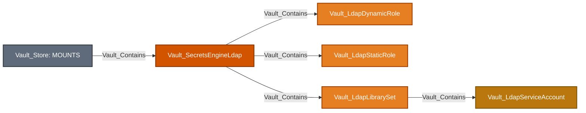

Equivalent Cypher query:

```cypher
MATCH mount = (:Vault_Store)-[:Vault_Contains]->(engine:Vault_SecretsEngineLdap)
OPTIONAL MATCH objects = (engine)-[:Vault_Contains*1..]->(n)
RETURN mount, objects
```

### Nodes

| Node | Description |
| --- | --- |
| `Vault_SecretsEngineLdap` | LDAP secrets-engine mount and directory bind/search configuration. |
| `Vault_LdapDynamicRole` | Dynamic LDAP credential-generation role. |
| `Vault_LdapStaticRole` | Existing LDAP account managed and rotated by Vault. |
| `Vault_LdapLibrarySet` | Checkout pool containing managed LDAP service accounts. |
| `Vault_LdapServiceAccount` | Concrete service account observed in a library set. |

### Specialized Edges

Common containment, configuration, object-lifecycle, credential, and potential-access behavior is documented in [Common Edges](#common-edges).

| Edge | Source | Destination | Traversable | Meaning |
| --- | --- | --- | :---: | --- |
| `Vault_LdapReadLibraryStatus` | Policy | LDAP library or service account | :x: | Reads account availability and checkout state. |
| `Vault_LdapCheckoutServiceAccount` | Policy | Available LDAP service account | :white_check_mark: | Checks out one observed currently available account. |
| `Vault_LdapCheckinServiceAccount` | Policy | LDAP service account | :x: | Returns a checked-out account. |
| `Vault_LdapForceCheckinServiceAccount` | Policy | LDAP service account | :x: | Administratively forces an account check-in. |

### Properties

| Node/Edge Type | Property | Description |
| --- | --- | --- |
| `Vault_SecretsEngineLdap` | `Bind DN` | Identifies the directory account used by Vault. |
| `Vault_SecretsEngineLdap` | `Bind Password Present` | Indicates that a bind password is configured without exporting it. |
| `Vault_SecretsEngineLdap` | `URL` | Stores the LDAP server URL. |
| `Vault_SecretsEngineLdap` | `User DN` | Stores the base DN used for user searches. |
| `Vault_SecretsEngineLdap` | `User Attribute` | Identifies the LDAP username attribute. |
| `Vault_SecretsEngineLdap` | `Group DN` | Stores the base DN used for group searches. |
| `Vault_SecretsEngineLdap` | `Group Attribute` | Identifies the LDAP group-name attribute. |
| `Vault_SecretsEngineLdap` | `UPN Domain` | Records the user principal name domain. |
| `Vault_SecretsEngineLdap` | `Start TLS` | Indicates whether StartTLS is enabled. |
| `Vault_SecretsEngineLdap` | `Insecure TLS` | Indicates whether TLS verification is disabled. |
| `Vault_SecretsEngineLdap` | `TLS Min Version` | Records the minimum permitted TLS version. |
| `Vault_SecretsEngineLdap` | `TLS Max Version` | Records the maximum permitted TLS version. |
| `Vault_SecretsEngineLdap` | `Certificate Present` | Indicates that a trusted CA certificate is configured. |
| `Vault_SecretsEngineLdap` | `Client TLS Certificate Present` | Indicates that a client TLS certificate is configured. |
| `Vault_SecretsEngineLdap` | `Client TLS Key Present` | Indicates that a client TLS private key is configured. |
| `Vault_LdapDynamicRole`<br>`Vault_LdapStaticRole` | `Role Name` | Identifies the LDAP role. |
| `Vault_LdapDynamicRole` | `Has Creation LDIF` | Indicates that account-creation LDIF is configured without duplicating it. |
| `Vault_LdapDynamicRole` | `Has Deletion LDIF` | Indicates that account-deletion LDIF is configured. |
| `Vault_LdapDynamicRole` | `Has Rollback LDIF` | Indicates that rollback LDIF is configured. |
| `Vault_LdapStaticRole` | `DN` | Identifies the managed LDAP account's distinguished name. |
| `Vault_LdapStaticRole` | `Username` | Identifies the managed LDAP username. |
| `Vault_LdapStaticRole` | `Rotation Period` | Records interval-based password rotation. |
| `Vault_LdapStaticRole` | `Rotation Schedule` | Records schedule-based password rotation. |
| `Vault_LdapStaticRole` | `Last Vault Rotation` | Records the last Vault-managed password rotation. |
| `Vault_LdapLibrarySet` | `Set Name` | Identifies the service-account library. |
| `Vault_LdapLibrarySet` | `Service Account Names` | Lists accounts configured in the checkout pool. |
| `Vault_LdapLibrarySet` | `TTL` | Records the default checkout duration. |
| `Vault_LdapLibrarySet` | `Max TTL` | Records the maximum checkout duration. |
| `Vault_LdapServiceAccount` | `Service Account Name` | Identifies the concrete account in a library set. |
| `Vault_LdapServiceAccount` | `Set Name` | Names the containing library set. |
| `Vault_LdapServiceAccount` | `Available` | Indicates that the account is currently available for checkout. |
| `Vault_LdapServiceAccount` | `Borrower Entity ID` | Identifies the entity currently borrowing the account. |
| `Vault_LdapServiceAccount` | `Borrower Client Token` | Records borrower token context returned by Vault without exporting token material. |
| `Vault_LdapReadLibraryStatus`<br>`Vault_LdapCheckoutServiceAccount`<br>`Vault_LdapCheckinServiceAccount`<br>`Vault_LdapForceCheckinServiceAccount`<br>`Vault_PotentialAccess` | `Library Sets` | Lists library sets matched by the policy path. |
| `Vault_LdapCheckoutServiceAccount`<br>`Vault_PotentialAccess` | `Allocation Modes` | Distinguishes concrete available-account checkout from unresolved pool access. |
| `Vault_LdapReadLibraryStatus`<br>`Vault_LdapCheckoutServiceAccount`<br>`Vault_LdapCheckinServiceAccount`<br>`Vault_LdapForceCheckinServiceAccount` | `Hierarchy Prefixes` | Preserves matched library hierarchy prefixes. |
| `Vault_LdapReadLibraryStatus`<br>`Vault_LdapCheckoutServiceAccount`<br>`Vault_LdapCheckinServiceAccount`<br>`Vault_LdapForceCheckinServiceAccount` | `Operations` | Lists status, checkout, check-in, or forced check-in operations. |
| `Vault_PotentialAccess` | `Requirements` | Lists unresolved account-availability prerequisites. |
| `Vault_PotentialAccess` | `Resolution Status` | Explains why checkout could not target a proven available account. |

Unknown account availability becomes potential access. Checkout is not routed through a traversable library container because Vault returns one available account rather than every member.

### Attack Paths

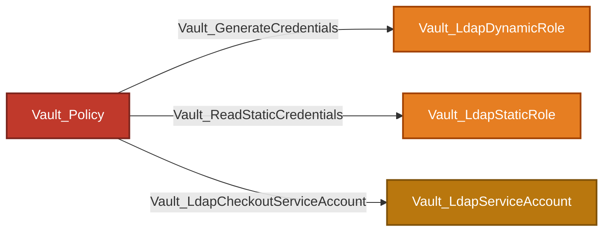

Equivalent Cypher query:

```cypher
MATCH p = (authority)-[:Vault_GenerateCredentials|Vault_ReadStaticCredentials|Vault_LdapCheckoutServiceAccount]->(target)
WHERE (authority:Vault_Policy
    OR authority:Vault_Entity
    OR authority:Vault_EntityAlias
    OR authority:Vault_Group)
  AND (target:Vault_LdapDynamicRole OR target:Vault_LdapStaticRole OR target:Vault_LdapServiceAccount)
RETURN p
```

Dynamic and static role paths yield LDAP credentials according to their role mode. Checkout targets only an observed account currently marked available. Unknown availability emits `Vault_PotentialAccess`; it does not create a traversable edge to the library set and fan out through containment.

## PKI

PKI mounts contain roles, issuers, and keys. An issuer references its key; it does not contain it.

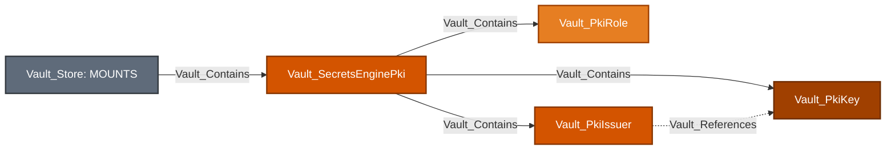

Equivalent Cypher query:

```cypher
MATCH mount = (:Vault_Store)-[:Vault_Contains]->(engine:Vault_SecretsEnginePki)
OPTIONAL MATCH objects = (engine)-[:Vault_Contains|Vault_References*1..]->(n)
RETURN mount, objects
```

### Nodes

| Node | Description |
| --- | --- |
| `Vault_SecretsEnginePki` | PKI mount, authority configuration, and issuance-protocol settings. |
| `Vault_PkiRole` | Certificate issuance and signing constraints. |
| `Vault_PkiIssuer` | Root, intermediate, or other issuer registered in the mount. |
| `Vault_PkiKey` | Software, hardware-backed, or managed-key-backed PKI key. |

### Specialized Edges

Common containment, reference, configuration, object-lifecycle, and potential-access behavior is documented in [Common Edges](#common-edges).

| Edge | Source | Destination | Traversable | Meaning |
| --- | --- | --- | :---: | --- |
| `Vault_PkiListCertificateInfo` | Policy | PKI mount | :x: | Lists authenticated certificate information collections. |
| `Vault_PkiIssueCertificate` | Policy | PKI role or issuer | :white_check_mark: | Issues a certificate through a role or issuer-scoped external-policy endpoint. |
| `Vault_PkiSignCertificate` | Policy | PKI role or issuer | :white_check_mark: | Signs a CSR through a role or issuer-scoped external-policy endpoint. |
| `Vault_PkiSignVerbatim` | Policy | PKI role or issuer | :white_check_mark: | Signs through a role-qualified, role-less, or issuer-specific verbatim surface after concrete resolution. |
| `Vault_PkiSignIntermediate` | Policy | PKI issuer | :white_check_mark: | Signs an intermediate CA certificate with a concrete issuer. |
| `Vault_PkiSignSelfIssued` | Policy | PKI issuer | :white_check_mark: | Signs a self-issued CA certificate with a concrete issuer. |
| `Vault_PkiRevokeCertificate` | Policy | PKI mount or issuer | :x: | Revokes a certificate. |
| `Vault_PkiRevokeIssuer` | Policy | PKI issuer | :x: | Revokes a concrete issuer. |
| `Vault_PkiProvisionIssuer` | Policy | PKI mount | :x: | Generates or imports issuer material, or generates an intermediate CSR. |
| `Vault_PkiManageRoot` | Policy | PKI mount | :x: | Performs a root CA lifecycle operation. |
| `Vault_PkiDeleteRoot` | Policy | PKI mount | :x: | Deletes all issuer and key material. |
| `Vault_PkiManageIntermediate` | Policy | PKI mount | :x: | Performs an intermediate CA lifecycle workflow. |
| `Vault_PkiAcmeCreateEab` | Policy | PKI mount or protocol context | :x: | Creates ACME external-account-binding material. |
| `Vault_PkiAcmeManageAccounts` | Policy | PKI mount | :x: | Manages ACME account records. |

### Properties

| Node/Edge Type | Property | Description |
| --- | --- | --- |
| `Vault_SecretsEnginePki` | `ACME Enabled` | Indicates whether ACME issuance is enabled. |
| `Vault_SecretsEnginePki` | `ACME Default Policy` | Records the default ACME policy behavior. |
| `Vault_SecretsEnginePki` | `CMPv2 Enabled` | Indicates whether CMPv2 issuance is enabled. |
| `Vault_SecretsEnginePki` | `CMPv2 Default Policy` | Records the default CMPv2 policy behavior. |
| `Vault_SecretsEnginePki` | `EST Enabled` | Indicates whether EST issuance is enabled. |
| `Vault_SecretsEnginePki` | `EST Default Policy` | Records the default EST policy behavior. |
| `Vault_SecretsEnginePki` | `SCEP Enabled` | Indicates whether SCEP issuance is enabled. |
| `Vault_SecretsEnginePki` | `SCEP Default Policy` | Records the default SCEP policy behavior. |
| `Vault_PkiRole` | `Role Name` | Identifies the PKI role. |
| `Vault_PkiRole` | `Issuer` | Selects the issuer used by the role. |
| `Vault_PkiRole` | `Issued Certificates Expire After` | Limits absolute expiration of certificates issued by the role. |
| `Vault_PkiRole` | `Max TTL` | Records the maximum certificate lifetime. |
| `Vault_PkiRole` | `Allow Localhost` | Allows localhost names in issued certificates. |
| `Vault_PkiRole` | `Allowed Domains` | Lists DNS domains accepted by the role. |
| `Vault_PkiRole` | `Allow Templates In Allowed Domains` | Enables identity templates in allowed-domain entries. |
| `Vault_PkiRole` | `Allow Bare Domains` | Allows certificates for configured domain roots. |
| `Vault_PkiRole` | `Allow Subdomains` | Allows subdomains of configured domains. |
| `Vault_PkiRole` | `Allow Glob Domains` | Interprets allowed domains as glob patterns. |
| `Vault_PkiRole` | `Allow Wildcard Certificates` | Allows wildcard DNS names. |
| `Vault_PkiRole` | `Allow Any Name` | Disables ordinary name restrictions. |
| `Vault_PkiRole` | `Enforce Hostnames` | Requires DNS names to satisfy hostname syntax. |
| `Vault_PkiRole` | `Allow IP Subject Alternative Names` | Allows IP address SANs. |
| `Vault_PkiRole` | `URI Subject Alternative Names (URI SANs)` | Lists allowed URI SAN patterns. |
| `Vault_PkiRole` | `Allow URI SANs Template` | Enables identity templates in URI SAN constraints. |
| `Vault_PkiRole` | `Other SANs` | Lists allowed non-DNS SAN types and values. |
| `Vault_PkiRole` | `Allowed Serial Numbers` | Lists allowed subject serial-number patterns. |
| `Vault_PkiRole` | `Allowed User IDs` | Lists allowed subject user IDs. |
| `Vault_PkiRole` | `Server Flag` | Enables TLS server-auth extended key usage. |
| `Vault_PkiRole` | `Client Flag` | Enables TLS client-auth extended key usage. |
| `Vault_PkiRole` | `Code Signing Flag` | Enables code-signing extended key usage. |
| `Vault_PkiRole` | `Email Protection Flag` | Enables email-protection extended key usage. |
| `Vault_PkiRole` | `Key Type` | Identifies the certificate public-key type. |
| `Vault_PkiRole` | `Key Bits` | Records the generated or accepted key size. |
| `Vault_PkiRole` | `Signature Bits` | Records the RSA signature size. |
| `Vault_PkiRole` | `Use PSS` | Enables RSA-PSS signatures. |
| `Vault_PkiRole` | `Key Usage` | Lists X.509 key-usage flags. |
| `Vault_PkiRole` | `Extended Key Usage` | Lists named extended-key-usage values. |
| `Vault_PkiRole` | `Extended Key Usage OIDs` | Lists additional extended-key-usage object identifiers. |
| `Vault_PkiRole` | `Use CSR Common Name` | Uses the CSR common name when signing. |
| `Vault_PkiRole` | `Use CSR Subject Alternative Names` | Uses SAN values supplied by the CSR. |
| `Vault_PkiRole` | `Organizational Units (OU)` | Lists default subject organizational units. |
| `Vault_PkiRole` | `Organization` | Lists default subject organizations. |
| `Vault_PkiRole` | `Country` | Lists default subject countries. |
| `Vault_PkiRole` | `Locality/City` | Lists default subject localities. |
| `Vault_PkiRole` | `Province/State` | Lists default subject states or provinces. |
| `Vault_PkiRole` | `Street Address` | Lists default subject street addresses. |
| `Vault_PkiRole` | `Postal Code` | Lists default subject postal codes. |
| `Vault_PkiRole` | `Store In Storage Backend` | Indicates whether issued certificates are stored. |
| `Vault_PkiRole` | `Store Metadata` | Indicates whether issuance metadata is stored. |
| `Vault_PkiRole` | `Generate Lease With Certificate` | Indicates whether issued certificates receive Vault leases. |
| `Vault_PkiRole` | `Issued Certificate Backdating` | Records certificate not-before backdating. |
| `Vault_PkiRole` | `Require Common Name` | Requires a common name in issuance requests. |
| `Vault_PkiRole` | `Policy Identifiers` | Lists certificate-policy object identifiers. |
| `Vault_PkiRole` | `Add Basic Constraints` | Adds basic-constraints extensions to certificates. |
| `Vault_PkiIssuer` | `Issuer Ref` | Stores the stable issuer reference. |
| `Vault_PkiIssuer` | `Common Name` | Stores the issuer certificate common name. |
| `Vault_PkiIssuer` | `Issuer Name` | Stores the configured issuer name. |
| `Vault_PkiIssuer` | `Key Usage` | Lists the issuer certificate key-usage flags. |
| `Vault_PkiIssuer` | `Is Root` | Indicates that the issuer is self-signed as a root CA. |
| `Vault_PkiIssuer` | `Is Default` | Indicates that the mount selects this issuer by default. |
| `Vault_PkiIssuer` | `Use PSS` | Indicates RSA-PSS signing by the issuer. |
| `Vault_PkiIssuer` | `Not Valid Before` | Records the issuer certificate validity start. |
| `Vault_PkiIssuer` | `Not Valid After` | Records the issuer certificate expiration. |
| `Vault_PkiIssuer` | `Issuing Certificates` | Lists authority-information-access issuer URLs. |
| `Vault_PkiIssuer` | `CRL Distribution Points` | Lists CRL distribution URLs. |
| `Vault_PkiIssuer` | `OCSP Servers` | Lists OCSP responder URLs. |
| `Vault_PkiKey` | `Key Ref` | Stores the stable PKI key reference. |
| `Vault_PkiKey` | `Key Type` | Identifies the software, managed, or hardware-backed key type. |
| `Vault_PkiKey` | `Hardware Backed` | Indicates that private-key operations occur in an external device. |
| `Vault_PkiKey` | `Managed Key Reference Known` | Indicates whether an external managed-key reference resolved. |
| `Vault_PkiKey` | Managed-key name and ID fields | Identify the external managed key where Vault returns the reference. |
| `Vault_PkiIssueCertificate`<br>`Vault_PkiSignCertificate`<br>`Vault_PkiSignVerbatim`<br>`Vault_PkiSignIntermediate`<br>`Vault_PkiSignSelfIssued`<br>`Vault_PotentialAccess` | `Targets` | Identifies role, issuer, or mount-native issuance targets. |
| `Vault_PkiIssueCertificate`<br>`Vault_PkiSignCertificate`<br>`Vault_PkiSignVerbatim`<br>`Vault_PotentialAccess` | `Issuance Protocols` | Lists ACME, CMPv2, EST, SCEP, or native PKI protocols. |
| `Vault_PkiIssueCertificate`<br>`Vault_PkiSignCertificate`<br>`Vault_PkiSignVerbatim`<br>`Vault_PotentialAccess` | `Protocol Paths` | Lists protocol endpoint paths represented by the edge. |
| `Vault_PkiIssueCertificate`<br>`Vault_PkiSignCertificate`<br>`Vault_PkiSignVerbatim`<br>`Vault_PotentialAccess` | `Protocol Enabled` | Indicates whether the selected issuance protocol is enabled. |
| `Vault_PkiIssueCertificate`<br>`Vault_PkiSignCertificate`<br>`Vault_PkiSignVerbatim` | `Path Qualification` | Distinguishes role-qualified, issuer-qualified, and role-less surfaces. |
| `Vault_PkiIssueCertificate`<br>`Vault_PkiSignCertificate`<br>`Vault_PkiSignVerbatim`<br>`Vault_PkiSignIntermediate`<br>`Vault_PkiSignSelfIssued` | `Issuer References` | Lists issuer selectors represented by the operation. |
| `Vault_PkiIssueCertificate`<br>`Vault_PkiSignCertificate`<br>`Vault_PkiSignVerbatim` | `Issuer Selection` | Describes explicit, default, or runtime issuer selection. |
| `Vault_PkiIssueCertificate`<br>`Vault_PkiSignCertificate` | `Policy Services` | Identifies external policy services involved in issuance or signing. |
| `Vault_PkiIssueCertificate`<br>`Vault_PkiSignCertificate`<br>`Vault_PkiSignVerbatim`<br>`Vault_PkiSignIntermediate`<br>`Vault_PkiSignSelfIssued` | `Certificate Targets` | Identifies issued certificate, CSR, or CA-certificate outcomes. |
| `Vault_PkiIssueCertificate`<br>`Vault_PkiSignCertificate`<br>`Vault_PkiSignVerbatim` | `Certificate Format` | Records requested certificate encoding. |
| `Vault_PkiSignCertificate`<br>`Vault_PkiSignVerbatim`<br>`Vault_PkiSignIntermediate` | `CSR Format` | Records the expected CSR encoding. |
| `Vault_PkiIssueCertificate`<br>`Vault_PkiSignCertificate`<br>`Vault_PkiSignVerbatim`<br>`Vault_PkiSignIntermediate`<br>`Vault_PkiSignSelfIssued` | `Key Types` | Lists compatible key types. |
| `Vault_PkiIssueCertificate`<br>`Vault_PkiSignCertificate`<br>`Vault_PkiSignVerbatim`<br>`Vault_PkiSignIntermediate`<br>`Vault_PkiSignSelfIssued` | `Key Bits` | Records requested key sizes. |
| `Vault_PkiIssueCertificate`<br>`Vault_PkiSignCertificate`<br>`Vault_PkiSignVerbatim`<br>`Vault_PkiSignIntermediate`<br>`Vault_PkiSignSelfIssued` | `Signature Bits` | Records requested signature sizes. |
| `Vault_PkiIssueCertificate`<br>`Vault_PkiSignCertificate`<br>`Vault_PkiSignVerbatim`<br>`Vault_PkiSignIntermediate`<br>`Vault_PkiSignSelfIssued` | `TTL` | Records the requested certificate lifetime. |
| `Vault_PkiIssueCertificate`<br>`Vault_PkiSignCertificate`<br>`Vault_PkiSignVerbatim` | `Common Names` | Lists requested common names when statically known. |
| `Vault_PkiIssueCertificate`<br>`Vault_PkiSignCertificate`<br>`Vault_PkiSignVerbatim` | `Alternative Names` | Lists requested SAN values when statically known. |
| `Vault_PotentialAccess` | `Requirements` | Lists unresolved role, issuer, protocol, or compatibility prerequisites. |
| `Vault_PotentialAccess` | `Resolution Status` | Explains why a concrete issuance target could not be proven. |
| `Vault_PkiListCertificateInfo`<br>`Vault_ReadObject` | `Read Targets` | Identifies certificate, issuer, key, CRL, or metadata information returned. |
| `Vault_PkiListCertificateInfo`<br>`Vault_ReadObject` | `Certificate Targets` | Distinguishes certificate records from authority information. |
| `Vault_PkiListCertificateInfo`<br>`Vault_ReadObject` | `Certificate Format` | Records JSON, PEM, DER, or raw certificate representation. |
| `Vault_ReadObject` | `CRL Format` | Records the requested full-CRL encoding. |
| `Vault_ReadObject` | `CRL Delta Format` | Records the requested delta-CRL encoding. |
| `Vault_PkiRevokeCertificate` | `Requires Private Key` | Distinguishes ordinary revocation from revoke-with-key. |
| `Vault_ManageObject`<br>`Vault_PkiRevokeIssuer` | `Issuer Actions` | Lists issuer update, revoke, delete, or CRL-combination actions. |
| `Vault_PkiProvisionIssuer` | `Creation Methods` | Distinguishes issuer generation and import workflows. |
| `Vault_PkiProvisionIssuer`<br>`Vault_PkiManageRoot` | `Generation Types` | Records generated root or intermediate material types. |
| `Vault_PkiProvisionIssuer`<br>`Vault_ManageObject` | `Import Targets` | Records issuer or key bundle formats selected by PKI import endpoints. PKI key lifecycle edges are canonicalized to `Vault_ManageObject`. |
| `Vault_PkiManageRoot`<br>`Vault_PkiDeleteRoot` | `Root Actions` | Lists root generation, rotation, replacement, signing, or deletion actions. |
| `Vault_PkiManageIntermediate` | `Intermediate Actions` | Lists intermediate generation, cross-sign, and set-signed actions. |
| `Vault_PkiAcmeCreateEab`<br>`Vault_PkiAcmeManageAccounts` | `ACME Operations` | Lists external-account-binding or account-management actions. |
| `Vault_References` | `Reference Types` | Classifies issuer-key or delegated-authentication dependencies. |
| `Vault_References` | `Reference Evidence` | Identifies the configuration that proves each PKI reference. |
| `Vault_References` | Delegated-authenticator and role-selection fields | Preserve selected auth accessors, auth roles, and protocol context. |

Traversable issuance and signing edges do not terminate at the mount when doing so would imply control of every role, issuer, and key through containment. Role/issuer globs expand to observed compatible children; unresolved mount-native outcomes remain potential or non-traversable.

Authenticated ACME, CMP, EST, and SCEP policy surfaces fold into existing issue, sign, and config families. `Issuance Protocols`, `Protocol Paths`, directory scope, role, issuer, format, and target properties retain the protocol context. Public CA, chain, CRL, OCSP, and similar unauthenticated authority-information endpoints are not modeled as policy authority.

### Attack Paths

Certificate issuance and signing target the concrete resource that constrains the operation:

```mermaid
flowchart LR
    policy[Vault_Policy]:::policyNode -->|Vault_PkiIssueCertificate| role[Vault_PkiRole]:::secretObjectNode
    policy -->|Vault_PkiSignCertificate| role
    policy -->|Vault_PkiSignVerbatim| role
    policy -->|Vault_PkiIssueCertificate| issuer[Vault_PkiIssuer]:::issuerNode
    policy -->|Vault_PkiSignCertificate| issuer
    policy -->|Vault_PkiSignVerbatim| issuer
    policy -->|Vault_PkiSignIntermediate| issuer
    policy -->|Vault_PkiSignSelfIssued| issuer

    classDef policyNode fill:#C0392B,color:#fff,stroke:#7B241C,stroke-width:2px
    classDef secretObjectNode fill:#E67E22,color:#fff,stroke:#A04000,stroke-width:2px
    classDef issuerNode fill:#D35400,color:#fff,stroke:#873600,stroke-width:2px
```

The role-targeted `Vault_PkiSignVerbatim` path is role-qualified. Issuer-targeted issue and sign paths represent external-policy operations, while issuer-targeted `Vault_PkiSignVerbatim` resolves to the default or explicitly selected issuer. Edge properties preserve the route and issuer evidence.

Equivalent Cypher query:

```cypher
MATCH p = (authority)-[:Vault_PkiIssueCertificate|Vault_PkiSignCertificate|Vault_PkiSignVerbatim|Vault_PkiSignIntermediate|Vault_PkiSignSelfIssued]->(target)
WHERE (authority:Vault_Policy
    OR authority:Vault_Entity
    OR authority:Vault_EntityAlias
    OR authority:Vault_Group)
  AND (target:Vault_PkiRole OR target:Vault_PkiIssuer)
RETURN p
```

A role glob such as:

```hcl
path "pki/issue/*" {
  capabilities = ["create", "update"]
}
```

expands `Vault_PkiIssueCertificate` to every observed compatible role. It does not create a traversable edge to the PKI mount, because traversable containment would incorrectly imply control of every issuer and key.

Role-less, issuer-selected, and protocol issuance paths remain traversable only when the collector can resolve a concrete compatible role or issuer. Runtime-selected mount outcomes become potential or non-traversable.

Revocation, issuer provisioning, root/intermediate lifecycle, and ordinary issuer management can be operationally severe but remain non-traversable. Destroying an issuer does not grant its signing authority.

## SSH

SSH uses one role node kind for OTP and CA role modes. The role properties identify which operations are valid.

```mermaid
flowchart LR
    store[Vault_Store: MOUNTS]:::storeNode -->|Vault_Contains| mount[Vault_SecretsEngineSsh]:::mountNode
    mount -->|Vault_Contains| role[Vault_SshRole]:::secretObjectNode

    classDef storeNode fill:#5F6B7A,color:#fff,stroke:#343A40,stroke-width:2px
    classDef mountNode fill:#D35400,color:#fff,stroke:#873600,stroke-width:2px
    classDef secretObjectNode fill:#E67E22,color:#fff,stroke:#A04000,stroke-width:2px
```

Equivalent Cypher query:

```cypher
MATCH mount = (:Vault_Store)-[:Vault_Contains]->(engine:Vault_SecretsEngineSsh)
OPTIONAL MATCH objects = (engine)-[:Vault_Contains*1..]->(n)
RETURN mount, objects
```

### Nodes

| Node | Description |
| --- | --- |
| `Vault_SecretsEngineSsh` | SSH secrets-engine mount and CA/zero-address configuration. |
| `Vault_SshRole` | OTP or CA role for credential generation, signing, or key-pair issuance. |

### Specialized Edges

Common containment, configuration, and object-lifecycle behavior is documented in [Common Edges](#common-edges).

| Edge | Source | Destination | Traversable | Meaning |
| --- | --- | --- | :---: | --- |
| `Vault_SshGenerateOtp` | Policy | OTP-compatible SSH role | :white_check_mark: | Generates an SSH one-time password. |
| `Vault_SshSignKey` | Policy | CA-compatible SSH role | :white_check_mark: | Signs a supplied SSH public key. |
| `Vault_SshIssueKeyPair` | Policy | CA-compatible SSH role | :white_check_mark: | Issues a new SSH key pair and certificate. |
| `Vault_SshLookupRoles` | Policy | SSH mount | :x: | Discovers roles matching supplied connection attributes. |

### Properties

| Node/Edge Type | Property | Description |
| --- | --- | --- |
| `Vault_SecretsEngineSsh` | `CA Public Key` | Stores the current SSH CA public key. |
| `Vault_SecretsEngineSsh` | `CA Managed` | Indicates that the SSH CA uses an external managed key. |
| `Vault_SecretsEngineSsh` | `CA Managed Key Name` | Names the external managed key used by the CA. |
| `Vault_SecretsEngineSsh` | `CA Managed Key ID` | Identifies the external managed key used by the CA. |
| `Vault_SecretsEngineSsh` | `CA Managed Key Reference Known` | Indicates whether the managed-key reference resolved to an observed key. |
| `Vault_SshRole` | `Role Name` | Identifies the SSH role. |
| `Vault_SshRole` | `Zero Address Enabled` | Indicates that the OTP role is enabled for zero-address lookup. |
| `Vault_SshRole` | `Key Type` | Distinguishes OTP and CA roles. |
| `Vault_SshRole` | `Default User` | Records the default SSH principal. |
| `Vault_SshRole` | `Default User Template` | Indicates whether the default user is templated. |
| `Vault_SshRole` | `Allowed Users` | Lists SSH principals permitted by the role. |
| `Vault_SshRole` | `Allowed Users Template` | Indicates whether allowed-user entries are templated. |
| `Vault_SshRole` | `Allowed Domains` | Lists host domains permitted by the role. |
| `Vault_SshRole` | `Allowed Domains Template` | Indicates whether allowed-domain entries are templated. |
| `Vault_SshRole` | `Allow Bare Domains` | Allows certificate issuance for bare configured domains. |
| `Vault_SshRole` | `Allow Subdomains` | Allows subdomains of configured domains. |
| `Vault_SshRole` | `Allow User Certificates` | Allows user certificate signing. |
| `Vault_SshRole` | `Allow Host Certificates` | Allows host certificate signing. |
| `Vault_SshRole` | `Allow User Key IDs` | Allows callers to supply certificate key IDs. |
| `Vault_SshRole` | `Key ID Format` | Stores the certificate key-ID template. |
| `Vault_SshRole` | `Algorithm Signer` | Selects the SSH signing algorithm. |
| `Vault_SshRole` | `Allowed User Key Lengths` | Lists permitted user public-key lengths. |
| `Vault_SshRole` | `Allowed Critical Options` | Lists caller-selectable certificate critical options. |
| `Vault_SshRole` | `Allowed Extensions` | Lists caller-selectable certificate extensions. |
| `Vault_SshRole` | `Default Critical Options` | Stores critical options added by default. |
| `Vault_SshRole` | `Default Extensions` | Stores certificate extensions added by default. |
| `Vault_SshRole` | `Default Extensions Template` | Indicates whether default extensions are templated. |
| `Vault_SshRole` | `Not Before Duration` | Records certificate validity backdating. |
| `Vault_SshRole` | `TTL` | Records the default credential or certificate lifetime. |
| `Vault_SshRole` | `Max TTL` | Records the maximum credential or certificate lifetime. |
| `Vault_SshGenerateOtp`<br>`Vault_SshSignKey`<br>`Vault_SshIssueKeyPair` | `Role Types` | Lists compatible OTP or CA role modes. |
| `Vault_SshGenerateOtp`<br>`Vault_SshSignKey`<br>`Vault_SshIssueKeyPair` | `Credential Types` | Identifies OTP, signed certificate, or issued key-pair outcomes. |
| `Vault_SshGenerateOtp`<br>`Vault_SshSignKey`<br>`Vault_SshIssueKeyPair` | `Credential Material` | Identifies the secret, private key, or certificate returned by Vault. |
| `Vault_SshGenerateOtp`<br>`Vault_SshSignKey`<br>`Vault_SshIssueKeyPair` | `Generation Effects` | Describes the generated SSH credential outcome. |
| `Vault_SshGenerateOtp`<br>`Vault_SshSignKey`<br>`Vault_SshIssueKeyPair` | `Request Surfaces` | Lists the `creds`, `sign`, or `issue` endpoint surfaces. |
| `Vault_SshGenerateOtp`<br>`Vault_SshSignKey`<br>`Vault_SshIssueKeyPair` | `Request Methods` | Lists the HTTP methods used by the operation. |
| `Vault_SshGenerateOtp`<br>`Vault_SshSignKey`<br>`Vault_SshIssueKeyPair` | `Requirements` | Lists role-mode or request prerequisites. |
| `Vault_ReadConfig` | `Read Targets` | Distinguishes current and snapshot CA public-key reads. |
| `Vault_ManageConfig` | `Config Targets` | Identifies CA, zero-address, or tidy configuration. |
| `Vault_ReadConfig`<br>`Vault_ManageConfig` | `Operations` | Lists SSH configuration operations represented by the edge. |

CA and zero-address configuration uses generic config edges. CA public keys are mount properties; unauthenticated public-key retrieval is not modeled as ACL authority. Role globs expand security outcomes to compatible observed roles.

### Attack Paths

```mermaid
flowchart LR
    policy[Vault_Policy]:::policyNode -->|Vault_SshGenerateOtp| otp["Vault_SshRole: OTP"]:::secretObjectNode
    policy -->|Vault_SshSignKey| ca["Vault_SshRole: CA"]:::secretObjectNode
    policy -->|Vault_SshIssueKeyPair| ca

    classDef policyNode fill:#C0392B,color:#fff,stroke:#7B241C,stroke-width:2px
    classDef secretObjectNode fill:#E67E22,color:#fff,stroke:#A04000,stroke-width:2px
```

Equivalent Cypher query:

```cypher
MATCH p = (authority)-[:Vault_SshGenerateOtp|Vault_SshSignKey|Vault_SshIssueKeyPair]->(:Vault_SshRole)
WHERE authority:Vault_Policy
   OR authority:Vault_Entity
   OR authority:Vault_EntityAlias
   OR authority:Vault_Group
RETURN p
```

OTP generation returns a usable one-time password. Signing turns an attacker-supplied public key into an SSH certificate. Key-pair issuance returns new private-key material and its certificate. Role-mode compatibility is checked before any of these traversable edges are emitted.

## Terraform Cloud

Terraform Cloud roles generate organization, team, or user API tokens.

```mermaid
flowchart LR
    store[Vault_Store: MOUNTS]:::storeNode -->|Vault_Contains| mount[Vault_SecretsEngineTerraform]:::mountNode
    mount -->|Vault_Contains| role[Vault_TerraformRole]:::secretObjectNode

    classDef storeNode fill:#5F6B7A,color:#fff,stroke:#343A40,stroke-width:2px
    classDef mountNode fill:#D35400,color:#fff,stroke:#873600,stroke-width:2px
    classDef secretObjectNode fill:#E67E22,color:#fff,stroke:#A04000,stroke-width:2px
```

Equivalent Cypher query:

```cypher
MATCH mount = (:Vault_Store)-[:Vault_Contains]->(engine:Vault_SecretsEngineTerraform)
OPTIONAL MATCH objects = (engine)-[:Vault_Contains|Vault_References*1..]->(n)
RETURN mount, objects
```

The mount stores Terraform Cloud address and token configuration. Role and generation properties identify token mode, organization, team or user target, TTL, and generated credential material.

### Nodes

| Node | Description |
| --- | --- |
| `Vault_SecretsEngineTerraform` | Terraform Cloud secrets-engine mount and API configuration. |
| `Vault_TerraformRole` | Organization, team, or user token-generation and lifecycle configuration. |

### Specialized Edges

Common containment, configuration, object-lifecycle, and credential behavior is documented in [Common Edges](#common-edges).

This secrets engine does not define any specialized edges.

### Properties

| Node/Edge Type | Property | Description |
| --- | --- | --- |
| `Vault_SecretsEngineTerraform` | `Address` | Stores the configured HCP Terraform or Terraform Enterprise address. |
| `Vault_SecretsEngineTerraform` | `Base Path` | Stores the API base path. |
| `Vault_SecretsEngineTerraform` | `Platform Type` | Distinguishes HCP Terraform from Terraform Enterprise. |
| `Vault_SecretsEngineTerraform` | `Custom Address` | Indicates that a non-default service address is configured. |
| `Vault_SecretsEngineTerraform` | `Access Config Visibility` | Records which configuration fields were visible to the collector. |
| `Vault_SecretsEngineTerraform` | `Secret Material Visibility` | Records whether the API exposed configured token material. |
| `Vault_TerraformRole` | `Role Name` | Identifies the Terraform Cloud role. |
| `Vault_TerraformRole` | `Organization` | Identifies the target organization. |
| `Vault_TerraformRole` | `Team ID` | Identifies the target team for team-token generation. |
| `Vault_TerraformRole` | `User ID` | Identifies the target user for user-token generation. |
| `Vault_TerraformRole` | `Credential Type` | Identifies the generated API token type. |
| `Vault_TerraformRole` | `Target Type` | Distinguishes organization, team, and user targets. |
| `Vault_TerraformRole` | `Target Identifier` | Stores the target organization, team, or user identifier. |
| `Vault_TerraformRole` | `Token Lifecycle Mode` | Describes dynamic, rotatable, or persistent token behavior. |
| `Vault_TerraformRole` | `Single Active Token` | Indicates that only one token remains active for the target. |
| `Vault_TerraformRole` | `Dynamic Per Request` | Indicates that each request generates a new token. |
| `Vault_TerraformRole` | `Rotatable` | Indicates that Vault can rotate the token. |
| `Vault_TerraformRole` | `TTL Applies` | Indicates whether the role's TTL constrains the token. |
| `Vault_TerraformRole` | `Max TTL Applies` | Indicates whether the role's maximum TTL constrains the token. |
| `Vault_TerraformRole` | `Lease Backed` | Indicates whether Vault leases the token. |
| `Vault_TerraformRole` | `Renewable` | Indicates whether the token lease can be renewed. |
| `Vault_TerraformRole` | `Returns Same Token Until Rotation` | Indicates that repeated reads return the currently managed token. |
| `Vault_TerraformRole` | `May Revoke Existing Token On Generation` | Indicates that generation can replace an existing active token. |
| `Vault_TerraformRole` | `Generation Effects` | Describes token creation and replacement behavior. |
| `Vault_GenerateCredentials` | `Scope Type` | Identifies organization, team, or user token scope. |
| `Vault_GenerateCredentials` | `Credential Type` | Identifies the returned Terraform API token. |
| `Vault_GenerateCredentials` | `Target Type` | Distinguishes organization, team, and user targets. |
| `Vault_GenerateCredentials` | `Token Lifecycle Mode` | Describes dynamic or managed token behavior. |
| `Vault_GenerateCredentials` | `Single Active Token` | Indicates whether generation maintains one active token. |
| `Vault_GenerateCredentials` | `Dynamic Per Request` | Indicates whether each request creates a new token. |
| `Vault_GenerateCredentials` | `Rotatable` | Indicates whether Vault can rotate the generated token. |
| `Vault_GenerateCredentials` | `TTL Applies` | Indicates whether TTL constraints apply. |
| `Vault_GenerateCredentials` | `Max TTL Applies` | Indicates whether maximum TTL constraints apply. |
| `Vault_GenerateCredentials` | `Lease Backed` | Indicates whether Vault leases the generated token. |
| `Vault_GenerateCredentials` | `Renewable` | Indicates whether the token lease is renewable. |
| `Vault_GenerateCredentials` | `Returns Same Token Until Rotation` | Indicates managed-token read behavior. |
| `Vault_GenerateCredentials` | `May Revoke Existing Token On Generation` | Indicates possible replacement of an existing token. |
| `Vault_GenerateCredentials` | `Request Surfaces` | Lists the Terraform credential endpoints represented by the edge. |
| `Vault_GenerateCredentials` | `Request Methods` | Lists the HTTP methods used by the credential endpoints. |

### Attack Paths

```mermaid
flowchart LR
    policy[Vault_Policy]:::policyNode -->|Vault_GenerateCredentials| role[Vault_TerraformRole]:::secretObjectNode

    classDef policyNode fill:#C0392B,color:#fff,stroke:#7B241C,stroke-width:2px
    classDef secretObjectNode fill:#E67E22,color:#fff,stroke:#A04000,stroke-width:2px
```

Equivalent Cypher query:

```cypher
MATCH p = (authority)-[:Vault_GenerateCredentials]->(:Vault_TerraformRole)
WHERE authority:Vault_Policy
   OR authority:Vault_Entity
   OR authority:Vault_EntityAlias
   OR authority:Vault_Group
RETURN p
```

The path yields a Terraform Cloud organization, team, or user API token according to the role. It proves token generation through Vault, while the resulting Terraform Cloud authorization remains an external-system concern.

## TOTP

TOTP mounts contain named key configurations.

```mermaid
flowchart LR
    store[Vault_Store: MOUNTS]:::storeNode -->|Vault_Contains| mount[Vault_SecretsEngineTotp]:::mountNode
    mount -->|Vault_Contains| key[Vault_TotpKey]:::keyNode

    classDef storeNode fill:#5F6B7A,color:#fff,stroke:#343A40,stroke-width:2px
    classDef mountNode fill:#D35400,color:#fff,stroke:#873600,stroke-width:2px
    classDef keyNode fill:#B9770E,color:#fff,stroke:#7E5109,stroke-width:2px
```

Equivalent Cypher query:

```cypher
MATCH mount = (:Vault_Store)-[:Vault_Contains]->(engine:Vault_SecretsEngineTotp)
OPTIONAL MATCH objects = (engine)-[:Vault_Contains*1..]->(n)
RETURN mount, objects
```

### Nodes

| Node | Description |
| --- | --- |
| `Vault_SecretsEngineTotp` | TOTP secrets-engine mount and backend configuration. |
| `Vault_TotpKey` | Named TOTP key configuration without collected secret seed material. |

### Specialized Edges

Common containment, configuration, and object-lifecycle behavior is documented in [Common Edges](#common-edges).

| Edge | Source | Destination | Traversable | Meaning |
| --- | --- | --- | :---: | --- |
| `Vault_TotpGenerateCode` | Policy | TOTP key | :white_check_mark: | Returns a current usable TOTP code. |
| `Vault_TotpValidateCode` | Policy | TOTP key | :x: | Validates a submitted code without yielding credential material. |

### Properties

| Node/Edge Type | Property | Description |
| --- | --- | --- |
| `Vault_SecretsEngineTotp` | None | TOTP-specific configuration is stored on individual keys. |
| `Vault_TotpKey` | `Key Name` | Identifies the TOTP key configuration. |
| `Vault_TotpKey` | `Issuer` | Records the issuer displayed by authenticator applications. |
| `Vault_TotpKey` | `Account Name` | Records the account label displayed by authenticator applications. |
| `Vault_TotpKey` | `Period` | Records the TOTP time-step duration. |
| `Vault_TotpKey` | `Algorithm` | Identifies the TOTP hash algorithm. |
| `Vault_TotpKey` | `Digits` | Records the number of digits in generated codes. |
| `Vault_TotpKey` | `Skew` | Records accepted clock skew. |
| `Vault_TotpKey` | `Key Size` | Records the seed size. |
| `Vault_TotpKey` | `QR Size` | Records the generated enrollment QR-code size. |
| `Vault_TotpKey` | `Exported` | Indicates whether key creation returned enrollment material. |
| `Vault_TotpGenerateCode`<br>`Vault_TotpValidateCode`<br>`Vault_ManageObject` | `Key Operations` | Distinguishes generation, validation, and key lifecycle operations. |
| `Vault_TotpGenerateCode` | `Credential Types` | Identifies the returned TOTP code. |
| `Vault_TotpGenerateCode` | `Credential Material` | Indicates that a usable one-time code is returned. |
| `Vault_TotpGenerateCode` | `Generation Effects` | Describes current-code generation. |
| `Vault_TotpGenerateCode`<br>`Vault_TotpValidateCode` | `Request Surfaces` | Identifies the code-generation or validation endpoint. |
| `Vault_TotpGenerateCode`<br>`Vault_TotpValidateCode` | `Requirements` | Lists key-state and request prerequisites. |

Keys include issuer, account name, period, algorithm, digits, skew, key size, and export state where Vault returns them.

### Attack Paths

```mermaid
flowchart LR
    policy[Vault_Policy]:::policyNode -->|Vault_TotpGenerateCode| key[Vault_TotpKey]:::keyNode

    classDef policyNode fill:#C0392B,color:#fff,stroke:#7B241C,stroke-width:2px
    classDef keyNode fill:#B9770E,color:#fff,stroke:#7E5109,stroke-width:2px
```

Equivalent Cypher query:

```cypher
MATCH p = (authority)-[:Vault_TotpGenerateCode]->(:Vault_TotpKey)
WHERE authority:Vault_Policy
   OR authority:Vault_Entity
   OR authority:Vault_EntityAlias
   OR authority:Vault_Group
RETURN p
```

The edge is traversable because the endpoint returns a currently usable code. `Vault_TotpValidateCode` remains non-traversable because validation accepts a candidate code but does not reveal one.

## Transit

Transit mounts contain cryptographic keys and expose operations without returning raw key material unless export is explicitly enabled.

```mermaid
flowchart LR
    store[Vault_Store: MOUNTS]:::storeNode -->|Vault_Contains| mount[Vault_SecretsEngineTransit]:::mountNode
    mount -->|Vault_Contains| key[Vault_TransitKey]:::transitKeyNode
    key -.->|Vault_ManagedBy| managed[Vault_ManagedKey]:::managedKeyNode

    classDef storeNode fill:#5F6B7A,color:#fff,stroke:#343A40,stroke-width:2px
    classDef mountNode fill:#D35400,color:#fff,stroke:#873600,stroke-width:2px
    classDef transitKeyNode fill:#8E44AD,color:#fff,stroke:#512E5F,stroke-width:2px
    classDef managedKeyNode fill:#B9770E,color:#fff,stroke:#7E5109,stroke-width:2px
```

Equivalent Cypher query:

```cypher
MATCH mount = (:Vault_Store)-[:Vault_Contains]->(engine:Vault_SecretsEngineTransit)
OPTIONAL MATCH objects = (engine)-[:Vault_Contains|Vault_ManagedBy*1..]->(n)
RETURN mount, objects
```

### Nodes

| Node | Description |
| --- | --- |
| `Vault_SecretsEngineTransit` | Transit secrets-engine mount and key-configuration defaults. |
| `Vault_TransitKey` | Named cryptographic key with type, version, export, derivation, and operation support. |

### Specialized Edges

Common containment, managed-key reference, configuration, object-lifecycle, and potential-access behavior is documented in [Common Edges](#common-edges).

| Edge | Source | Destination | Traversable | Meaning |
| --- | --- | --- | :---: | --- |
| `Vault_TransitEncrypt` | Policy | Transit key | :x: | Encrypts plaintext. |
| `Vault_TransitDecrypt` | Policy | Transit key | :white_check_mark: | Recovers plaintext. |
| `Vault_TransitGenerateDataKey` | Policy | Transit key | :x: | Generates a data key; returned mode remains operation context. |
| `Vault_TransitRewrap` | Policy | Transit key | :x: | Rewraps ciphertext without revealing plaintext. |
| `Vault_TransitSign` | Policy | Transit key | :white_check_mark: | Produces a signature; properties distinguish message/digest and CSR signing. |
| `Vault_TransitGenerateCmac` | Policy | Transit key | :white_check_mark: | Generates a CMAC with a compatible key. |
| `Vault_TransitGenerateHmac` | Policy | Transit key | :white_check_mark: | Generates an HMAC with a compatible key. |
| `Vault_TransitVerify` | Policy | Transit key | :x: | Verifies signatures, HMACs, or CMACs. |
| `Vault_TransitExportKey` | Policy | Transit key | :white_check_mark: | Exports compatible secret key material when the observed key is exportable. |
| `Vault_TransitExportByokKey` | Policy | Transit key | :x: | Returns BYOK-wrapped material rather than raw secret key material. |

### Properties

| Node/Edge Type | Property | Description |
| --- | --- | --- |
| `Vault_SecretsEngineTransit` | `Disable Upsert` | Indicates whether operation endpoints may create missing keys. |
| `Vault_SecretsEngineTransit` | `Cache Size` | Records the Transit backend cache size. |
| `Vault_TransitKey` | `Type` | Identifies the key algorithm and primitive family. |
| `Vault_TransitKey` | `Auto-Rotation Period` | Records the automatic key-version rotation interval. |
| `Vault_TransitKey` | `Deletion Allowed` | Indicates whether the key may be deleted. |
| `Vault_TransitKey` | `Derived` | Indicates that operations require a derivation context. |
| `Vault_TransitKey` | `Exportable` | Indicates whether Vault permits raw key-material export. |
| `Vault_TransitKey` | `Allow Plaintext Backup` | Indicates whether the key can be backed up in plaintext-wrapped Vault format. |
| `Vault_TransitKey` | `Supports Encryption` | Indicates compatibility with encryption. |
| `Vault_TransitKey` | `Supports Decryption` | Indicates compatibility with decryption. |
| `Vault_TransitKey` | `Supports Signing` | Indicates compatibility with signing. |
| `Vault_TransitKey` | `Supports Derivation` | Indicates support for context-derived keys. |
| `Vault_TransitKey` | `Supports HMAC` | Indicates compatibility with HMAC generation and verification. |
| `Vault_TransitKey` | `Supports CMAC` | Indicates compatibility with CMAC generation and verification. |
| `Vault_TransitKey` | `Imported Key` | Indicates that key material was imported. |
| `Vault_TransitKey` | `Allow Rotation` | Indicates whether new key versions may be created. |
| `Vault_TransitKey` | `Latest Version` | Records the newest key version. |
| `Vault_TransitKey` | `Min Decryption Version` | Records the oldest version permitted for decryption. |
| `Vault_TransitKey` | `Min Encryption Version` | Records the minimum version used for encryption. |
| `Vault_TransitKey` | `Min Available Version` | Records the oldest retained key version. |
| `Vault_TransitKey` | `Convergent Encryption` | Indicates deterministic encryption support. |
| `Vault_TransitKey` | `Convergent Version` | Records the convergent-encryption format version. |
| `Vault_TransitKey` | `Version Count` | Records the number of retained key versions. |
| `Vault_TransitKey` | `Managed` | Indicates that the Transit key is backed by a managed key. |
| `Vault_TransitKey` | `Managed Key Name` | Names the backing managed key. |
| `Vault_TransitKey` | `Managed Key ID` | Identifies the backing managed key. |
| `Vault_TransitKey` | `Managed Key Reference Known` | Indicates whether the backing managed-key reference resolved. |
| `Vault_TransitEncrypt`<br>`Vault_TransitDecrypt`<br>`Vault_TransitGenerateDataKey`<br>`Vault_TransitRewrap`<br>`Vault_TransitSign`<br>`Vault_TransitGenerateCmac`<br>`Vault_TransitGenerateHmac`<br>`Vault_TransitVerify`<br>`Vault_PotentialAccess` | `Key Types` | Lists Transit key types compatible with the operation. |
| `Vault_TransitEncrypt`<br>`Vault_TransitDecrypt`<br>`Vault_TransitGenerateDataKey`<br>`Vault_TransitRewrap`<br>`Vault_TransitSign`<br>`Vault_TransitGenerateCmac`<br>`Vault_TransitGenerateHmac`<br>`Vault_TransitVerify`<br>`Vault_PotentialAccess` | `Compatibility Status` | Records whether the observed key is compatible, blocked, or unresolved. |
| `Vault_TransitSign`<br>`Vault_TransitGenerateCmac`<br>`Vault_TransitGenerateHmac`<br>`Vault_TransitVerify` | `Hash Algorithms` | Lists supported or selected digest algorithms. |
| `Vault_TransitSign`<br>`Vault_TransitVerify` | `Signature Algorithms` | Lists supported or selected signature algorithms. |
| `Vault_TransitSign`<br>`Vault_TransitVerify` | `Marshaling Algorithms` | Lists signature marshaling formats. |
| `Vault_TransitSign`<br>`Vault_TransitVerify` | `Prehashed` | Indicates whether the endpoint receives a digest instead of raw input. |
| `Vault_TransitEncrypt`<br>`Vault_TransitDecrypt`<br>`Vault_TransitGenerateDataKey`<br>`Vault_TransitRewrap`<br>`Vault_TransitSign`<br>`Vault_TransitGenerateCmac`<br>`Vault_TransitGenerateHmac`<br>`Vault_TransitVerify` | `Context Required` | Indicates that the selected derived key requires a context value. |
| `Vault_TransitEncrypt`<br>`Vault_TransitGenerateDataKey` | `Nonce Required` | Indicates that the request must supply a nonce. |
| `Vault_TransitEncrypt`<br>`Vault_TransitDecrypt`<br>`Vault_TransitGenerateDataKey`<br>`Vault_TransitRewrap`<br>`Vault_TransitSign`<br>`Vault_TransitGenerateCmac`<br>`Vault_TransitGenerateHmac`<br>`Vault_TransitVerify` | `Batch Input Supported` | Indicates support for batch operation requests. |
| `Vault_TransitGenerateDataKey` | `Generation Modes` | Distinguishes the `datakey`, `datakeys`, and `derivedkeys` endpoint families matched by the policy. |
| `Vault_TransitGenerateDataKey` | `Data Key Outputs` | Identifies whether the endpoint returns plaintext or wrapped data-key material. |
| `Vault_TransitSign` | `Signing Targets` | Distinguishes ordinary payload, digest, and CSR signing. |
| `Vault_TransitVerify` | `Verification Targets` | Distinguishes signature, HMAC, and CMAC verification. |
| `Vault_TransitEncrypt`<br>`Vault_TransitDecrypt`<br>`Vault_TransitGenerateDataKey`<br>`Vault_TransitRewrap`<br>`Vault_TransitSign`<br>`Vault_TransitGenerateCmac`<br>`Vault_TransitGenerateHmac`<br>`Vault_TransitVerify`<br>`Vault_PotentialAccess` | `Requirements` | Lists key type, context, exportability, or request prerequisites. |
| `Vault_TransitExportKey`<br>`Vault_TransitExportByokKey`<br>`Vault_PotentialAccess` | `Export Types` | Distinguishes encryption, signing, HMAC, CMAC, public, and BYOK export types. |
| `Vault_TransitExportKey`<br>`Vault_TransitExportByokKey`<br>`Vault_PotentialAccess` | `Export Outcomes` | Describes raw secret material, public material, or wrapped key output. |
| `Vault_TransitExportKey`<br>`Vault_TransitExportByokKey` | `Versions` | Lists key versions selected for export. |
| `Vault_TransitExportByokKey` | `Destination Keys` | Lists destination wrapping keys supplied for BYOK export. |
| `Vault_TransitExportByokKey` | `Required Destination Key Types` | Lists acceptable destination wrapping-key types. |
| `Vault_TransitExportKey`<br>`Vault_TransitExportByokKey`<br>`Vault_PotentialAccess` | `Requirements` | Lists exportability, key-type, version, or destination-key prerequisites. |
| `Vault_CreateObject`<br>`Vault_ManageObject` | `Operations` | Lists create, import, rotate, trim, configure, backup, restore, or delete actions. |
| `Vault_CreateObject`<br>`Vault_ManageObject` | `Conditional Key Settings` | Lists key settings that condition lifecycle viability. |
| `Vault_ManageObject` | `Backup Formats` | Identifies Transit backup representations. |
| `Vault_ManageObject` | `Restore Modes` | Distinguishes new-key and overwrite restore behavior. |

Key properties include type, versions, derivation, convergent encryption, exportability, plaintext backup, rotation, operation support, and managed-key references. Key-type compatibility and exportability are enforced before traversable edges are emitted. Public key/certificate-chain reads use `Vault_ReadObject`, not secret export.

### Attack Paths

```mermaid
flowchart LR
    policy[Vault_Policy]:::policyNode -->|Vault_TransitDecrypt| key[Vault_TransitKey]:::transitKeyNode
    policy -->|Vault_TransitSign| key
    policy -->|Vault_TransitGenerateCmac| key
    policy -->|Vault_TransitGenerateHmac| key
    policy -->|Vault_TransitExportKey| key

    classDef policyNode fill:#C0392B,color:#fff,stroke:#7B241C,stroke-width:2px
    classDef transitKeyNode fill:#8E44AD,color:#fff,stroke:#512E5F,stroke-width:2px
```

Equivalent Cypher query:

```cypher
MATCH p = (authority)-[:Vault_TransitDecrypt|Vault_TransitSign|Vault_TransitGenerateCmac|Vault_TransitGenerateHmac|Vault_TransitExportKey]->(:Vault_TransitKey)
WHERE authority:Vault_Policy
   OR authority:Vault_Entity
   OR authority:Vault_EntityAlias
   OR authority:Vault_Group
RETURN p
```

Decrypt is a plaintext oracle. Sign, CMAC, and HMAC exercise concrete cryptographic authority. `/sign/:key` records `Signing Targets: Message or Digest`, while `/keys/:key/csr` records `Signing Targets: Certificate Signing Request`; both merge into the same key edge when both surfaces are authorized. Secret export is emitted only when the observed key type supports the requested export and the key is exportable. Public-key reads use `Vault_ReadObject`, while BYOK-wrapped export uses non-traversable `Vault_TransitExportByokKey`.

For an exact missing path such as `transit/decrypt/future-key`, the collector may create a detached synthetic key but emits `Vault_PotentialAccess` with `Target Observed: false`. The synthetic key is not attached through normal containment and therefore cannot become an asserted attack path.
