# Mount Store

The Mount Store represents the namespace-local secrets-engine registry at `sys/mounts`. It contains every observed secrets-engine mount. Supported engines receive a specific node kind, child-resource collection, and endpoint-aware access edges; unsupported engines remain generic `Vault_SecretsEngine` nodes with existence, path, type, and mount properties only.

## Common Mount Topology

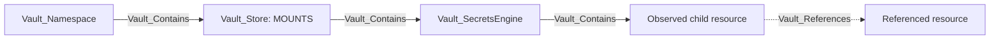

Specific mounts carry their display kind first and `Vault_SecretsEngine` as a base kind. Role-like child nodes carry `Vault_SecretsRole` where useful for cross-engine queries. Per-engine layout diagrams are structural: policy access and security outcomes appear in the edge descriptions and attack-path sections instead. Dashed relationships represent non-owning dependencies rather than traversable containment.

### Common Mount Nodes And Edges

| Type | Meaning |
| --- | --- |
| `Vault_SecretsEngine` | Base node for a mounted secrets backend. |
| `Vault_SecretsRole` | Base node for role-like secrets-engine resources. |
| `Vault_Contains` | Mount Store to engine, and engine/resource to immediate observed children. |
| `Vault_References` | Non-owning dependency such as issuer-to-key or role-to-connection. |
| `Vault_ListObjects` | List roles, keys, accounts, connections, KV children, or similar collections. |
| `Vault_CreateObject` | Create an object at a collection or exact synthetic target. |
| `Vault_ReadObject` | Read durable configuration on a concrete child. |
| `Vault_ManageObject` | Update, delete, rotate, import, or otherwise administer a concrete child. |
| `Vault_ReadConfig` | Read mount, tuning, or backend-wide configuration. |
| `Vault_ManageConfig` | Change configuration, tuning, root credentials, or maintenance state. |
| `Vault_GenerateCredentials` | Obtain dynamic credentials from a concrete viable role. |
| `Vault_ReadStaticCredentials` | Read a managed static credential from a concrete role or account. |

Generic edges retain `Engine Types`, `Object Types`, `Role Types`, `Operations`, `Credential Types`, `Read Targets`, `Config Targets`, request surfaces, and prerequisites.

### Common Mount Properties

The tables in each engine section list stable properties beyond the common contract in [the graph model](../MODEL.md#property-contract). Supported plugin APIs may return additional version- or plugin-specific fields; VaultHound exports those fields with humanized labels while suppressing or reducing secret values to presence indicators.

| Applies to | Non-common properties | Meaning |
| --- | --- | --- |
| Secrets-engine mount | `KV Version`, `Delegated Auth Accessors`, `Allowed Managed Keys` | Optional engine version and mount-level delegation/managed-key constraints. |
| Secrets-engine child | `Engine Path`, `Logical Path`, backend-specific identifiers | Connects a durable child to its API and logical request surfaces. |
| `Vault_References` and `Vault_ManagedBy` | `Reference Types`, `Reference Evidence` | Explains the non-owning dependency represented by the edge. |
| Credential-generation/read edges | `Credential Types`, `Credential Material`, `Generation Effects`, `Request Surfaces`, `Request Methods`, `Modes`, `Lease Backed`, `Renewable`, `Revocable` | Describes what Vault can return and its lifecycle without invoking the endpoint. |
| Generic object/config edges | `Engine Types`, `Object Types`, `Role Types`, `Operations`, `Read Targets`, `Config Targets` | Retains engine-specific meaning after CRUD and maintenance edges are folded into generic families. |

## Supported Engines

| Technology | Supported | Tested | Mount Node |
| --- | :---: | :---: | --- |
| Agent Registry | :x: | :x: | N/A |
| AliCloud | :x: | :x: | N/A |
| AWS | :white_check_mark: | :x: | `Vault_SecretsEngineAws` |
| Azure | :white_check_mark: | :x: | `Vault_SecretsEngineAzure` |
| Consul | :x: | :x: | N/A |
| Cubbyhole | :x: | :x: | N/A |
| Database | :white_check_mark: | :x: | `Vault_SecretsEngineDatabase` |
| GCP | :white_check_mark: | :x: | `Vault_SecretsEngineGcp` |
| GCP KMS | :white_check_mark: | :x: | `Vault_SecretsEngineGcpKms` |
| Key Management | :x: | :x: | N/A |
| KMIP | :x: | :x: | N/A |
| Kubernetes | :white_check_mark: | :x: | `Vault_SecretsEngineKubernetes` |
| K/V | :white_check_mark: | :x: | `Vault_SecretsEngineKv` |
| LDAP | :white_check_mark: | :x: | `Vault_SecretsEngineLdap` |
| MongoDB Atlas | :x: | :x: | N/A |
| Nomad | :x: | :x: | N/A |
| OS Local Accounts | :x: | :x: | N/A |
| PKI | :white_check_mark: | :x: | `Vault_SecretsEnginePki` |
| PKI External CA | :x: | :x: | N/A |
| RabbitMQ | :x: | :x: | N/A |
| SPIFFE | :x: | :x: | N/A |
| SSH | :white_check_mark: | :x: | `Vault_SecretsEngineSsh` |
| Terraform Cloud | :white_check_mark: | :x: | `Vault_SecretsEngineTerraform` |
| TOTP | :white_check_mark: | :x: | `Vault_SecretsEngineTotp` |
| Transform | :x: | :x: | N/A |
| Transit | :white_check_mark: | :x: | `Vault_SecretsEngineTransit` |

`Identity` is modeled as the separate namespace-local [Identity Store](IDENTITY.md), not as a mount-specific secrets-engine implementation. Other unsupported engines are still emitted when observed as generic `Vault_SecretsEngine` nodes with their existence, type, path, and common mount properties.

### AWS

AWS dynamic roles describe IAM user, assumed role, federation token, or session token modes. Static roles map existing IAM users managed by Vault.

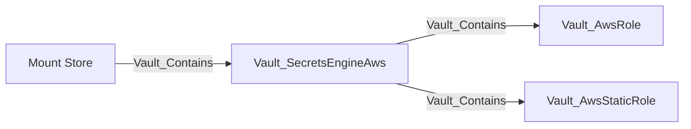

Dynamic-role properties include policy documents and ARNs, role ARNs, IAM groups, tags, permissions boundaries, credential modes, TTLs, and MFA configuration. Traversable generation requires at least one proven viable mode; session-token-only access requiring an MFA code becomes `Vault_PotentialAccess` when that prerequisite is unresolved.

Root credentials, lease settings, root rotation, and mount tuning use generic config edges. Role CRUD and collection operations use generic object edges.

#### Nodes

| Node | Description |
| --- | --- |
| `Vault_SecretsEngineAws` | AWS secrets-engine mount, root credential mode, lease, and endpoint configuration. |
| `Vault_AwsRole` | Dynamic IAM or STS credential-generation role. |
| `Vault_AwsStaticRole` | Existing IAM user whose credential rotation is managed by Vault. |

#### Edges

| Edge | Source | Destination | Traversable | Meaning |
| --- | --- | --- | :---: | --- |
| `Vault_Contains` | Mount Store or AWS mount | AWS mount, dynamic role, or static role | :white_check_mark: | Places the mount and observed roles in the namespace hierarchy. |
| `Vault_ReadConfig` | Policy | AWS mount | :x: | Reads root, lease, or mount configuration. |
| `Vault_ManageConfig` | Policy | AWS mount | :x: | Changes root credentials, lease settings, tuning, or performs root rotation. |
| `Vault_ListObjects` | Policy | AWS mount | :x: | Lists dynamic or static roles. |
| `Vault_CreateObject` | Policy | AWS mount or synthetic role | :x: | Creates a role or records authority to create an unobserved role. |
| `Vault_ReadObject` | Policy | AWS role or static role | :x: | Reads a concrete role. |
| `Vault_ManageObject` | Policy | AWS role or static role | :x: | Updates, deletes, or rotates a concrete role. |
| `Vault_GenerateCredentials` | Policy | AWS role | :white_check_mark: | Generates credentials through at least one proven viable dynamic mode. |
| `Vault_ReadStaticCredentials` | Policy | AWS static role | :white_check_mark: | Returns the IAM user's credential managed by Vault. |
| `Vault_PotentialAccess` | Policy | AWS role | :x: | Records generation with unresolved MFA or another external prerequisite. |

#### Properties

| Applies to | Non-common properties | Meaning |
| --- | --- | --- |
| `Vault_SecretsEngineAws` | `Root Auth Mode`, `Can Rotate Root`, `Access Key`, `Secret Key Present`, `IAM Endpoint`, `STS Endpoint`, `Max Retries`, `Region`, `Role ARN`, `Identity Token Audience`, `Lease`, `Lease Max` | Root credential mode, endpoint selection, rotation viability, and lease defaults. |
| `Vault_AwsRole` | `Role Name`, `Credential Type`, `Credential Types`, `Policy Document`, `Policy ARNs`, `Role ARNs`, `IAM Groups`, `IAM Tags`, `Permissions Boundary ARN`, `MFA Serial Number`, `Modeled Request Surfaces`, `Generation Effects`, `Surface Restriction Visibility`, `Requires Role ARN Selection`, `Role ARN Selection Mode`, `Allowed Role ARNs` | IAM-user/session mode, downstream policy material, role selection, MFA, and modeled credential outcomes. |
| `Vault_AwsStaticRole` | `Role Name`, `Username`, `Rotation Period`, `Rotation Schedule`, `Rotation Window`, `Last Vault Rotation` | Managed IAM user and rotation state. |
| AWS credential edges | `Request Surface`, `Request Method`, `Lease Bound`, `Supports Custom TTL`, `Generation Effects`, `Requirements`, `Potential Outcomes`, `Resolution Status` | Identifies `creds` versus `sts`, custom-TTL support, MFA requirements, and why generation is viable or only potential. |

#### Attack Paths

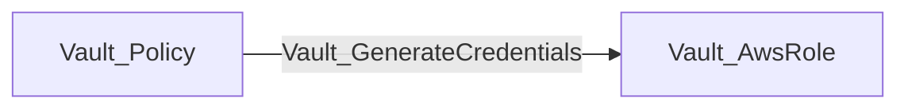

The destination role records whether Vault returns an IAM user, assumed-role credential, federation token, or session token. The edge is traversable only when at least one configured mode is viable. A session-token-only role that requires an unproven MFA code instead produces `Vault_PotentialAccess`.

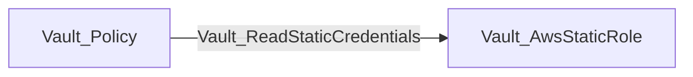

This yields the managed IAM user's current credential through Vault. Neither path proves the generated principal's downstream AWS permissions; those require correlation with AWS graph data.

### Azure

Azure dynamic roles generate service principals; static roles map existing applications or service principals and credential rotation state.

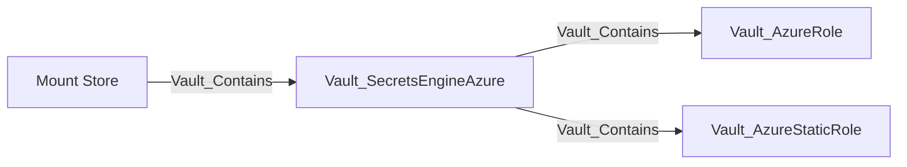

Roles retain Azure role assignments, groups, application settings, TTL behavior, and generated credential effects. `Vault_AzureImportStaticRole` is a specialized non-traversable administrative operation; ordinary role CRUD uses generic object edges.

#### Nodes

| Node | Description |
| --- | --- |
| `Vault_SecretsEngineAzure` | Azure secrets-engine mount and tenant, subscription, root credential, and lease configuration. |
| `Vault_AzureRole` | Dynamic Azure service-principal credential-generation role. |
| `Vault_AzureStaticRole` | Existing Azure application whose credential is managed by Vault. |

#### Edges

| Edge | Source | Destination | Traversable | Meaning |
| --- | --- | --- | :---: | --- |
| `Vault_Contains` | Mount Store or Azure mount | Azure mount, dynamic role, or static role | :white_check_mark: | Places the mount and observed roles in the namespace hierarchy. |
| `Vault_ReadConfig` | Policy | Azure mount | :x: | Reads root, lease, or mount configuration. |
| `Vault_ManageConfig` | Policy | Azure mount | :x: | Changes Azure backend configuration, tuning, or root credentials. |
| `Vault_ListObjects` | Policy | Azure mount | :x: | Lists dynamic or static roles. |
| `Vault_CreateObject` | Policy | Azure mount or synthetic role | :x: | Creates a role or records authority to create an unobserved role. |
| `Vault_ReadObject` | Policy | Azure role or static role | :x: | Reads a concrete role. |
| `Vault_ManageObject` | Policy | Azure role or static role | :x: | Updates, deletes, or rotates a concrete role. |
| `Vault_AzureImportStaticRole` | Policy | Azure static role or mount | :x: | Imports an existing application credential into Vault management. |
| `Vault_GenerateCredentials` | Policy | Azure role | :white_check_mark: | Generates a service-principal credential through a dynamic role. |
| `Vault_ReadStaticCredentials` | Policy | Azure static role | :white_check_mark: | Returns the credential managed through a concrete static role. |

#### Properties

| Applies to | Non-common properties | Meaning |
| --- | --- | --- |
| `Vault_SecretsEngineAzure` | `Subscription ID`, `Tenant ID`, `Client ID`, `Client Secret Present`, `Environment`, `Root Password TTL` | Azure subscription/tenant identity, credential presence, and root-password behavior. |
| `Vault_AzureRole` | `Role Name`, `Azure Roles`, `Azure Groups`, `Application Object ID`, `Permanently Delete`, `Generation Mode`, `Generation Effects` | Dynamic role assignments and whether generation creates a service principal or another secret for an existing application. |
| `Vault_AzureStaticRole` | `Role Name`, `Azure Roles`, `Azure Groups`, `Application Object ID`, `Permanently Delete`, `Service Principal Name`, `Rotation Period`, `Rotation Schedule`; dynamic `metadata_<key>` fields preserve returned metadata | Managed application/service-principal and credential rotation state. |
| Azure credential/import edges | Common credential properties plus `Operations` for import and rotation | Distinguishes generated credentials, static reads, metadata-only/full import, and rotation workflows. |

#### Attack Paths

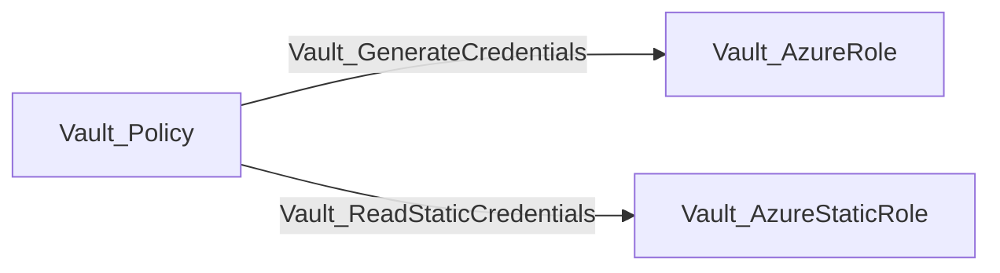

The first path obtains a generated Azure service-principal credential constrained by the dynamic role. The second reads the current credential managed through the concrete static role. Importing or managing a static role is not itself traversable because it does not prove that usable credential material is returned.

### Database

Database mounts contain plugin connections, dynamic roles, and static roles. Roles reference rather than contain their connection.

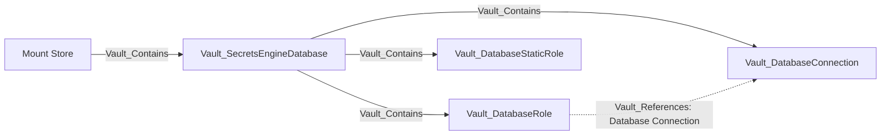

#### Nodes

| Node | Description |
| --- | --- |
| `Vault_SecretsEngineDatabase` | Database secrets-engine mount and backend-wide configuration. |
| `Vault_DatabaseConnection` | Named database plugin connection and allowed-role configuration. |
| `Vault_DatabaseRole` | Dynamic database credential-generation role and creation/revocation statements. |
| `Vault_DatabaseStaticRole` | Existing database account managed and rotated by Vault. |

#### Edges

| Edge | Source | Destination | Traversable | Meaning |
| --- | --- | --- | :---: | --- |
| `Vault_Contains` | Mount Store or Database mount | Database mount, connection, dynamic role, or static role | :white_check_mark: | Places the mount and observed database resources in the namespace hierarchy. |
| `Vault_References` | Database role or static role | Database connection | :x: | Records the assigned connection and allowed-role viability evidence. |
| `Vault_ReadConfig` | Policy | Database mount | :x: | Reads mount or backend-wide configuration. |
| `Vault_ManageConfig` | Policy | Database mount | :x: | Changes backend configuration or reloads a plugin process; properties identify the operation and plugin. |
| `Vault_ListObjects` | Policy | Database mount | :x: | Lists connections, dynamic roles, or static roles. |
| `Vault_CreateObject` | Policy | Database mount or synthetic resource | :x: | Creates a connection or role, or records authority to create an unobserved resource. |
| `Vault_ReadObject` | Policy | Database connection or role | :x: | Reads a concrete connection, dynamic role, or static role. |
| `Vault_ManageObject` | Policy | Database connection or role | :x: | Updates, deletes, rotates, or resets a concrete resource; `Operations` identifies connection reset. |
| `Vault_GenerateCredentials` | Policy | Database role | :white_check_mark: | Generates a dynamic credential from a compatible, permitted connection. |
| `Vault_ReadStaticCredentials` | Policy | Database static role | :white_check_mark: | Returns the current managed static credential. |
| `Vault_PotentialAccess` | Policy | Database role | :x: | Records credential generation when connection compatibility or permission is unresolved. |

#### Properties

| Applies to | Non-common properties | Meaning |
| --- | --- | --- |
| `Vault_DatabaseConnection` | `Connection Name`, `Plugin Name`, `Allowed Roles`, `Verify Connection`, `Root Rotation Statements`, `Password Policy`, `Username Template`, credential/private-key presence flags, `Supports Root Rotation`, `Supports Dynamic Roles`, `Supports Static Roles`, `Supported Credential Types`, `Plugin Capability Source` | Plugin connection, role allowlist, credential-presence, and compatibility profile. Additional plugin fields are passed through with humanized labels. |
| `Vault_DatabaseRole` | `Role Name`, `Role Type`, `Database Name`, `Creation Statements`, `Revocation Statements`, `Rollback Statements`, `Renew Statements`, `Generation Effects`, `Lease Backed` | Dynamic account statements and lease-backed credential behavior. |
| `Vault_DatabaseStaticRole` | The dynamic-role fields plus `Username`, `Rotation Period`, `Rotation Schedule`, password-presence flags | Existing database account and rotation behavior. |
| `Vault_References` | `Allowed Roles`, `Allowed Role Match Types`, `Allowed By Connection`, `Matched Allowed Role Patterns`, `Reference Types`, `Reference Evidence` | Proves or disproves that the selected connection permits the role. |
| Database credential edges | `Request Surfaces`, `Generation Modes`, `Credential Types`, `Credential Material`, `Generation Effects`, `Lease Backed`, `Requirements`, `Resolution Status` | Captures compatible plugin mode and unknown/missing-connection prerequisites. |
| Database management edges | `Operations`, `Plugin Names` | Identifies connection reset, role rotation, or plugin reload after generic edge folding. |

Dynamic credential generation requires an observed compatible connection and an `allowed_roles` match. Missing or incompatible connection evidence downgrades the result to potential access.

#### Attack Paths

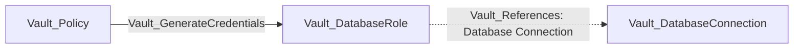

The attack path terminates at the role; `Vault_References` is supporting evidence, not a traversable hop. Generation is traversable only when the referenced connection was observed, uses a compatible plugin, and permits the role through `allowed_roles`. Incomplete collection emits `Vault_PotentialAccess`.

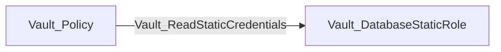

Static credential reads target the exact managed account and do not depend on dynamic-role connection viability in the same way.

### GCP

The GCP engine models rolesets, static service accounts, and impersonated accounts.

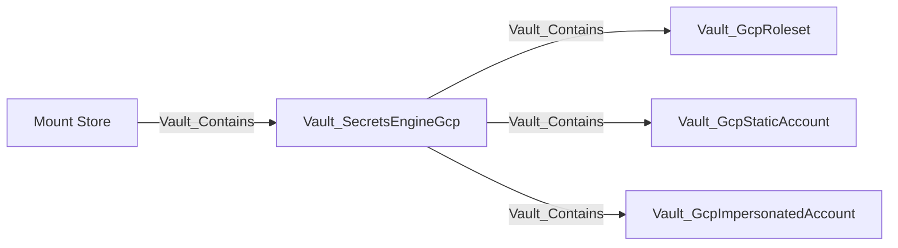

Rolesets retain secret type, project, IAM bindings, token scopes, rotation, and credential effects. Static and impersonated accounts retain OAuth token or service-account-key surfaces supported by their endpoint. The collector does not independently verify Google Cloud IAM.

#### Nodes

| Node | Description |
| --- | --- |
| `Vault_SecretsEngineGcp` | GCP secrets-engine mount and credential-source, lease, and identity-token configuration. |
| `Vault_GcpRoleset` | Dynamic GCP roleset that produces OAuth tokens or service-account keys. |
| `Vault_GcpStaticAccount` | Existing GCP service account managed through static-account endpoints. |
| `Vault_GcpImpersonatedAccount` | Account configuration that produces credentials through service-account impersonation. |

#### Edges

| Edge | Source | Destination | Traversable | Meaning |
| --- | --- | --- | :---: | --- |
| `Vault_Contains` | Mount Store or GCP mount | GCP mount, roleset, static account, or impersonated account | :white_check_mark: | Places the mount and observed account resources in the namespace hierarchy. |
| `Vault_ReadConfig` | Policy | GCP mount | :x: | Reads mount or GCP backend configuration. |
| `Vault_ManageConfig` | Policy | GCP mount | :x: | Changes GCP backend configuration, tuning, or root credentials. |
| `Vault_ListObjects` | Policy | GCP mount | :x: | Lists rolesets, static accounts, or impersonated accounts. |
| `Vault_CreateObject` | Policy | GCP mount or synthetic resource | :x: | Creates an account resource or records authority to create one. |
| `Vault_ReadObject` | Policy | GCP roleset or account | :x: | Reads a concrete GCP resource. |
| `Vault_ManageObject` | Policy | GCP roleset or account | :x: | Updates, deletes, or rotates a concrete GCP resource. |
| `Vault_GenerateCredentials` | Policy | GCP roleset, static account, or impersonated account | :white_check_mark: | Requests an OAuth token or service-account key supported by the concrete object. |

#### Properties

| Applies to | Non-common properties | Meaning |
| --- | --- | --- |
| `Vault_SecretsEngineGcp` | `Credentials Present`, `Credential Source`, `TTL`, `Max TTL`, `Service Account Email`, `Identity Token Audience` | Static, ambient, or workload-identity credential source and lease configuration. |
| `Vault_GcpRoleset` | `Roleset Name`, `Account Ownership`, `Project`, `Secret Type`, `Bindings`, `Token Scopes`, `Generation Effects`, `Revocation Effects` | Vault-managed service account and its IAM/token behavior. |
| `Vault_GcpStaticAccount` | `Static Account Name`, `Account Ownership`, `Bindings Visibility`, `Project`, `Service Account Email`, `Secret Type`, `Bindings`, `Token Scopes`, `Generation Effects`, `Revocation Effects` | Externally managed service account and Vault-managed bindings/credential surfaces. |
| `Vault_GcpImpersonatedAccount` | `Impersonated Account Name`, `Account Ownership`, `Service Account Email`, `Token Scopes`, `Secret Type`, `Generation Effects`, `Revocation Effects` | Existing service account impersonated for OAuth tokens. |
| GCP credential edges | `Request Surface`, `Request Methods`, `Resource Types`, `Credential Types`, `Generation Effects`, `Revocation Effects`, `Lease Bound`, `Renewable`, `Revocable`, `Endpoint Variants` | Distinguishes roleset, static-account, and impersonated-account token/key outcomes. |

#### Attack Paths

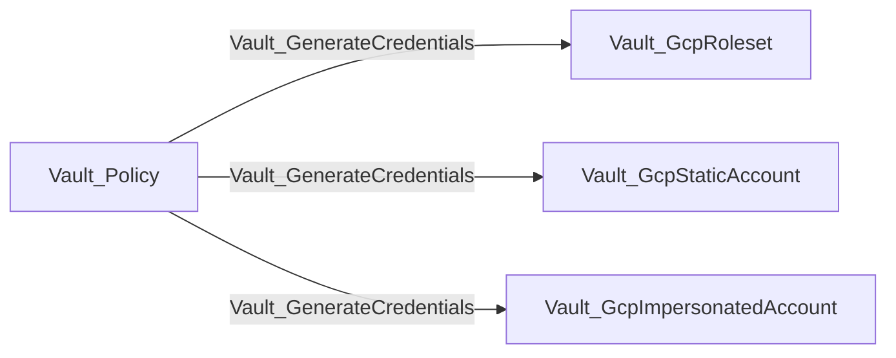

The edge represents the ability to request a credential from the concrete GCP object. Rolesets support OAuth access tokens or service-account keys according to their configured secret type; static accounts expose OAuth access-token or service-account-key endpoints; impersonated accounts expose OAuth access tokens. The paths prove Vault-side credential acquisition, not the resulting Google Cloud IAM permissions.

### GCP KMS

GCP KMS nodes represent Vault registrations of external Google Cloud KMS keys.

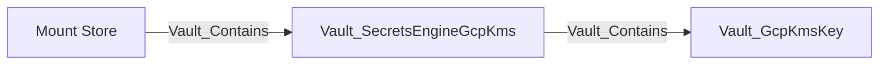

#### Nodes

| Node | Description |
| --- | --- |
| `Vault_SecretsEngineGcpKms` | GCP KMS secrets-engine mount and provider configuration. |
| `Vault_GcpKmsKey` | Registered Cloud KMS key and its cryptographic purpose and compatibility. |

#### Edges

| Edge | Source | Destination | Traversable | Meaning |
| --- | --- | --- | :---: | --- |
| `Vault_Contains` | Mount Store or GCP KMS mount | GCP KMS mount or key | :white_check_mark: | Places the mount and observed key registrations in the namespace hierarchy. |
| `Vault_ReadConfig` | Policy | GCP KMS mount | :x: | Reads mount or backend configuration. |
| `Vault_ManageConfig` | Policy | GCP KMS mount | :x: | Changes backend configuration or mount tuning. |
| `Vault_ListObjects` | Policy | GCP KMS mount | :x: | Lists registered keys. |
| `Vault_CreateObject` | Policy | GCP KMS mount or synthetic key | :x: | Registers a key or records authority to register an unobserved key. |
| `Vault_ReadObject` | Policy | GCP KMS key | :x: | Reads a concrete key registration. |
| `Vault_ManageObject` | Policy | GCP KMS key | :x: | Updates or deletes a concrete key registration. |
| `Vault_GcpKmsEncrypt` | Policy | GCP KMS key | :x: | Encrypts plaintext with a compatible key. |
| `Vault_GcpKmsDecrypt` | Policy | GCP KMS key | :white_check_mark: | Recovers plaintext with a compatible observed key purpose. |
| `Vault_GcpKmsReencrypt` | Policy | GCP KMS key | :x: | Re-encrypts ciphertext. |
| `Vault_GcpKmsSign` | Policy | GCP KMS key | :white_check_mark: | Produces a signature with a compatible signing key. |
| `Vault_GcpKmsVerify` | Policy | GCP KMS key | :x: | Verifies a signature or MAC. |
| `Vault_PotentialAccess` | Policy | GCP KMS key | :x: | Records decrypt or sign authority when key-purpose compatibility is unknown. |

#### Properties

| Applies to | Non-common properties | Meaning |
| --- | --- | --- |
| `Vault_SecretsEngineGcpKms` | `Credentials Visibility`, `Credentials Present`, `Credential Source`, `Scopes` | Credential visibility/source and configured Cloud KMS scopes. |
| `Vault_GcpKmsKey` | `Key Name`, `Crypto Key ID`, `Key Ring`, `Purpose`, `Protection Level`, `Algorithm` | External Cloud KMS key registration and operation compatibility. Additional returned configuration fields are passed through. |
| GCP KMS operation edges | `Key Purposes`, `Compatibility Status`, `Operations`, `Requirements`, `Resolution Status` | Records whether the observed key purpose permits encrypt, decrypt, sign, re-encrypt, or verify. |

Unknown key purpose produces `Vault_PotentialAccess` rather than a traversable decrypt or sign edge.

#### Attack Paths

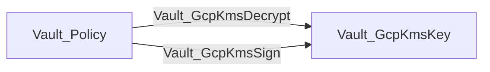

Decrypt represents a plaintext oracle; sign represents use of signing authority. Both require a compatible observed key purpose. Encrypt, re-encrypt, and verify remain non-traversable because they do not reveal plaintext or confer signing authority.

### KV

KV models path hierarchy without collecting plaintext values. Directories and files are intentionally separate node kinds and do not share a KV object base type.

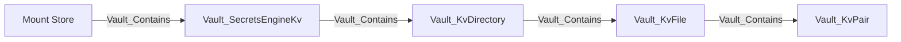

`Vault_KvDirectory` is a logical path prefix, not a mutable Vault object. `Vault_KvFile` is a secret path. `Vault_KvPair` exposes only top-level key names; values are never exported.

### KV v1 And v2

| Surface | Purpose | Exported edges |
| --- | --- | --- |
| KV v1 path | Secret read/write/delete/list | `Vault_KvReadSecret`, `Vault_KvManageSecret`, `Vault_ListObjects` |
| `data/:path` | KV v2 data and versions | `Vault_KvReadSecret`, `Vault_KvManageSecret` |
| `metadata/:path` | Listing, version metadata, custom metadata | `Vault_ListObjects`, `Vault_KvReadMetadata`, `Vault_KvManageMetadata` |
| `delete/:path` | Soft-delete versions | `Vault_KvManageSecret` |
| `undelete/:path` | Recover versions | `Vault_KvManageSecret` |
| `destroy/:path` | Permanently destroy versions | `Vault_KvManageSecret` |
| `subkeys/:path` | Subkey structure plus selected-version metadata | `Vault_KvReadMetadata` with read-target properties |
| `config` | CAS, version retention, delete-after | Generic config edges to the mount |

#### Nodes

| Node | Description |
| --- | --- |
| `Vault_SecretsEngineKv` | KV v1 or v2 mount and engine-level retention/CAS configuration. |
| `Vault_KvDirectory` | Observed logical KV directory or path prefix. |
| `Vault_KvFile` | Observed or exact synthetic secret object without plaintext values. |
| `Vault_KvPair` | Top-level key name contained by a collected KV file; the value is not collected. |

#### Edges

| Edge | Source | Destination | Traversable | Meaning |
| --- | --- | --- | :---: | --- |
| `Vault_Contains` | Mount Store, KV mount, directory, or file | KV mount, directory, file, or pair | :white_check_mark: | Builds the observed KV path and key-name hierarchy. |
| `Vault_ReadConfig` | Policy | KV mount | :x: | Reads KV v2 engine configuration. |
| `Vault_ManageConfig` | Policy | KV mount | :x: | Changes CAS, version retention, or delete-after configuration. |
| `Vault_ListObjects` | Policy or template-resolved principal | KV mount or directory | :x: | Lists compatible observed children through KV v1 or v2 metadata paths. |
| `Vault_CreateObject` | Policy | KV mount, directory, or synthetic file | :x: | Records authority to create a secret at an exact or collection path. |
| `Vault_KvReadSecret` | Policy or template-resolved principal | KV file | :white_check_mark: | Returns secret plaintext from KV v1 or KV v2 data. |
| `Vault_KvManageSecret` | Policy or template-resolved principal | KV file | :x: | Creates, updates, patches, deletes, undeletes, or destroys secret data or versions. |
| `Vault_KvReadMetadata` | Policy or template-resolved principal | KV file | :x: | Reads version/custom metadata or the subkeys view and selected-version metadata. |
| `Vault_KvManageMetadata` | Policy or template-resolved principal | KV file | :x: | Creates, updates, patches, or deletes KV v2 metadata. |
| `Vault_PotentialAccess` | Policy or template-resolved principal | Synthetic or unresolved KV target | :x: | Records a matching path whose concrete target or prerequisite is not proven. |

#### Properties

| Applies to | Non-common properties | Meaning |
| --- | --- | --- |
| `Vault_SecretsEngineKv` | `KV Version`, `CAS Required`, `Max Versions`, `Effective Max Versions`, `Delete Version After` | KV protocol version and engine-wide CAS/retention defaults. |
| `Vault_KvDirectory` | `Relative Path`, `List Path`, `Metadata Path`, `KV Version` | Logical hierarchy and the v1 or v2 collection endpoint used to enumerate children. |
| `Vault_KvFile` | `Relative Path`, `Data Path`, `Metadata Path`, `Delete Path`, `Undelete Path`, `Destroy Path`, `KV Version`, `Exists`, `Discovered`, `Field Count`, `Current Version`, `Oldest Version`, `Version Count`, `Active Version Count`, `Deleted Version Count`, `Destroyed Version Count`, `Created Time`, `Updated Time`, `Deletion Time`, `Destroyed`, `Current Version Created By Actor`, `Current Version Created By Operation`, `Current Version Created By Entity ID`, `Current Version Created By Client ID`, `Configured Max Versions`, `Effective Max Versions`, `Configured CAS Required`, `Effective CAS Required`, `Configured Delete Version After`, `Effective Delete Version After`; dynamic `custom_metadata_<key>` values preserve custom metadata | Concrete secret-path state and KV v2 version/CAS/retention metadata without plaintext values. |
| `Vault_KvPair` | `Key`, `Field Path`, `Value Type`, `Relative Path`, `Data Path`, `KV Version` | Top-level key name and value type only; the value is never exported. |
| KV access edges | `Surfaces`, `Scopes`, `Viable Operations`, `Operation Requirements`, `CAS Required By Default`, `CAS Requirement Source`, `CAS Required For Operations`, `CAS Optional For Operations`, `Version Selection`, `Metadata Read Targets` | Distinguishes data, metadata, lifecycle, subkeys, exact/subtree scope, operation-state, and CAS conditions. |

Only `Vault_KvReadSecret` is traversable. Lifecycle and metadata operations do not reveal secret data. KV v2 mount and per-key metadata contribute effective CAS requirements to write-edge properties.

Exact paths target the compatible file or directory. Globs expand to observed compatible descendants. Template-effective edges originate from the entity, alias, or group representation referenced by the template expression.

#### Attack Paths

A policy-backed identity path can reach a concrete secret file:

```mermaid
flowchart LR
    user[Vault_AuthUser] -->|Vault_MapsTo| alias[Vault_EntityAlias]
    alias -->|Vault_MapsTo| entity[Vault_Entity]
    entity -->|Vault_MemberOf| group[Vault_Group]
    group -->|Vault_LinksPolicy| policy[Vault_Policy]
    policy -->|Vault_KvReadSecret| file[Vault_KvFile]
    file -->|Vault_Contains| pair[Vault_KvPair]
```

The file read exposes plaintext at request time. The pair node records only a top-level key name; VaultHound does not store its value.

For an identity template such as:

```hcl
path "kv/data/dept/{{identity.entity.metadata.department}}/*" {
  capabilities = ["read"]
}
```

an entity with `department=engineering` receives effective `Vault_KvReadSecret` edges to matching observed files. The edge preserves both the rendered path and original policy path. An alias or group becomes the source only when the template expression references that representation.

`Vault_ListObjects`, `Vault_KvReadMetadata`, and KV management edges are non-traversable. They expose names or metadata, or alter lifecycle state, but do not return secret plaintext.

### Kubernetes

Kubernetes secrets roles describe the service account and optional RBAC objects Vault creates or uses when generating credentials.

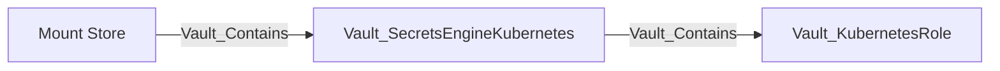

Roles retain service-account name, allowed namespaces, namespace selectors, token TTL, generated role or cluster-role bindings, and request parameters. Generation effects identify namespaced versus cluster-scoped outcomes. Live Kubernetes RBAC is not independently verified.

#### Nodes

| Node | Description |
| --- | --- |
| `Vault_SecretsEngineKubernetes` | Kubernetes secrets-engine mount and cluster/service-account configuration. |
| `Vault_KubernetesRole` | Service-account credential-generation and generated RBAC binding constraints. |

#### Edges

| Edge | Source | Destination | Traversable | Meaning |
| --- | --- | --- | :---: | --- |
| `Vault_Contains` | Mount Store or Kubernetes mount | Kubernetes mount or role | :white_check_mark: | Places the mount and observed roles in the namespace hierarchy. |
| `Vault_ReadConfig` | Policy | Kubernetes mount | :x: | Reads cluster and backend configuration. |
| `Vault_ManageConfig` | Policy | Kubernetes mount | :x: | Changes cluster credentials, backend configuration, or mount tuning. |
| `Vault_ListObjects` | Policy | Kubernetes mount | :x: | Lists Kubernetes secrets roles. |
| `Vault_CreateObject` | Policy | Kubernetes mount or synthetic role | :x: | Creates a role or records authority to create an unobserved role. |
| `Vault_ReadObject` | Policy | Kubernetes role | :x: | Reads a concrete role. |
| `Vault_ManageObject` | Policy | Kubernetes role | :x: | Updates or deletes a concrete role. |
| `Vault_GenerateCredentials` | Policy | Kubernetes role | :white_check_mark: | Generates a service-account token through the concrete role. |

#### Properties

| Applies to | Non-common properties | Meaning |
| --- | --- | --- |
| `Vault_SecretsEngineKubernetes` | `Kubernetes Host`, `Disable Local CA JWT`, `Kubernetes CA Cert Present` | Target cluster and local-credential/trust behavior. |
| `Vault_KubernetesRole` | `Role Name`, `Generation Mode`, `Namespace Scope Type`, `Namespace Scope`, `Namespace Scope Combination`, `Generation Effects`, `Request Parameters`, `Binding Types`, `Role Types`, `Cluster Scope Possible`, `Allowed Kubernetes Namespaces`, `Allowed Kubernetes Namespace Selector`, `Service Account Name`, `Kubernetes Role Name`, `Kubernetes Role Type`, `Kubernetes Role Ref Type`, `Generated Role Rules` | Whether Vault uses an existing service account or creates service-account/RBAC objects and where those objects may exist. Additional returned role fields are passed through. |
| `Vault_GenerateCredentials` | `Generation Effects`, `Modes`, `Request Parameters`, `Binding Types`, `Role Types`, `Cluster Scope Possible`, `Namespace Scope Type`, `Namespace Scope`, `Namespace Scope Combination` | Captures the token and Kubernetes objects generated by the request. |

#### Attack Paths

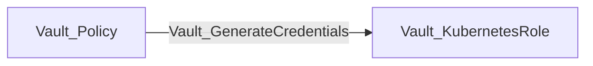

The edge represents generation of a Kubernetes service-account token through the concrete role. Role properties describe namespace selectors and generated namespaced or cluster-scoped bindings. The path does not independently prove the live Kubernetes RBAC attached to the resulting token.

### LDAP

The LDAP secrets engine manages dynamic credentials, static accounts, and service-account libraries.

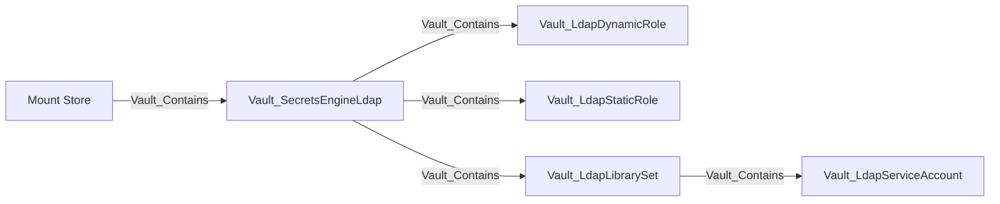

#### Nodes

| Node | Description |
| --- | --- |
| `Vault_SecretsEngineLdap` | LDAP secrets-engine mount and directory bind/search configuration. |
| `Vault_LdapDynamicRole` | Dynamic LDAP credential-generation role. |
| `Vault_LdapStaticRole` | Existing LDAP account managed and rotated by Vault. |
| `Vault_LdapLibrarySet` | Checkout pool containing managed LDAP service accounts. |
| `Vault_LdapServiceAccount` | Concrete service account observed in a library set. |

#### Edges

| Edge | Source | Destination | Traversable | Meaning |
| --- | --- | --- | :---: | --- |
| `Vault_Contains` | Mount Store, LDAP mount, or library | LDAP mount, role, library, or service account | :white_check_mark: | Places the mount and observed LDAP resources in the namespace hierarchy. |
| `Vault_ReadConfig` | Policy | LDAP mount | :x: | Reads LDAP connection, lease, password, or migration configuration. |
| `Vault_ManageConfig` | Policy | LDAP mount | :x: | Changes backend configuration, rotates root credentials, or manages migration state. |
| `Vault_ListObjects` | Policy | LDAP mount or library | :x: | Lists roles, libraries, or library accounts. |
| `Vault_CreateObject` | Policy | LDAP mount or synthetic resource | :x: | Creates a role or library resource. |
| `Vault_ReadObject` | Policy | LDAP role, library, or service account | :x: | Reads a concrete LDAP resource. |
| `Vault_ManageObject` | Policy | LDAP role, library, or service account | :x: | Updates, deletes, rotates, or administers a concrete resource. |
| `Vault_GenerateCredentials` | Policy | LDAP dynamic role | :white_check_mark: | Generates a dynamic LDAP credential. |
| `Vault_ReadStaticCredentials` | Policy | LDAP static role | :white_check_mark: | Returns the managed static LDAP credential. |
| `Vault_LdapReadLibraryStatus` | Policy | LDAP library or service account | :x: | Reads account availability and checkout state. |
| `Vault_LdapCheckoutServiceAccount` | Policy | Available LDAP service account | :white_check_mark: | Checks out one observed currently available account. |
| `Vault_LdapCheckinServiceAccount` | Policy | LDAP service account | :x: | Returns a checked-out account. |
| `Vault_LdapForceCheckinServiceAccount` | Policy | LDAP service account | :x: | Administratively forces an account check-in. |
| `Vault_PotentialAccess` | Policy | LDAP library or service account | :x: | Records checkout when account availability is unknown. |

#### Properties

| Applies to | Non-common properties | Meaning |
| --- | --- | --- |
| `Vault_SecretsEngineLdap` | `Bind DN`, `Bind Password Present`, `URL`, `User DN`, `User Attribute`, `Group DN`, `Group Attribute`, `UPN Domain`, `Start TLS`, `Insecure TLS`, `TLS Min Version`, `TLS Max Version`, `Certificate Present`, `Client TLS Certificate Present`, `Client TLS Key Present` | LDAP connection, bind identity, directory layout, and TLS credential-presence state. Additional returned config fields are passed through. |
| `Vault_LdapDynamicRole` | `Role Name`, `Has Creation LDIF`, `Has Deletion LDIF`, `Has Rollback LDIF`; other returned fields are humanized | Dynamic account lifecycle statement presence without duplicating large LDIF bodies. |
| `Vault_LdapStaticRole` | `Role Name`, `DN`, `Username`, `Rotation Period`, `Rotation Schedule`, `Last Vault Rotation`; password fields are omitted | Existing LDAP account and rotation state. |
| `Vault_LdapLibrarySet` | `Set Name`, `Service Account Names`, `TTL`, `Max TTL` | Checkout pool membership and borrowing lifetime. |
| `Vault_LdapServiceAccount` | `Service Account Name`, `Set Name`, `Available`, `Borrower Entity ID`, `Borrower Client Token` | Observed account availability and current borrower state. |
| LDAP library edges | `Library Sets`, `Allocation Modes`, `Hierarchy Prefixes`, `Operations`, availability requirements and resolution status | Identifies checkout/checkin scope and whether a concrete account is currently obtainable. |

Unknown account availability becomes potential access. Checkout is not routed through a traversable library container because Vault returns one available account rather than every member.

#### Attack Paths

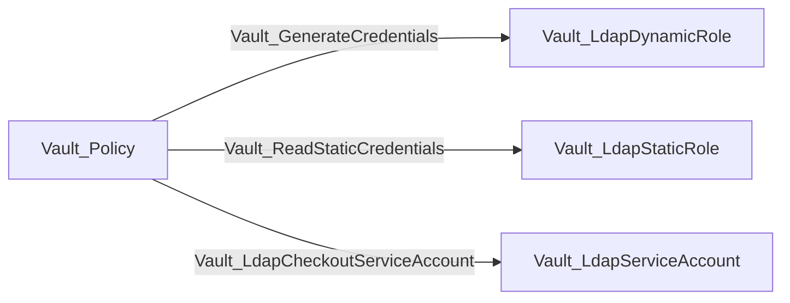

Dynamic and static role paths yield LDAP credentials according to their role mode. Checkout targets only an observed account currently marked available. Unknown availability emits `Vault_PotentialAccess`; it does not create a traversable edge to the library set and fan out through containment.

### PKI

PKI mounts contain roles, issuers, and keys. An issuer references its key; it does not contain it.

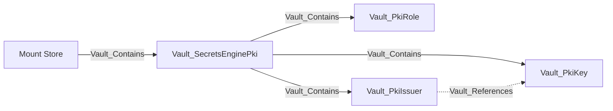

#### Nodes

| Node | Description |
| --- | --- |
| `Vault_SecretsEnginePki` | PKI mount, authority configuration, and issuance-protocol settings. |
| `Vault_PkiRole` | Certificate issuance and signing constraints. |
| `Vault_PkiIssuer` | Root, intermediate, or other issuer registered in the mount. |
| `Vault_PkiKey` | Software, hardware-backed, or managed-key-backed PKI key. |

#### Edges

| Edge | Source | Destination | Traversable | Meaning |
| --- | --- | --- | :---: | --- |
| `Vault_Contains` | Mount Store or PKI mount | PKI mount, role, issuer, or key | :white_check_mark: | Places the mount and observed PKI resources in the namespace hierarchy. |
| `Vault_References` | PKI issuer or protocol configuration | PKI key or auth dependency | :x: | Records non-owning key and delegated-authentication references. |
| `Vault_ReadConfig` | Policy | PKI mount | :x: | Reads PKI backend, issuance-protocol, or tidy-status configuration. |
| `Vault_ManageConfig` | Policy | PKI mount | :x: | Changes PKI backend, issuance-protocol, CRL, or tidy configuration. |
| `Vault_ListObjects` | Policy | PKI mount | :x: | Lists roles, issuers, keys, or authenticated certificate information collections. |
| `Vault_CreateObject` | Policy | PKI mount or synthetic resource | :x: | Creates a role, issuer workflow, key, or other supported PKI object. |
| `Vault_ReadObject` | Policy | PKI role, issuer, or key | :x: | Reads a concrete durable PKI object. |
| `Vault_ManageObject` | Policy | PKI role, issuer, or key | :x: | Updates, deletes, imports, rotates, or otherwise administers a concrete object. |
| `Vault_PkiListCertificateInfo` | Policy | PKI mount | :x: | Lists authenticated certificate information collections. |
| `Vault_PkiIssueCertificate` | Policy | PKI role or issuer | :white_check_mark: | Issues a certificate through a role or issuer-scoped external-policy endpoint. |
| `Vault_PkiSignCertificate` | Policy | PKI role or issuer | :white_check_mark: | Signs a CSR through a role or issuer-scoped external-policy endpoint. |
| `Vault_PkiSignVerbatim` | Policy | PKI role or issuer | :white_check_mark: | Signs through a role-qualified, role-less, or issuer-specific verbatim surface after concrete resolution. |
| `Vault_PkiSignIntermediate` | Policy | PKI issuer | :white_check_mark: | Signs an intermediate CA certificate with a concrete issuer. |
| `Vault_PkiSignSelfIssued` | Policy | PKI issuer | :white_check_mark: | Signs a self-issued CA certificate with a concrete issuer. |
| `Vault_PkiRevokeCertificate` | Policy | PKI mount or issuer | :x: | Revokes a certificate. |
| `Vault_PkiRevokeIssuer` | Policy | PKI issuer | :x: | Revokes a concrete issuer. |
| `Vault_PkiProvisionIssuer` | Policy | PKI mount | :x: | Generates or imports issuer material, or generates an intermediate CSR. |
| `Vault_PkiManageRoot` | Policy | PKI mount | :x: | Performs a root CA lifecycle operation. |
| `Vault_PkiDeleteRoot` | Policy | PKI mount | :x: | Deletes all issuer and key material. |
| `Vault_PkiManageIntermediate` | Policy | PKI mount | :x: | Performs an intermediate CA lifecycle workflow. |
| `Vault_PkiAcmeCreateEab` | Policy | PKI mount or protocol context | :x: | Creates ACME external-account-binding material. |
| `Vault_PkiAcmeManageAccounts` | Policy | PKI mount | :x: | Manages ACME account records. |
| `Vault_PotentialAccess` | Policy | PKI mount or unresolved resource | :x: | Records issuance or signing whose concrete compatible target cannot be proven. |

#### Properties

| Applies to | Non-common properties | Meaning |
| --- | --- | --- |
| `Vault_SecretsEnginePki` | `ACME Enabled`, `ACME Default Policy`, `CMPv2 Enabled`, `CMPv2 Default Policy`, `EST Enabled`, `EST Default Policy`, `SCEP Enabled`, `SCEP Default Policy` | Issuance-protocol enablement and default policy behavior. |
| `Vault_PkiRole` | `Role Name`, `Issuer`, `Issued Certificates Expire After`, `Max TTL`, `Allow Localhost`, `Allowed Domains`, `Allow Templates In Allowed Domains`, `Allow Bare Domains`, `Allow Subdomains`, `Allow Glob Domains`, `Allow Wildcard Certificates`, `Allow Any Name`, `Enforce Hostnames`, `Allow IP Subject Alternative Names`, `URI Subject Alternative Names (URI SANs)`, `Allow URI SANs Template`, `Other SANs`, `Allowed Serial Numbers`, `Allowed User IDs` | Identity and name constraints corresponding to Vault's PKI role UI and API. |
| `Vault_PkiRole` | `Server Flag`, `Client Flag`, `Code Signing Flag`, `Email Protection Flag`, `Key Type`, `Key Bits`, `Signature Bits`, `Use PSS`, `Key Usage`, `Extended Key Usage`, `Extended Key Usage OIDs`, `Use CSR Common Name`, `Use CSR Subject Alternative Names` | Certificate purpose, key, signature, usage, and CSR behavior. |
| `Vault_PkiRole` | `Organizational Units (OU)`, `Organization`, `Country`, `Locality/City`, `Province/State`, `Street Address`, `Postal Code`, `Store In Storage Backend`, `Store Metadata`, `Generate Lease With Certificate`, `Issued Certificate Backdating`, `Require Common Name`, `Policy Identifiers`, `Add Basic Constraints` | Subject defaults, storage, lease, validity, policy, and basic-constraints behavior. |
| `Vault_PkiIssuer` | `Issuer Ref`, `Common Name`, `Issuer Name`, `Key Usage`, `Is Root`, `Is Default`, `Use PSS`, `Not Valid Before`, `Not Valid After`, `Issuing Certificates`, `CRL Distribution Points`, `OCSP Servers`; remaining non-secret issuer API fields are passed through | Issuer identity, hierarchy role, validity, key usage, and authority-information locations. |
| `Vault_PkiKey` | `Key Ref`, `Key Type`, `Hardware Backed`, `Managed Key Reference Known`, managed-key name/ID where returned; remaining non-secret key API fields are passed through | Key identity, implementation type, and external managed-key backing. |
| PKI issuance/signing edges | `Targets`, `Issuance Protocols`, `Protocol Paths`, `Protocol Enabled`, `Path Qualification`, `Issuer References`, `Issuer Selection`, `Policy Services`, `Certificate Targets`, `Certificate Format`, `CSR Format`, `Key Types`, `Key Bits`, `Signature Bits`, `TTL`, `Common Names`, `Alternative Names`, `Requirements`, `Resolution Status` | Preserves the role/issuer, protocol, certificate request, and compatibility context merged into each security outcome. |
| PKI read/revocation/lifecycle edges | `Read Targets`, `Certificate Targets`, `Certificate Format`, `CRL Format`, `CRL Delta Format`, `Requires Private Key`, `Issuer Actions`, `Creation Methods`, `Generation Types`, `Import Types`, `Root Actions`, `Intermediate Actions`, `ACME Operations` | Distinguishes certificate/issuer/CRL data and root, intermediate, issuer, revocation, and ACME workflows. |
| PKI reference edges | `Reference Types`, `Reference Evidence`, delegated-authenticator and role-selection fields | Connects issuers to keys and issuance protocols to selected auth methods/roles without implying ownership. |

Traversable issuance and signing edges do not terminate at the mount when doing so would imply control of every role, issuer, and key through containment. Role/issuer globs expand to observed compatible children; unresolved mount-native outcomes remain potential or non-traversable.

Authenticated ACME, CMP, EST, and SCEP policy surfaces fold into existing issue, sign, and config families. `Issuance Protocols`, `Protocol Paths`, directory scope, role, issuer, format, and target properties retain the protocol context. Public CA, chain, CRL, OCSP, and similar unauthenticated authority-information endpoints are not modeled as policy authority.

#### Attack Paths

Certificate issuance and signing target the concrete resource that constrains the operation:

```mermaid
flowchart LR
    policy[Vault_Policy] -->|Vault_PkiIssueCertificate| role[Vault_PkiRole]
    policy -->|Vault_PkiSignCertificate| role
    policy -->|Vault_PkiSignVerbatim: role-qualified| role
    policy -->|Vault_PkiIssueCertificate: issuer external policy| issuer[Vault_PkiIssuer]
    policy -->|Vault_PkiSignCertificate: issuer external policy| issuer
    policy -->|Vault_PkiSignVerbatim: resolved default or selected issuer| issuer
    policy -->|Vault_PkiSignIntermediate| issuer
    policy -->|Vault_PkiSignSelfIssued| issuer
```

A role glob such as:

```hcl
path "pki/issue/*" {
  capabilities = ["create", "update"]
}
```

expands `Vault_PkiIssueCertificate` to every observed compatible role. It does not create a traversable edge to the PKI mount, because traversable containment would incorrectly imply control of every issuer and key.

Role-less, issuer-selected, and protocol issuance paths remain traversable only when the collector can resolve a concrete compatible role or issuer. Runtime-selected mount outcomes become potential or non-traversable.

Revocation, issuer provisioning, root/intermediate lifecycle, and ordinary issuer management can be operationally severe but remain non-traversable. Destroying an issuer does not grant its signing authority.

### SSH

SSH uses one role node kind for OTP and CA role modes. The role properties identify which operations are valid.

```mermaid
flowchart LR
    store[Mount Store] -->|Vault_Contains| mount[Vault_SecretsEngineSsh]
    mount -->|Vault_Contains| role[Vault_SshRole]
```

#### Nodes

| Node | Description |
| --- | --- |
| `Vault_SecretsEngineSsh` | SSH secrets-engine mount and CA/zero-address configuration. |
| `Vault_SshRole` | OTP or CA role for credential generation, signing, or key-pair issuance. |

#### Edges

| Edge | Source | Destination | Traversable | Meaning |
| --- | --- | --- | :---: | --- |
| `Vault_Contains` | Mount Store or SSH mount | SSH mount or role | :white_check_mark: | Places the mount and observed roles in the namespace hierarchy. |
| `Vault_ReadConfig` | Policy | SSH mount | :x: | Reads authenticated CA, zero-address, or mount configuration. |
| `Vault_ManageConfig` | Policy | SSH mount | :x: | Changes CA, zero-address, tidy, or mount configuration. |
| `Vault_ListObjects` | Policy | SSH mount | :x: | Lists SSH roles. |
| `Vault_CreateObject` | Policy | SSH mount or synthetic role | :x: | Creates a role or records authority to create an unobserved role. |
| `Vault_ReadObject` | Policy | SSH role | :x: | Reads a concrete role. |
| `Vault_ManageObject` | Policy | SSH role | :x: | Updates or deletes a concrete role. |
| `Vault_SshGenerateOtp` | Policy | OTP-compatible SSH role | :white_check_mark: | Generates an SSH one-time password. |
| `Vault_SshSignKey` | Policy | CA-compatible SSH role | :white_check_mark: | Signs a supplied SSH public key. |
| `Vault_SshIssueKeyPair` | Policy | CA-compatible SSH role | :white_check_mark: | Issues a new SSH key pair and certificate. |
| `Vault_SshLookupRoles` | Policy | SSH mount | :x: | Discovers roles matching supplied connection attributes. |

#### Properties

| Applies to | Non-common properties | Meaning |
| --- | --- | --- |
| `Vault_SecretsEngineSsh` | `CA Public Key`, `CA Managed`, `CA Managed Key Name`, `CA Managed Key ID`, `CA Managed Key Reference Known` | Current CA public material and external managed-key backing state. |
| `Vault_SshRole` | `Role Name`, `Zero Address Enabled`, `Key Type`, `Default User`, `Default User Template`, `Allowed Users`, `Allowed Users Template`, `Allowed Domains`, `Allowed Domains Template`, `Allow Bare Domains`, `Allow Subdomains`, `Allow User Certificates`, `Allow Host Certificates`, `Allow User Key IDs`, `Key ID Format`, `Algorithm Signer`, `Allowed User Key Lengths`, `Allowed Critical Options`, `Allowed Extensions`, `Default Critical Options`, `Default Extensions`, `Default Extensions Template`, `Not Before Duration`, `TTL`, `Max TTL` | OTP/CA role mode, principal and host constraints, signed-certificate options, and validity. Additional returned role fields are passed through. |
| SSH operation edges | `Role Types`, `Credential Types`, `Credential Material`, `Generation Effects`, `Request Surfaces`, `Request Methods`, `Requirements` | Records OTP, signing, and key-pair compatibility and returned material. |
| SSH config edges | `Read Targets`, `Config Targets`, `Operations` | Identifies current/snapshot CA public-key reads, CA changes, zero-address updates, and tidy maintenance. |

CA and zero-address configuration uses generic config edges. CA public keys are mount properties; unauthenticated public-key retrieval is not modeled as ACL authority. Role globs expand security outcomes to compatible observed roles.

#### Attack Paths

```mermaid
flowchart LR
    policy[Vault_Policy] -->|Vault_SshGenerateOtp| otp["Vault_SshRole: OTP"]
    policy -->|Vault_SshSignKey| ca["Vault_SshRole: CA"]
    policy -->|Vault_SshIssueKeyPair| ca
```

OTP generation returns a usable one-time password. Signing turns an attacker-supplied public key into an SSH certificate. Key-pair issuance returns new private-key material and its certificate. Role-mode compatibility is checked before any of these traversable edges are emitted.

### Terraform Cloud

Terraform Cloud roles generate organization, team, or user API tokens.

```mermaid
flowchart LR
    store[Mount Store] -->|Vault_Contains| mount[Vault_SecretsEngineTerraform]
    mount -->|Vault_Contains| role[Vault_TerraformRole]
```

The mount stores Terraform Cloud address and token configuration. Role and generation properties identify token mode, organization, team or user target, TTL, and generated credential material.

#### Nodes

| Node | Description |
| --- | --- |
| `Vault_SecretsEngineTerraform` | Terraform Cloud secrets-engine mount and API configuration. |
| `Vault_TerraformRole` | Organization, team, or user token-generation and lifecycle configuration. |

#### Edges

| Edge | Source | Destination | Traversable | Meaning |
| --- | --- | --- | :---: | --- |
| `Vault_Contains` | Mount Store or Terraform Cloud mount | Terraform Cloud mount or role | :white_check_mark: | Places the mount and observed roles in the namespace hierarchy. |
| `Vault_ReadConfig` | Policy | Terraform Cloud mount | :x: | Reads backend address, token, or mount configuration. |
| `Vault_ManageConfig` | Policy | Terraform Cloud mount | :x: | Changes backend configuration or mount tuning. |
| `Vault_ListObjects` | Policy | Terraform Cloud mount | :x: | Lists Terraform Cloud roles. |
| `Vault_CreateObject` | Policy | Terraform Cloud mount or synthetic role | :x: | Creates a role or records authority to create an unobserved role. |
| `Vault_ReadObject` | Policy | Terraform Cloud role | :x: | Reads a concrete role. |
| `Vault_ManageObject` | Policy | Terraform Cloud role | :x: | Updates or deletes a concrete role. |
| `Vault_GenerateCredentials` | Policy | Terraform Cloud role | :white_check_mark: | Generates an organization, team, or user API token. |

#### Properties

| Applies to | Non-common properties | Meaning |
| --- | --- | --- |
| `Vault_SecretsEngineTerraform` | `Address`, `Base Path`, `Platform Type`, `Custom Address`, `Access Config Visibility`, `Secret Material Visibility` | HCP Terraform or Terraform Enterprise endpoint and the read API's token-visibility boundary. |
| `Vault_TerraformRole` | `Role Name`, `Organization`, `Team ID`, `User ID`, `Credential Type`, `Target Type`, `Target Identifier`, `Token Lifecycle Mode`, `Single Active Token`, `Dynamic Per Request`, `Rotatable`, `TTL Applies`, `Max TTL Applies`, `Lease Backed`, `Renewable`, `Returns Same Token Until Rotation`, `May Revoke Existing Token On Generation`, `Generation Effects` | Token ownership, target, rotation, lease, and replacement behavior. |
| Terraform credential edges | `Scope Type`, `Credential Type`, `Target Type`, `Token Lifecycle Mode`, `Single Active Token`, `Dynamic Per Request`, `Rotatable`, `TTL Applies`, `Max TTL Applies`, `Lease Backed`, `Renewable`, `Returns Same Token Until Rotation`, `May Revoke Existing Token On Generation`, `Request Surface`, `Request Method` | Preserves organization/team/user token semantics after generic generation and configuration folding. |

#### Attack Paths

```mermaid
flowchart LR
    policy[Vault_Policy] -->|Vault_GenerateCredentials| role[Vault_TerraformRole]
```

The path yields a Terraform Cloud organization, team, or user API token according to the role. It proves token generation through Vault, while the resulting Terraform Cloud authorization remains an external-system concern.

### TOTP

TOTP mounts contain named key configurations.

```mermaid
flowchart LR
    store[Mount Store] -->|Vault_Contains| mount[Vault_SecretsEngineTotp]
    mount -->|Vault_Contains| key[Vault_TotpKey]
```

#### Nodes

| Node | Description |
| --- | --- |
| `Vault_SecretsEngineTotp` | TOTP secrets-engine mount and backend configuration. |
| `Vault_TotpKey` | Named TOTP key configuration without collected secret seed material. |

#### Edges

| Edge | Source | Destination | Traversable | Meaning |
| --- | --- | --- | :---: | --- |
| `Vault_Contains` | Mount Store or TOTP mount | TOTP mount or key | :white_check_mark: | Places the mount and observed key configurations in the namespace hierarchy. |
| `Vault_ReadConfig` | Policy | TOTP mount | :x: | Reads mount or backend configuration. |
| `Vault_ManageConfig` | Policy | TOTP mount | :x: | Changes backend configuration or mount tuning. |
| `Vault_ListObjects` | Policy | TOTP mount | :x: | Lists TOTP key configurations. |
| `Vault_CreateObject` | Policy | TOTP mount or synthetic key | :x: | Creates a key configuration or records authority to create one. |
| `Vault_ReadObject` | Policy | TOTP key | :x: | Reads a concrete key configuration without exporting its seed. |
| `Vault_ManageObject` | Policy | TOTP key | :x: | Updates or deletes a concrete key configuration. |
| `Vault_TotpGenerateCode` | Policy | TOTP key | :white_check_mark: | Returns a current usable TOTP code. |
| `Vault_TotpValidateCode` | Policy | TOTP key | :x: | Validates a submitted code without yielding credential material. |

#### Properties

| Applies to | Non-common properties | Meaning |
| --- | --- | --- |
| `Vault_SecretsEngineTotp` | None beyond common mount properties | TOTP configuration is stored on individual keys. |
| `Vault_TotpKey` | `Key Name`, `Issuer`, `Account Name`, `Period`, `Algorithm`, `Digits`, `Skew`, `Key Size`, `QR Size`, `Exported` | TOTP identity, algorithm, timing, code length, and seed export state. |
| TOTP edges | `Key Operations`, `Credential Types`, `Credential Material`, `Generation Effects`, `Request Surfaces`, `Requirements` | Distinguishes code generation, validation, and key lifecycle operations. |

Keys include issuer, account name, period, algorithm, digits, skew, key size, and export state where Vault returns them.

#### Attack Paths

```mermaid
flowchart LR
    policy[Vault_Policy] -->|Vault_TotpGenerateCode| key[Vault_TotpKey]
```

The edge is traversable because the endpoint returns a currently usable code. `Vault_TotpValidateCode` remains non-traversable because validation accepts a candidate code but does not reveal one.

### Transit

Transit mounts contain cryptographic keys and expose operations without returning raw key material unless export is explicitly enabled.

```mermaid
flowchart LR
    store[Mount Store] -->|Vault_Contains| mount[Vault_SecretsEngineTransit]
    mount -->|Vault_Contains| key[Vault_TransitKey]
    key -.->|Vault_ManagedBy| managed[Vault_ManagedKey]
```

#### Nodes

| Node | Description |
| --- | --- |
| `Vault_SecretsEngineTransit` | Transit secrets-engine mount and key-configuration defaults. |
| `Vault_TransitKey` | Named cryptographic key with type, version, export, derivation, and operation support. |

#### Edges

| Edge | Source | Destination | Traversable | Meaning |
| --- | --- | --- | :---: | --- |
| `Vault_Contains` | Mount Store or Transit mount | Transit mount or key | :white_check_mark: | Places the mount and observed Transit keys in the namespace hierarchy. |
| `Vault_ManagedBy` | Transit key | Managed key | :x: | Records an external managed key backing the Transit key. |
| `Vault_ReadConfig` | Policy | Transit mount | :x: | Reads cache or mount configuration. |
| `Vault_ManageConfig` | Policy | Transit mount | :x: | Changes cache, maintenance, or mount configuration. |
| `Vault_ListObjects` | Policy | Transit mount | :x: | Lists Transit keys. |
| `Vault_CreateObject` | Policy | Transit mount or synthetic key | :x: | Creates a key or records authority to create an unobserved key. |
| `Vault_ReadObject` | Policy | Transit key | :x: | Reads key configuration, public material, or certificate-chain information. |
| `Vault_ManageObject` | Policy | Transit key | :x: | Updates, rotates, imports, restores, backs up, or deletes a concrete key. |
| `Vault_TransitEncrypt` | Policy | Transit key | :x: | Encrypts plaintext. |
| `Vault_TransitDecrypt` | Policy | Transit key | :white_check_mark: | Recovers plaintext. |
| `Vault_TransitGenerateDataKey` | Policy | Transit key | :x: | Generates a data key; returned mode remains operation context. |
| `Vault_TransitRewrap` | Policy | Transit key | :x: | Rewraps ciphertext without revealing plaintext. |
| `Vault_TransitSign` | Policy | Transit key | :white_check_mark: | Produces a signature; properties distinguish message/digest and CSR signing. |
| `Vault_TransitGenerateCmac` | Policy | Transit key | :white_check_mark: | Generates a CMAC with a compatible key. |
| `Vault_TransitGenerateHmac` | Policy | Transit key | :white_check_mark: | Generates an HMAC with a compatible key. |
| `Vault_TransitVerify` | Policy | Transit key | :x: | Verifies signatures, HMACs, or CMACs. |
| `Vault_TransitExportKey` | Policy | Transit key | :white_check_mark: | Exports compatible secret key material when the observed key is exportable. |
| `Vault_TransitExportByokKey` | Policy | Transit key | :x: | Returns BYOK-wrapped material rather than raw secret key material. |
| `Vault_PotentialAccess` | Policy | Synthetic or unresolved Transit key | :x: | Records an operation whose concrete key or compatibility is unproven. |

#### Properties

| Applies to | Non-common properties | Meaning |
| --- | --- | --- |
| `Vault_SecretsEngineTransit` | `Disable Upsert`, `Cache Size` | Whether operation endpoints may create missing keys and the backend cache setting. |
| `Vault_TransitKey` | `Type`, `Auto-Rotation Period`, `Deletion Allowed`, `Derived`, `Exportable`, `Allow Plaintext Backup`, `Supports Encryption`, `Supports Decryption`, `Supports Signing`, `Supports Derivation`, `Supports HMAC`, `Supports CMAC`, `Imported Key`, `Allow Rotation`, `Latest Version`, `Min Decryption Version`, `Min Encryption Version`, `Min Available Version`, `Convergent Encryption`, `Convergent Version`, `Version Count`, `Managed`, `Managed Key Name`, `Managed Key ID`, `Managed Key Reference Known` | Key algorithm, version floor, supported operations, export/backup/rotation behavior, and managed-key backing. |
| Transit cryptographic edges | `Key Types`, `Compatibility Status`, `Hash Algorithms`, `Signature Algorithms`, `Marshaling Algorithms`, `Prehashed`, `Context Required`, `Nonce Required`, `Batch Input Supported`, `Signing Targets`, `Verification Targets`, `Requirements` | Records key-type and request compatibility for encrypt, decrypt, sign, verify, HMAC, CMAC, rewrap, and data-key operations. |
| Transit export edges | `Export Types`, `Export Outcomes`, `Versions`, `Destination Keys`, `Required Destination Key Types`, `Requirements` | Distinguishes raw secret export, public material, and BYOK-wrapped export. |
| Transit lifecycle edges | `Operations`, `Conditional Key Settings`, `Import Types`, `Backup Formats`, `Restore Modes` | Identifies create/import, rotate, trim, configure, backup, restore, or delete behavior represented by generic object management. |

Key properties include type, versions, derivation, convergent encryption, exportability, plaintext backup, rotation, operation support, and managed-key references. Key-type compatibility and exportability are enforced before traversable edges are emitted. Public key/certificate-chain reads use `Vault_ReadObject`, not secret export.

#### Attack Paths

```mermaid
flowchart LR
    policy[Vault_Policy] -->|Vault_TransitDecrypt| key[Vault_TransitKey]
    policy -->|Vault_TransitSign| key
    policy -->|Vault_TransitGenerateCmac| key
    policy -->|Vault_TransitGenerateHmac| key
    policy -->|Vault_TransitExportKey| key
```

Decrypt is a plaintext oracle. Sign, CMAC, and HMAC exercise concrete cryptographic authority. `/sign/:key` records `Signing Targets: Message or Digest`, while `/keys/:key/csr` records `Signing Targets: Certificate Signing Request`; both merge into the same key edge when both surfaces are authorized. Secret export is emitted only when the observed key type supports the requested export and the key is exportable. Public-key reads use `Vault_ReadObject`, while BYOK-wrapped export uses non-traversable `Vault_TransitExportByokKey`.

For an exact missing path such as `transit/decrypt/future-key`, the collector may create a detached synthetic key but emits `Vault_PotentialAccess` with `Target Observed: false`. The synthetic key is not attached through normal containment and therefore cannot become an asserted attack path.

## Unsupported Mounts

Any observed backend outside the supported table remains a generic `Vault_SecretsEngine`. VaultHound retains its path, type, accessor, local/seal-wrap flags, lease settings, and mount options where available.

Unsupported engines do not receive:

- Child-resource collection.
- Synthetic endpoint objects.
- Generic secret-read or credential-generation edges.
- Guessed endpoint semantics based only on the mount type string.

This keeps unsupported existence visible without inventing attack paths.

## External-System Boundary

Cloud, database, LDAP, Kubernetes, and Terraform properties describe what Vault is configured to request or return. They do not prove downstream IAM, RBAC, directory, or network state. Hybrid graph edges should be added only when another collector resolves the external principal or resource unambiguously.
