# Mount Store

The Mount Store represents the namespace-local secrets-engine registry at `sys/mounts`. It contains every observed secrets-engine mount. Supported engines receive a specific node kind, child-resource collection, and endpoint-aware access edges; unsupported engines remain generic `Vault_SecretsEngine` nodes with existence, path, type, and mount properties only.

## Common Topology

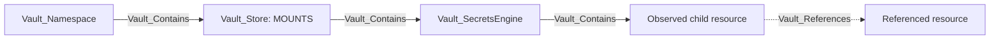

Specific mounts carry their display kind first and `Vault_SecretsEngine` as a base kind. Role-like child nodes carry `Vault_SecretsRole` where useful for cross-engine queries. Per-engine layout diagrams are structural: policy access and security outcomes appear in the edge descriptions and attack-path sections instead. Dashed relationships represent non-owning dependencies rather than traversable containment.

## Common Nodes And Edges

| Type | Meaning |
| --- | --- |
| `Vault_SecretsEngine` | Base node for a mounted secrets backend. |
| `Vault_SecretsRole` | Base node for role-like secrets-engine resources. |
| `Vault_Contains` | Mount Store to engine, and engine/resource to immediate observed children. |
| `Vault_References` | Non-owning dependency such as issuer-to-key or role-to-connection. |
| `Vault_ListObjects` | List roles, keys, accounts, connections, KV children, or similar collections. |
| `Vault_CreateObject` | Create an object at a collection or exact synthetic target. |
| `Vault_ReadObject` | Read durable configuration on a concrete child. |
| `Vault_ManageObject` | Update, delete, rotate, import, or otherwise administer a concrete child. |
| `Vault_ReadConfig` | Read mount, tuning, or backend-wide configuration. |
| `Vault_ManageConfig` | Change configuration, tuning, root credentials, or maintenance state. |
| `Vault_GenerateCredentials` | Obtain dynamic credentials from a concrete viable role. |
| `Vault_ReadStaticCredentials` | Read a managed static credential from a concrete role or account. |

Generic edges retain `Engine Types`, `Object Types`, `Role Types`, `Operations`, `Credential Types`, `Read Targets`, `Config Targets`, request surfaces, and prerequisites.

## Supported Engines

| Engine | Mount node | Child nodes |
| --- | --- | --- |
| AWS | `Vault_SecretsEngineAws` | `Vault_AwsRole`, `Vault_AwsStaticRole` |
| Azure | `Vault_SecretsEngineAzure` | `Vault_AzureRole`, `Vault_AzureStaticRole` |
| Database | `Vault_SecretsEngineDatabase` | `Vault_DatabaseConnection`, `Vault_DatabaseRole`, `Vault_DatabaseStaticRole` |
| GCP | `Vault_SecretsEngineGcp` | `Vault_GcpRoleset`, `Vault_GcpStaticAccount`, `Vault_GcpImpersonatedAccount` |
| GCP KMS | `Vault_SecretsEngineGcpKms` | `Vault_GcpKmsKey` |
| KV | `Vault_SecretsEngineKv` | `Vault_KvDirectory`, `Vault_KvFile`, `Vault_KvPair` |
| Kubernetes | `Vault_SecretsEngineKubernetes` | `Vault_KubernetesRole` |
| LDAP | `Vault_SecretsEngineLdap` | `Vault_LdapDynamicRole`, `Vault_LdapStaticRole`, `Vault_LdapLibrarySet`, `Vault_LdapServiceAccount` |
| PKI | `Vault_SecretsEnginePki` | `Vault_PkiRole`, `Vault_PkiIssuer`, `Vault_PkiKey` |
| SSH | `Vault_SecretsEngineSsh` | `Vault_SshRole` |
| Terraform Cloud | `Vault_SecretsEngineTerraform` | `Vault_TerraformRole` |
| TOTP | `Vault_SecretsEngineTotp` | `Vault_TotpKey` |
| Transit | `Vault_SecretsEngineTransit` | `Vault_TransitKey` |

## AWS

AWS dynamic roles describe IAM user, assumed role, federation token, or session token modes. Static roles map existing IAM users managed by Vault.

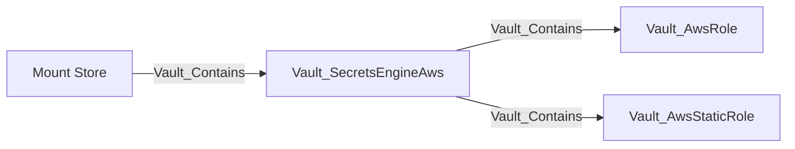

Dynamic-role properties include policy documents and ARNs, role ARNs, IAM groups, tags, permissions boundaries, credential modes, TTLs, and MFA configuration. Traversable generation requires at least one proven viable mode; session-token-only access requiring an MFA code becomes `Vault_PotentialAccess` when that prerequisite is unresolved.

Root credentials, lease settings, root rotation, and mount tuning use generic config edges. Role CRUD and collection operations use generic object edges.

### Edges

| Edge | Source | Destination | Traversable | Meaning |
| --- | --- | --- | --- | --- |
| `Vault_Contains` | Mount Store or AWS mount | AWS mount, dynamic role, or static role | Yes | Places the mount and observed roles in the namespace hierarchy. |
| `Vault_ReadConfig` | Policy | AWS mount | No | Reads root, lease, or mount configuration. |
| `Vault_ManageConfig` | Policy | AWS mount | No | Changes root credentials, lease settings, tuning, or performs root rotation. |
| `Vault_ListObjects` | Policy | AWS mount | No | Lists dynamic or static roles. |
| `Vault_CreateObject` | Policy | AWS mount or synthetic role | No | Creates a role or records authority to create an unobserved role. |
| `Vault_ReadObject` | Policy | AWS role or static role | No | Reads a concrete role. |
| `Vault_ManageObject` | Policy | AWS role or static role | No | Updates, deletes, or rotates a concrete role. |
| `Vault_GenerateCredentials` | Policy | AWS role | Yes | Generates credentials through at least one proven viable dynamic mode. |
| `Vault_ReadStaticCredentials` | Policy | AWS static role | Yes | Returns the IAM user's credential managed by Vault. |
| `Vault_PotentialAccess` | Policy | AWS role | No | Records generation with unresolved MFA or another external prerequisite. |

### Attack Paths

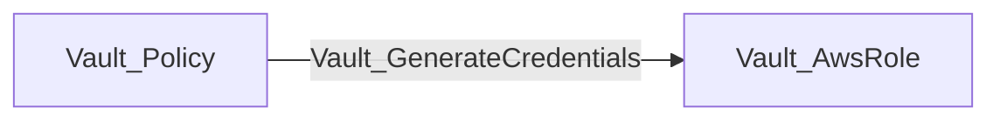

The destination role records whether Vault returns an IAM user, assumed-role credential, federation token, or session token. The edge is traversable only when at least one configured mode is viable. A session-token-only role that requires an unproven MFA code instead produces `Vault_PotentialAccess`.

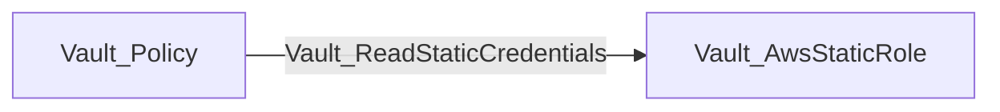

This yields the managed IAM user's current credential through Vault. Neither path proves the generated principal's downstream AWS permissions; those require correlation with AWS graph data.

## Azure

Azure dynamic roles generate service principals; static roles map existing applications or service principals and credential rotation state.

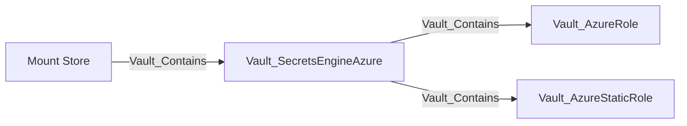

Roles retain Azure role assignments, groups, application settings, TTL behavior, and generated credential effects. `Vault_AzureImportStaticRole` is a specialized non-traversable administrative operation; ordinary role CRUD uses generic object edges.

### Edges

| Edge | Source | Destination | Traversable | Meaning |
| --- | --- | --- | --- | --- |
| `Vault_Contains` | Mount Store or Azure mount | Azure mount, dynamic role, or static role | Yes | Places the mount and observed roles in the namespace hierarchy. |
| `Vault_ReadConfig` | Policy | Azure mount | No | Reads root, lease, or mount configuration. |
| `Vault_ManageConfig` | Policy | Azure mount | No | Changes Azure backend configuration, tuning, or root credentials. |
| `Vault_ListObjects` | Policy | Azure mount | No | Lists dynamic or static roles. |
| `Vault_CreateObject` | Policy | Azure mount or synthetic role | No | Creates a role or records authority to create an unobserved role. |
| `Vault_ReadObject` | Policy | Azure role or static role | No | Reads a concrete role. |
| `Vault_ManageObject` | Policy | Azure role or static role | No | Updates, deletes, or rotates a concrete role. |
| `Vault_AzureImportStaticRole` | Policy | Azure static role or mount | No | Imports an existing application credential into Vault management. |
| `Vault_GenerateCredentials` | Policy | Azure role | Yes | Generates a service-principal credential through a dynamic role. |
| `Vault_ReadStaticCredentials` | Policy | Azure static role | Yes | Returns the credential managed through a concrete static role. |

### Attack Paths

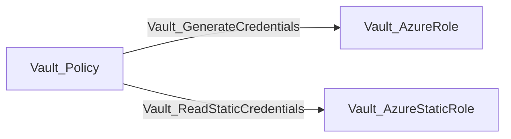

The first path obtains a generated Azure service-principal credential constrained by the dynamic role. The second reads the current credential managed through the concrete static role. Importing or managing a static role is not itself traversable because it does not prove that usable credential material is returned.

## Database

Database mounts contain plugin connections, dynamic roles, and static roles. Roles reference rather than contain their connection.

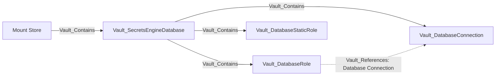

### Edges

| Edge | Source | Destination | Traversable | Meaning |
| --- | --- | --- | --- | --- |
| `Vault_Contains` | Mount Store or Database mount | Database mount, connection, dynamic role, or static role | Yes | Places the mount and observed database resources in the namespace hierarchy. |
| `Vault_References` | Database role or static role | Database connection | No | Records the assigned connection and allowed-role viability evidence. |
| `Vault_ReadConfig` | Policy | Database mount | No | Reads mount or backend-wide configuration. |
| `Vault_ManageConfig` | Policy | Database mount | No | Changes backend configuration or reloads a plugin process; properties identify the operation and plugin. |
| `Vault_ListObjects` | Policy | Database mount | No | Lists connections, dynamic roles, or static roles. |
| `Vault_CreateObject` | Policy | Database mount or synthetic resource | No | Creates a connection or role, or records authority to create an unobserved resource. |
| `Vault_ReadObject` | Policy | Database connection or role | No | Reads a concrete connection, dynamic role, or static role. |
| `Vault_ManageObject` | Policy | Database connection or role | No | Updates, deletes, rotates, or resets a concrete resource; `Operations` identifies connection reset. |
| `Vault_GenerateCredentials` | Policy | Database role | Yes | Generates a dynamic credential from a compatible, permitted connection. |
| `Vault_ReadStaticCredentials` | Policy | Database static role | Yes | Returns the current managed static credential. |
| `Vault_PotentialAccess` | Policy | Database role | No | Records credential generation when connection compatibility or permission is unresolved. |

Dynamic credential generation requires an observed compatible connection and an `allowed_roles` match. Missing or incompatible connection evidence downgrades the result to potential access.

### Attack Paths

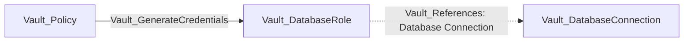

The attack path terminates at the role; `Vault_References` is supporting evidence, not a traversable hop. Generation is traversable only when the referenced connection was observed, uses a compatible plugin, and permits the role through `allowed_roles`. Incomplete collection emits `Vault_PotentialAccess`.

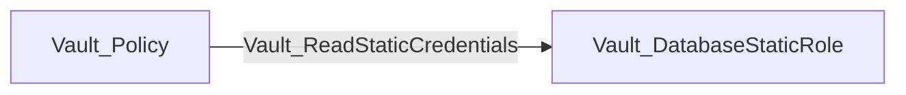

Static credential reads target the exact managed account and do not depend on dynamic-role connection viability in the same way.

## GCP

The GCP engine models rolesets, static service accounts, and impersonated accounts.

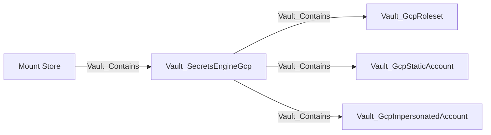

Rolesets retain secret type, project, IAM bindings, token scopes, rotation, and credential effects. Static and impersonated accounts retain OAuth token or service-account-key surfaces supported by their endpoint. The collector does not independently verify Google Cloud IAM.

### Edges

| Edge | Source | Destination | Traversable | Meaning |
| --- | --- | --- | --- | --- |
| `Vault_Contains` | Mount Store or GCP mount | GCP mount, roleset, static account, or impersonated account | Yes | Places the mount and observed account resources in the namespace hierarchy. |
| `Vault_ReadConfig` | Policy | GCP mount | No | Reads mount or GCP backend configuration. |
| `Vault_ManageConfig` | Policy | GCP mount | No | Changes GCP backend configuration, tuning, or root credentials. |
| `Vault_ListObjects` | Policy | GCP mount | No | Lists rolesets, static accounts, or impersonated accounts. |
| `Vault_CreateObject` | Policy | GCP mount or synthetic resource | No | Creates an account resource or records authority to create one. |
| `Vault_ReadObject` | Policy | GCP roleset or account | No | Reads a concrete GCP resource. |
| `Vault_ManageObject` | Policy | GCP roleset or account | No | Updates, deletes, or rotates a concrete GCP resource. |
| `Vault_GenerateCredentials` | Policy | GCP roleset, static account, or impersonated account | Yes | Requests an OAuth token or service-account key supported by the concrete object. |

### Attack Paths

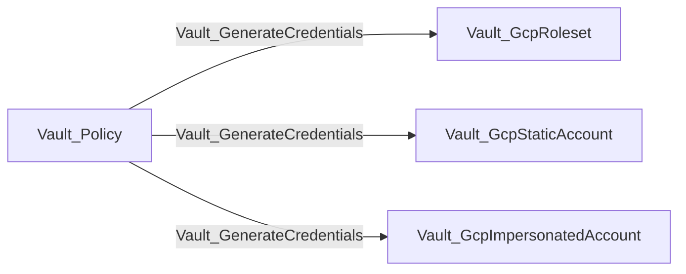

The edge represents the ability to request a credential from the concrete GCP object. Rolesets support OAuth access tokens or service-account keys according to their configured secret type; static accounts expose OAuth access-token or service-account-key endpoints; impersonated accounts expose OAuth access tokens. The paths prove Vault-side credential acquisition, not the resulting Google Cloud IAM permissions.

## GCP KMS

GCP KMS nodes represent Vault registrations of external Google Cloud KMS keys.

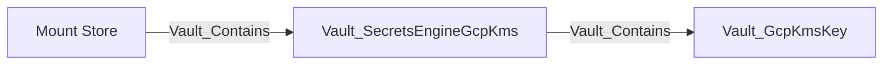

### Edges

| Edge | Source | Destination | Traversable | Meaning |
| --- | --- | --- | --- | --- |
| `Vault_Contains` | Mount Store or GCP KMS mount | GCP KMS mount or key | Yes | Places the mount and observed key registrations in the namespace hierarchy. |
| `Vault_ReadConfig` | Policy | GCP KMS mount | No | Reads mount or backend configuration. |
| `Vault_ManageConfig` | Policy | GCP KMS mount | No | Changes backend configuration or mount tuning. |
| `Vault_ListObjects` | Policy | GCP KMS mount | No | Lists registered keys. |
| `Vault_CreateObject` | Policy | GCP KMS mount or synthetic key | No | Registers a key or records authority to register an unobserved key. |
| `Vault_ReadObject` | Policy | GCP KMS key | No | Reads a concrete key registration. |
| `Vault_ManageObject` | Policy | GCP KMS key | No | Updates or deletes a concrete key registration. |
| `Vault_GcpKmsEncrypt` | Policy | GCP KMS key | No | Encrypts plaintext with a compatible key. |
| `Vault_GcpKmsDecrypt` | Policy | GCP KMS key | Yes | Recovers plaintext with a compatible observed key purpose. |
| `Vault_GcpKmsReencrypt` | Policy | GCP KMS key | No | Re-encrypts ciphertext. |
| `Vault_GcpKmsSign` | Policy | GCP KMS key | Yes | Produces a signature with a compatible signing key. |
| `Vault_GcpKmsVerify` | Policy | GCP KMS key | No | Verifies a signature or MAC. |
| `Vault_PotentialAccess` | Policy | GCP KMS key | No | Records decrypt or sign authority when key-purpose compatibility is unknown. |

Unknown key purpose produces `Vault_PotentialAccess` rather than a traversable decrypt or sign edge.

### Attack Paths

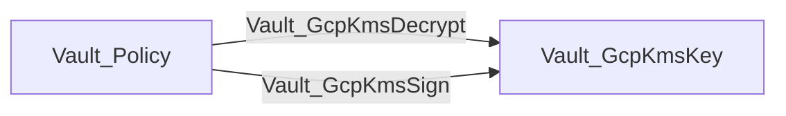

Decrypt represents a plaintext oracle; sign represents use of signing authority. Both require a compatible observed key purpose. Encrypt, re-encrypt, and verify remain non-traversable because they do not reveal plaintext or confer signing authority.

## KV

KV models path hierarchy without collecting plaintext values. Directories and files are intentionally separate node kinds and do not share a KV object base type.

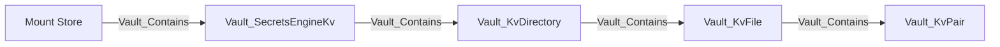

`Vault_KvDirectory` is a logical path prefix, not a mutable Vault object. `Vault_KvFile` is a secret path. `Vault_KvPair` exposes only top-level key names; values are never exported.

### KV v1 And v2

| Surface | Purpose | Exported edges |
| --- | --- | --- |
| KV v1 path | Secret read/write/delete/list | `Vault_KvReadSecret`, `Vault_KvManageSecret`, `Vault_ListObjects` |
| `data/:path` | KV v2 data and versions | `Vault_KvReadSecret`, `Vault_KvManageSecret` |
| `metadata/:path` | Listing, version metadata, custom metadata | `Vault_ListObjects`, `Vault_KvReadMetadata`, `Vault_KvManageMetadata` |
| `delete/:path` | Soft-delete versions | `Vault_KvManageSecret` |
| `undelete/:path` | Recover versions | `Vault_KvManageSecret` |
| `destroy/:path` | Permanently destroy versions | `Vault_KvManageSecret` |
| `subkeys/:path` | Subkey structure plus selected-version metadata | `Vault_KvReadMetadata` with read-target properties |
| `config` | CAS, version retention, delete-after | Generic config edges to the mount |

### Edges

| Edge | Source | Destination | Traversable | Meaning |
| --- | --- | --- | --- | --- |
| `Vault_Contains` | Mount Store, KV mount, directory, or file | KV mount, directory, file, or pair | Yes | Builds the observed KV path and key-name hierarchy. |
| `Vault_ReadConfig` | Policy | KV mount | No | Reads KV v2 engine configuration. |
| `Vault_ManageConfig` | Policy | KV mount | No | Changes CAS, version retention, or delete-after configuration. |
| `Vault_ListObjects` | Policy or template-resolved principal | KV mount or directory | No | Lists compatible observed children through KV v1 or v2 metadata paths. |
| `Vault_CreateObject` | Policy | KV mount, directory, or synthetic file | No | Records authority to create a secret at an exact or collection path. |
| `Vault_KvReadSecret` | Policy or template-resolved principal | KV file | Yes | Returns secret plaintext from KV v1 or KV v2 data. |
| `Vault_KvManageSecret` | Policy or template-resolved principal | KV file | No | Creates, updates, patches, deletes, undeletes, or destroys secret data or versions. |
| `Vault_KvReadMetadata` | Policy or template-resolved principal | KV file | No | Reads version/custom metadata or the subkeys view and selected-version metadata. |
| `Vault_KvManageMetadata` | Policy or template-resolved principal | KV file | No | Creates, updates, patches, or deletes KV v2 metadata. |
| `Vault_PotentialAccess` | Policy or template-resolved principal | Synthetic or unresolved KV target | No | Records a matching path whose concrete target or prerequisite is not proven. |

Only `Vault_KvReadSecret` is traversable. Lifecycle and metadata operations do not reveal secret data. KV v2 mount and per-key metadata contribute effective CAS requirements to write-edge properties.

Exact paths target the compatible file or directory. Globs expand to observed compatible descendants. Template-effective edges originate from the entity, alias, or group representation referenced by the template expression.

### Attack Paths

A policy-backed identity path can reach a concrete secret file:

```mermaid
flowchart LR
    user[Vault_AuthUser] -->|Vault_MapsTo| alias[Vault_EntityAlias]
    alias -->|Vault_MapsTo| entity[Vault_Entity]
    entity -->|Vault_MemberOf| group[Vault_Group]
    group -->|Vault_LinksPolicy| policy[Vault_Policy]
    policy -->|Vault_KvReadSecret| file[Vault_KvFile]
    file -->|Vault_Contains| pair[Vault_KvPair]
```

The file read exposes plaintext at request time. The pair node records only a top-level key name; VaultHound does not store its value.

For an identity template such as:

```hcl
path "kv/data/dept/{{identity.entity.metadata.department}}/*" {
  capabilities = ["read"]
}
```

an entity with `department=engineering` receives effective `Vault_KvReadSecret` edges to matching observed files. The edge preserves both the rendered path and original policy path. An alias or group becomes the source only when the template expression references that representation.

`Vault_ListObjects`, `Vault_KvReadMetadata`, and KV management edges are non-traversable. They expose names or metadata, or alter lifecycle state, but do not return secret plaintext.

## Kubernetes

Kubernetes secrets roles describe the service account and optional RBAC objects Vault creates or uses when generating credentials.

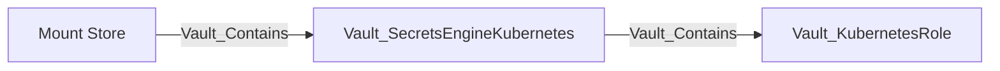

Roles retain service-account name, allowed namespaces, namespace selectors, token TTL, generated role or cluster-role bindings, and request parameters. Generation effects identify namespaced versus cluster-scoped outcomes. Live Kubernetes RBAC is not independently verified.

### Edges

| Edge | Source | Destination | Traversable | Meaning |
| --- | --- | --- | --- | --- |
| `Vault_Contains` | Mount Store or Kubernetes mount | Kubernetes mount or role | Yes | Places the mount and observed roles in the namespace hierarchy. |
| `Vault_ReadConfig` | Policy | Kubernetes mount | No | Reads cluster and backend configuration. |
| `Vault_ManageConfig` | Policy | Kubernetes mount | No | Changes cluster credentials, backend configuration, or mount tuning. |
| `Vault_ListObjects` | Policy | Kubernetes mount | No | Lists Kubernetes secrets roles. |
| `Vault_CreateObject` | Policy | Kubernetes mount or synthetic role | No | Creates a role or records authority to create an unobserved role. |
| `Vault_ReadObject` | Policy | Kubernetes role | No | Reads a concrete role. |
| `Vault_ManageObject` | Policy | Kubernetes role | No | Updates or deletes a concrete role. |
| `Vault_GenerateCredentials` | Policy | Kubernetes role | Yes | Generates a service-account token through the concrete role. |

### Attack Paths

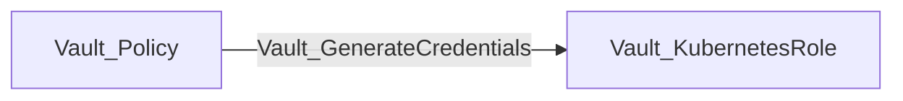

The edge represents generation of a Kubernetes service-account token through the concrete role. Role properties describe namespace selectors and generated namespaced or cluster-scoped bindings. The path does not independently prove the live Kubernetes RBAC attached to the resulting token.

## LDAP

The LDAP secrets engine manages dynamic credentials, static accounts, and service-account libraries.

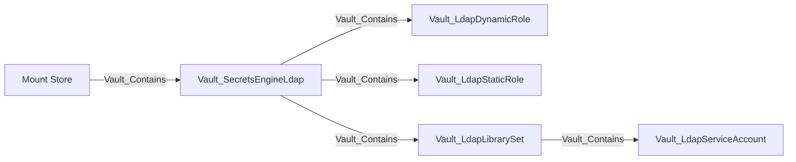

### Edges

| Edge | Source | Destination | Traversable | Meaning |
| --- | --- | --- | --- | --- |
| `Vault_Contains` | Mount Store, LDAP mount, or library | LDAP mount, role, library, or service account | Yes | Places the mount and observed LDAP resources in the namespace hierarchy. |
| `Vault_ReadConfig` | Policy | LDAP mount | No | Reads LDAP connection, lease, password, or migration configuration. |
| `Vault_ManageConfig` | Policy | LDAP mount | No | Changes backend configuration, rotates root credentials, or manages migration state. |
| `Vault_ListObjects` | Policy | LDAP mount or library | No | Lists roles, libraries, or library accounts. |
| `Vault_CreateObject` | Policy | LDAP mount or synthetic resource | No | Creates a role or library resource. |
| `Vault_ReadObject` | Policy | LDAP role, library, or service account | No | Reads a concrete LDAP resource. |
| `Vault_ManageObject` | Policy | LDAP role, library, or service account | No | Updates, deletes, rotates, or administers a concrete resource. |
| `Vault_GenerateCredentials` | Policy | LDAP dynamic role | Yes | Generates a dynamic LDAP credential. |
| `Vault_ReadStaticCredentials` | Policy | LDAP static role | Yes | Returns the managed static LDAP credential. |
| `Vault_LdapReadLibraryStatus` | Policy | LDAP library or service account | No | Reads account availability and checkout state. |
| `Vault_LdapCheckoutServiceAccount` | Policy | Available LDAP service account | Yes | Checks out one observed currently available account. |
| `Vault_LdapCheckinServiceAccount` | Policy | LDAP service account | No | Returns a checked-out account. |
| `Vault_LdapForceCheckinServiceAccount` | Policy | LDAP service account | No | Administratively forces an account check-in. |
| `Vault_PotentialAccess` | Policy | LDAP library or service account | No | Records checkout when account availability is unknown. |

Unknown account availability becomes potential access. Checkout is not routed through a traversable library container because Vault returns one available account rather than every member.

### Attack Paths

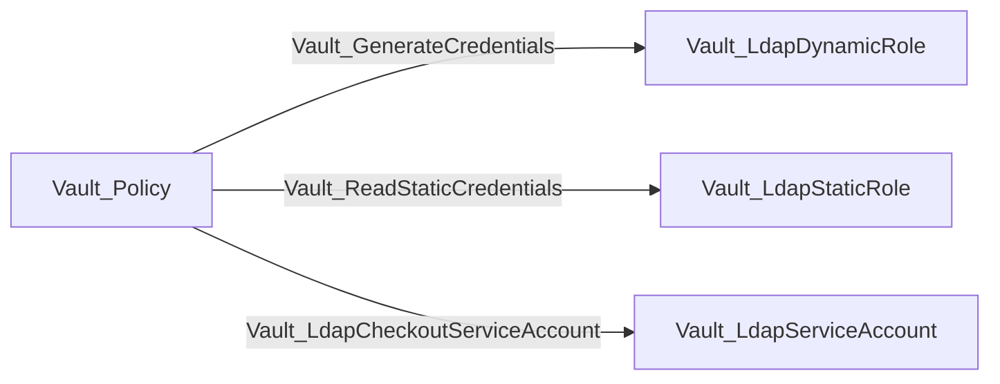

Dynamic and static role paths yield LDAP credentials according to their role mode. Checkout targets only an observed account currently marked available. Unknown availability emits `Vault_PotentialAccess`; it does not create a traversable edge to the library set and fan out through containment.

## PKI

PKI mounts contain roles, issuers, and keys. An issuer references its key; it does not contain it.

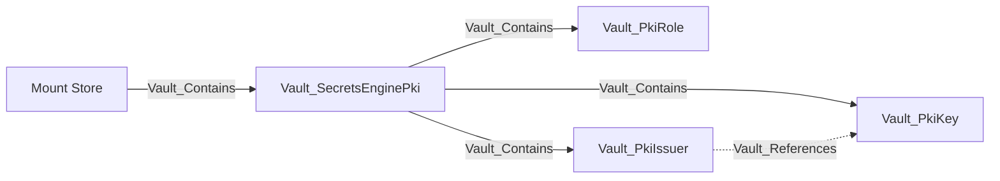

### Edges

| Edge | Source | Destination | Traversable | Meaning |
| --- | --- | --- | --- | --- |
| `Vault_Contains` | Mount Store or PKI mount | PKI mount, role, issuer, or key | Yes | Places the mount and observed PKI resources in the namespace hierarchy. |
| `Vault_References` | PKI issuer or protocol configuration | PKI key or auth dependency | No | Records non-owning key and delegated-authentication references. |
| `Vault_ReadConfig` | Policy | PKI mount | No | Reads PKI backend, issuance-protocol, or tidy-status configuration. |
| `Vault_ManageConfig` | Policy | PKI mount | No | Changes PKI backend, issuance-protocol, CRL, or tidy configuration. |
| `Vault_ListObjects` | Policy | PKI mount | No | Lists roles, issuers, keys, or authenticated certificate information collections. |
| `Vault_CreateObject` | Policy | PKI mount or synthetic resource | No | Creates a role, issuer workflow, key, or other supported PKI object. |
| `Vault_ReadObject` | Policy | PKI role, issuer, or key | No | Reads a concrete durable PKI object. |
| `Vault_ManageObject` | Policy | PKI role, issuer, or key | No | Updates, deletes, imports, rotates, or otherwise administers a concrete object. |
| `Vault_PkiListCertificateInfo` | Policy | PKI mount | No | Lists authenticated certificate information collections. |
| `Vault_PkiIssueCertificate` | Policy | PKI role or issuer | Yes | Issues a certificate through a role or issuer-scoped external-policy endpoint. |
| `Vault_PkiSignCertificate` | Policy | PKI role or issuer | Yes | Signs a CSR through a role or issuer-scoped external-policy endpoint. |
| `Vault_PkiSignVerbatim` | Policy | PKI role or issuer | Yes | Signs through a role-qualified, role-less, or issuer-specific verbatim surface after concrete resolution. |
| `Vault_PkiSignIntermediate` | Policy | PKI issuer | Yes | Signs an intermediate CA certificate with a concrete issuer. |
| `Vault_PkiSignSelfIssued` | Policy | PKI issuer | Yes | Signs a self-issued CA certificate with a concrete issuer. |
| `Vault_PkiRevokeCertificate` | Policy | PKI mount or issuer | No | Revokes a certificate. |
| `Vault_PkiRevokeIssuer` | Policy | PKI issuer | No | Revokes a concrete issuer. |
| `Vault_PkiProvisionIssuer` | Policy | PKI mount | No | Generates or imports issuer material, or generates an intermediate CSR. |
| `Vault_PkiManageRoot` | Policy | PKI mount | No | Performs a root CA lifecycle operation. |
| `Vault_PkiDeleteRoot` | Policy | PKI mount | No | Deletes all issuer and key material. |
| `Vault_PkiManageIntermediate` | Policy | PKI mount | No | Performs an intermediate CA lifecycle workflow. |
| `Vault_PkiAcmeCreateEab` | Policy | PKI mount or protocol context | No | Creates ACME external-account-binding material. |
| `Vault_PkiAcmeManageAccounts` | Policy | PKI mount | No | Manages ACME account records. |
| `Vault_PotentialAccess` | Policy | PKI mount or unresolved resource | No | Records issuance or signing whose concrete compatible target cannot be proven. |

Traversable issuance and signing edges do not terminate at the mount when doing so would imply control of every role, issuer, and key through containment. Role/issuer globs expand to observed compatible children; unresolved mount-native outcomes remain potential or non-traversable.

Authenticated ACME, CMP, EST, and SCEP policy surfaces fold into existing issue, sign, and config families. `Issuance Protocols`, `Protocol Paths`, directory scope, role, issuer, format, and target properties retain the protocol context. Public CA, chain, CRL, OCSP, and similar unauthenticated authority-information endpoints are not modeled as policy authority.

### Attack Paths

Certificate issuance and signing target the concrete resource that constrains the operation:

```mermaid
flowchart LR
    policy[Vault_Policy] -->|Vault_PkiIssueCertificate| role[Vault_PkiRole]
    policy -->|Vault_PkiSignCertificate| role
    policy -->|Vault_PkiSignVerbatim: role-qualified| role
    policy -->|Vault_PkiIssueCertificate: issuer external policy| issuer[Vault_PkiIssuer]
    policy -->|Vault_PkiSignCertificate: issuer external policy| issuer
    policy -->|Vault_PkiSignVerbatim: resolved default or selected issuer| issuer
    policy -->|Vault_PkiSignIntermediate| issuer
    policy -->|Vault_PkiSignSelfIssued| issuer
```

A role glob such as:

```hcl
path "pki/issue/*" {
  capabilities = ["create", "update"]
}
```

expands `Vault_PkiIssueCertificate` to every observed compatible role. It does not create a traversable edge to the PKI mount, because traversable containment would incorrectly imply control of every issuer and key.

Role-less, issuer-selected, and protocol issuance paths remain traversable only when the collector can resolve a concrete compatible role or issuer. Runtime-selected mount outcomes become potential or non-traversable.

Revocation, issuer provisioning, root/intermediate lifecycle, and ordinary issuer management can be operationally severe but remain non-traversable. Destroying an issuer does not grant its signing authority.

## SSH

SSH uses one role node kind for OTP and CA role modes. The role properties identify which operations are valid.

```mermaid
flowchart LR
    store[Mount Store] -->|Vault_Contains| mount[Vault_SecretsEngineSsh]
    mount -->|Vault_Contains| role[Vault_SshRole]
```

### Edges

| Edge | Source | Destination | Traversable | Meaning |
| --- | --- | --- | --- | --- |
| `Vault_Contains` | Mount Store or SSH mount | SSH mount or role | Yes | Places the mount and observed roles in the namespace hierarchy. |
| `Vault_ReadConfig` | Policy | SSH mount | No | Reads authenticated CA, zero-address, or mount configuration. |
| `Vault_ManageConfig` | Policy | SSH mount | No | Changes CA, zero-address, tidy, or mount configuration. |
| `Vault_ListObjects` | Policy | SSH mount | No | Lists SSH roles. |
| `Vault_CreateObject` | Policy | SSH mount or synthetic role | No | Creates a role or records authority to create an unobserved role. |
| `Vault_ReadObject` | Policy | SSH role | No | Reads a concrete role. |
| `Vault_ManageObject` | Policy | SSH role | No | Updates or deletes a concrete role. |
| `Vault_SshGenerateOtp` | Policy | OTP-compatible SSH role | Yes | Generates an SSH one-time password. |
| `Vault_SshSignKey` | Policy | CA-compatible SSH role | Yes | Signs a supplied SSH public key. |
| `Vault_SshIssueKeyPair` | Policy | CA-compatible SSH role | Yes | Issues a new SSH key pair and certificate. |
| `Vault_SshLookupRoles` | Policy | SSH mount | No | Discovers roles matching supplied connection attributes. |

CA and zero-address configuration uses generic config edges. CA public keys are mount properties; unauthenticated public-key retrieval is not modeled as ACL authority. Role globs expand security outcomes to compatible observed roles.

### Attack Paths

```mermaid
flowchart LR
    policy[Vault_Policy] -->|Vault_SshGenerateOtp| otp["Vault_SshRole: OTP"]
    policy -->|Vault_SshSignKey| ca["Vault_SshRole: CA"]
    policy -->|Vault_SshIssueKeyPair| ca
```

OTP generation returns a usable one-time password. Signing turns an attacker-supplied public key into an SSH certificate. Key-pair issuance returns new private-key material and its certificate. Role-mode compatibility is checked before any of these traversable edges are emitted.

## Terraform Cloud

Terraform Cloud roles generate organization, team, or user API tokens.

```mermaid
flowchart LR
    store[Mount Store] -->|Vault_Contains| mount[Vault_SecretsEngineTerraform]
    mount -->|Vault_Contains| role[Vault_TerraformRole]
```

The mount stores Terraform Cloud address and token configuration. Role and generation properties identify token mode, organization, team or user target, TTL, and generated credential material.

### Edges

| Edge | Source | Destination | Traversable | Meaning |
| --- | --- | --- | --- | --- |
| `Vault_Contains` | Mount Store or Terraform Cloud mount | Terraform Cloud mount or role | Yes | Places the mount and observed roles in the namespace hierarchy. |
| `Vault_ReadConfig` | Policy | Terraform Cloud mount | No | Reads backend address, token, or mount configuration. |
| `Vault_ManageConfig` | Policy | Terraform Cloud mount | No | Changes backend configuration or mount tuning. |
| `Vault_ListObjects` | Policy | Terraform Cloud mount | No | Lists Terraform Cloud roles. |
| `Vault_CreateObject` | Policy | Terraform Cloud mount or synthetic role | No | Creates a role or records authority to create an unobserved role. |
| `Vault_ReadObject` | Policy | Terraform Cloud role | No | Reads a concrete role. |
| `Vault_ManageObject` | Policy | Terraform Cloud role | No | Updates or deletes a concrete role. |
| `Vault_GenerateCredentials` | Policy | Terraform Cloud role | Yes | Generates an organization, team, or user API token. |

### Attack Paths

```mermaid
flowchart LR
    policy[Vault_Policy] -->|Vault_GenerateCredentials| role[Vault_TerraformRole]
```

The path yields a Terraform Cloud organization, team, or user API token according to the role. It proves token generation through Vault, while the resulting Terraform Cloud authorization remains an external-system concern.

## TOTP

TOTP mounts contain named key configurations.

```mermaid
flowchart LR
    store[Mount Store] -->|Vault_Contains| mount[Vault_SecretsEngineTotp]
    mount -->|Vault_Contains| key[Vault_TotpKey]
```

### Edges

| Edge | Source | Destination | Traversable | Meaning |
| --- | --- | --- | --- | --- |
| `Vault_Contains` | Mount Store or TOTP mount | TOTP mount or key | Yes | Places the mount and observed key configurations in the namespace hierarchy. |
| `Vault_ReadConfig` | Policy | TOTP mount | No | Reads mount or backend configuration. |
| `Vault_ManageConfig` | Policy | TOTP mount | No | Changes backend configuration or mount tuning. |
| `Vault_ListObjects` | Policy | TOTP mount | No | Lists TOTP key configurations. |
| `Vault_CreateObject` | Policy | TOTP mount or synthetic key | No | Creates a key configuration or records authority to create one. |
| `Vault_ReadObject` | Policy | TOTP key | No | Reads a concrete key configuration without exporting its seed. |
| `Vault_ManageObject` | Policy | TOTP key | No | Updates or deletes a concrete key configuration. |
| `Vault_TotpGenerateCode` | Policy | TOTP key | Yes | Returns a current usable TOTP code. |
| `Vault_TotpValidateCode` | Policy | TOTP key | No | Validates a submitted code without yielding credential material. |

Keys include issuer, account name, period, algorithm, digits, skew, key size, and export state where Vault returns them.

### Attack Paths

```mermaid
flowchart LR
    policy[Vault_Policy] -->|Vault_TotpGenerateCode| key[Vault_TotpKey]
```

The edge is traversable because the endpoint returns a currently usable code. `Vault_TotpValidateCode` remains non-traversable because validation accepts a candidate code but does not reveal one.

## Transit

Transit mounts contain cryptographic keys and expose operations without returning raw key material unless export is explicitly enabled.

```mermaid
flowchart LR
    store[Mount Store] -->|Vault_Contains| mount[Vault_SecretsEngineTransit]
    mount -->|Vault_Contains| key[Vault_TransitKey]
    key -.->|Vault_ManagedBy| managed[Vault_ManagedKey]
```

### Edges

| Edge | Source | Destination | Traversable | Meaning |
| --- | --- | --- | --- | --- |
| `Vault_Contains` | Mount Store or Transit mount | Transit mount or key | Yes | Places the mount and observed Transit keys in the namespace hierarchy. |
| `Vault_ManagedBy` | Transit key | Managed key | No | Records an external managed key backing the Transit key. |
| `Vault_ReadConfig` | Policy | Transit mount | No | Reads cache or mount configuration. |
| `Vault_ManageConfig` | Policy | Transit mount | No | Changes cache, maintenance, or mount configuration. |
| `Vault_ListObjects` | Policy | Transit mount | No | Lists Transit keys. |
| `Vault_CreateObject` | Policy | Transit mount or synthetic key | No | Creates a key or records authority to create an unobserved key. |
| `Vault_ReadObject` | Policy | Transit key | No | Reads key configuration, public material, or certificate-chain information. |
| `Vault_ManageObject` | Policy | Transit key | No | Updates, rotates, imports, restores, backs up, or deletes a concrete key. |
| `Vault_TransitEncrypt` | Policy | Transit key | No | Encrypts plaintext. |
| `Vault_TransitDecrypt` | Policy | Transit key | Yes | Recovers plaintext. |
| `Vault_TransitGenerateDataKey` | Policy | Transit key | No | Generates a data key; returned mode remains operation context. |
| `Vault_TransitRewrap` | Policy | Transit key | No | Rewraps ciphertext without revealing plaintext. |
| `Vault_TransitSign` | Policy | Transit key | Yes | Produces a signature; properties distinguish message/digest and CSR signing. |
| `Vault_TransitGenerateCmac` | Policy | Transit key | Yes | Generates a CMAC with a compatible key. |
| `Vault_TransitGenerateHmac` | Policy | Transit key | Yes | Generates an HMAC with a compatible key. |
| `Vault_TransitVerify` | Policy | Transit key | No | Verifies signatures, HMACs, or CMACs. |
| `Vault_TransitExportKey` | Policy | Transit key | Yes | Exports compatible secret key material when the observed key is exportable. |
| `Vault_TransitExportByokKey` | Policy | Transit key | No | Returns BYOK-wrapped material rather than raw secret key material. |
| `Vault_PotentialAccess` | Policy | Synthetic or unresolved Transit key | No | Records an operation whose concrete key or compatibility is unproven. |

Key properties include type, versions, derivation, convergent encryption, exportability, plaintext backup, rotation, operation support, and managed-key references. Key-type compatibility and exportability are enforced before traversable edges are emitted. Public key/certificate-chain reads use `Vault_ReadObject`, not secret export.

### Attack Paths

```mermaid
flowchart LR
    policy[Vault_Policy] -->|Vault_TransitDecrypt| key[Vault_TransitKey]
    policy -->|Vault_TransitSign| key
    policy -->|Vault_TransitGenerateCmac| key
    policy -->|Vault_TransitGenerateHmac| key
    policy -->|Vault_TransitExportKey| key
```

Decrypt is a plaintext oracle. Sign, CMAC, and HMAC exercise concrete cryptographic authority. `/sign/:key` records `Signing Targets: Message or Digest`, while `/keys/:key/csr` records `Signing Targets: Certificate Signing Request`; both merge into the same key edge when both surfaces are authorized. Secret export is emitted only when the observed key type supports the requested export and the key is exportable. Public-key reads use `Vault_ReadObject`, while BYOK-wrapped export uses non-traversable `Vault_TransitExportByokKey`.

For an exact missing path such as `transit/decrypt/future-key`, the collector may create a detached synthetic key but emits `Vault_PotentialAccess` with `Target Observed: false`. The synthetic key is not attached through normal containment and therefore cannot become an asserted attack path.

## Unsupported Mounts

Any observed backend outside the supported table remains a generic `Vault_SecretsEngine`. VaultHound retains its path, type, accessor, local/seal-wrap flags, lease settings, and mount options where available.

Unsupported engines do not receive:

- Child-resource collection.
- Synthetic endpoint objects.
- Generic secret-read or credential-generation edges.
- Guessed endpoint semantics based only on the mount type string.

This keeps unsupported existence visible without inventing attack paths.

## External-System Boundary

Cloud, database, LDAP, Kubernetes, and Terraform properties describe what Vault is configured to request or return. They do not prove downstream IAM, RBAC, directory, or network state. Hybrid graph edges should be added only when another collector resolves the external principal or resource unambiguously.
