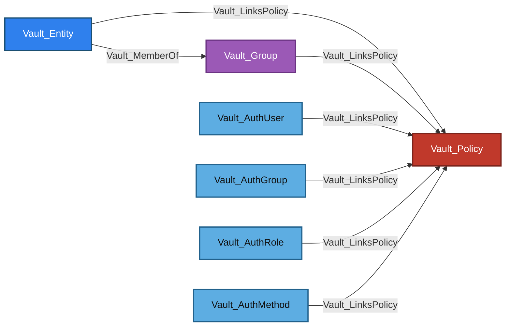
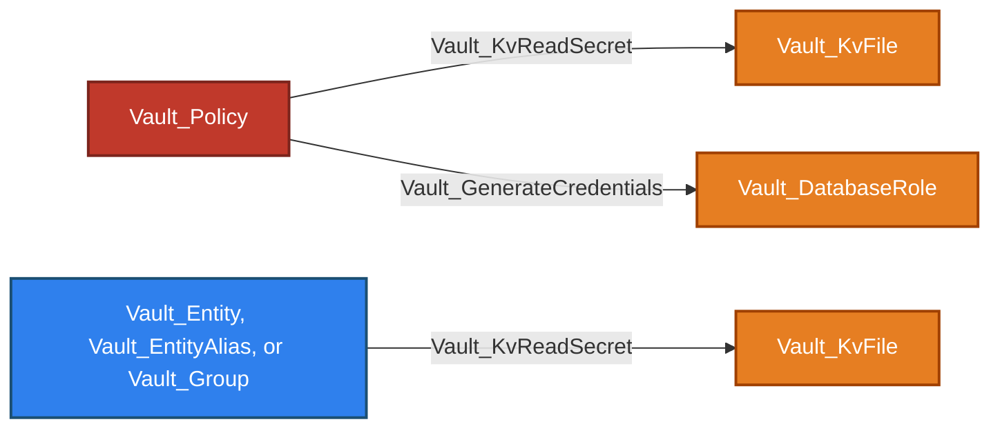
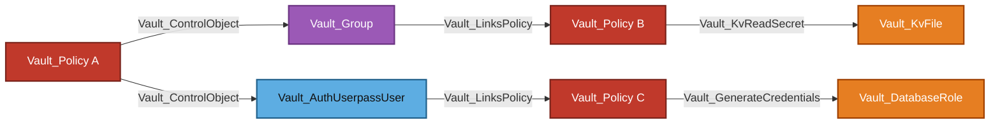

```mermaid
flowchart LR
    document[Vault_Policy]:::policyNode --> block[HCL path block]:::processNode
    block --> matcher[Exact, +, *, or template matcher]:::processNode
    matcher --> endpoint[Supported Vault endpoint]:::endpointNode
    endpoint --> edge[Specific or generic access edge]:::processNode
    edge --> target[Observed, synthetic, or potential target]:::objectNode

    classDef policyNode fill:#C0392B,color:#fff,stroke:#7B241C,stroke-width:2px
    classDef processNode fill:#7F8C8D,color:#fff,stroke:#4D5656,stroke-width:2px
    classDef endpointNode fill:#17A589,color:#fff,stroke:#0E6655,stroke-width:2px
    classDef objectNode fill:#D35400,color:#fff,stroke:#873600,stroke-width:2px
```

# Policy Store

The Policy Store contains namespace-local authorization documents and anchors policy-registry operations. Policies are the model's declared authority: assignments lead to policy nodes, and ACL policy paths lead from those policy nodes to the concrete Vault objects and operations they authorize.

VaultHound collects ACL, Role Governing Policy (RGP), and Endpoint Governing Policy (EGP) documents. Only ACL path blocks are interpreted by the endpoint-aware access model.

## Supported Policy Types

| Policy Type | Collection Surface | Collected | Parsed As ACL | Assignment Target | Administration |
| --- | --- | :---: | :---: | :---: | :---: |
| ACL | `sys/policies/acl`; legacy fallback through `sys/policy` | :white_check_mark: | :white_check_mark: | :white_check_mark: | :white_check_mark: |
| RGP | `sys/policies/rgp` | :white_check_mark: | :x: | :white_check_mark: | :white_check_mark: |
| EGP | `sys/policies/egp` | :white_check_mark: | :x: | :x: | :white_check_mark: |

ACL collection prefers `sys/policies/acl` and falls back to `sys/policy` only when the modern collection returns no names. RGP assignment is resolved by policy name; when ACL and RGP policies share a name, the ACL policy is the assignment target. EGP policies govern endpoint paths rather than being assigned as token policies.

## Store Topology

In schema topology diagrams, solid arrows represent traversable relationships and dashed arrows represent non-traversable relationships. Processing-flow diagrams are explicitly identified and do not use this graph-edge convention.


Equivalent Cypher query:

```cypher
MATCH p = (:Vault_Namespace)-[:Vault_Contains]->(store:Vault_Store)-[:Vault_Contains]->(:Vault_Policy)
WHERE store.`Store Type` = "Policy"
RETURN p
```

| Node Type | Description |
| --- | --- |
| `Vault_Store` | One built-in Policy Store for each collected namespace. Its `Paths` property records the modern ACL, legacy ACL, RGP, and EGP registry surfaces. |
| `Vault_Policy` | A collected ACL, RGP, or EGP policy document, or a synthetic policy representing an exact unobserved creation target. |

The namespace-local store records `sys/policy`, `sys/policies/acl`, `sys/policies/rgp`, and `sys/policies/egp`. The topology stops at the policy authority boundary; concrete policy outcomes are documented under [ACL Evaluation](#acl-evaluation), [Attack Paths](#attack-paths), and the destination subsystem guides.

## Policy Documents

### Node Properties

Shared node properties such as `Name` and `Namespace ID` follow the canonical [property contract](../MODEL.md#property-contract).

| Node Type | Property | Description |
| --- | --- | --- |
| `Vault_Store` | `Paths` | Lists the modern ACL, legacy ACL, RGP, and EGP registry paths represented by the Policy Store. |
| `Vault_Policy` | `Policy Type` | Identifies the document as ACL, RGP, or EGP. |
| `Vault_Policy` | `Is Wildcard` | Indicates that an ACL policy contains the literal path `*`; it does not mean merely that a path contains `+` or a trailing `*`. |
| `Vault_Policy` | `Uses Templates` | Indicates that at least one ACL path contains an Identity template expression. |
| `Vault_Policy` | `Can Manage Audit` | Indicates that an ACL policy can administer an audit path or contains the literal path `*`. |
| `Vault_Policy` | `High Value` | Marks literal-wildcard ACL policies, ACL policies with policy-write authority, and EGP policies governing `*`. |
| `Vault_Policy` | `Paths Summary` | Lists every parsed ACL path and normalized capability set. It is empty for RGP and EGP because they are not parsed as ACL policies. |
| `Vault_Policy` | `Policy Language` | Records `Sentinel` for collected RGP and EGP policies. |
| `Vault_Policy` | `Enforcement Level` | Records the RGP or EGP enforcement level returned by Vault. |
| `Vault_Policy` | `Governed Paths` | Lists paths governed by an EGP policy when Vault returns them. |
| `Vault_Policy` | `Synthetic` | Marks an exact policy name inferred from create authority but not observed during collection. |

Raw policy rules remain internal to the collector. `Paths Summary` is the multi-valued, human-readable ACL representation exported to BloodHound; it is not truncated.

## Policy Assignment

`Vault_LinksPolicy` describes configured policy acquisition rather than endpoint ACL matching. It is traversable because a successful login or canonical Identity path can acquire the linked policy authority.


Equivalent Cypher query:

```cypher
MATCH p = (source)-[:Vault_LinksPolicy]->(:Vault_Policy)
RETURN p
```

| Edge Type | Source | Destination | Traversable | Description |
| --- | --- | --- | :---: | --- |
| `Vault_LinksPolicy` | Entity, group, auth user, auth group, auth role, or auth method | ACL or assignable RGP policy | :white_check_mark: | Shows that Identity or authentication configuration grants the target policy. |

### Policy Link Types

The multi-valued `Policy Link Types` property explains how the source grants the target policy.

| Value | Meaning |
| --- | --- |
| `Direct Assignment` | Direct entity, group, or UserPass-user policy assignment. |
| `Authentication Grant` | Policy granted by an auth user, auth group, auth role, or equivalent authentication object. |
| `Auth Method Default` | Default token policy configured on an auth method. |
| `Unregistered User Default` | RADIUS policy granted to an unregistered user. |
| `Token Role Allowed Policy` | Explicit policy allowed by a token role. |
| `Token Role Allowed Policy Glob` | Observed policy matched by a token role's allowed-policy glob. |
| `Token Role Default Policy` | Default policy inherited through a token role. |

Group inheritance is structural rather than another link type: `Vault_Entity -> Vault_MemberOf -> Vault_Group -> Vault_LinksPolicy -> Vault_Policy`.

## Policy Administration

Policy registry permissions use the generic object-operation edge families. They remain non-traversable because the ability to list, create, read, or mutate a policy does not prove that the caller or an attacker-controlled identity receives that policy.


Equivalent Cypher query:

```cypher
MATCH p = (authority)-[:Vault_ListObjects|Vault_CreateObject|Vault_ReadObject|Vault_ManageObject]->(target)
WHERE (authority:Vault_Policy
    OR authority:Vault_Entity
    OR authority:Vault_EntityAlias
    OR authority:Vault_Group)
  AND (
    target:Vault_Policy
    OR (target:Vault_Store AND target.`Store Type` = "Policy")
  )
RETURN p
```

### Operations

| Edge Type | Destination | Required Capability | Operation | Description |
| --- | --- | --- | --- | --- |
| `Vault_ListObjects` | Policy Store | `list`, or `read` on the legacy collection | `List` | Enumerates policies through a matched registry collection. |
| `Vault_CreateObject` | Policy Store or synthetic `Vault_Policy` | `create` | `Create` | Represents broad policy creation or creation of an exact unobserved policy. |
| `Vault_ReadObject` | Observed `Vault_Policy` | `read` | `Read` | Reads a concrete policy document. |
| `Vault_ManageObject` | Observed non-root `Vault_Policy` | `update`, `delete` | `Update`, `Delete` | Modifies or removes a concrete policy. The ACL root policy is excluded. |

### Creation And Synthetic Policies

A patterned creation path targets the Policy Store and records `Potential Only: TRUE` and `Can Create Unobserved Objects: TRUE`. An exact create path for a missing, non-root policy creates a detached `Vault_Policy` node marked `Synthetic: TRUE`; it receives no `Vault_Contains` edge because its existence was not observed.

### Edge Properties

Generic properties follow the [cross-cutting property contract](../MODEL.md#cross-cutting-properties). Policy administration uses these policy-specific values:

| Edge Type | Property | Description |
| --- | --- | --- |
| `Vault_ListObjects`<br>`Vault_CreateObject`<br>`Vault_ReadObject`<br>`Vault_ManageObject` | `Object Types` | Contains the normalized value `Policy`. |
| `Vault_ListObjects`<br>`Vault_CreateObject`<br>`Vault_ReadObject`<br>`Vault_ManageObject` | `Capabilities` | Lists only the capabilities relevant to the represented operation. |
| `Vault_ListObjects`<br>`Vault_CreateObject`<br>`Vault_ReadObject`<br>`Vault_ManageObject` | `Operations` | Lists `List`, `Create`, `Read`, `Update`, or `Delete` as applicable. |
| `Vault_ListObjects`<br>`Vault_CreateObject`<br>`Vault_ReadObject`<br>`Vault_ManageObject` | `Scopes` | Distinguishes collection, exact, pattern expansion, exact unresolved, and canonical potential targets. |
| `Vault_ListObjects`<br>`Vault_CreateObject`<br>`Vault_ReadObject`<br>`Vault_ManageObject` | `Matched Policy Paths` | Lists the original HCL paths authorizing the operation. |
| `Vault_CreateObject` | `Potential Only` | Marks creation authority whose target is not an observed policy. |
| `Vault_CreateObject` | `Can Create Unobserved Objects` | Marks patterned authority that can create additional policy objects beneath the registry. |

Policy type and API-surface details are used while routing registry endpoints but are removed when these relationships are canonicalized into generic object-operation edges. The target node and `Object Types` identify the resulting object family.

## ACL Evaluation

VaultHound interprets path blocks only from ACL policies. RGP and EGP policies remain policy objects but are not routed through the ACL endpoint model.

The following diagram is collector processing flow, not graph topology; its arrows show processing order rather than relationship traversability.



### Path Matching

| Path Form | Collector Behavior |
| --- | --- |
| Exact path | Matches the same normalized request path. A supported endpoint handler may infer a synthetic target when the path names an unobserved object. |
| `+` | Matches exactly one non-empty path segment. `+` is a wildcard only when it occupies the complete segment. |
| Trailing `*` | Performs a prefix match over the remaining path. `*` in the middle of a path is not interpreted as a wildcard. |
| Literal `*` | Routes the policy across every supported ACL subsystem and collected mount. |
| Identity template | Renders the expression for collected identity contexts before applying ordinary exact, `+`, or trailing-`*` matching. |

Trailing `*` can cover both observed descendants and future objects beneath the prefix. Endpoint-specific handlers decide whether that represents a collection, subtree, mount, or ordinary glob.

For effective template permissions, VaultHound selects the most-specific matching path family before combining capabilities:

1. The pattern whose first wildcard occurs latest wins.
2. A path not ending in `*` wins over one that does.
3. A path with fewer `+` segments wins.
4. The longer path wins.
5. Lexical ordering breaks any remaining tie.

When a winning rule includes `deny`, its effective capability set becomes only `deny`.

### Identity Templates

Supported expressions include entity IDs, entity names, entity metadata, accessor-selected aliases, and Identity groups selected by ID or name. A rendered value containing `*` or `+` is rejected, while wildcards outside the template expression remain valid.

Template-effective relationships originate from the identity representation supplying the entitlement:

- Entity fields produce an edge from `Vault_Entity`.
- Alias-only expressions produce an edge from the referenced `Vault_EntityAlias` when that alias was collected.
- A single group expression may produce an edge from `Vault_Group` when the same group also grants the policy.
- Mixed or ambiguous resolved source contexts fall back to the entity.

When a template expression cannot be resolved for an identity context, VaultHound emits no effective relationship for that rendering.

Policy inheritance remains provenance through properties such as `Via Policies`, `Policy Origins`, and `Inherited From Group IDs`. Disabled entities do not receive effective template relationships.

### Target Resolution

| Target State | Representation |
| --- | --- |
| Observed | The relationship targets a concrete node collected from Vault. |
| Synthetic | An exact supported path may create a node marked `Synthetic: TRUE`. Synthetic nodes receive no containment edge because their existence was not observed. |
| Potential | An unresolved prerequisite, runtime-selected or future object, or security outcome involving a synthetic target is marked `Potential Only`. Applicable attack outcomes are converted to `Vault_PotentialAccess`; ordinary wildcard matches to observed descendants remain concrete edges. |
| Creation anchor | When a wildcard can create unobserved objects, the relationship targets the nearest observed directory, mount, or store and records `Can Create Unobserved Objects`. |

Synthetic targets are endpoint- and operation-specific. VaultHound creates one only when the handler understands the object type and the represented operation is meaningful for an absent object.

### Capability Routing

Capabilities are routed through endpoint-specific handlers rather than exported as generic capability edges. Each relationship retains only the capabilities relevant to its operation. For example, `read` can become `Vault_KvReadSecret`, `Vault_ReadObject`, or `Vault_ReadConfig` depending on the request path.

Unsupported endpoints and unsupported secrets-engine implementations receive no fallback access edge. Relationships sharing a source, target, and edge kind are merged; their capabilities, paths, scopes, surfaces, operations, and requirements become deduplicated arrays.

### Deny, Sudo, And Parameters

`deny` emits a non-traversable `Vault_DenyAccess` relationship. VaultHound resolves its target by probing modeled endpoint operations, but the resulting edge represents denied scope rather than permission to perform those operations.

Declared policy edges preserve grant and deny evidence from individual policies independently. VaultHound does not globally remove a declared grant merely because another policy emits a matching deny. Full winner selection and deny suppression are applied when calculating effective Identity-template outcomes.

`sudo` is retained only where an endpoint requires it. A broad rule containing `sudo` does not add the capability to unrelated relationships.

`required_parameters`, `allowed_parameters`, and `denied_parameters` are parsed and consulted by parameter-aware derivations. Constraints can prevent a control relationship, restrict it to known values, or downgrade it to `Vault_PotentialAccess`. Exported relationships retain parameter names and constraint status; raw allowed and denied value maps remain internal.

`Vault_DenyAccess` uses the following evidence:

| Edge Type | Property | Description |
| --- | --- | --- |
| `Vault_DenyAccess` | `Capabilities` | Records the overriding `deny` capability. |
| `Vault_DenyAccess` | `Matched Policy Paths` | Lists the original HCL paths declaring the deny. |
| `Vault_DenyAccess` | `Matched Paths` | On template-resolved deny edges only, lists rendered paths that differ from the original HCL paths. |
| `Vault_DenyAccess` | `Scopes` | Identifies the exact, collection, single-segment, glob, subtree, mount, or potential scope. |
| `Vault_DenyAccess` | `Surfaces` | Identifies the modeled endpoint families affected by the deny. |

### Evidence Properties

Policy-derived relationship kinds use the shared [Policy-Derived Edge Metadata](../MODEL.md#policy-derived-edge-metadata) contract.

| Property | Meaning |
| --- | --- |
| `Capabilities` | Capabilities relevant to the represented operation. |
| `Matched Policy Paths` | Original HCL paths declaring the authority. |
| `Matched Paths` | Rendered template paths, emitted only when they differ from the original policy paths. |
| `Scopes` | Exact, collection, single-segment, glob, subtree, mount, or potential scope. |
| `Surfaces` | Vault API endpoint families represented by the edge. |
| `Operations` | Human-readable operations represented by the edge. |
| `Requirements` | Preconditions such as sudo, CAS, CIDR, or target-state requirements. |
| `Via Policies` | Policies contributing to an effective template relationship. |
| `Policy Origins` | Direct, group-inherited, token-derived, or other policy provenance. |

These properties belong to the concrete edge kind being emitted; "policy-derived access edge" is not itself a schema kind. Evidence arrays are merged summaries. When multiple path blocks collapse into one relationship, do not assume that every capability came from every listed path. `Paths Summary` on the policy node preserves the parsed path-and-capability combinations.

### Worked Examples

| Policy Scenario | Resulting Representation |
| --- | --- |
| `kv/data/dev/database` grants `read` | `Vault_Policy -> Vault_KvReadSecret -> Vault_KvFile`. |
| `database/creds/reporting` grants `read` | `Vault_Policy -> Vault_GenerateCredentials -> Vault_DatabaseRole`. |
| `kv/data/{{identity.entity.name}}/*` grants `read` | The rendered `Vault_KvReadSecret` originates from `Vault_Entity`; `Via Policies` retains the declaring policy. |
| An exact supported path grants creation of a missing object | A detached node marked `Synthetic: TRUE` represents the inferred target, and the edge is marked potential where appropriate. |
| A glob can create future objects | The edge targets the nearest observed collection anchor and records `Can Create Unobserved Objects`. |
| A parameter constraint or prerequisite cannot be resolved | The outcome becomes non-traversable `Vault_PotentialAccess`. |
| A path grants `deny` | A non-traversable `Vault_DenyAccess` edge records the denied target and scope. |

## Policy Authority Model

Policy-to-target edges remain visible even when a derived Identity-template edge exists. This preserves both the policy that declares the authority and the concrete identity representation for which the template resolves.

VaultHound intentionally avoids materializing every non-templated policy grant as a duplicate principal-to-resource relationship. Policy assignment and group membership already provide the traversable route to declared authority:

`Principal -> Vault_LinksPolicy -> Vault_Policy -> operation edge -> target`

Template-effective edges are the exception because the rendered target and edge source depend on the referenced identity context. Their `Via Policies` property preserves the declaration source.

## Attack Paths

### Policy Acquisition

Policy authority can be reached directly from Identity and authentication objects or through Identity group membership.



Equivalent Cypher query for direct assignment and one-level Identity group inheritance:

```cypher
MATCH p = (source)-[:Vault_MemberOf*0..1]->(grantor)-[:Vault_LinksPolicy]->(:Vault_Policy)
WHERE source:Vault_Entity
   OR source:Vault_Group
   OR source:Vault_AuthUser
   OR source:Vault_AuthGroup
   OR source:Vault_AuthRole
   OR source:Vault_AuthMethod
RETURN p
```

### Declared And Template-Rendered Outcomes

ACL policies emit endpoint-specific relationships. Template-rendered outcomes instead originate from the identity representation that supplies the template value.



Equivalent Cypher query for the representative declared outcomes:

```cypher
MATCH p = (:Vault_Policy)-[:Vault_KvReadSecret|Vault_GenerateCredentials]->()
RETURN p
```

Equivalent Cypher query for template-rendered outcomes:

```cypher
MATCH p = (source)-[r]->(target)
WHERE (source:Vault_Entity OR source:Vault_EntityAlias OR source:Vault_Group)
  AND r.templated = true
RETURN p
```

The concrete endpoint relationship determines attack-path meaning. `Vault_PotentialAccess` and `Vault_DenyAccess` remain non-traversable evidence rather than successful outcomes.

### Control-Based Escalation

`Vault_ControlObject` is emitted only for a parameter-aware, security-bearing takeover such as password replacement, group-membership modification, alias rebinding, or authentication-trust replacement. Ordinary `Vault_ManageObject` does not imply control.



Equivalent Cypher query:

```cypher
MATCH p = (authority)-[:Vault_ControlObject]->(controlled)-[:Vault_LinksPolicy]->(:Vault_Policy)
WHERE authority:Vault_Policy
   OR authority:Vault_Entity
   OR authority:Vault_EntityAlias
   OR authority:Vault_Group
RETURN p
```

Alias rebinding targets the candidate entity or group directly. The controlled alias is retained as evidence through properties such as `Via Object IDs` and `Via Object Names`, rather than inserted as an intermediate traversable node.

## Limitations

- ACL edges describe static authorization and do not prove that a principal currently possesses a usable Vault token.
- RGP and EGP documents are collected but are not interpreted as ACL path rules.
- Declared edges preserve per-policy evidence; the collector does not compute a complete effective capability union across every policy attached to a token.
- Control groups, response wrapping, runtime request parameters, namespaces, and plugin-side validation can impose additional conditions.
- Synthetic and potential targets represent inferred authority rather than proof that the target currently exists or is usable.
- Ordinary policy mutation remains non-traversable; VaultHound does not infer acquisition of the modified policy without a separate assignment or control path.
