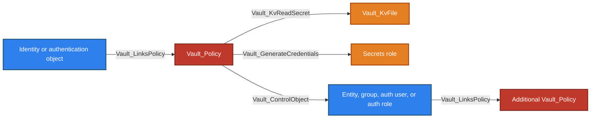
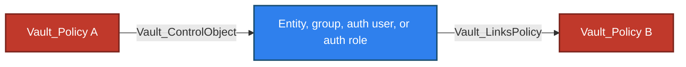

# Policy Store

The Policy Store contains namespace-local policy documents and anchors policy-registry operations. It covers the modern ACL surface and Vault's legacy ACL path; the store also records the RGP and EGP registry paths exposed by Vault Enterprise.

## Glob, Synthetic, And Control Behavior

- Exact ACL paths target concrete observed or synthetic resources when the endpoint family supports them.
- `+`, trailing `*`, and templated paths preserve their declared policy path while resolving compatible targets.
- Broad collection creation remains anchored to the relevant store or mount rather than implying that every child exists.
- Deny rules remain explicit non-traversable evidence and override otherwise granted capabilities.
- Parameter constraints and unresolved prerequisites can downgrade an apparent outcome to `Vault_PotentialAccess`.

## Limitations

- ACL edges describe static authorization and do not prove that a principal currently holds a usable token.
- RGP and EGP documents are collected as policies, but are not interpreted as ACL path rules.
- Control groups, wrapping, runtime request parameters, and plugin-side validation can add conditions.
- Policy mutation remains non-traversable; VaultHound does not derive a generic policy-takeover edge from `Vault_ManageObject`.

## Store Topology

In schema topology diagrams, solid arrows represent traversable relationships and dashed arrows represent non-traversable relationships. Processing-flow diagrams are explicitly identified and do not use this graph-edge convention.


Equivalent Cypher query:

```cypher
MATCH p = (:Vault_Namespace)-[:Vault_Contains]->(store:Vault_Store)-[:Vault_Contains*1..]->(n)
WHERE store.`Store Type` = "Policy"
RETURN p
```

The store topology stops at the policy authority boundary. Concrete outcomes declared by a policy are documented under [Attack Paths](#attack-paths) and in the destination subsystem catalogue.

### Common Nodes

| Type | Meaning |
| --- | --- |
| `Vault_Policy` | Collected policy document with name, namespace, raw rules, parsed path summary, capabilities, and policy metadata. |

The namespace-local policy registry uses the shared `Vault_Store` anchor defined in [The VaultHound Graph Model](../MODEL.md#base-nodes). Its paths cover `sys/policy`, `sys/policies/acl`, `sys/policies/rgp`, and `sys/policies/egp`. ACL policy collection and endpoint-aware ACL resolution are the first-class behavior. Registry paths retained on the store do not imply that every Enterprise policy type is parsed with ACL semantics.

### Common Edges

In every edge table in this guide, `Policy` denotes [policy authority](../MODEL.md#declared-and-derived-authority): normally the declaring `Vault_Policy`, or the referenced entity, alias, or group when an Identity template produces an effective rendered edge.


Equivalent Cypher query:

```cypher
MATCH p = (n)-[:Vault_LinksPolicy]->(:Vault_Policy)
RETURN p
```

| Edge | Source | Destination | Traversable | Meaning |
| --- | --- | --- | :---: | --- |
| `Vault_Contains` | Policy Store | Policy | :white_check_mark: | Observed policy belongs to this namespace registry. |
| `Vault_LinksPolicy` | Identity or auth configuration object | Policy | :white_check_mark: | Object directly receives or grants the policy. |

The edge describes configured policy acquisition rather than a textual reference. Its assignment semantics are defined once in [Common Properties](#common-properties).

### Common Properties

Shared `Vault_Store` properties follow the canonical [cross-cutting properties](../MODEL.md#cross-cutting-properties). The row below retains the Policy Store's subsystem-specific registry paths.

| Node/Edge Type | Property | Description |
| --- | --- | --- |
| `Vault_Store` | `Paths` | Lists the modern ACL, legacy ACL, RGP, and EGP registry API paths represented by the Policy Store. |
| `Vault_Policy` | `Policy Type` | Identifies ACL, RGP, EGP, or another collected policy type. |
| `Vault_Policy` | `Is Wildcard` | Indicates whether at least one parsed ACL path contains wildcard matching. |
| `Vault_Policy` | `Uses Templates` | Indicates whether at least one ACL path contains an Identity template expression. |
| `Vault_Policy` | `Can Manage Audit` | Indicates whether parsed ACL paths authorize audit-device administration. |
| `Vault_Policy` | `High Value` | Marks policies classified as security-sensitive by the collector. |
| `Vault_Policy` | `Paths Summary` | Lists every parsed ACL path and capability set without truncation. |
| `Vault_Policy` | `Policy Language` | For RGP and EGP policies, identifies the Sentinel policy language returned by Vault Enterprise. |
| `Vault_Policy` | `Enforcement Level` | For RGP and EGP policies, records the configured Sentinel enforcement level. |
| `Vault_Policy` | `Governed Paths` | For EGP policies, lists endpoint paths governed by the policy when returned by Vault. |
| `Vault_LinksPolicy` | `Policy Link Types` | Distinguishes direct assignments, inherited group grants, auth-object grants, and backend defaults. |

The collector stores parsed ACL rules internally for edge resolution. Raw secret-bearing request data is not added as a graph property; `Paths Summary` is the human-readable, multi-valued policy view exported to BloodHound.

## Policy Administration


Equivalent Cypher query:

```cypher
MATCH p = (authority)-[:Vault_ListObjects|Vault_CreateObject|Vault_ReadObject|Vault_ManageObject]->(d)
WHERE (authority:Vault_Policy
    OR authority:Vault_Entity
    OR authority:Vault_EntityAlias
    OR authority:Vault_Group)
  AND (d:Vault_Store OR d:Vault_Policy)
RETURN p
```

### Nodes

Policy administration uses the common Policy `Vault_Store` and `Vault_Policy` node kinds. It introduces no additional durable node type.

### Applicable Edges

This store-wide table applies the shared generic object-operation families to policy administration. Policy administration introduces no additional specialized edge kind.

| Edge | Source | Destination | Traversable | Meaning |
| --- | --- | --- | :---: | --- |
| `Vault_ListObjects` | Policy | Policy Store | :x: | Lists policies through modern or legacy collection endpoints. |
| `Vault_CreateObject` | Policy | Policy Store or synthetic policy | :x: | Creates a policy, preserving policy type and API surface in properties. |
| `Vault_ReadObject` | Policy | Concrete policy | :x: | Reads policy rules. |
| `Vault_ManageObject` | Policy | Concrete policy | :x: | Updates, patches, or deletes policy rules. |

Ordinary policy management is non-traversable. Merely being able to modify a policy does not prove that the caller or an attacker-controlled identity receives it.

### Properties

Generic object-operation and policy-derived evidence properties follow the canonical contracts in [the graph model](../MODEL.md#property-contract). The table below retains policy-registry-specific type and surface distinctions.

| Node/Edge Type | Property | Description |
| --- | --- | --- |
| `Vault_ListObjects`<br>`Vault_CreateObject`<br>`Vault_ReadObject`<br>`Vault_ManageObject` | `Policy Types` | Lists ACL, RGP, or EGP registry types represented by the edge. |
| `Vault_ListObjects`<br>`Vault_CreateObject`<br>`Vault_ReadObject`<br>`Vault_ManageObject` | `Surfaces` | Identifies the modern, legacy, RGP, or EGP endpoint surface matched by the policy. |
| `Vault_DenyAccess` | `Capabilities` | Records the overriding `deny` capability. |
| `Vault_DenyAccess` | `Matched Paths` | On template-resolved deny edges only, lists rendered request paths that differ from the original HCL paths. |
| `Vault_DenyAccess` | `Matched Policy Paths` | Lists the original HCL paths that declared the deny rule. |
| `Vault_DenyAccess` | `Scopes` | Identifies the exact, collection, pattern, subtree, or mount scope of the deny. |
| `Vault_DenyAccess` | `Surfaces` | Identifies the endpoint families affected by the deny. |

### Attack Paths

Policies normally serve as the authority-bearing middle of a path:



Equivalent Cypher query:

```cypher
MATCH p = (s)-[:Vault_LinksPolicy|Vault_KvReadSecret|Vault_GenerateCredentials|Vault_ControlObject*1..3]->(d)
WHERE s:Vault_Entity
   OR s:Vault_Group
   OR s:Vault_AuthRole
   OR s:Vault_AuthUser
   OR s:Vault_AuthGroup
RETURN p
```

These are representative concrete outcomes rather than an exhaustive list. Each relationship label is an edge kind defined by the schema; the relevant subsystem guide documents its complete set of traversable operations.

Control of a canonical entity or group, an auth user, or an auth role can reach policies already linked to that object. Auth-group mapping nodes are not generic `Vault_ControlObject` targets:



Equivalent Cypher query:

```cypher
MATCH p = (authority)-[:Vault_ControlObject]->(object)-[:Vault_LinksPolicy]->(:Vault_Policy)
WHERE (authority:Vault_Policy
    OR authority:Vault_Entity
    OR authority:Vault_EntityAlias
    OR authority:Vault_Group)
  AND (object:Vault_Entity
    OR object:Vault_Group
    OR object:Vault_AuthRole
    OR object:Vault_AuthUser)
RETURN p
```

The model does not synthesize a direct Policy A to Policy B shortcut from policy-assignment parameters. Those parameters remain contextual evidence on management, control, or potential-access edges. A standalone `Vault_ManageObject` edge to Policy B is intentionally not traversable.

## ACL Path Resolution

For each path block, VaultHound:

1. Parses and normalizes the capability set.
2. Preserves the original HCL path as `Matched Policy Paths`.
3. Renders identity templates when a concrete identity context is available.
4. Compares the resulting path with supported endpoint surfaces.
5. Emits only operation-relevant capabilities on the resulting edge.
6. Applies deny precedence and endpoint-specific sudo requirements.

```mermaid
flowchart LR
    document[Vault_Policy]:::policyNode --> block[HCL path block]:::processNode
    block --> matcher[Exact, +, *, or template matcher]:::processNode
    matcher --> endpoint[Supported Vault endpoint]:::endpointNode
    endpoint --> edge[Specific or generic access edge]:::processNode
    edge --> target[Observed, synthetic, or potential target]:::objectNode

    classDef policyNode fill:#C0392B,color:#fff,stroke:#7B241C,stroke-width:2px
    classDef processNode fill:#7F8C8D,color:#fff,stroke:#4D5656,stroke-width:2px
    classDef endpointNode fill:#17A589,color:#fff,stroke:#0E6655,stroke-width:2px
    classDef objectNode fill:#D35400,color:#fff,stroke:#873600,stroke-width:2px
```

The following diagram is a collector processing flow, not a graph topology; its arrows show processing order rather than relationship traversability.



Equivalent Cypher query for the emitted policy outcomes:

```cypher
MATCH p = (authority)-[r]->(target)
WHERE (authority:Vault_Policy
    OR authority:Vault_Entity
    OR authority:Vault_EntityAlias
    OR authority:Vault_Group)
  AND r.matched_policy_paths IS NOT NULL
RETURN p
```

| Form | Behavior |
| --- | --- |
| Exact object path | Targets the observed object or creates a detached synthetic target. |
| `+` segment | Matches exactly one path segment. |
| Trailing `*` | Expands to compatible observed descendants and may retain an unobserved-creation anchor. |
| Identity template | Emits a rendered effective relationship from the identity representation referenced by the expression. |

The collector does not treat all capabilities as interchangeable. `read` on KV data, `read` on PKI issuer configuration, `update` on Transit decrypt, and `sudo` on token accessor listing map to different outcomes.

## Policy Evidence Properties

Policy-derived relationship kinds use the shared [Policy-Derived Edge Metadata](../MODEL.md#policy-derived-edge-metadata) contract for `Capabilities`, `Matched Paths`, `Matched Policy Paths`, `Scopes`, `Surfaces`, `Operations`, `Requirements`, template-resolution fields, and provenance such as `Via Policies` and `Policy Origins`.

Those contracts apply to the concrete schema relationship kind being emitted, such as `Vault_KvReadSecret`, `Vault_GenerateCredentials`, or `Vault_ControlObject`; “policy-derived access edge” is not itself a node or edge kind. Properties that merge evidence from multiple matching path blocks are arrays. The raw policy remains available on the policy node, so access edges keep the context needed to understand the represented operation rather than repeating the entire policy.

## Deny, Sudo, And Parameters

`deny` is represented by `Vault_DenyAccess` and overrides grants for matching paths. `sudo` is included only for endpoints that Vault documents or enforces as sudo-gated; its presence in a broad policy block is not copied to unrelated edges.

`allowed_parameters`, `denied_parameters`, and `required_parameters` are retained and consulted for parameter-aware outcomes. For example, an unrestricted password replacement can become `Vault_ControlObject`, while a constrained mutation may remain `Vault_ManageObject` or `Vault_PotentialAccess`.

## Policy As Source Of Truth

Policy-to-target edges remain visible even when a derived identity-specific attack path exists. This allows analysts to answer both questions:

- Which policy declares this authority?
- Which concrete identity or controlled object can exercise it?

VaultHound intentionally avoids materializing every non-templated policy grant as a duplicate entity-to-resource relationship. Policy assignment and group membership already provide the traversable path to the declared authority.
