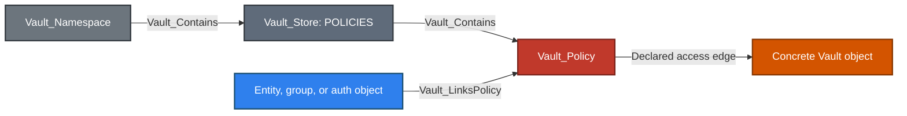
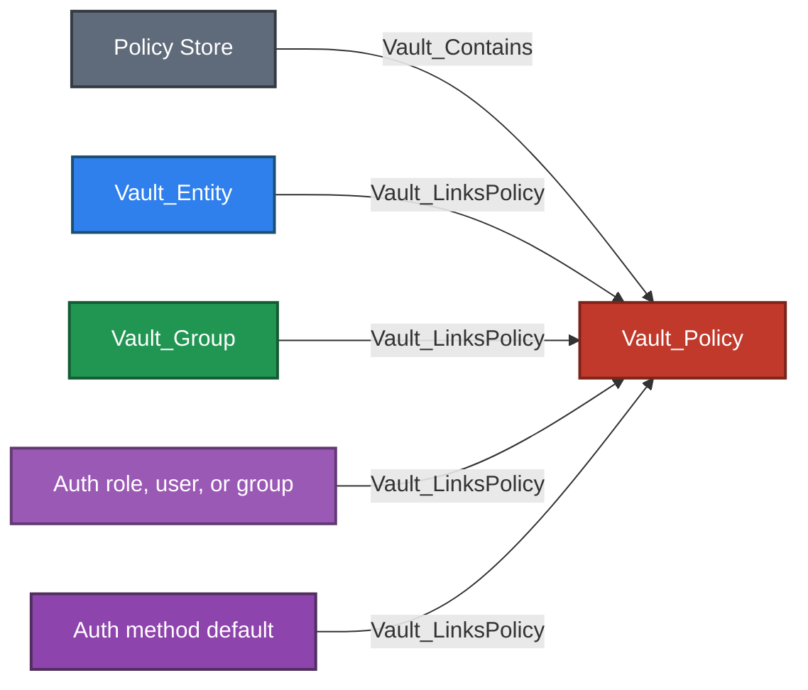
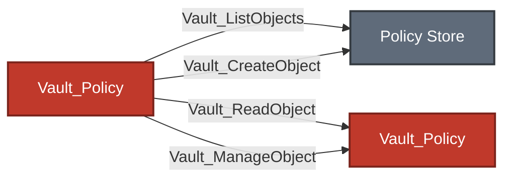
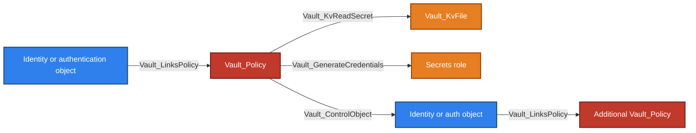

# Policy Store

The Policy Store contains namespace-local policy documents and anchors policy-registry operations. It covers the modern ACL surface and Vault's legacy ACL path; the store also records the RGP and EGP registry paths exposed by Vault Enterprise.

## Nodes

| Node | Description |
| --- | --- |
| `Vault_Store` | Namespace-local policy registry with paths for `sys/policy`, `sys/policies/acl`, `sys/policies/rgp`, and `sys/policies/egp`. |
| `Vault_Policy` | Collected policy document with name, namespace, raw rules, parsed path summary, capabilities, and policy metadata. |

ACL policy collection and endpoint-aware ACL resolution are the first-class behavior. Registry paths retained on the store do not imply that every Enterprise policy type is parsed with ACL semantics.

### Properties

| Applies to | Non-common properties | Meaning |
| --- | --- | --- |
| Policy `Vault_Store` | `Store Type`, `Paths`, `Built In` | Identifies the policy registry and its modern ACL, legacy ACL, RGP, and EGP API surfaces. |
| `Vault_Policy` | `Policy Type`, `Is Wildcard`, `Uses Templates`, `Can Manage Audit`, `High Value`, `Paths Summary` | Classifies the policy and summarizes every parsed ACL path and capability set without truncation. |
| RGP or EGP `Vault_Policy` | `Policy Language`, `Enforcement Level`, `Governed Paths` | Sentinel-specific policy metadata returned by Enterprise endpoints. `Governed Paths` is present for EGP when supplied. |

The collector stores parsed ACL rules internally for edge resolution. Raw secret-bearing request data is not added as a graph property; `Paths Summary` is the human-readable, multi-valued policy view exported to BloodHound.

## Containment And Assignment

| Edge | Source | Destination | Traversable | Meaning |
| --- | --- | --- | :---: | --- |
| `Vault_Contains` | Policy Store | Policy | :white_check_mark: | Observed policy belongs to this namespace registry. |
| `Vault_LinksPolicy` | Identity or auth configuration object | Policy | :white_check_mark: | Object directly receives or grants the policy. |

`Policy Link Types` distinguishes direct entity assignment, group inheritance, auth-role grant, auth-user grant, auth-group grant, and backend defaults. The edge describes configured policy acquisition; it is not merely a textual reference.

## Policy Administration

| Edge | Source | Destination | Traversable | Meaning |
| --- | --- | --- | :---: | --- |
| `Vault_ListObjects` | Policy | Policy Store | :x: | Lists policies through modern or legacy collection endpoints. |
| `Vault_CreateObject` | Policy | Policy Store or synthetic policy | :x: | Creates a policy, preserving policy type and API surface in properties. |
| `Vault_ReadObject` | Policy | Concrete policy | :x: | Reads policy rules. |
| `Vault_ManageObject` | Policy | Concrete policy | :x: | Updates, patches, or deletes policy rules. |

Ordinary policy management is non-traversable. Merely being able to modify a policy does not prove that the caller or an attacker-controlled identity receives it.

### Properties

| Applies to | Non-common properties | Meaning |
| --- | --- | --- |
| `Vault_LinksPolicy` | `Policy Link Types` | Distinguishes direct identity assignment, group assignment or inheritance, auth role/user/group grants, and backend defaults. |
| `Vault_ListObjects`, `Vault_CreateObject`, `Vault_ReadObject`, `Vault_ManageObject` | `Object Types`, `Policy Types`, `Operations`, `Surfaces` | Identifies the policy kind, registry endpoint, and concrete administrative action represented by the generic edge. |
| `Vault_DenyAccess` | `Capabilities`, `Matched Paths`, `Matched Policy Paths`, `Scopes`, `Surfaces` | Preserves the path and endpoint context of an overriding `deny` rule. |

### Attack Paths

Policies normally serve as the authority-bearing middle of a path:

These are representative concrete outcomes rather than an exhaustive list. Each relationship label is an edge kind defined by the schema; the relevant subsystem guide documents its complete set of traversable operations.

Control of an identity or authentication object can reach policies already linked to that object:

The model does not synthesize a direct Policy A to Policy B shortcut from policy-assignment parameters. Those parameters remain contextual evidence on management, control, or potential-access edges. A standalone `Vault_ManageObject` edge to Policy B is intentionally not traversable.

## ACL Path Resolution

For each path block, VaultHound:

1. Parses and normalizes the capability set.
2. Preserves the original HCL path as `Matched Policy Paths`.
3. Renders identity templates when a concrete identity context is available.
4. Compares the resulting path with supported endpoint surfaces.
5. Emits only operation-relevant capabilities on the resulting edge.
6. Applies deny precedence and endpoint-specific sudo requirements.

```mermaid
flowchart LR
    document[Vault_Policy]:::policyNode --> block[HCL path block]:::processNode
    block --> matcher[Exact, +, *, or template matcher]:::processNode
    matcher --> endpoint[Supported Vault endpoint]:::endpointNode
    endpoint --> edge[Specific or generic access edge]:::processNode
    edge --> target[Observed, synthetic, or potential target]:::objectNode

    classDef policyNode fill:#C0392B,color:#fff,stroke:#7B241C,stroke-width:2px
    classDef processNode fill:#7F8C8D,color:#fff,stroke:#4D5656,stroke-width:2px
    classDef endpointNode fill:#17A589,color:#fff,stroke:#0E6655,stroke-width:2px
    classDef objectNode fill:#D35400,color:#fff,stroke:#873600,stroke-width:2px
```

| Form | Behavior |
| --- | --- |
| Exact object path | Targets the observed object or creates a detached synthetic target. |
| `+` segment | Matches exactly one path segment. |
| Trailing `*` | Expands to compatible observed descendants and may retain an unobserved-creation anchor. |
| Identity template | Emits a rendered effective relationship from the identity representation referenced by the expression. |

The collector does not treat all capabilities as interchangeable. `read` on KV data, `read` on PKI issuer configuration, `update` on Transit decrypt, and `sudo` on token accessor listing map to different outcomes.

## Policy Evidence Properties

| Property | Meaning |
| --- | --- |
| `Capabilities` | Capabilities needed for the exported operation. |
| `Matched Paths` | Concrete or rendered request paths. |
| `Matched Policy Paths` | Original HCL paths. |
| `Scopes` | Exact, pattern, collection, subtree, mount, or similar scope. |
| `Surfaces` | Endpoint family, such as KV metadata or PKI issue. |
| `Operations` | Human-readable actions represented by the relationship. |
| `Requirements` | Known runtime or endpoint prerequisites. |
| `Via Policies` | Policies contributing to a derived effective relationship. |
| `Policy Origins` | Direct, group-inherited, auth-role, or other provenance. |

Properties that merge evidence from multiple matching path blocks are arrays. The raw policy remains available on the policy node, so access edges keep the context needed to understand the represented operation rather than repeating the entire policy.

## Deny, Sudo, And Parameters

`deny` is represented by `Vault_DenyAccess` and overrides grants for matching paths. `sudo` is included only for endpoints that Vault documents or enforces as sudo-gated; its presence in a broad policy block is not copied to unrelated edges.

`allowed_parameters`, `denied_parameters`, and `required_parameters` are retained and consulted for parameter-aware outcomes. For example, an unrestricted password replacement can become `Vault_ControlObject`, while a constrained mutation may remain `Vault_ManageObject` or `Vault_PotentialAccess`.

## Policy As Source Of Truth

Policy-to-target edges remain visible even when a derived identity-specific attack path exists. This allows analysts to answer both questions:

- Which policy declares this authority?
- Which concrete identity or controlled object can exercise it?

VaultHound intentionally avoids materializing every non-templated policy grant as a duplicate entity-to-resource relationship. Policy assignment and group membership already provide the traversable path to the declared authority.

## Limitations

- Runtime control groups, Sentinel decisions, quotas, response wrapping, and token state can affect an otherwise valid ACL operation.
- A broad create right may affect future objects that are absent from collection; that remains non-traversable or potential.
- Enterprise policy types outside ordinary ACL path semantics are not assumed to behave like ACL policies solely because their registry path is recorded.
