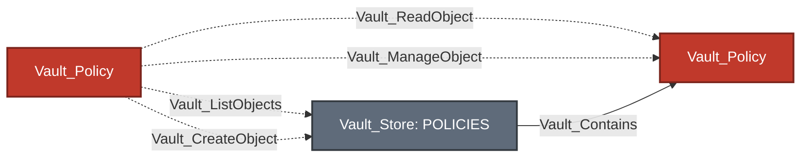
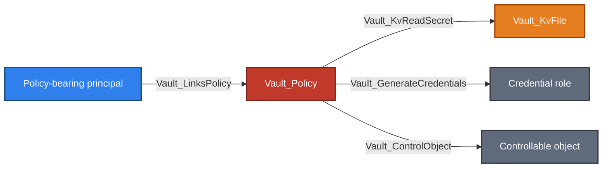
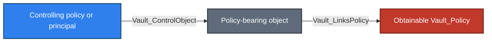

# Policy Store

The Policy Store contains namespace-local authorization documents and anchors policy-registry operations. Policies are the model's declared authority: assignments lead to policy nodes, and ACL policy paths lead from those policy nodes to the concrete Vault objects and operations they authorize.

VaultHound collects ACL, Role Governing Policy (RGP), and Endpoint Governing Policy (EGP) documents. Only ACL path blocks are interpreted by the endpoint-aware access model.

## Supported Policy Types

| Policy Type | Collection Surface | Supported | Parsed As ACL | Assignment Target | Administration |
| --- | --- | :---: | :---: | :---: | :---: |
| ACL | `sys/policies/acl`; legacy fallback through `sys/policy` | :white_check_mark: | :white_check_mark: | :white_check_mark: | :white_check_mark: |
| RGP | `sys/policies/rgp` | :white_check_mark: | :x: | :white_check_mark: | :white_check_mark: |
| EGP | `sys/policies/egp` | :white_check_mark: | :x: | :x: | :white_check_mark: |

Supported means that VaultHound understands the policy family and attempts its collection surface. A policy appears only when the collector can list the registry and read that policy document. RGP and EGP additionally require the corresponding Vault Enterprise surface. Insufficient ACL visibility, unavailable Enterprise features, or unreadable individual documents therefore produce a partial Policy Store rather than placeholder nodes.

ACL collection prefers `sys/policies/acl` and falls back to `sys/policy` only when the modern collection returns no names. RGP assignment is resolved by policy name; when ACL and RGP policies share a name, the ACL policy is the assignment target. EGP policies govern endpoint paths rather than being assigned as token policies.

## Store Topology

In schema topology diagrams, solid arrows represent traversable relationships and dashed arrows represent non-traversable relationships. Processing-flow diagrams are explicitly identified and do not use this graph-edge convention.


Equivalent Cypher query:

```cypher
MATCH p = (store:Vault_Store)-[:Vault_Contains]->(n)
WHERE store.`Store Type` = "Policy"
RETURN p
```

| Node Type | Description |
| --- | --- |
| `Vault_Store` | One built-in Policy Store for each collected namespace. Its `Paths` property records the modern ACL, legacy ACL, RGP, and EGP registry surfaces. |
| `Vault_Policy` | A collected ACL, RGP, or EGP policy document, or a synthetic policy representing an exact unobserved creation target. |

The namespace-local store records `sys/policy`, `sys/policies/acl`, `sys/policies/rgp`, and `sys/policies/egp`. The topology stops at the policy authority boundary; concrete policy outcomes are documented under [ACL Evaluation](#acl-evaluation), [Attack Paths](#attack-paths), and the destination subsystem guides.

## Policy Documents

### Node Properties

Shared node properties such as `Name` and `Namespace ID` follow the canonical [property contract](../MODEL.md#property-contract).

| Node Type | Property | Description |
| --- | --- | --- |
| `Vault_Store` | `Paths` | Lists the modern ACL, legacy ACL, RGP, and EGP registry paths represented by the Policy Store. |
| `Vault_Policy` | `Policy Type` | Identifies the document as ACL, RGP, or EGP. |
| `Vault_Policy` | `Is Wildcard` | Indicates that an ACL policy contains the literal path `*`; it does not mean merely that a path contains `+` or a trailing `*`. |
| `Vault_Policy` | `Uses Templates` | Indicates that at least one ACL path contains an Identity template expression. |
| `Vault_Policy` | `Can Manage Audit` | Collector heuristic set when an ACL has write authority on a `sys/audit...` path or contains the literal path `*`. The literal `*` condition currently marks the policy regardless of that path block's capability set, so this property is a triage hint rather than proof of usable audit-management authority. |
| `Vault_Policy` | `High Value` | Marks literal-wildcard ACL policies, ACL policies with policy-write authority, and EGP policies governing `*`. |
| `Vault_Policy` | `Paths Summary` | Lists every parsed ACL path and normalized capability set. It is empty for RGP and EGP because they are not parsed as ACL policies. |
| `Vault_Policy` | `Policy Language` | Records `Sentinel` for collected RGP and EGP policies. |
| `Vault_Policy` | `Enforcement Level` | Records the RGP or EGP enforcement level returned by Vault. |
| `Vault_Policy` | `Governed Paths` | Lists paths governed by an EGP policy when Vault returns them. |
| `Vault_Policy` | `Synthetic` | Marks an exact policy name inferred from create authority but not observed during collection. |

Raw policy rules remain internal to the collector. `Paths Summary` is the multi-valued, human-readable ACL representation exported to BloodHound; it is not truncated.

## Policy Assignment

`Vault_LinksPolicy` describes configured policy acquisition rather than endpoint ACL matching. It is traversable because a successful login or canonical Identity path can acquire the linked policy authority.


Equivalent Cypher query:

```cypher
MATCH p = (n)-[:Vault_LinksPolicy]->(:Vault_Policy)
RETURN p
```

| Edge Type | Source | Destination | Traversable | Description |
| --- | --- | --- | :---: | --- |
| `Vault_LinksPolicy` | Entity, group, auth user, auth group, auth role, or auth method | ACL or assignable RGP policy | :white_check_mark: | Shows that Identity or authentication configuration grants the target policy. |

### Policy Link Types

The multi-valued `Policy Link Types` property explains how the source grants the target policy.

| Value | Meaning |
| --- | --- |
| `Direct Assignment` | Direct entity, group, or UserPass-user policy assignment. |
| `Authentication Grant` | Policy granted by an auth user, auth group, auth role, or equivalent authentication object. |
| `Auth Method Default` | Default token policy configured on an auth method. |
| `Unregistered User Default` | RADIUS policy granted to an unregistered user. |
| `Token Role Allowed Policy` | Explicit policy allowed by a token role. |
| `Token Role Allowed Policy Glob` | Observed policy matched by a token role's allowed-policy glob. |
| `Token Role Default Policy` | Default policy inherited through a token role. |

Group inheritance is structural rather than another link type: `Vault_Entity -> Vault_MemberOf -> Vault_Group -> Vault_LinksPolicy -> Vault_Policy`.

## Policy Administration

Policy registry permissions use the generic object-operation edge families. They remain non-traversable because the ability to list, create, read, or mutate a policy does not prove that the caller or an attacker-controlled identity receives that policy.



Equivalent Cypher query:

```cypher
MATCH p = (s)-[:Vault_ListObjects|Vault_CreateObject|Vault_ReadObject|Vault_ManageObject]->(d)
WHERE d:Vault_Policy OR (d:Vault_Store AND d.`Store Type` = "Policy")
RETURN p
```

### Edges

| Edge Type | Destination | Required Capability | Operation | Description |
| --- | --- | --- | --- | --- |
| `Vault_ListObjects` | Policy Store | `list`, or `read` on the legacy collection | `List` | Enumerates policies through a matched registry collection. |
| `Vault_CreateObject` | Policy Store or synthetic `Vault_Policy` | `create` | `Create` | Represents broad policy creation or creation of an exact unobserved policy. |
| `Vault_ReadObject` | Observed `Vault_Policy` | `read` | `Read` | Reads a concrete policy document. |
| `Vault_ManageObject` | Observed non-root `Vault_Policy` | `update`, `delete` | `Update`, `Delete` | Modifies or removes a concrete policy. The ACL root policy is excluded. |

### Edge Properties

Generic properties follow the [cross-cutting property contract](../MODEL.md#cross-cutting-properties). Policy administration uses these policy-specific values:

| Edge Type | Property | Description |
| --- | --- | --- |
| `Vault_ListObjects`<br>`Vault_CreateObject`<br>`Vault_ReadObject`<br>`Vault_ManageObject` | `Object Types` | Contains the normalized value `Policy`. |
| `Vault_ListObjects`<br>`Vault_CreateObject`<br>`Vault_ReadObject`<br>`Vault_ManageObject` | `Capabilities` | Lists only the capabilities relevant to the represented operation. |
| `Vault_ListObjects`<br>`Vault_CreateObject`<br>`Vault_ReadObject`<br>`Vault_ManageObject` | `Operations` | Lists `List`, `Create`, `Read`, `Update`, or `Delete` as applicable. |
| `Vault_ListObjects`<br>`Vault_CreateObject`<br>`Vault_ReadObject`<br>`Vault_ManageObject` | `Scopes` | Uses `collection`, `exact`, or `pattern_expansion` for observed administration; exact missing policy creation retains `exact_unresolved`, while store-anchored creation is canonicalized to `potential`. |
| `Vault_ListObjects`<br>`Vault_CreateObject`<br>`Vault_ReadObject`<br>`Vault_ManageObject` | `Matched Policy Paths` | Lists the original HCL paths authorizing the operation. |
| `Vault_CreateObject` | `Potential Only` | Marks creation authority whose target is not an observed policy. |
| `Vault_CreateObject` | `Can Create Unobserved Objects` | Marks patterned authority that can create additional policy objects beneath the registry. |

Policy type and API-surface details are used while routing registry endpoints but are removed when these relationships are canonicalized into generic object-operation edges. The target node and `Object Types` identify the resulting object family.

### Creation And Synthetic Policies

A patterned creation path targets the Policy Store and records `Potential Only: TRUE` and `Can Create Unobserved Objects: TRUE`. An exact create path for a missing, non-root policy creates a detached `Vault_Policy` node marked `Synthetic: TRUE`; it receives no `Vault_Contains` edge because its existence was not observed.

## ACL Evaluation

VaultHound interprets path blocks only from ACL policies. RGP and EGP policies remain policy objects but are not routed through the ACL endpoint model.

### Path Matching

| Path Form | Collector Behavior |
| --- | --- |
| Exact path | Matches the same normalized request path. A supported endpoint handler may infer a synthetic target when the path names an unobserved object. |
| `+` | Matches exactly one non-empty path segment. `+` is a wildcard only when it occupies the complete segment. |
| Trailing `*` | Performs a prefix match over the remaining path. `*` in the middle of a path is not interpreted as a wildcard. |
| Literal `*` | Routes the policy across every supported ACL subsystem and collected mount. |
| Identity template | Renders the expression for collected identity contexts before applying ordinary exact, `+`, or trailing-`*` matching. |

Trailing `*` can cover both observed descendants and future objects beneath the prefix. Endpoint-specific handlers decide whether that represents a collection, subtree, mount, or ordinary glob.

For effective template permissions, VaultHound selects the most-specific matching path family before combining capabilities:

1. The pattern whose first wildcard occurs latest wins.
2. A path not ending in `*` wins over one that does.
3. A path with fewer `+` segments wins.
4. The longer path wins.
5. Lexical ordering breaks any remaining tie.

When a winning rule includes `deny`, its effective capability set becomes only `deny`.

### Identity Templates

VaultHound renders the following Identity expression families. `<accessor>`, `<group-id>`, and `<group-name>` are literal selectors in the policy expression; `<key>` selects one metadata field.

| Expression | Resolved Value | Effective Edge Source |
| --- | --- | --- |
| `{{identity.entity.id}}` | Canonical entity ID | `Vault_Entity` |
| `{{identity.entity.name}}` | Canonical entity name | `Vault_Entity` |
| `{{identity.entity.metadata.<key>}}` | Entity metadata value | `Vault_Entity` |
| `{{identity.entity.aliases.<accessor>.id}}` | Alias ID on the selected auth accessor | Referenced `Vault_EntityAlias` |
| `{{identity.entity.aliases.<accessor>.name}}` | Alias name on the selected auth accessor | Referenced `Vault_EntityAlias` |
| `{{identity.entity.aliases.<accessor>.metadata.<key>}}` | Alias metadata value | Referenced `Vault_EntityAlias` |
| `{{identity.entity.aliases.<accessor>.custom_metadata.<key>}}` | Alias custom-metadata value | Referenced `Vault_EntityAlias` |
| `{{identity.groups.ids.<group-id>.name}}` | Name of an effective group selected by ID | The referenced `Vault_Group` only when it is the single group context and also grants the policy; otherwise `Vault_Entity` |
| `{{identity.groups.ids.<group-id>.metadata.<key>}}` | Metadata of an effective group selected by ID | The referenced `Vault_Group` under the same single-granting-group condition; otherwise `Vault_Entity` |
| `{{identity.groups.names.<group-name>.id}}` | ID of an effective group selected by name | The referenced `Vault_Group` under the same single-granting-group condition; otherwise `Vault_Entity` |
| `{{identity.groups.names.<group-name>.metadata.<key>}}` | Metadata of an effective group selected by name | The referenced `Vault_Group` under the same single-granting-group condition; otherwise `Vault_Entity` |
| Multiple alias-only expressions | Values from each selected alias | Each collected referenced `Vault_EntityAlias`; if no alias graph source is available, `Vault_Entity` |
| Mixed entity, alias, or group contexts | All referenced values | `Vault_Entity`, because the result is specific to the combined entity context |

A rendered value containing `*` or `+` is rejected; wildcards outside the template expression remain valid and are matched after rendering. Missing selectors or metadata values produce no effective relationship for that entity rendering. Policy inheritance remains provenance through `Via Policies`, `Policy Origins`, and `Inherited From Group IDs`; inheritance alone does not change the edge source. Disabled entities do not receive effective template relationships.

### Capability Routing

Capabilities are routed through endpoint-specific handlers rather than exported as generic capability edges. Each relationship retains only the capabilities relevant to its operation.

Unsupported endpoints and unsupported secrets-engine implementations receive no fallback access edge. Relationships sharing a source, target, and edge kind are merged; their capabilities, paths, scopes, surfaces, operations, and requirements become deduplicated arrays. Observed, synthetic, potential, and creation-anchor behavior follows the shared [target-state contract](../MODEL.md#observed-synthetic-and-potential); endpoint handlers decide whether an exact missing target can be represented safely.

### Deny, Sudo, And Parameters

`deny` emits a non-traversable `Vault_DenyAccess` relationship. VaultHound resolves its target by probing modeled endpoint operations, but the resulting edge represents denied scope rather than permission to perform those operations.

Declared policy edges preserve grant and deny evidence from individual policies independently. VaultHound does not globally remove a declared grant merely because another policy emits a matching deny. Full winner selection and deny suppression are applied when calculating effective Identity-template outcomes.

`sudo` is retained only where an endpoint requires it. A broad rule containing `sudo` does not add the capability to unrelated relationships.

`required_parameters`, `allowed_parameters`, and `denied_parameters` are parsed and consulted by parameter-aware derivations. Constraints can prevent a control relationship, restrict it to known values, or downgrade it to `Vault_PotentialAccess`. Exported relationships retain parameter names and constraint status; raw allowed and denied value maps remain internal.

### Policy Evidence

Policy-derived relationships use the shared [policy-derived edge metadata](../MODEL.md#policy-derived-edge-metadata). Policy-specific interpretation has two important rules:

- `Matched Policy Paths` preserves the original HCL declaration; `Matched Paths` is added only when template rendering changes that path.
- Merged arrays summarize all declarations contributing to one source, target, and edge kind. They do not assert that every listed capability came from every listed path; consult the policy node's `Paths Summary` for path-and-capability pairings.

## Attack Paths

Policy nodes are the declared authority boundary. Non-templated grants normally compose through `Vault_LinksPolicy` rather than being duplicated from every principal. Template-effective edges are emitted from the resolved entity, alias, or group and retain their declaring policies in `Via Policies`.

### Assigned Policy Authority

The following examples use real traversable subsystem edges. They illustrate secret disclosure, dynamic credential generation, and proven object takeover; destination subsystem guides document the complete edge families and prerequisites.



Equivalent Cypher query:

```cypher
MATCH p = (principal)-[:Vault_LinksPolicy]->(policy:Vault_Policy)-[operation]->(target)
WHERE type(operation) IN [
  "Vault_KvReadSecret",
  "Vault_GenerateCredentials",
  "Vault_ControlObject"
]
RETURN p
```

### Policy Acquisition Through Object Control

When a proven takeover-capable mutation controls an observed entity, group, auth user, or auth role, its existing `Vault_LinksPolicy` relationships expose the policies obtainable through that object.



Equivalent Cypher query:

```cypher
MATCH p = (authority)-[:Vault_ControlObject]->(object)-[:Vault_LinksPolicy]->(:Vault_Policy)
RETURN p
```

### Unresolved Policy Assignment

If object control is proven but value constraints leave assignable policy names unresolved, VaultHound emits non-traversable `Vault_PotentialAccess` to the controlled object with `Potential Outcomes: Obtain Additional Policy`. It does not invent a relationship to an unknown policy node.


Equivalent Cypher query:

```cypher
MATCH p = (authority)-[potential:Vault_PotentialAccess]->(object)
WHERE "Obtain Additional Policy" IN potential.`Potential Outcomes`
RETURN p
```

## Limitations

- ACL edges describe static authorization and do not prove that a principal currently possesses a usable Vault token.
- Policy collection reflects only registries and documents visible to the collector. RGP and EGP also depend on Vault Enterprise availability and are not interpreted as ACL path rules.
- Declared edges preserve per-policy evidence; the collector does not compute a complete effective capability union across every policy attached to a token.
- Control groups, response wrapping, runtime request parameters, namespaces, and plugin-side validation can impose additional conditions.
- Synthetic and potential targets represent inferred authority rather than proof that the target currently exists or is usable.
- Ordinary policy mutation remains non-traversable; VaultHound does not infer acquisition of the modified policy without a separate assignment or control path.
- Generic policy administration edges normalize `Object Types` to `Policy`; ACL, RGP, and EGP distinctions may therefore require the target node's `Policy Type` or the matched registry path.
